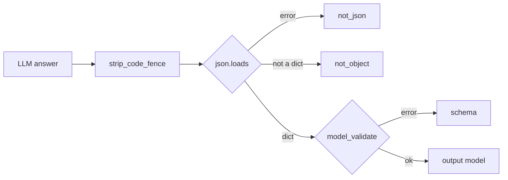

# MH-1: Output models and a strict parser for LLM JSON

## Apply with the runner

The handoff runner applies this file: it writes the test file, runs the red command (it must fail), writes the module, runs the "Done when" checks (they must pass), and commits. See `docs/handoff-runner.md`.

Apply this handoff (WSL, from `apps/backend-py`):

```bash
.venv/bin/python scripts/run_handoff.py ../../tasks/active/step-3-7-structured-output/mh-1-output-models.md
```

## Why

Nine call sites take LLM JSON with the regex `\{.*\}` and read the keys with `dict.get`, so a wrong shape goes through with default values. This handoff adds one output model for each call site and one strict parser. It changes no call site. The eval suite (MH-2) uses the models to measure the answers of the current code, and MH-3 to MH-7 send each model's JSON schema to Ollama and parse with `parse_structured`.



The models follow the JSON shape that each prompt asks for today. A field that the prompt allows to be empty is `Optional` (required, but `null` is allowed). The two recommendation fields accept only `approve`, `needs_revision`, or `reject`, and the scores are 0 to 100.

## Files

- `apps/backend-py/src/llm/structured.py` (new)
- `apps/backend-py/tests/unit/test_structured_output.py` (new)

## Step 1: add the test file, run it, and see it fail

```python new=apps/backend-py/tests/unit/test_structured_output.py
"""Tests for the structured LLM output models and the strict parser (Step 3.7, MH-1)."""

import json
from typing import Any, Dict

import pytest

from src.llm.structured import (
    OUTPUT_MODELS,
    CoverLetterReviewAnswer,
    ResumeAnalysisAnswer,
    ResumeValidationAnswer,
    StructuredOutputError,
    extract_braced_object,
    parse_structured,
    strip_code_fence,
)

SAMPLE_ANSWERS: Dict[str, Dict[str, Any]] = {
    "selection": {
        "selected_projects": [{"name": "Ledger", "reason": "Payments work"}],
        "keywords_to_emphasize": ["Python"],
        "key_achievements": ["Cut batch time by half"],
        "summary_suggestion": "Backend engineer with payments work.",
    },
    "resume_writing": {
        "summary": "Backend engineer.",
        "skills": ["Python", "SQL"],
        "experience": [
            {
                "title": "Engineer",
                "company": "Acme",
                "dates": "2024 - 2025",
                "highlights": ["Built an API"],
            }
        ],
        "projects": [
            {
                "name": "Ledger",
                "description": "A ledger service.",
                "technologies": ["Python"],
                "highlights": ["Handles refunds"],
            }
        ],
        "education": [{"degree": "BSc", "school": "NUS", "year": "2025"}],
    },
    "resume_validation": {
        "is_valid": True,
        "missing_projects": [],
        "missing_keywords": ["Go"],
        "fabricated_content": [],
        "date_inconsistencies": [],
        "overall_score": 85,
        "recommendation": "approve",
    },
    "resume_analysis": {
        "overall_score": 70,
        "summary": "Solid junior profile.",
        "key_strengths": ["Python"],
        "key_improvements": ["Add metrics"],
        "resume_improvements": ["Quantify results"],
        "skill_gaps": ["Kubernetes"],
        "next_steps": ["Build a cloud project"],
    },
    "cover_letter_review": {"critique": "Name the role.", "rewrite_needed": True},
    "cover_letter_validation": {
        "structure_score": 80,
        "content_score": 75,
        "tone_score": 90,
        "overall_score": 80,
        "is_valid": True,
        "recommendation": "needs_revision",
        "issues": ["Generic opening"],
    },
    "resume_parsing": {
        "basics": {
            "name": "Mara Chen",
            "email": None,
            "phone": None,
            "location": "Singapore, Singapore",
            "linkedin": None,
            "github": None,
        },
        "summary": None,
        "skills": {
            "programming_languages": ["Python"],
            "frameworks": ["FastAPI"],
            "tools": [],
            "databases": ["PostgreSQL"],
            "cloud": [],
            "domains": [],
        },
        "experience": [
            {
                "title": "Engineer",
                "company": "Acme",
                "location": None,
                "start_date": "2024-01",
                "end_date": "present",
                "highlights": ["Built an API"],
            }
        ],
        "projects": [
            {
                "name": "Ledger",
                "description": None,
                "technologies": ["Python"],
                "url": None,
                "highlights": [],
            }
        ],
        "education": [
            {
                "degree": "BSc",
                "school": "NUS",
                "location": None,
                "graduation_year": "2025",
                "gpa": None,
            }
        ],
        "certifications": [],
        "target_job": {
            "keywords": ["Software Engineer"],
            "locations": ["Singapore"],
            "experience_levels": ["Entry Level"],
            "remote_preference": None,
            "industries": ["Technology"],
        },
        "apprenticeship": None,
    },
    "jd_extraction": {
        "title": "Backend Engineer",
        "company": "Acme",
        "location": "Singapore",
        "requirements": ["3 years of Python"],
        "responsibilities": ["Build APIs"],
        "skills": ["Python"],
        "experience_level": "Mid",
        "salary_range": None,
    },
    "job_classification": {
        "industry": "Technology",
        "role_category": "Engineering",
        "company_size": "Unknown",
        "company_stage": None,
        "work_pace": "Unknown",
        "team_structure": "Unknown",
        "technical_skills": [
            {
                "name": "Python",
                "proficiency": "Advanced",
                "is_required": True,
                "category": "programming_language",
            }
        ],
        "soft_skills": [],
        "domain_skills": [],
        "experience_level_confidence": 0.8,
        "actual_experience_years": [3.0, 5.0],
        "management_level": None,
        "impact_scope": None,
        "classification_confidence": 0.7,
        "tags": ["backend"],
        "red_flags": [],
    },
}

REVIEW = '{"critique": "Name the role.", "rewrite_needed": true}'


def test_output_models_cover_the_nine_call_sites() -> None:
    """There is one output model for each of the 9 JSON call sites."""
    assert set(OUTPUT_MODELS) == set(SAMPLE_ANSWERS)


@pytest.mark.parametrize("site", sorted(SAMPLE_ANSWERS))
def test_each_model_accepts_the_shape_of_its_prompt(site: str) -> None:
    """A sample answer in the shape that each prompt asks for validates."""
    parsed = parse_structured(json.dumps(SAMPLE_ANSWERS[site]), OUTPUT_MODELS[site])

    assert isinstance(parsed, OUTPUT_MODELS[site])


@pytest.mark.parametrize("site", sorted(SAMPLE_ANSWERS))
def test_each_model_has_a_json_schema_with_required_fields(site: str) -> None:
    """Each schema is a JSON object schema with required fields, for Ollama."""
    schema = OUTPUT_MODELS[site].model_json_schema()

    assert schema["type"] == "object"
    assert schema["required"]
    json.dumps(schema)


def test_parse_returns_the_model() -> None:
    """A whole JSON answer becomes a model instance."""
    parsed = parse_structured(REVIEW, CoverLetterReviewAnswer)

    assert parsed.critique == "Name the role."
    assert parsed.rewrite_needed is True


@pytest.mark.parametrize(
    "content",
    [
        "```json\n" + REVIEW + "\n```",
        "```\n" + REVIEW + "\n```",
        "  " + REVIEW + "\n",
    ],
)
def test_parse_accepts_a_code_fence_and_spaces(content: str) -> None:
    """A code fence or spaces around the JSON are allowed."""
    parsed = parse_structured(content, CoverLetterReviewAnswer)

    assert parsed.rewrite_needed is True


def test_strip_code_fence_keeps_an_answer_without_a_fence() -> None:
    """An answer without a fence comes back stripped and otherwise unchanged."""
    assert strip_code_fence("  " + REVIEW + "  ") == REVIEW


def test_parse_rejects_text_around_the_json() -> None:
    """Prose around the JSON is a ``not_json`` failure; the parser does not search."""
    with pytest.raises(StructuredOutputError) as caught:
        parse_structured("Here is the review: " + REVIEW, CoverLetterReviewAnswer)

    assert caught.value.reason == "not_json"


def test_parse_rejects_a_json_array() -> None:
    """A JSON array is a ``not_object`` failure."""
    with pytest.raises(StructuredOutputError) as caught:
        parse_structured("[" + REVIEW + "]", CoverLetterReviewAnswer)

    assert caught.value.reason == "not_object"


def test_parse_rejects_a_missing_field() -> None:
    """A missing required field is a ``schema`` failure."""
    with pytest.raises(StructuredOutputError) as caught:
        parse_structured('{"critique": "Fine."}', CoverLetterReviewAnswer)

    assert caught.value.reason == "schema"


def test_parse_rejects_an_unknown_recommendation() -> None:
    """A recommendation outside the three allowed values is a ``schema`` failure."""
    answer = dict(SAMPLE_ANSWERS["resume_validation"], recommendation="Approve")

    with pytest.raises(StructuredOutputError) as caught:
        parse_structured(json.dumps(answer), ResumeValidationAnswer)

    assert caught.value.reason == "schema"


def test_parse_rejects_a_score_above_100() -> None:
    """A score above 100 is a ``schema`` failure."""
    answer = dict(SAMPLE_ANSWERS["resume_validation"], overall_score=150)

    with pytest.raises(StructuredOutputError) as caught:
        parse_structured(json.dumps(answer), ResumeValidationAnswer)

    assert caught.value.reason == "schema"


def test_analysis_fields_of_the_job_specific_prompt_are_optional() -> None:
    """The general analysis has no alignment score or competitive fields."""
    parsed = parse_structured(
        json.dumps(SAMPLE_ANSWERS["resume_analysis"]), ResumeAnalysisAnswer
    )

    assert parsed.target_alignment_score is None
    assert parsed.competitive_advantages == []
    assert parsed.competitive_gaps == []
    assert parsed.metadata == {}


def test_error_is_a_value_error() -> None:
    """Call sites that catch ``ValueError`` also catch a parse failure."""
    assert issubclass(StructuredOutputError, ValueError)


def test_extract_braced_object_takes_the_first_and_last_brace() -> None:
    """The old regex took the text from the first ``{`` to the last ``}``."""
    content = 'Sure: {"a": {"b": 1}} Thanks.'

    assert extract_braced_object(content) == '{"a": {"b": 1}}'


@pytest.mark.parametrize("content", ["no braces here", "} then {", ""])
def test_extract_braced_object_without_an_object(content: str) -> None:
    """Without a ``{`` before a ``}`` there is nothing to rescue."""
    assert extract_braced_object(content) is None
```

Run it. It must fail (the module does not exist yet):

```bash red cwd=apps/backend-py
.venv/bin/python -m pytest tests/unit/test_structured_output.py -q
```

## Step 2: add `src/llm/structured.py`

```python new=apps/backend-py/src/llm/structured.py
"""
Job Raider - Structured LLM Output

Output models for the LLM tasks that answer in JSON, and one strict parser
(Step 3.7). Each model is the contract of one call site: the router sends
the model's JSON schema to Ollama as ``format``, and the call site checks
the answer with ``parse_structured``. The parser uses no regex.

Author: Job Raider
Date: 2026-10-31
"""

import json
from typing import Dict, List, Literal, Optional, Type, TypeVar

from pydantic import BaseModel, Field, ValidationError

T = TypeVar("T", bound=BaseModel)

Recommendation = Literal["approve", "needs_revision", "reject"]


class StructuredOutputError(ValueError):
    """An LLM answer that is not valid JSON for the expected output model."""

    def __init__(self, reason: str, detail: str) -> None:
        """
        Keep the reason and the detail of the failure.

        Args:
            reason: ``not_json``, ``not_object``, or ``schema``.
            detail: A short description of the problem.
        """
        super().__init__(f"{reason}: {detail}")
        self.reason = reason
        self.detail = detail


def strip_code_fence(content: str) -> str:
    """
    Remove one Markdown code fence around an answer, if there is one.

    Args:
        content: The raw LLM answer.

    Returns:
        The text inside the fence, or the stripped answer when it has no fence.
    """
    text = content.strip()
    if not text.startswith("```"):
        return text
    first_newline = text.find("\n")
    if first_newline == -1:
        return text
    body = text[first_newline + 1 :].rstrip()
    if body.endswith("```"):
        body = body[: -len("```")]
    return body.strip()


def parse_structured(content: str, model: Type[T]) -> T:
    """
    Parse a whole LLM answer as one JSON object and validate it.

    Args:
        content: The raw LLM answer. A code fence around it is allowed;
            other text around the JSON is not.
        model: The output model of the task.

    Returns:
        The validated model instance.

    Raises:
        StructuredOutputError: When the answer is not JSON (``not_json``),
            not a JSON object (``not_object``), or does not match the model
            (``schema``).
    """
    text = strip_code_fence(content)
    try:
        data = json.loads(text)
    except json.JSONDecodeError as exc:
        raise StructuredOutputError("not_json", str(exc)) from exc
    if not isinstance(data, dict):
        raise StructuredOutputError("not_object", type(data).__name__)
    try:
        return model.model_validate(data)
    except ValidationError as exc:
        raise StructuredOutputError("schema", f"{exc.error_count()} errors") from exc


def extract_braced_object(content: str) -> Optional[str]:
    """
    Return the text from the first ``{`` to the last ``}`` of an answer.

    This is what the old regex ``\\{.*\\}`` found. Only the eval suite uses
    it, to count the answers that only the old parsing could rescue.

    Args:
        content: The raw LLM answer.

    Returns:
        The braced text, or ``None`` when there is no ``{`` before a ``}``.
    """
    start = content.find("{")
    end = content.rfind("}")
    if start == -1 or end < start:
        return None
    return content[start : end + 1]


class SelectedProject(BaseModel):
    """One profile project that the selector picks."""

    name: str
    reason: str


class SelectionAnswer(BaseModel):
    """Answer of the selection task (``selector.py``)."""

    selected_projects: List[SelectedProject]
    keywords_to_emphasize: List[str]
    key_achievements: List[str]
    summary_suggestion: str


class WrittenExperience(BaseModel):
    """One experience entry of a written resume."""

    title: str
    company: str
    dates: str
    highlights: List[str]


class WrittenProject(BaseModel):
    """One project entry of a written resume."""

    name: str
    description: str
    technologies: List[str]
    highlights: List[str]


class WrittenEducation(BaseModel):
    """One education entry of a written resume."""

    degree: str
    school: str
    year: str


class ResumeWritingAnswer(BaseModel):
    """Answer of the resume writing task (``resume_writer.py``)."""

    summary: str
    skills: List[str]
    experience: List[WrittenExperience]
    projects: List[WrittenProject]
    education: List[WrittenEducation]


class ResumeValidationAnswer(BaseModel):
    """Answer of the LLM resume validation (``validator.py``)."""

    is_valid: bool
    missing_projects: List[str]
    missing_keywords: List[str]
    fabricated_content: List[str]
    date_inconsistencies: List[str]
    overall_score: int = Field(ge=0, le=100)
    recommendation: Recommendation


class ResumeAnalysisAnswer(BaseModel):
    """Answer of the general and job-specific resume analysis (``resume_analyzer.py``)."""

    overall_score: int = Field(ge=0, le=100)
    summary: str
    key_strengths: List[str]
    key_improvements: List[str]
    resume_improvements: List[str]
    skill_gaps: List[str]
    next_steps: List[str]
    target_alignment_score: Optional[int] = Field(default=None, ge=0, le=100)
    competitive_advantages: List[str] = Field(default_factory=list)
    competitive_gaps: List[str] = Field(default_factory=list)
    metadata: Dict[str, str] = Field(default_factory=dict)


class CoverLetterReviewAnswer(BaseModel):
    """Answer of the cover letter review (``cover_letter_reviewer.py``)."""

    critique: str
    rewrite_needed: bool


class CoverLetterValidationAnswer(BaseModel):
    """Answer of the LLM cover letter validation (``cover_letter_validator.py``)."""

    structure_score: int = Field(ge=0, le=100)
    content_score: int = Field(ge=0, le=100)
    tone_score: int = Field(ge=0, le=100)
    overall_score: int = Field(ge=0, le=100)
    is_valid: bool
    recommendation: Recommendation
    issues: List[str]


class ParsedBasics(BaseModel):
    """Contact basics of a parsed resume."""

    name: str
    email: Optional[str]
    phone: Optional[str]
    location: Optional[str]
    linkedin: Optional[str]
    github: Optional[str]


class ParsedSkills(BaseModel):
    """Skills of a parsed resume, by group."""

    programming_languages: List[str]
    frameworks: List[str]
    tools: List[str]
    databases: List[str]
    cloud: List[str]
    domains: List[str]


class ParsedExperience(BaseModel):
    """One experience entry of a parsed resume."""

    title: str
    company: str
    location: Optional[str]
    start_date: Optional[str]
    end_date: Optional[str]
    highlights: List[str]


class ParsedProject(BaseModel):
    """One project entry of a parsed resume."""

    name: str
    description: Optional[str]
    technologies: List[str]
    url: Optional[str]
    highlights: List[str]


class ParsedEducation(BaseModel):
    """One education entry of a parsed resume."""

    degree: str
    school: str
    location: Optional[str]
    graduation_year: Optional[str]
    gpa: Optional[str]


class ParsedCertification(BaseModel):
    """One certification of a parsed resume."""

    name: str
    issuer: Optional[str]
    date: Optional[str]


class ParsedTargetJob(BaseModel):
    """Target job preferences inferred from a parsed resume."""

    keywords: List[str]
    locations: List[str]
    experience_levels: List[str]
    remote_preference: Optional[bool]
    industries: List[str]


class ParsedApprenticeship(BaseModel):
    """Apprenticeship or traineeship obligation of a parsed resume."""

    field: Optional[str]
    duration_months: Optional[int]
    employer: Optional[str]
    start_date: Optional[str]
    end_date: Optional[str]
    is_active: Optional[bool]


class ResumeParsingAnswer(BaseModel):
    """Answer of the LLM resume parser (``resume_parser.py``)."""

    basics: ParsedBasics
    summary: Optional[str]
    skills: ParsedSkills
    experience: List[ParsedExperience]
    projects: List[ParsedProject]
    education: List[ParsedEducation]
    certifications: List[ParsedCertification]
    target_job: ParsedTargetJob
    apprenticeship: Optional[ParsedApprenticeship]


class JDExtractionAnswer(BaseModel):
    """Answer of the LLM job description extractor (``jd_extractor.py``)."""

    title: str
    company: str
    location: Optional[str]
    requirements: List[str]
    responsibilities: List[str]
    skills: List[str]
    experience_level: Optional[str]
    salary_range: Optional[str]


class ClassifiedSkill(BaseModel):
    """One skill requirement of a classified job."""

    name: str
    proficiency: str
    is_required: bool
    category: str


class JobClassificationAnswer(BaseModel):
    """Answer of the LLM job classifier (``job_classifier.py``)."""

    industry: str
    role_category: str
    company_size: str
    company_stage: Optional[str]
    work_pace: str
    team_structure: str
    technical_skills: List[ClassifiedSkill]
    soft_skills: List[ClassifiedSkill]
    domain_skills: List[ClassifiedSkill]
    experience_level_confidence: float = Field(ge=0, le=1)
    actual_experience_years: Optional[List[float]]
    management_level: Optional[str]
    impact_scope: Optional[str]
    classification_confidence: float = Field(ge=0, le=1)
    tags: List[str]
    red_flags: List[str]


OUTPUT_MODELS: Dict[str, Type[BaseModel]] = {
    "selection": SelectionAnswer,
    "resume_writing": ResumeWritingAnswer,
    "resume_validation": ResumeValidationAnswer,
    "resume_analysis": ResumeAnalysisAnswer,
    "cover_letter_review": CoverLetterReviewAnswer,
    "cover_letter_validation": CoverLetterValidationAnswer,
    "resume_parsing": ResumeParsingAnswer,
    "jd_extraction": JDExtractionAnswer,
    "job_classification": JobClassificationAnswer,
}
```

## Done when

Run the new tests:

```bash check cwd=apps/backend-py
.venv/bin/python -m pytest tests/unit/test_structured_output.py -q
```

Format the new files:

```bash check cwd=apps/backend-py
.venv/bin/python -m black src/llm/structured.py tests/unit/test_structured_output.py
```

Check the lint:

```bash check cwd=apps/backend-py
.venv/bin/python -m ruff check src/llm/structured.py tests/unit/test_structured_output.py
```

Run the mypy gate (no new errors):

```bash check cwd=apps/backend-py
.venv/bin/python scripts/mypy_gate.py
```

Commit message:

```text commit
feat(llm): add output models and a strict parser for LLM JSON

Nine call sites take LLM JSON with the regex \{.*\} and read keys with
dict.get. src/llm/structured.py adds one Pydantic output model for each
call site and parse_structured, which accepts only a whole JSON object
(a code fence is allowed) that matches the model. No call site changes
yet (Step 3.7, MH-1).
```
