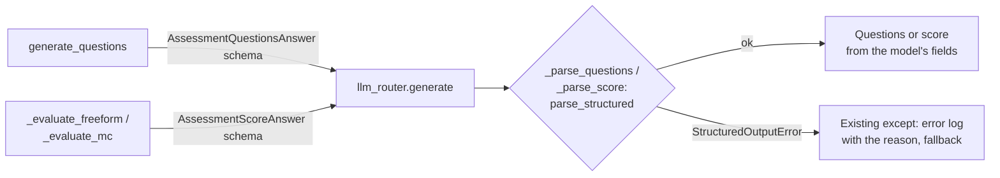

# MH-10: The assessment engine asks for its JSON schema and parses strictly

This is a spec handoff: it gives the behavior and the tests to write, not the code. Read `AGENT.md` first. MH-8 must be in the repository (it adds the output models).

## Why

The assessment engine (`src/assessment/engine.py`) removes a code fence and calls `json.loads` in two places: `_parse_questions` (question generation) and `_parse_score` (free-form and multiple-choice scoring). It reads keys with `dict.get` and defaults. The generation prompt asks for a bare JSON array, but Ollama's `format` and `parse_structured` take one JSON object.

After this handoff, the three calls send their output model's JSON schema, the generation prompt asks for an object with one key, `questions`, and both parsers use `parse_structured`. A parse failure keeps its existing path: the fallback questions, or the fallback score of 50.



## Files

- `apps/backend-py/src/assessment/engine.py` (change)
- `apps/backend-py/config/prompt_templates.yaml` (change one line)
- `apps/backend-py/tests/unit/test_structured_assessment.py` (new)
- `apps/backend-py/tests/unit/test_assessment_engine.py` (change four tests, Step 1.2)
- `apps/backend-py/tests/unit/test_assessment_template_nonce.py` (change one line, Step 1.2)

Do not change other files.

## Required behavior

The output models and the parser are in `src/llm/structured.py`: `AssessmentQuestionsAnswer`, `AssessmentScoreAnswer`, and `parse_structured`.

1. `config/prompt_templates.yaml`, `assessment_generation.user`: change the line `      Return a JSON array of question objects. Each object must have:` to `      Return a JSON object with one key, "questions": an array of question objects. Each question object must have:` (keep the 6-space indentation). Do not change other lines.
2. `engine.py`:
   - Add `response_schema=AssessmentQuestionsAnswer.model_json_schema()` to the `generate` call in `generate_questions`, and `response_schema=AssessmentScoreAnswer.model_json_schema()` to the `generate` calls in `_evaluate_freeform` and `_evaluate_mc`.
   - In `_parse_questions`, parse with `answer = parse_structured(response_content, AssessmentQuestionsAnswer)`, and make one `Question` for each item of `answer.questions[:expected]`, from the item's fields: `QuestionType(item.question_type)`, `AnswerFormat(item.answer_format)`, `DifficultyLevel(item.difficulty)`, `topic`, `question_text`, `correct_answer_hint`, `time_limit_seconds`, and one `MultipleChoiceOption(label=..., text=..., is_correct=...)` for each item of `item.options`. Remove the fence handling, `json.loads`, and the `isinstance(data, list)` code.
   - In `_parse_score`, parse with `answer = parse_structured(response_content, AssessmentScoreAnswer)`, and make the `QuestionScore` from its fields (`score=float(answer.score)`, `is_correct`, `feedback`, `strengths`, `improvements`, `model_answer`). Remove the fence handling and `json.loads`.
   - `import json` is then not used. Remove it, and change both `except (json.JSONDecodeError, KeyError, ValueError) as e:` to `except (KeyError, ValueError) as e:`. (`StructuredOutputError` is a `ValueError`, so the existing error log gets its text, which starts with the reason, for example `not_json`.)
3. Do not add a new fallback. Do not change the other prompts.

## Step 1: write the tests, run them, and see the named tests fail

### 1.1 The new test file `tests/unit/test_structured_assessment.py`

Define these module constants:

```python
QUESTION = {
    "question_type": "coding",
    "answer_format": "multiple_choice",
    "difficulty": "advanced",
    "topic": "algorithms",
    "question_text": "Which search is O(log n)?",
    "options": [
        {"label": "A", "text": "Binary search", "is_correct": True},
        {"label": "B", "text": "Linear search", "is_correct": False},
    ],
    "correct_answer_hint": "Binary search halves the range.",
    "time_limit_seconds": 120,
}
SCORE_ANSWER = {
    "score": 80,
    "feedback": "Good answer.",
    "strengths": ["Clear"],
    "improvements": ["Add an example"],
    "model_answer": "Binary search.",
}
```

Write these helpers (with docstrings and type hints):

- `make_engine(content)`: `AssessmentEngine.__new__(AssessmentEngine)` with `llm_router = MagicMock()` whose `generate` returns `MagicMock(content=content)`, `logger = MagicMock()`, and the three templates as small dicts with `"system"` and `"user"` strings (as the `engine` fixture in `test_assessment_engine.py` does).
- `free_form_question()`: a `Question` with `question_id="q-ff"`, `QuestionType.CONCEPTUAL`, `AnswerFormat.FREEFORM`, `DifficultyLevel.INTERMEDIATE`, `topic="Python"`, `question_text="Explain a tuple."`, `correct_answer_hint="Immutable sequence."`.
- `choice_question()`: a `Question` with `question_id="q-mc"`, `AnswerFormat.MULTIPLE_CHOICE`, and two options (`A` correct, `B` not).
- `logged_errors(engine)`: the text of all calls to `engine.logger.error` as one string.

Write these 11 tests:

| Test | Input | Check |
|------|-------|-------|
| `test_question_generation_sends_its_schema` | `generate_questions(AssessmentSession(mode=AssessmentMode.SKILL_BASED, target_skills=["Python"], question_count=1), count=1)` with answer `json.dumps({"questions": [QUESTION]})` | `response_schema == AssessmentQuestionsAnswer.model_json_schema()` |
| `test_questions_parse_a_strict_answer` | `_parse_questions(json.dumps({"questions": [QUESTION]}), 1)` | `question_type == QuestionType.CODING`, `topic == "algorithms"`, `options[0].is_correct is True`, `time_limit_seconds == 120` |
| `test_questions_fall_back_on_a_bare_list` | `_parse_questions(json.dumps([QUESTION]), 1)` | the first question's `topic != "algorithms"` and `"not_object"` is in `logged_errors(engine)` |
| `test_questions_fall_back_on_text_around_the_json` | `"Here are the questions: " + json.dumps({"questions": [QUESTION]})` | `topic != "algorithms"` and `"not_json"` is in `logged_errors(engine)` |
| `test_free_form_scoring_sends_its_schema` | `_evaluate_freeform(free_form_question(), Answer(question_id="q-ff", freeform_text="A tuple."))` with answer `json.dumps(SCORE_ANSWER)` | `response_schema == AssessmentScoreAnswer.model_json_schema()` |
| `test_choice_scoring_sends_its_schema` | `_evaluate_mc(choice_question(), Answer(question_id="q-mc", selected_option="A"))` with answer `json.dumps(dict(SCORE_ANSWER, is_correct=True))` | the same schema |
| `test_score_parses_a_strict_answer` | `_parse_score(json.dumps(SCORE_ANSWER), "q-ff")` | `score == 80.0`, `feedback == "Good answer."`, `is_correct is None` |
| `test_score_falls_back_on_a_missing_field` | `SCORE_ANSWER` without `model_answer` | `score == 50.0` and `feedback == "Could not parse evaluation response."` |
| `test_score_falls_back_on_text_around_the_json` | `"Score: " + json.dumps(SCORE_ANSWER)` | `score == 50.0` and `"not_json"` is in `logged_errors(engine)` |
| `test_prompt_asks_for_a_questions_object` | `assessment_generation.user` from `config/prompt_templates.yaml` (`yaml.safe_load`) | `'Return a JSON object with one key, "questions"'` is in it and `"Return a JSON array"` is not |
| `test_no_json_loads_left` | the text of `src/assessment/engine.py` | `"json.loads"` is not in it |

### 1.2 Change five existing tests

These tests send the old bare list or look for the old prompt text. Change only what is said here:

1. `tests/unit/test_assessment_engine.py`, `TestGenerateQuestions.test_generates_expected_count`: the answer becomes `json.dumps({"questions": [ ... ]})`, with the same list inside.
2. The same file, `TestParseQuestions.test_parses_clean_json`: the same change.
3. The same file, `TestParseQuestions.test_truncates_to_expected_count`: the same change.
4. The same file, `TestParseQuestions.test_handles_markdown_fences`: inside the fenced string, the list `[{...}]` becomes `{"questions": [{...}]}`.
5. `tests/unit/test_assessment_template_nonce.py`, `test_nonce_after_json_schema_instructions`: `schema_marker = "Return a JSON array of question objects"` becomes `schema_marker = "Return a JSON object with one key"`.

### 1.3 Run the tests

Run the new file. Exactly 1 test passes (`test_score_parses_a_strict_answer`) and the other 10 fail (`FAILED`, not `ERROR`):

```bash
.venv/bin/python -m pytest tests/unit/test_structured_assessment.py -q --maxfail=20
```

## Step 2: change the engine and the prompt

Change `engine.py` and `prompt_templates.yaml` as "Required behavior" says.

## Done when

Run the new tests. All 11 pass:

```bash
.venv/bin/python -m pytest tests/unit/test_structured_assessment.py -q
```

Run the other assessment tests. All pass:

```bash
.venv/bin/python -m pytest tests/unit/test_assessment_engine.py tests/unit/test_assessment_api.py tests/unit/test_assessment_storage.py tests/unit/test_assessment_template_nonce.py tests/unit/test_disc_engine.py -q
```

Format the changed Python files:

```bash
.venv/bin/python -m black src/assessment/engine.py tests/unit/test_structured_assessment.py tests/unit/test_assessment_engine.py tests/unit/test_assessment_template_nonce.py
```

Check the lint:

```bash
.venv/bin/python -m ruff check src/assessment/engine.py tests/unit/test_structured_assessment.py tests/unit/test_assessment_engine.py tests/unit/test_assessment_template_nonce.py
```

Run the mypy gate. It must report 0 new errors. It can also say that some baseline errors are fixed; do nothing about that. Do not add `--update`:

```bash
.venv/bin/python scripts/mypy_gate.py
```

The working tree has other changed files that are not part of this handoff. Do not stage them. Do not use `git add -A`, `git add .`, or `git commit -a`. Stage only your five files:

```bash
git add src/assessment/engine.py config/prompt_templates.yaml tests/unit/test_structured_assessment.py tests/unit/test_assessment_engine.py tests/unit/test_assessment_template_nonce.py
```

Check that only these five files are staged:

```bash
git diff --cached --name-only
```

Commit with this message:

```text
feat(assessment): use the JSON schema and the strict parser for assessments

Question generation and answer scoring send their output model's JSON
schema and parse the whole answer with parse_structured instead of a
fence removal and json.loads. The generation prompt asks for an object
with one key, questions, because Ollama's format takes one object. A
parse failure keeps the fallback questions or the fallback score, with
the reason in the error log (Step 3.7, MH-10).
```
