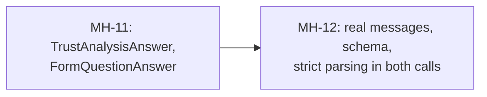

# MH-11: Output models for the trust analysis and the form-question fallback

## Apply with the runner

The handoff runner applies this file: it writes the test file, runs the red command (it must fail), adds the models, runs the "Done when" checks (they must pass), and commits. See `docs/handoff-runner.md`.

Apply this handoff (WSL, from `apps/backend-py`):

```bash
.venv/bin/python scripts/run_handoff.py ../../tasks/active/step-3-7-structured-output/mh-11-trust-and-form-models.md
```

## Why

After MH-10, two places still cut an LLM answer by brace position: the deep trust analysis (`scoring/trust_analyzer.py`) and the form-question fallback of the LinkedIn Easy Apply answer engine (`linkedin/answer_engine.py`). Both also call `llm_router.generate` with `prompt=` and no `messages`, so the calls raise a `TypeError` that the methods catch: neither LLM path has ever returned a result. This handoff adds their output models; MH-12 fixes the two calls.



- `TrustAnalysisAnswer`: `summary`, `additional_indicators`, and `confidence_adjustment` from -0.1 to 0.2 (the range that the trust prompt gives).
- `FormQuestionAnswer`: `answer`, `confidence` (`high`, `medium`, or `low`; the engine's `unknown` is for answers that no tier gives), and `reasoning`. With Ollama's `format`, the model cannot write a bare `NEEDS_MANUAL_REVIEW`; it writes that text as the answer.

## Files

- `apps/backend-py/src/llm/structured.py` (change)
- `apps/backend-py/tests/unit/test_structured_output_trust_and_forms.py` (new)

## Step 1: add the test file, run it, and see it fail

```python new=apps/backend-py/tests/unit/test_structured_output_trust_and_forms.py
"""Tests for the output models of the trust analysis and the form-question fallback (Step 3.7, MH-11)."""

import json
from typing import Any, Dict

import pytest

from src.llm.structured import (
    FormQuestionAnswer,
    StructuredOutputError,
    TrustAnalysisAnswer,
    parse_structured,
)

TRUST_ANSWER: Dict[str, Any] = {
    "summary": "Looks legitimate.",
    "additional_indicators": [],
    "confidence_adjustment": 0.0,
}
FORM_ANSWER: Dict[str, Any] = {
    "answer": "Yes",
    "confidence": "high",
    "reasoning": "The profile says the candidate can relocate.",
}


def test_trust_answer_matches_its_prompt_shape() -> None:
    """A trust answer in the prompt's shape validates."""
    parsed = parse_structured(json.dumps(TRUST_ANSWER), TrustAnalysisAnswer)

    assert parsed.summary == "Looks legitimate."


def test_form_answer_matches_its_prompt_shape() -> None:
    """A form answer in the prompt's shape validates."""
    parsed = parse_structured(json.dumps(FORM_ANSWER), FormQuestionAnswer)

    assert parsed.answer == "Yes"


def test_both_schemas_require_every_field() -> None:
    """Each schema requires all of its prompt's fields."""
    trust = TrustAnalysisAnswer.model_json_schema()
    form = FormQuestionAnswer.model_json_schema()

    assert set(trust["required"]) == {
        "summary",
        "additional_indicators",
        "confidence_adjustment",
    }
    assert set(form["required"]) == {"answer", "confidence", "reasoning"}


@pytest.mark.parametrize("adjustment", [-0.1, 0.0, 0.2])
def test_trust_adjustment_inside_the_prompt_range(adjustment: float) -> None:
    """Adjustments from -0.1 to 0.2 match."""
    answer = dict(TRUST_ANSWER, confidence_adjustment=adjustment)

    parsed = parse_structured(json.dumps(answer), TrustAnalysisAnswer)

    assert parsed.confidence_adjustment == adjustment


@pytest.mark.parametrize("adjustment", [-0.11, 0.21, 0.5])
def test_trust_adjustment_outside_the_prompt_range(adjustment: float) -> None:
    """Adjustments below -0.1 or above 0.2 do not match."""
    answer = dict(TRUST_ANSWER, confidence_adjustment=adjustment)

    with pytest.raises(StructuredOutputError) as caught:
        parse_structured(json.dumps(answer), TrustAnalysisAnswer)

    assert caught.value.reason == "schema"


@pytest.mark.parametrize("confidence", ["unknown", "certain", "High"])
def test_form_confidence_has_three_values(confidence: str) -> None:
    """A confidence outside high, medium, and low does not match."""
    answer = dict(FORM_ANSWER, confidence=confidence)

    with pytest.raises(StructuredOutputError):
        parse_structured(json.dumps(answer), FormQuestionAnswer)
```

Run it. It must fail (the models do not exist yet):

```bash red cwd=apps/backend-py
.venv/bin/python -m pytest tests/unit/test_structured_output_trust_and_forms.py -q
```

## Step 2: add the models to `src/llm/structured.py`

Add the models before `OUTPUT_MODELS`:

```python edit=apps/backend-py/src/llm/structured.py
<<<<<<< OLD
OUTPUT_MODELS: Dict[str, Type[BaseModel]] = {
=======
class TrustAnalysisAnswer(BaseModel):
    """Answer of the deep trust analysis (``scoring/trust_analyzer.py``)."""

    summary: str
    additional_indicators: List[str]
    confidence_adjustment: float = Field(ge=-0.1, le=0.2)


class FormQuestionAnswer(BaseModel):
    """Answer of the form-question fallback (``linkedin/answer_engine.py``).

    The model writes ``NEEDS_MANUAL_REVIEW`` as the answer when the profile
    does not give one.
    """

    answer: str
    confidence: Literal["high", "medium", "low"]
    reasoning: str


OUTPUT_MODELS: Dict[str, Type[BaseModel]] = {
>>>>>>> NEW
```

## Done when

Run the new tests and the other model tests:

```bash check cwd=apps/backend-py
.venv/bin/python -m pytest tests/unit/test_structured_output_trust_and_forms.py tests/unit/test_structured_output_other_tasks.py tests/unit/test_structured_output.py tests/unit/test_structured_suite.py -q
```

Format the changed files:

```bash check cwd=apps/backend-py
.venv/bin/python -m black src/llm/structured.py tests/unit/test_structured_output_trust_and_forms.py
```

Check the lint:

```bash check cwd=apps/backend-py
.venv/bin/python -m ruff check src/llm/structured.py tests/unit/test_structured_output_trust_and_forms.py
```

Run the mypy gate (no new errors):

```bash check cwd=apps/backend-py
.venv/bin/python scripts/mypy_gate.py
```

Commit message:

```text commit
feat(llm): add output models for the trust analysis and form answers

The deep trust analysis and the form-question fallback still cut LLM
answers by brace position. src/llm/structured.py gets their output
models: TrustAnalysisAnswer (adjustment from -0.1 to 0.2) and
FormQuestionAnswer (confidence high, medium, or low). No call site
changes yet (Step 3.7, MH-11).
```
