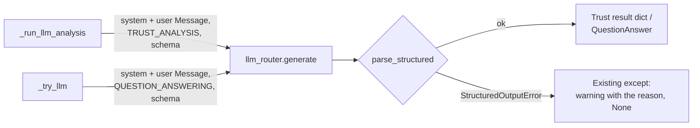

# MH-12: The trust analyzer and the form-answer engine call the router correctly and parse strictly

This is a spec handoff: it gives the behavior and the tests to write, not the code. Read `AGENT.md` first. MH-11 must be in the repository (it adds the output models).

## Why

Two LLM calls have never returned a result:

- `TrustAnalyzer._run_llm_analysis` (`src/scoring/trust_analyzer.py`, the deep trust analysis of `routes/jobs.py`) calls `self.llm_router.generate(task_type=..., prompt=..., system_prompt=...)`. `LLMRouter.generate` takes `messages`, so the call raises a `TypeError`, which the method catches ("LLM trust analysis failed"), and it returns `None`. The code after the call also treats the response as a string and cuts it from the first `{` to the last `}`; when that fails, it uses the raw text as the summary.
- `QuestionAnswerEngine._try_llm` (`src/linkedin/answer_engine.py`, the third tier of the LinkedIn Easy Apply form filler) calls `generate(task_type=..., prompt=...)` the same way, with no system prompt, and cuts the text from the first `{`; when that fails, it uses the raw text as the form answer.

After this handoff, both methods send a system and a user `Message`, the task type, a low temperature, and the output model's JSON schema, and parse the whole answer with `parse_structured`. A parse failure goes to the existing `except` branch (a warning log with the reason, and `None`), not to raw text.



## Files

- `apps/backend-py/src/scoring/trust_analyzer.py` (change)
- `apps/backend-py/src/linkedin/answer_engine.py` (change)
- `apps/backend-py/tests/unit/test_structured_trust_and_forms.py` (new)

Do not change other files.

## Required behavior

`Message` and `MessageType` are in `src/llm/base.py`. The output models and the parser are in `src/llm/structured.py`: `TrustAnalysisAnswer`, `FormQuestionAnswer`, and `parse_structured`.

1. `trust_analyzer.py`, `_run_llm_analysis`:
   - Build `messages = [Message(role=MessageType.SYSTEM, content=SYSTEM_PROMPT), Message(role=MessageType.USER, content=prompt)]`.
   - Call `self.llm_router.generate(messages, task_type=TaskType.TRUST_ANALYSIS, temperature=0.2, response_schema=TrustAnalysisAnswer.model_json_schema())`.
   - Return `parse_structured(response.content, TrustAnalysisAnswer).model_dump()`.
   - Remove `if not response: return None`, the `text = response.strip()` code, the local `import json`, the brace search, and the raw-text fallback dictionary. Keep the existing outer `except Exception as e` with its warning log; it now logs the parse reason (for example `not_json`) and returns `None`.
   - Import `Message`, `MessageType`, `TrustAnalysisAnswer`, and `parse_structured` at the top of the file. Keep the local `from ..llm.router import TaskType` as it is. Do not change `SYSTEM_PROMPT`, `USER_PROMPT_TEMPLATE`, or `analyze`.
2. `answer_engine.py`:
   - Add this module constant after the imports, before `class AnswerBank`:

     ```python
     FORM_ANSWER_SYSTEM_PROMPT = """You are a job application form filler. Given a question from a job
     application and the applicant's profile, give a concise, truthful answer.

     Rules:
     1. Use only information from the applicant's profile.
     2. Do not make up or guess information.
     3. Keep the answer short enough for a form field.
     4. For a multiple-choice question, give the option that best matches the profile.
     5. For a numeric question, give only the number.
     6. If the profile does not give the answer, set "answer" to NEEDS_MANUAL_REVIEW.

     Return a JSON object with "answer", "confidence" (high, medium, or low), and
     "reasoning" (why you chose this answer)."""
     ```

   - In `_try_llm`, build `messages = [Message(role=MessageType.SYSTEM, content=FORM_ANSWER_SYSTEM_PROMPT), Message(role=MessageType.USER, content=prompt)]` (the existing `prompt` text), call `self.llm_router.generate(messages, task_type=TaskType.QUESTION_ANSWERING, temperature=0.2, response_schema=FormQuestionAnswer.model_json_schema())`, and parse with `answer = parse_structured(response.content, FormQuestionAnswer)`.
   - When `"NEEDS_MANUAL_REVIEW"` is in `answer.answer`, return the existing manual-review `QuestionAnswer` (empty answer, `LOW`, `needs_review=True`).
   - Otherwise return a `QuestionAnswer` with `answer_value=answer.answer`, `confidence=AnswerConfidence(answer.confidence)`, `source="llm"`, `needs_review` as now (`LOW` or `UNKNOWN`), and `reasoning=answer.reasoning`.
   - Remove `if not response: return None`, `answer_text = response.strip()`, the local `import json`, and the brace search. Keep the existing outer `except Exception as e` with its warning log; it now logs the parse reason and returns `None` (then `answer_question` gives its "no answer" result, which needs review).
   - Import `Message`, `MessageType`, `FormQuestionAnswer`, and `parse_structured` at the top of the file. Keep the local `from ..llm.router import TaskType`.
3. Do not change other methods.

## Step 1: write the tests, run them, and see them fail

### The new test file `tests/unit/test_structured_trust_and_forms.py`

Define these module constants:

```python
TRUST_ANSWER = {
    "summary": "Looks legitimate.",
    "additional_indicators": ["Asks for a fee"],
    "confidence_adjustment": 0.2,
}
FORM_ANSWER = {
    "answer": "Yes",
    "confidence": "high",
    "reasoning": "The profile says the candidate can relocate.",
}
QUESTION = FormQuestion(
    question_text="Are you willing to relocate?",
    question_type=QuestionType.RADIO,
    options=["Yes", "No"],
)
```

Write these helpers (with docstrings and type hints):

- `router_returning(content)`: a `MagicMock` router whose `generate` returns `LLMResponse(content=content, model="qwen2.5:7b", provider="ollama")`.
- `logged_warnings(component)`: the text of all calls to `component.logger.warning` as one string. A test sets `component.logger = MagicMock()` after it makes the component.

Use the fixtures `sample_job_listing` and `sample_user_profile` from `tests/conftest.py`. Make the components as `TrustAnalyzer(llm_router=router)` (call `analyze(job, deep=True)`) and `QuestionAnswerEngine(user_profile=profile, llm_router=router)` (call `_try_llm(QUESTION)`). In a "sends messages" test, the messages are `router.generate.call_args.args[0]`.

Write these 11 tests:

| Test | Input | Check |
|------|-------|-------|
| `test_trust_analysis_sends_messages_and_its_schema` | `json.dumps(TRUST_ANSWER)` | the message roles are `[MessageType.SYSTEM, MessageType.USER]`, `task_type == TaskType.TRUST_ANALYSIS`, and `response_schema == TrustAnalysisAnswer.model_json_schema()` |
| `test_trust_analysis_uses_a_strict_answer` | `json.dumps(TRUST_ANSWER)` | `llm_summary == "Looks legitimate."`, `llm_indicators == ["Asks for a fee"]`, `llm_confidence_adjustment == 0.2` |
| `test_trust_adjustment_changes_the_confidence` | `json.dumps(TRUST_ANSWER)`; `base = TrustAnalyzer().analyze(job).confidence` | `confidence == round(min(1.0, base + 0.2), 3)` |
| `test_trust_analysis_drops_text_around_the_json` | `"Analysis: " + json.dumps(TRUST_ANSWER)`; logger replaced | `llm_summary is None` and `"not_json"` is in `logged_warnings(analyzer)` |
| `test_trust_analysis_drops_an_adjustment_out_of_range` | `TRUST_ANSWER` with `confidence_adjustment=0.5`; logger replaced | `llm_summary is None` and `"schema"` is in `logged_warnings(analyzer)` |
| `test_form_answer_sends_messages_and_its_schema` | `json.dumps(FORM_ANSWER)` | the roles are `[SYSTEM, USER]`, the system message contains `"NEEDS_MANUAL_REVIEW"`, `task_type == TaskType.QUESTION_ANSWERING`, and `response_schema == FormQuestionAnswer.model_json_schema()` |
| `test_form_answer_uses_a_strict_answer` | `json.dumps(FORM_ANSWER)` | `answer_value == "Yes"`, `confidence == AnswerConfidence.HIGH`, `needs_review is False`, `reasoning` is the answer's reasoning |
| `test_form_answer_marks_manual_review` | `FORM_ANSWER` with `answer="NEEDS_MANUAL_REVIEW"` and `confidence="low"` | `needs_review is True` and `answer_value == ""` |
| `test_form_answer_drops_text_around_the_json` | `"Answer: " + json.dumps(FORM_ANSWER)`; logger replaced | `_try_llm` returns `None`, and `"not_json"` is in `logged_warnings(engine)` |
| `test_form_answer_drops_an_unknown_confidence` | `FORM_ANSWER` with `confidence="certain"`; logger replaced | `_try_llm` returns `None`, and `"schema"` is in `logged_warnings(engine)` |
| `test_no_brace_search_left` | the text of `src/scoring/trust_analyzer.py` and `src/linkedin/answer_engine.py` | `'index("{")'` and `'rfind("}")'` are not in either |

### Run the tests

Run the new file. All 11 tests fail (`FAILED`, not `ERROR`). The fake router accepts any arguments, so the current code gets an `LLMResponse` and fails on `response.strip()`; the warning then gives that error, not `not_json` or `schema`:

```bash
.venv/bin/python -m pytest tests/unit/test_structured_trust_and_forms.py -q --maxfail=20
```

## Step 2: change the two files

Change `trust_analyzer.py` and `answer_engine.py` as "Required behavior" says.

## Done when

Run the new tests. All 11 pass:

```bash
.venv/bin/python -m pytest tests/unit/test_structured_trust_and_forms.py -q
```

Run the scam and trust tests. All pass:

```bash
.venv/bin/python -m pytest tests/unit/test_scam_defaults.py tests/unit/test_scam_detector.py tests/unit/test_scam_suite.py -q
```

Format the changed files:

```bash
.venv/bin/python -m black src/scoring/trust_analyzer.py src/linkedin/answer_engine.py tests/unit/test_structured_trust_and_forms.py
```

Check the lint:

```bash
.venv/bin/python -m ruff check src/scoring/trust_analyzer.py src/linkedin/answer_engine.py tests/unit/test_structured_trust_and_forms.py
```

Run the mypy gate. It must report 0 new errors. It can also say that some baseline errors are fixed; do nothing about that. Do not add `--update`:

```bash
.venv/bin/python scripts/mypy_gate.py
```

The working tree has other changed files that are not part of this handoff. Do not stage them. Do not use `git add -A`, `git add .`, or `git commit -a`. Stage only your three files:

```bash
git add src/scoring/trust_analyzer.py src/linkedin/answer_engine.py tests/unit/test_structured_trust_and_forms.py
```

Check that only these three files are staged:

```bash
git diff --cached --name-only
```

Commit with this message:

```text
fix(llm): make the trust analysis and form-answer calls work, with strict parsing

TrustAnalyzer._run_llm_analysis and QuestionAnswerEngine._try_llm called
llm_router.generate with prompt= and no messages, so both raised a
TypeError that they caught: neither LLM path ever returned a result.
Both now send a system and a user message, the task, and their output
model's JSON schema, and parse the answer with parse_structured. A
parse failure gives None with the reason in the warning log, instead of
the raw text as a summary or a form answer (Step 3.7, MH-12).
```
