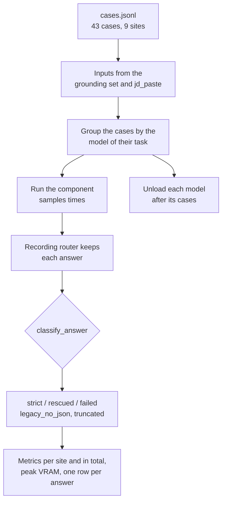

# MH-2: The `structured` eval suite and its fixed set

## Apply with the runner

The handoff runner applies this file: it writes the fixed set and the test file, runs the red command (it must fail), writes the suite, makes three edits in the suite registry, runs the "Done when" checks (they must pass), and commits. See `docs/handoff-runner.md`.

Apply this handoff (WSL, from `apps/backend-py`):

```bash
.venv/bin/python scripts/run_handoff.py ../../tasks/active/step-3-7-structured-output/mh-2-structured-suite.md
```

## Why

Step 3.7 measures the parse-failure rate of the 9 JSON call sites before and after the change (MH-3 to MH-7). This suite is the instrument for both runs. It runs the real component of each call site on fixed synthetic inputs, records each LLM answer, and checks the answer against the call site's output model from MH-1.



- `strict`: the whole answer is one JSON object that matches the model. `rescued`: only the text from the first `{` to the last `}` (what the old regex took) matches. `failed`: neither. `legacy_no_json`: the old parsing found no JSON object, so the component used its fallback.
- A prompt with at least 98% of the model's context length (`/api/ps`) counts as truncated.
- The suite turns the router's response cache off, so each of the 3 samples is a new answer. It loads one model at a time and unloads it after its cases. It records the peak GPU memory (`nvidia-smi`) and the calls that did not reach Ollama.
- The 43 cases use the grounding set's 3 synthetic profiles, jobs, and letters, and the 4 pasted JDs in `tests/fixtures/jd_paste/`. The cover letter validation cases use clean letters only, because a letter with a rule-based hard fail does not reach the LLM.
- The suite needs Ollama, so it runs locally (`python main.py eval structured`). Its unit tests use a fake `generate` and run in CI.

## Files

- `apps/backend-py/tests/fixtures/eval/structured/cases.jsonl` (new)
- `apps/backend-py/tests/unit/test_structured_suite.py` (new)
- `apps/backend-py/src/evaluation/suites/structured.py` (new)
- `apps/backend-py/src/evaluation/suites/__init__.py` (change)
- `apps/backend-py/tests/unit/test_scam_suite.py` (change: its registry test lists the suite names exactly)

## Step 1: add the fixed set and the test file, run the tests, and see them fail

```text new=apps/backend-py/tests/fixtures/eval/structured/cases.jsonl
{"case_id": "selection__ledger_hours", "site": "selection", "grounding_case": "clean__ledger_hours"}
{"case_id": "selection__query_story", "site": "selection", "grounding_case": "clean__query_story"}
{"case_id": "selection__atlas_search", "site": "selection", "grounding_case": "clean__atlas_search"}
{"case_id": "selection__finch_tuning", "site": "selection", "grounding_case": "clean__finch_tuning"}
{"case_id": "selection__harbor_tests", "site": "selection", "grounding_case": "clean__harbor_tests"}
{"case_id": "resume_writing__docker_handoff", "site": "resume_writing", "grounding_case": "clean__docker_handoff"}
{"case_id": "resume_writing__ledger_hours", "site": "resume_writing", "grounding_case": "clean__ledger_hours"}
{"case_id": "resume_writing__eval_sets", "site": "resume_writing", "grounding_case": "clean__eval_sets"}
{"case_id": "resume_writing__atlas_search", "site": "resume_writing", "grounding_case": "clean__atlas_search"}
{"case_id": "resume_writing__cedar_forms", "site": "resume_writing", "grounding_case": "clean__cedar_forms"}
{"case_id": "resume_validation__query_story", "site": "resume_validation", "grounding_case": "clean__query_story"}
{"case_id": "resume_validation__docker_handoff", "site": "resume_validation", "grounding_case": "clean__docker_handoff"}
{"case_id": "resume_validation__finch_tuning", "site": "resume_validation", "grounding_case": "clean__finch_tuning"}
{"case_id": "resume_validation__harbor_tests", "site": "resume_validation", "grounding_case": "clean__harbor_tests"}
{"case_id": "resume_validation__campus_queue", "site": "resume_validation", "grounding_case": "clean__campus_queue"}
{"case_id": "resume_analysis__general_backend", "site": "resume_analysis", "mode": "general", "profile_id": "backend"}
{"case_id": "resume_analysis__general_ml", "site": "resume_analysis", "mode": "general", "profile_id": "ml"}
{"case_id": "resume_analysis__general_grad", "site": "resume_analysis", "mode": "general", "profile_id": "grad"}
{"case_id": "resume_analysis__job_ledger_hours", "site": "resume_analysis", "mode": "job_specific", "grounding_case": "clean__ledger_hours"}
{"case_id": "resume_analysis__job_eval_sets", "site": "resume_analysis", "mode": "job_specific", "grounding_case": "clean__eval_sets"}
{"case_id": "cover_letter_review__ledger_hours", "site": "cover_letter_review", "grounding_case": "clean__ledger_hours"}
{"case_id": "cover_letter_review__aws", "site": "cover_letter_review", "grounding_case": "fabricated_technology__aws"}
{"case_id": "cover_letter_review__atlas_search", "site": "cover_letter_review", "grounding_case": "clean__atlas_search"}
{"case_id": "cover_letter_review__gcp", "site": "cover_letter_review", "grounding_case": "fabricated_technology__gcp"}
{"case_id": "cover_letter_review__harbor_tests", "site": "cover_letter_review", "grounding_case": "clean__harbor_tests"}
{"case_id": "cover_letter_validation__query_story", "site": "cover_letter_validation", "grounding_case": "clean__query_story"}
{"case_id": "cover_letter_validation__bridge_validation", "site": "cover_letter_validation", "grounding_case": "clean__bridge_validation"}
{"case_id": "cover_letter_validation__finch_tuning", "site": "cover_letter_validation", "grounding_case": "clean__finch_tuning"}
{"case_id": "cover_letter_validation__precision_gain", "site": "cover_letter_validation", "grounding_case": "clean__precision_gain"}
{"case_id": "cover_letter_validation__cedar_forms", "site": "cover_letter_validation", "grounding_case": "clean__cedar_forms"}
{"case_id": "resume_parsing__backend", "site": "resume_parsing", "profile_id": "backend"}
{"case_id": "resume_parsing__ml", "site": "resume_parsing", "profile_id": "ml"}
{"case_id": "resume_parsing__grad", "site": "resume_parsing", "profile_id": "grad"}
{"case_id": "jd_extraction__greenhouse_midcut", "site": "jd_extraction", "text_file": "jd_paste/greenhouse_midcut.txt"}
{"case_id": "jd_extraction__html_greenhouse_crumbs", "site": "jd_extraction", "text_file": "jd_paste/html_greenhouse_crumbs.txt"}
{"case_id": "jd_extraction__linkedin_highlight", "site": "jd_extraction", "text_file": "jd_paste/linkedin_highlight.txt"}
{"case_id": "jd_extraction__prose_no_headers", "site": "jd_extraction", "text_file": "jd_paste/prose_no_headers.txt"}
{"case_id": "jd_extraction__job_eval_sets", "site": "jd_extraction", "grounding_case": "clean__eval_sets"}
{"case_id": "job_classification__ledger_hours", "site": "job_classification", "grounding_case": "clean__ledger_hours"}
{"case_id": "job_classification__docker_handoff", "site": "job_classification", "grounding_case": "clean__docker_handoff"}
{"case_id": "job_classification__atlas_search", "site": "job_classification", "grounding_case": "clean__atlas_search"}
{"case_id": "job_classification__eval_sets", "site": "job_classification", "grounding_case": "clean__eval_sets"}
{"case_id": "job_classification__harbor_tests", "site": "job_classification", "grounding_case": "clean__harbor_tests"}
```

```python new=apps/backend-py/tests/unit/test_structured_suite.py
"""Tests for the structured-output eval suite (Step 3.7, MH-2)."""

import json
from collections import Counter
from pathlib import Path
from typing import Any, Callable, Dict, List

import pytest

import src.evaluation.suites.structured as structured_module
from src.evaluation.datasets import load_jsonl
from src.evaluation.suites import SUITE_NAMES, get_suite
from src.evaluation.suites.structured import (
    DEFAULT_DATASET_DIR,
    RecordingRouter,
    StructuredCase,
    check_references,
    classify_answer,
    fixed_resume,
    fixed_selection,
    load_suite_data,
    render_job_text,
    render_resume_text,
    run_structured_suite,
    skill_names,
)
from src.llm.base import LLMResponse
from src.llm.router import LLMRouter, TaskType
from src.llm.structured import OUTPUT_MODELS, CoverLetterReviewAnswer
from src.models.job_listing import JobListing

VALID: Dict[TaskType, Dict[str, Any]] = {
    TaskType.SELECTION: {
        "selected_projects": [{"name": "Ledger", "reason": "Payments work"}],
        "keywords_to_emphasize": ["Python"],
        "key_achievements": ["Cut batch time by half"],
        "summary_suggestion": "Backend engineer.",
    },
    TaskType.RESUME_WRITING: {
        "summary": "Backend engineer.",
        "skills": ["Python"],
        "experience": [
            {"title": "Engineer", "company": "Acme", "dates": "2024", "highlights": []}
        ],
        "projects": [
            {
                "name": "Ledger",
                "description": "A ledger.",
                "technologies": ["Python"],
                "highlights": [],
            }
        ],
        "education": [{"degree": "BSc", "school": "NUS", "year": "2025"}],
    },
    TaskType.VALIDATION: {
        "is_valid": True,
        "missing_projects": [],
        "missing_keywords": [],
        "fabricated_content": [],
        "date_inconsistencies": [],
        "overall_score": 80,
        "recommendation": "approve",
        "structure_score": 80,
        "content_score": 80,
        "tone_score": 80,
        "issues": [],
    },
    TaskType.RESUME_ANALYSIS: {
        "overall_score": 70,
        "summary": "Solid.",
        "key_strengths": ["Python"],
        "key_improvements": ["Metrics"],
        "resume_improvements": [],
        "skill_gaps": [],
        "next_steps": [],
    },
    TaskType.COVER_LETTER_REVIEW: {"critique": "Fine.", "rewrite_needed": False},
    TaskType.RESUME_PARSING: {
        "basics": {
            "name": "Mara Chen",
            "email": None,
            "phone": None,
            "location": "Singapore, Singapore",
            "linkedin": None,
            "github": None,
        },
        "summary": None,
        "skills": {
            "programming_languages": ["Python"],
            "frameworks": [],
            "tools": [],
            "databases": [],
            "cloud": [],
            "domains": [],
        },
        "experience": [],
        "projects": [],
        "education": [],
        "certifications": [],
        "target_job": {
            "keywords": ["Software Engineer"],
            "locations": ["Singapore"],
            "experience_levels": ["Entry Level"],
            "remote_preference": None,
            "industries": [],
        },
        "apprenticeship": None,
    },
    TaskType.JD_EXTRACTION: {
        "title": "Backend Engineer",
        "company": "Acme",
        "location": "Singapore",
        "requirements": [],
        "responsibilities": [],
        "skills": ["Python"],
        "experience_level": "Mid",
        "salary_range": None,
    },
    TaskType.CLASSIFICATION: {
        "industry": "Technology",
        "role_category": "Engineering",
        "company_size": "Unknown",
        "company_stage": None,
        "work_pace": "Unknown",
        "team_structure": "Unknown",
        "technical_skills": [],
        "soft_skills": [],
        "domain_skills": [],
        "experience_level_confidence": 0.5,
        "actual_experience_years": None,
        "management_level": None,
        "impact_scope": None,
        "classification_confidence": 0.5,
        "tags": [],
        "red_flags": [],
    },
}

CASES = load_jsonl(DEFAULT_DATASET_DIR / "cases.jsonl", StructuredCase)
SITE_COUNTS = Counter(case.site for case in CASES)


def make_router(
    monkeypatch: pytest.MonkeyPatch,
    answer: Callable[[TaskType], str],
    prompt_tokens: int = 50,
) -> LLMRouter:
    """
    Build a router whose ``generate`` returns a fixed answer per task type.

    Args:
        monkeypatch: The pytest monkeypatch fixture.
        answer: Gives the answer text for a task type.
        prompt_tokens: The prompt token count of each answer.

    Returns:
        A router with the default routes and a fake ``generate``.
    """
    router = LLMRouter()

    def generate(
        messages: List[Any],
        task_type: TaskType = TaskType.GENERAL,
        model: Any = None,
        **kwargs: Any,
    ) -> LLMResponse:
        """
        Return the fixed answer of the task type.

        Args:
            messages: Not used.
            task_type: The task type.
            model: Not used.
            **kwargs: Not used.

        Returns:
            The answer.
        """
        return LLMResponse(
            content=answer(task_type),
            model=router.resolve_primary_model(task_type)[1],
            provider="ollama",
            prompt_tokens=prompt_tokens,
            completion_tokens=10,
        )

    monkeypatch.setattr(router, "generate", generate)
    return router


def run(router: LLMRouter, **kwargs: Any) -> Any:
    """
    Run the suite with fake probes.

    Args:
        router: The fake router.
        **kwargs: Other suite arguments.

    Returns:
        The report.
    """
    options: Dict[str, Any] = {
        "samples": 1,
        "unload": lambda router, model: None,
        "context_probe": lambda router, model: 4096,
        "vram_probe": lambda: 1000,
    }
    options.update(kwargs)
    return run_structured_suite(DEFAULT_DATASET_DIR, router=router, **options)


def test_committed_set_covers_each_site_with_existing_inputs() -> None:
    """Each of the 9 sites has at least 3 cases, and every input exists."""
    assert set(SITE_COUNTS) == set(OUTPUT_MODELS)
    assert min(SITE_COUNTS.values()) >= 3
    assert len({case.case_id for case in CASES}) == len(CASES)
    check_references(CASES, load_suite_data())


@pytest.mark.parametrize(
    "case",
    [
        {"case_id": "translation__x", "site": "translation", "grounding_case": "a"},
        {"case_id": "x__y", "site": "selection", "grounding_case": "a"},
        {"case_id": "selection__x", "site": "selection"},
        {"case_id": "resume_parsing__x", "site": "resume_parsing"},
        {
            "case_id": "jd_extraction__x",
            "site": "jd_extraction",
            "text_file": "a.txt",
            "grounding_case": "a",
        },
        {"case_id": "jd_extraction__x", "site": "jd_extraction"},
        {
            "case_id": "resume_analysis__x",
            "site": "resume_analysis",
            "mode": "general",
            "grounding_case": "a",
        },
        {
            "case_id": "resume_analysis__x",
            "site": "resume_analysis",
            "mode": "job_specific",
            "profile_id": "backend",
        },
    ],
)
def test_case_rules(case: Dict[str, Any]) -> None:
    """A case needs a known site, a matching ID, and the inputs of its site."""
    with pytest.raises(ValueError):
        StructuredCase.model_validate(case)


def test_check_references_finds_a_missing_input() -> None:
    """A case that names a missing grounding case is refused."""
    bad = StructuredCase(
        case_id="selection__x", site="selection", grounding_case="no__such_case"
    )

    with pytest.raises(ValueError, match="unknown grounding case"):
        check_references([bad], load_suite_data())


REVIEW = json.dumps(VALID[TaskType.COVER_LETTER_REVIEW])


@pytest.mark.parametrize(
    "content, expected",
    [
        (REVIEW, ("strict", None, False)),
        ("Sure: " + REVIEW + " Done.", ("rescued", "not_json", False)),
        ("I cannot help with that.", ("failed", "not_json", True)),
        ('Sure: {"critique": "x"} Done.', ("failed", "not_json", False)),
        ('{"critique": "x"}', ("failed", "schema", False)),
        ("Sure: {critique} Done.", ("failed", "not_json", True)),
        ("[" + REVIEW + "]", ("rescued", "not_object", False)),
    ],
)
def test_classify_answer(content: str, expected: tuple) -> None:
    """Strict, rescued, and failed answers, with the old parsing's result."""
    assert classify_answer(content, CoverLetterReviewAnswer) == expected


def test_valid_answers_are_strict_for_every_site(
    monkeypatch: pytest.MonkeyPatch,
) -> None:
    """Valid JSON answers give a strict rate of 1.0 at each site."""
    router = make_router(monkeypatch, lambda task: json.dumps(VALID[task]))

    report = run(router, samples=2)

    for site, count in SITE_COUNTS.items():
        assert report.metrics[f"calls.{site}"] == 2 * count
        assert report.metrics[f"strict_rate.{site}"] == 1.0
        assert report.metrics[f"failed_rate.{site}"] == 0.0
        assert report.metrics[f"no_call.{site}"] == 0.0
    assert report.metrics["calls"] == 2 * len(CASES)
    assert report.metrics["peak_vram_mib"] == 1000.0
    assert report.metrics["non_local_calls"] == 0.0
    assert report.metadata.case_count == len(CASES)
    assert all(row["content"] is None for row in report.details["rows"])


def test_text_around_the_json_is_rescued(monkeypatch: pytest.MonkeyPatch) -> None:
    """Prose around a valid object counts as rescued, not strict."""
    router = make_router(
        monkeypatch, lambda task: "Here it is:\n" + json.dumps(VALID[task]) + "\nOK"
    )

    report = run(router)

    assert report.metrics["rescued_rate"] == 1.0
    assert report.metrics["strict_rate"] == 0.0
    assert report.metrics["legacy_no_json_rate"] == 0.0


def test_answers_without_json_fail(monkeypatch: pytest.MonkeyPatch) -> None:
    """An answer without JSON fails, and the old parsing found nothing."""
    router = make_router(monkeypatch, lambda task: "I cannot help with that.")

    report = run(router)

    assert report.metrics["failed_rate"] == 1.0
    assert report.metrics["legacy_no_json_rate"] == 1.0
    sites = report.details["sites"]
    assert sites["selection"]["reasons"] == {"not_json": SITE_COUNTS["selection"]}
    failed = report.details["rows"][0]
    assert failed["content"] == "I cannot help with that."


def test_full_prompts_count_as_truncated(monkeypatch: pytest.MonkeyPatch) -> None:
    """A prompt at 98% of the context length or more counts as truncated."""
    router = make_router(
        monkeypatch, lambda task: json.dumps(VALID[task]), prompt_tokens=98
    )

    full = run(router, context_probe=lambda router, model: 100)
    roomy = run(router, context_probe=lambda router, model: 200)

    assert full.metrics["truncated"] == float(len(CASES))
    assert roomy.metrics["truncated"] == 0.0


def test_each_model_is_unloaded_once_after_its_cases(
    monkeypatch: pytest.MonkeyPatch,
) -> None:
    """The suite runs the cases model by model and unloads each model once."""
    router = make_router(monkeypatch, lambda task: json.dumps(VALID[task]))
    unloaded: List[str] = []

    report = run(router, unload=lambda router, model: unloaded.append(model))

    models = [row["group_model"] for row in report.details["rows"]]
    assert unloaded == sorted(set(models))
    assert models == sorted(models)


def test_the_peak_vram_is_the_highest_reading(
    monkeypatch: pytest.MonkeyPatch,
) -> None:
    """The report keeps the highest GPU memory reading of the run."""
    router = make_router(monkeypatch, lambda task: json.dumps(VALID[task]))
    readings = iter([700, 2500, 900] + [800] * len(CASES))

    report = run(router, vram_probe=lambda: next(readings))

    assert report.metrics["peak_vram_mib"] == 2500.0


def test_only_the_sites_task_type_counts(monkeypatch: pytest.MonkeyPatch) -> None:
    """A call of another task type in the same case is not counted for the site."""
    router = make_router(monkeypatch, lambda task: "not JSON")
    real_run_case = structured_module.run_case

    def run_case_with_extra_call(case: Any, data: Any, recorder: Any) -> None:
        """
        Make one unrelated call, then run the case.

        Args:
            case: The case.
            data: The grounding data.
            recorder: The recording router.
        """
        recorder.generate([], task_type=TaskType.GENERAL)
        real_run_case(case, data, recorder)

    monkeypatch.setattr(structured_module, "run_case", run_case_with_extra_call)

    report = run(router)

    assert report.metrics["calls"] == float(len(CASES))


def test_run_refuses_a_missing_input(
    tmp_path: Path, monkeypatch: pytest.MonkeyPatch
) -> None:
    """A case that names a missing input stops the run before any call."""
    (tmp_path / "cases.jsonl").write_text(
        json.dumps(
            {
                "case_id": "selection__x",
                "site": "selection",
                "grounding_case": "no__such_case",
            }
        )
        + "\n",
        encoding="utf-8",
    )
    router = make_router(monkeypatch, lambda task: REVIEW)

    with pytest.raises(ValueError, match="unknown grounding case"):
        run_structured_suite(tmp_path, router=router, samples=1)


def test_a_router_error_gives_no_call(monkeypatch: pytest.MonkeyPatch) -> None:
    """When no answer comes back, the case counts as no_call, not as a parse result."""

    def broken(task: TaskType) -> str:
        """
        Fail like an unreachable Ollama.

        Args:
            task: Not used.

        Raises:
            RuntimeError: Always.
        """
        raise RuntimeError("Ollama is not running")

    report = run(make_router(monkeypatch, broken))

    assert report.metrics["calls"] == 0.0
    assert report.metrics["no_call"] == float(len(CASES))
    assert report.metrics["strict_rate"] is None


def test_recording_router_records_and_delegates(
    monkeypatch: pytest.MonkeyPatch,
) -> None:
    """The recorder keeps each answer and gives the router's other attributes."""
    router = make_router(monkeypatch, lambda task: REVIEW)
    recorder = RecordingRouter(router)

    recorder.generate([], task_type=TaskType.COVER_LETTER_REVIEW)

    assert recorder.routes is router.routes
    assert recorder.calls[0].task_type == "cover_letter_review"
    assert recorder.calls[0].content == REVIEW
    assert recorder.calls[0].provider == "ollama"


def test_fixed_inputs_use_only_profile_facts() -> None:
    """The fixed selection, resume, and texts come from the grounding data."""
    data = load_suite_data()
    case = data.grounding["clean__ledger_hours"]
    profile = data.profiles[case.profile_id]
    job = JobListing.model_validate(case.job)

    selection = fixed_selection(profile, job)
    resume = fixed_resume(profile, selection)
    resume_text = render_resume_text(profile)

    profile_projects = {project.name for project in profile.projects}
    job_text = " ".join(
        [job.title, job.description or "", *(skill.name for skill in job.skills)]
    ).lower()
    assert 0 < len(selection.selected_projects) <= 3
    assert {p["name"] for p in selection.selected_projects} <= profile_projects
    assert set(selection.keywords_to_emphasize) <= set(skill_names(profile))
    assert all(k.lower() in job_text for k in selection.keywords_to_emphasize)
    assert {p["name"] for p in resume.projects} <= profile_projects
    assert profile.name in resume_text
    assert all(name in resume_text for name in profile_projects)
    assert job.title in render_job_text(job)


def test_the_suite_is_registered() -> None:
    """``main.py eval structured`` finds the suite and its default set."""
    runner, dataset = get_suite("structured")

    assert "structured" in SUITE_NAMES
    assert runner is run_structured_suite
    assert dataset == DEFAULT_DATASET_DIR
```

Run the tests. They must fail (the suite does not exist yet):

```bash red cwd=apps/backend-py
.venv/bin/python -m pytest tests/unit/test_structured_suite.py -q
```

## Step 2: add the suite

```python new=apps/backend-py/src/evaluation/suites/structured.py
"""
Structured-output eval suite (Step 3.7).

Runs the real component of each JSON call site on a fixed set of synthetic
inputs, with a router that records each LLM answer, and checks each answer
against the call site's output model (``src/llm/structured.py``):

- ``strict``: the whole answer is one JSON object that matches the model;
- ``rescued``: only the text from the first ``{`` to the last ``}`` (what
  the old regex took) is a JSON object that matches the model;
- ``failed``: neither.

It also counts the answers in which the old parsing found no JSON object
(the component then used its fallback), the prompts that filled the
context, the peak GPU memory, and the calls that did not reach Ollama.
The suite needs Ollama, so it runs locally, not in CI. It loads one model
at a time and unloads each model after its cases.

A dataset folder has ``cases.jsonl``. The cases refer to the grounding set
(profiles, jobs, and letters) and to text files under ``tests/fixtures``.
"""

from __future__ import annotations

import json
import statistics
import subprocess
import time
from dataclasses import dataclass
from itertools import groupby
from pathlib import Path
from typing import Any, Callable, Dict, List, Literal, Optional, Tuple

import requests
from pydantic import BaseModel, model_validator

from ...classifiers.job_classifier import JobClassifier
from ...extractors.jd_extractor import JDExtractor
from ...extractors.resume_parser import ResumeParser
from ...generation.cover_letter_reviewer import CoverLetterReviewer
from ...generation.cover_letter_validator import CoverLetterValidator
from ...generation.cover_letter_writer import GeneratedCoverLetter
from ...generation.resume_analyzer import ResumeAnalyzer
from ...generation.resume_writer import GeneratedResume, ResumeWriter
from ...generation.selector import ResumeSelector, SelectionOutput
from ...generation.validator import ResumeValidator
from ...llm.router import TaskType
from ...llm.structured import (
    OUTPUT_MODELS,
    StructuredOutputError,
    extract_braced_object,
    parse_structured,
)
from ...models.job_listing import JobListing
from ...models.user_profile import UserProfile
from ..datasets import load_jsonl
from ..report import EvalReport
from ..run_metadata import BACKEND_DIR, build_run_metadata
from .grounding import DEFAULT_DATASET_DIR as GROUNDING_DIR
from .grounding import GroundingCase

SUITE = "structured"
DEFAULT_DATASET_DIR = BACKEND_DIR / "tests" / "fixtures" / "eval" / "structured"
FIXTURES_DIR = BACKEND_DIR / "tests" / "fixtures"
DEFAULT_SAMPLES = 3
TRUNCATION_SHARE = 0.98
MAX_CONTENT_CHARS = 2000

SITE_TASK_TYPES: Dict[str, TaskType] = {
    "selection": TaskType.SELECTION,
    "resume_writing": TaskType.RESUME_WRITING,
    "resume_validation": TaskType.VALIDATION,
    "resume_analysis": TaskType.RESUME_ANALYSIS,
    "cover_letter_review": TaskType.COVER_LETTER_REVIEW,
    "cover_letter_validation": TaskType.VALIDATION,
    "resume_parsing": TaskType.RESUME_PARSING,
    "jd_extraction": TaskType.JD_EXTRACTION,
    "job_classification": TaskType.CLASSIFICATION,
}

UnloadFn = Callable[[Any, str], None]
ContextProbe = Callable[[Any, str], Optional[int]]
VramProbe = Callable[[], Optional[int]]


class StructuredCase(BaseModel):
    """One input of the fixed set, for one call site."""

    case_id: str
    site: str
    grounding_case: Optional[str] = None
    profile_id: Optional[str] = None
    text_file: Optional[str] = None
    mode: Optional[Literal["general", "job_specific"]] = None

    @model_validator(mode="after")
    def _check_inputs(self) -> "StructuredCase":
        """
        Require a known site, a matching case ID, and the site's inputs.

        Returns:
            The case.

        Raises:
            ValueError: When the site is unknown, the case ID does not start
                with ``<site>__``, or the inputs do not fit the site.
        """
        if self.site not in OUTPUT_MODELS:
            raise ValueError(f"{self.case_id}: unknown site {self.site!r}")
        if not self.case_id.startswith(f"{self.site}__"):
            raise ValueError(f"{self.case_id}: the case ID must start with the site")
        if self.site == "resume_parsing":
            ok = self.profile_id is not None
        elif self.site == "jd_extraction":
            ok = (self.text_file is None) != (self.grounding_case is None)
        elif self.site == "resume_analysis":
            ok = (self.mode == "general" and self.profile_id is not None) or (
                self.mode == "job_specific" and self.grounding_case is not None
            )
        else:
            ok = self.grounding_case is not None
        if not ok:
            raise ValueError(f"{self.case_id}: wrong inputs for site {self.site}")
        return self


@dataclass
class RecordedCall:
    """One LLM answer that the recording router saw."""

    task_type: str
    content: str
    model: Optional[str]
    provider: Optional[str]
    prompt_tokens: Optional[int]
    completion_tokens: Optional[int]
    latency_ms: float
    cached: bool


class RecordingRouter:
    """Router wrapper that keeps each answer; other attributes come from the router."""

    def __init__(self, router: Any) -> None:
        """
        Wrap a router.

        Args:
            router: The real (or fake) LLM router.
        """
        self._router = router
        self.calls: List[RecordedCall] = []

    def generate(
        self,
        messages: List[Any],
        task_type: TaskType = TaskType.GENERAL,
        model: Optional[str] = None,
        **kwargs: Any,
    ) -> Any:
        """
        Call the wrapped router and record its answer.

        Args:
            messages: The messages of the call.
            task_type: The task type of the call.
            model: Optional model override.
            **kwargs: Other generation arguments.

        Returns:
            The wrapped router's response.
        """
        started = time.perf_counter()
        response = self._router.generate(
            messages, task_type=task_type, model=model, **kwargs
        )
        self.calls.append(
            RecordedCall(
                task_type=task_type.value,
                content=str(response.content or ""),
                model=getattr(response, "model", None),
                provider=getattr(response, "provider", None),
                prompt_tokens=getattr(response, "prompt_tokens", None),
                completion_tokens=getattr(response, "completion_tokens", None),
                latency_ms=(time.perf_counter() - started) * 1000,
                cached=bool(getattr(response, "cached", False)),
            )
        )
        return response

    def __getattr__(self, name: str) -> Any:
        """
        Give the wrapped router's attribute (``routes``, ``resolve_primary_model``).

        Args:
            name: Attribute name.

        Returns:
            The attribute of the wrapped router.
        """
        return getattr(self._router, name)


@dataclass
class SuiteData:
    """The grounding profiles and cases that the fixed set refers to."""

    profiles: Dict[str, UserProfile]
    grounding: Dict[str, GroundingCase]


@dataclass
class CallRow:
    """The outcome of one sample of one case."""

    case_id: str
    site: str
    sample: int
    group_model: str
    outcome: str
    reason: Optional[str] = None
    legacy_no_json: bool = False
    model: Optional[str] = None
    provider: Optional[str] = None
    prompt_tokens: Optional[int] = None
    completion_tokens: Optional[int] = None
    latency_ms: Optional[float] = None
    cached: bool = False
    truncated: bool = False
    error: Optional[str] = None
    content: Optional[str] = None


def classify_answer(
    content: str, model: type[BaseModel]
) -> Tuple[str, Optional[str], bool]:
    """
    Check one answer against its output model.

    Args:
        content: The raw LLM answer.
        model: The call site's output model.

    Returns:
        ``(outcome, reason, legacy_no_json)``: the outcome is ``strict``,
        ``rescued``, or ``failed``; the reason is the strict parser's reason
        (``None`` for ``strict``); ``legacy_no_json`` is true when the old
        parsing found no JSON object.
    """
    try:
        parse_structured(content, model)
        return "strict", None, False
    except StructuredOutputError as exc:
        reason = exc.reason
    braced = extract_braced_object(content)
    if braced is None:
        return "failed", reason, True
    try:
        legacy = json.loads(braced)
    except json.JSONDecodeError:
        return "failed", reason, True
    try:
        model.model_validate(legacy)
    except ValueError:
        return "failed", reason, False
    return "rescued", reason, False


def skill_names(profile: UserProfile) -> List[str]:
    """
    List the profile's skill names in order, without duplicates.

    Args:
        profile: The profile.

    Returns:
        Core skills first, then the other skills.
    """
    names: List[str] = []
    for name in [*profile.core_skills, *(skill.name for skill in profile.skills)]:
        if name and name.lower() not in {known.lower() for known in names}:
            names.append(name)
    return names


def fixed_selection(profile: UserProfile, job: JobListing) -> SelectionOutput:
    """
    A fixed selection for the steps after selection.

    Args:
        profile: The profile.
        job: The job.

    Returns:
        The first 3 profile projects, up to 5 profile skills that the job
        text names, and the first highlight of each selected project.
    """
    job_skills = " ".join(skill.name for skill in job.skills)
    job_text = " ".join([job.title, job.description or "", job_skills]).lower()
    projects = profile.projects[:3]
    keywords = [name for name in skill_names(profile) if name.lower() in job_text]
    return SelectionOutput(
        selected_projects=[
            {"name": project.name, "reason": "Fixed selection for the eval set."}
            for project in projects
        ],
        keywords_to_emphasize=keywords[:5],
        key_achievements=[p.highlights[0] for p in projects if p.highlights],
        summary_suggestion=profile.summary or "",
        raw_response="",
    )


def _dates(start: Any, end: Any, current: bool = False) -> str:
    """
    Format a date range as ``Mon YYYY - Mon YYYY``.

    Args:
        start: Start date or ``None``.
        end: End date or ``None``.
        current: Whether the entry has no end.

    Returns:
        The formatted range.
    """
    first = start.strftime("%b %Y") if start else ""
    last = "Present" if current or end is None else end.strftime("%b %Y")
    return f"{first} - {last}".strip(" -")


def fixed_resume(profile: UserProfile, selection: SelectionOutput) -> GeneratedResume:
    """
    A resume made only from profile facts, for the LLM resume validation.

    Args:
        profile: The profile.
        selection: The fixed selection.

    Returns:
        A resume with the profile's summary, skills, experience, selected
        projects, and education.
    """
    chosen = {item["name"] for item in selection.selected_projects}
    return GeneratedResume(
        summary=profile.summary or "",
        skills=skill_names(profile)[:12],
        experience=[
            {
                "title": item.title,
                "company": item.company,
                "dates": _dates(item.start_date, item.end_date, item.current),
                "highlights": list(item.highlights),
            }
            for item in profile.experience
        ],
        projects=[
            {
                "name": item.name,
                "description": item.description,
                "technologies": list(item.technologies),
                "highlights": list(item.highlights),
            }
            for item in profile.projects
            if item.name in chosen
        ],
        education=[
            {
                "degree": item.degree,
                "school": item.school,
                "year": str(item.end_date.year) if item.end_date else "",
            }
            for item in profile.education
        ],
        raw_response="",
        model_used="eval-fixture",
    )


def render_resume_text(profile: UserProfile) -> str:
    """
    Write a profile as plain resume text, the input of the resume parser.

    Args:
        profile: The profile.

    Returns:
        The resume text.
    """
    lines = [profile.name, profile.contact.location, str(profile.contact.email)]
    if profile.summary:
        lines += ["", "SUMMARY", profile.summary]
    lines += ["", "TECHNICAL SKILLS", ", ".join(skill_names(profile))]
    if profile.experience:
        lines += ["", "EXPERIENCE"]
        for item in profile.experience:
            lines += [
                f"{item.title} - {item.company}",
                _dates(item.start_date, item.end_date, item.current),
            ]
            lines += [f"- {text}" for text in item.highlights]
    if profile.projects:
        lines += ["", "PROJECTS"]
        for project in profile.projects:
            lines += [f"{project.name}: {project.description}"]
            if project.technologies:
                lines += [f"Tech: {', '.join(project.technologies)}"]
            lines += [f"- {text}" for text in project.highlights]
    if profile.education:
        lines += ["", "EDUCATION"]
        for school in profile.education:
            lines += [
                f"{school.degree}, {school.school}",
                _dates(school.start_date, school.end_date),
            ]
    return "\n".join(lines) + "\n"


def render_job_text(job: JobListing) -> str:
    """
    Write a job as pasted posting text, the input of the JD extractor.

    Args:
        job: The job.

    Returns:
        The posting text.
    """
    lines = [job.title, f"{job.company} - {job.location or 'Singapore'}", ""]
    lines += [job.description or ""]
    if job.skills:
        lines += ["", "Skills: " + ", ".join(skill.name for skill in job.skills)]
    return "\n".join(lines) + "\n"


def load_suite_data(grounding_dir: Path = GROUNDING_DIR) -> SuiteData:
    """
    Load the grounding profiles and cases.

    Args:
        grounding_dir: The grounding dataset folder.

    Returns:
        Profiles and cases by ID.
    """
    raw = json.loads((grounding_dir / "profiles.json").read_text(encoding="utf-8"))
    profiles = {pid: UserProfile.model_validate(data) for pid, data in raw.items()}
    cases = load_jsonl(grounding_dir / "cases.jsonl", GroundingCase)
    return SuiteData(profiles=profiles, grounding={c.case_id: c for c in cases})


def check_references(cases: List[StructuredCase], data: SuiteData) -> None:
    """
    Check that each case refers to an existing input.

    Args:
        cases: The fixed set.
        data: The grounding data.

    Raises:
        ValueError: When a case names a missing grounding case, profile, or file.
    """
    for case in cases:
        if case.grounding_case and case.grounding_case not in data.grounding:
            raise ValueError(f"{case.case_id}: unknown grounding case")
        if case.profile_id and case.profile_id not in data.profiles:
            raise ValueError(f"{case.case_id}: unknown profile")
        if case.text_file and not (FIXTURES_DIR / case.text_file).is_file():
            raise ValueError(f"{case.case_id}: missing file {case.text_file}")


def run_case(case: StructuredCase, data: SuiteData, router: Any) -> None:
    """
    Run the call site's component one time on the case's inputs.

    Args:
        case: The case.
        data: The grounding data.
        router: The (recording) router.
    """
    site = case.site
    if site == "resume_parsing":
        assert case.profile_id is not None
        ResumeParser(llm_router=router).parse_text(
            render_resume_text(data.profiles[case.profile_id])
        )
        return
    if site == "jd_extraction" and case.text_file:
        text = (FIXTURES_DIR / case.text_file).read_text(encoding="utf-8")
        JDExtractor(llm_router=router).extract_from_text(text)
        return
    if site == "resume_analysis" and case.mode == "general":
        assert case.profile_id is not None
        ResumeAnalyzer(router).analyze_general(data.profiles[case.profile_id])
        return
    assert case.grounding_case is not None
    grounding = data.grounding[case.grounding_case]
    profile = data.profiles[grounding.profile_id]
    job = JobListing.model_validate(grounding.job)
    if site == "jd_extraction":
        JDExtractor(llm_router=router).extract_from_text(render_job_text(job))
    elif site == "resume_analysis":
        ResumeAnalyzer(router).analyze_job_specific(profile, job)
    elif site == "job_classification":
        JobClassifier(llm_router=router).classify(job, use_llm=True)
    elif site == "selection":
        ResumeSelector(router).select(job, profile)
    else:
        selection = fixed_selection(profile, job)
        letter = GeneratedCoverLetter(
            content=grounding.letter,
            highlighted_experiences=[],
            word_count=len(grounding.letter.split()),
            model_used="eval-fixture",
        )
        if site == "resume_writing":
            ResumeWriter(router).write(job, profile, selection)
        elif site == "resume_validation":
            ResumeValidator(llm_router=router).validate_with_llm(
                fixed_resume(profile, selection), job, profile, selection
            )
        elif site == "cover_letter_review":
            CoverLetterReviewer(router).review(letter, job, profile, selection)
        else:
            CoverLetterValidator(llm_router=router).validate_with_llm(
                letter, job, profile, selection
            )


def ollama_base_url(router: Any, model: str) -> Optional[str]:
    """
    The base URL of the Ollama client that the router uses for a model.

    Args:
        router: The real router.
        model: The model name.

    Returns:
        The base URL, or ``None`` when the router has no Ollama client.
    """
    try:
        return str(router._get_client("ollama", model).base_url)
    except Exception:
        return None


def unload_ollama_model(router: Any, model: str) -> None:
    """
    Unload a model from Ollama (``keep_alive`` 0).

    Args:
        router: The real router.
        model: The model name.
    """
    base_url = ollama_base_url(router, model)
    if base_url is None:
        return
    try:
        requests.post(
            f"{base_url}/api/generate",
            json={"model": model, "keep_alive": 0},
            timeout=60,
        )
    except requests.RequestException:
        pass


def ollama_context_length(router: Any, model: str) -> Optional[int]:
    """
    The context length that Ollama uses for a loaded model (``/api/ps``).

    Args:
        router: The real router.
        model: The model name.

    Returns:
        The context length, or ``None`` when Ollama does not report it.
    """
    base_url = ollama_base_url(router, model)
    if base_url is None:
        return None
    try:
        loaded = requests.get(f"{base_url}/api/ps", timeout=10).json()
    except (requests.RequestException, ValueError):
        return None
    for item in loaded.get("models", []):
        if item.get("name") == model or item.get("model") == model:
            value = item.get("context_length")
            return int(value) if value else None
    return None


def gpu_memory_used_mib() -> Optional[int]:
    """
    The GPU memory in use, from ``nvidia-smi``.

    Returns:
        The used memory in MiB, or ``None`` when ``nvidia-smi`` is missing.
    """
    try:
        output = subprocess.run(
            [
                "nvidia-smi",
                "--query-gpu=memory.used",
                "--format=csv,noheader,nounits",
            ],
            capture_output=True,
            text=True,
            timeout=10,
            check=True,
        ).stdout
        return int(output.split()[0])
    except (OSError, subprocess.SubprocessError, ValueError, IndexError):
        return None


def default_router() -> Any:
    """
    The app's router with local models first and the response cache off.

    Returns:
        A router that follows the saved Settings. The response cache is
        off, so each sample is a new answer.
    """
    from ...llm.router import create_router

    router = create_router(prefer_local=True)
    router._response_cache.enabled = False
    return router


def _rate(count: int, total: int) -> Optional[float]:
    """
    A share, or ``None`` for no data.

    Args:
        count: The count.
        total: The total.

    Returns:
        ``count / total``, or ``None`` when the total is 0.
    """
    return count / total if total else None


def summarize(
    rows: List[CallRow], peak_vram: Optional[int]
) -> Tuple[Dict[str, Optional[float]], Dict[str, Any]]:
    """
    Count the outcomes for each site and in total.

    Args:
        rows: One row for each answer (or missing answer).
        peak_vram: The highest GPU memory use in MiB, or ``None``.

    Returns:
        ``(metrics, per_site)``.
    """
    metrics: Dict[str, Optional[float]] = {}
    per_site: Dict[str, Any] = {}
    groups: List[Tuple[str, List[CallRow]]] = [
        (site, [row for row in rows if row.site == site]) for site in OUTPUT_MODELS
    ]
    groups.append(("", rows))
    for site, site_rows in groups:
        answered = [row for row in site_rows if row.outcome != "no_call"]
        counts = {
            name: sum(1 for row in answered if row.outcome == name)
            for name in ("strict", "rescued", "failed")
        }
        suffix = f".{site}" if site else ""
        total = len(answered)
        metrics[f"calls{suffix}"] = float(total)
        for name, count in counts.items():
            metrics[f"{name}_rate{suffix}"] = _rate(count, total)
        legacy = sum(1 for row in answered if row.legacy_no_json)
        metrics[f"legacy_no_json_rate{suffix}"] = _rate(legacy, total)
        metrics[f"truncated{suffix}"] = float(sum(r.truncated for r in answered))
        metrics[f"no_call{suffix}"] = float(len(site_rows) - total)
        if site:
            reasons: Dict[str, int] = {}
            for row in answered:
                if row.reason:
                    reasons[row.reason] = reasons.get(row.reason, 0) + 1
            latencies = [row.latency_ms for row in answered if row.latency_ms]
            prompts = [row.prompt_tokens for row in answered if row.prompt_tokens]
            per_site[site] = {
                "models": sorted({row.group_model for row in site_rows}),
                "outcomes": counts,
                "reasons": reasons,
                "errors": sum(1 for row in site_rows if row.error),
                "latency_ms_p50": statistics.median(latencies) if latencies else None,
                "prompt_tokens_max": max(prompts) if prompts else None,
            }
    metrics["non_local_calls"] = float(
        sum(1 for row in rows if row.provider not in (None, "ollama"))
    )
    metrics["cached_calls"] = float(sum(1 for row in rows if row.cached))
    metrics["peak_vram_mib"] = float(peak_vram) if peak_vram is not None else None
    return metrics, per_site


def run_structured_suite(
    dataset_dir: Path = DEFAULT_DATASET_DIR,
    *,
    router: Optional[Any] = None,
    samples: int = DEFAULT_SAMPLES,
    unload: Optional[UnloadFn] = None,
    context_probe: Optional[ContextProbe] = None,
    vram_probe: Optional[VramProbe] = None,
    grounding_dir: Path = GROUNDING_DIR,
) -> EvalReport:
    """
    Run each case ``samples`` times and check each answer.

    Args:
        dataset_dir: Folder with ``cases.jsonl``.
        router: Router to use; the default is the app's router with the
            response cache off. Tests pass a fake.
        samples: Runs of each case.
        unload: Unloads a model after its cases (default: Ollama).
        context_probe: Gives a loaded model's context length (default:
            Ollama ``/api/ps``).
        vram_probe: Gives the GPU memory in use (default: ``nvidia-smi``).
        grounding_dir: The grounding set that the cases refer to.

    Returns:
        Report with the outcome rates per site and in total, the truncated
        prompts, the peak GPU memory, and one row for each answer.

    Raises:
        FileNotFoundError: When ``cases.jsonl`` is missing.
        ValueError: When a case is invalid or refers to a missing input.
    """
    cases_path = Path(dataset_dir) / "cases.jsonl"
    if not cases_path.exists():
        raise FileNotFoundError(f"{cases_path} not found")
    cases = load_jsonl(cases_path, StructuredCase)
    data = load_suite_data(grounding_dir)
    check_references(cases, data)

    real_router = router if router is not None else default_router()
    unload_fn = unload or unload_ollama_model
    probe_context = context_probe or ollama_context_length
    probe_vram = vram_probe or gpu_memory_used_mib
    recorder = RecordingRouter(real_router)

    def group_model(case: StructuredCase) -> str:
        """
        The primary model of the case's task type.

        Args:
            case: The case.

        Returns:
            The model name.
        """
        return str(real_router.resolve_primary_model(SITE_TASK_TYPES[case.site])[1])

    ordered = sorted(cases, key=lambda c: (group_model(c), c.site, c.case_id))
    rows: List[CallRow] = []
    context_lengths: Dict[str, Optional[int]] = {}
    peak_vram: Optional[int] = None
    for model_name, group in groupby(ordered, key=group_model):
        for case in group:
            output_model = OUTPUT_MODELS[case.site]
            task_value = SITE_TASK_TYPES[case.site].value
            for sample in range(samples):
                start = len(recorder.calls)
                error = None
                try:
                    run_case(case, data, recorder)
                except Exception as exc:  # noqa: BLE001 - count, then go on
                    error = type(exc).__name__
                calls = [
                    call
                    for call in recorder.calls[start:]
                    if call.task_type == task_value
                ]
                if not calls:
                    rows.append(
                        CallRow(
                            case_id=case.case_id,
                            site=case.site,
                            sample=sample,
                            group_model=model_name,
                            outcome="no_call",
                            error=error,
                        )
                    )
                for call in calls:
                    outcome, reason, legacy = classify_answer(
                        call.content, output_model
                    )
                    rows.append(
                        CallRow(
                            case_id=case.case_id,
                            site=case.site,
                            sample=sample,
                            group_model=model_name,
                            outcome=outcome,
                            reason=reason,
                            legacy_no_json=legacy,
                            model=call.model,
                            provider=call.provider,
                            prompt_tokens=call.prompt_tokens,
                            completion_tokens=call.completion_tokens,
                            latency_ms=round(call.latency_ms, 1),
                            cached=call.cached,
                            error=error,
                            content=(
                                None
                                if outcome == "strict"
                                else call.content[:MAX_CONTENT_CHARS]
                            ),
                        )
                    )
                used = probe_vram()
                if used is not None and (peak_vram is None or used > peak_vram):
                    peak_vram = used
        context_lengths[model_name] = probe_context(real_router, model_name)
        unload_fn(real_router, model_name)

    for row in rows:
        limit = context_lengths.get(row.group_model)
        if limit and row.prompt_tokens:
            row.truncated = row.prompt_tokens >= TRUNCATION_SHARE * limit

    metrics, per_site = summarize(rows, peak_vram)
    files = [cases_path, grounding_dir / "profiles.json", grounding_dir / "cases.jsonl"]
    files += sorted({FIXTURES_DIR / c.text_file for c in cases if c.text_file})
    metadata = build_run_metadata(SUITE, files, len(cases))
    return EvalReport(
        suite=SUITE,
        metadata=metadata,
        metrics=metrics,
        details={
            "samples": samples,
            "context_lengths": context_lengths,
            "sites": per_site,
            "rows": [row.__dict__ for row in rows],
        },
    )
```

## Step 3: register the suite in `src/evaluation/suites/__init__.py`

1. Name the step in the module docstring:

```python edit=apps/backend-py/src/evaluation/suites/__init__.py
<<<<<<< OLD
Step 3.3 adds ``scam`` and ``emscad``. Step 3.5 adds ``dedupe``.
=======
Step 3.3 adds ``scam`` and ``emscad``. Step 3.5 adds ``dedupe``.
Step 3.7 adds ``structured`` (local only; it needs Ollama).
>>>>>>> NEW
```

2. Add the name:

```python edit=apps/backend-py/src/evaluation/suites/__init__.py
<<<<<<< OLD
SUITE_NAMES: Tuple[str, ...] = ("grounding", "scam", "emscad", "dedupe")
=======
SUITE_NAMES: Tuple[str, ...] = (
    "grounding",
    "scam",
    "emscad",
    "dedupe",
    "structured",
)
>>>>>>> NEW
```

3. Return the runner and its default set:

```python edit=apps/backend-py/src/evaluation/suites/__init__.py
<<<<<<< OLD
        return run_dedupe_suite, DEFAULT_DATASET_DIR
    raise KeyError(f"unknown eval suite: {name}")
=======
        return run_dedupe_suite, DEFAULT_DATASET_DIR
    if name == "structured":
        from .structured import DEFAULT_DATASET_DIR, run_structured_suite

        return run_structured_suite, DEFAULT_DATASET_DIR
    raise KeyError(f"unknown eval suite: {name}")
>>>>>>> NEW
```

## Step 4: update the registry test in `tests/unit/test_scam_suite.py`

The registry test compares `SUITE_NAMES` with the exact tuple, so it gets the new name:

```python edit=apps/backend-py/tests/unit/test_scam_suite.py
<<<<<<< OLD
        assert SUITE_NAMES == ("grounding", "scam", "emscad", "dedupe")
=======
        assert SUITE_NAMES == ("grounding", "scam", "emscad", "dedupe", "structured")
>>>>>>> NEW
```

## Done when

Run the new tests:

```bash check cwd=apps/backend-py
.venv/bin/python -m pytest tests/unit/test_structured_suite.py -q
```

Run the other eval tests (the registry changed):

```bash check cwd=apps/backend-py
.venv/bin/python -m pytest tests/unit/test_scam_suite.py tests/unit/test_dedupe_suite.py tests/unit/test_evaluation_harness.py tests/unit/test_cli.py -q
```

Format the changed files:

```bash check cwd=apps/backend-py
.venv/bin/python -m black src/evaluation/suites/structured.py src/evaluation/suites/__init__.py tests/unit/test_structured_suite.py tests/unit/test_scam_suite.py
```

Check the lint:

```bash check cwd=apps/backend-py
.venv/bin/python -m ruff check src/evaluation/suites/structured.py src/evaluation/suites/__init__.py tests/unit/test_structured_suite.py tests/unit/test_scam_suite.py
```

Run the mypy gate (no new errors):

```bash check cwd=apps/backend-py
.venv/bin/python scripts/mypy_gate.py
```

Commit message:

```text commit
feat(eval): add the structured-output eval suite and its fixed set

The structured suite runs the real component of each of the 9 JSON call
sites on 43 synthetic cases, records each LLM answer, and counts strict,
rescued (old regex only), and failed answers per site, the answers
without any JSON, truncated prompts, the peak GPU memory, and non-local
calls. It loads one model at a time and turns the response cache off.
It needs Ollama, so it runs locally; its tests use a fake generate
(Step 3.7, MH-2).
```
