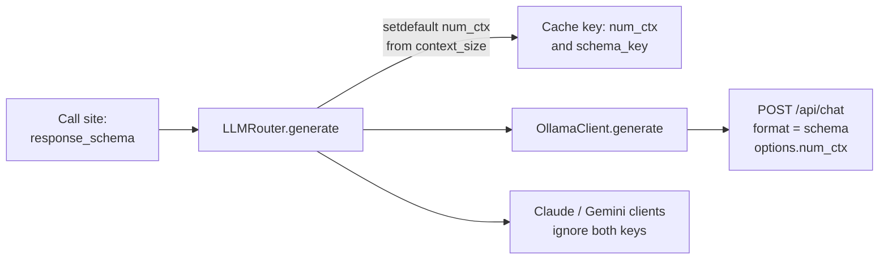

# MH-3: The router sends a JSON schema and a context size to Ollama

## Apply with the runner

The handoff runner applies this file: it writes the test file, runs the red command (it must fail), makes the eight edits, runs the "Done when" checks (they must pass), and commits. See `docs/handoff-runner.md`.

Apply this handoff (WSL, from `apps/backend-py`):

```bash
.venv/bin/python scripts/run_handoff.py ../../tasks/active/step-3-7-structured-output/mh-3-router-schema-context.md
```

## Why

The call sites (MH-4 to MH-7) will pass their output model's JSON schema, and Ollama must get it as `format`, so that the model can only write JSON in that shape. Each task also needs a fixed context size (`num_ctx`): today no code sets it, so Ollama uses its own default (4,096 tokens in the baseline run), and a long input is cut without a message.



- `context_size(task_type)`: 8,192 tokens for JD extraction and resume parsing (long inputs), 4,096 for the other tasks. Ollama loads a model again when `num_ctx` changes, so most tasks share one size; JD extraction and resume parsing run alone (a pasted JD, a CV upload). With `qwen2.5:7b`, 8,192 tokens add about 0.23 GB of cache over 4,096; the baseline peak was 6.85 GB.
- The router sets `num_ctx` only when the caller did not. The Claude and Gemini clients read only the keys that they know, so they ignore `num_ctx` and `response_schema`.
- The response-cache key gets `num_ctx` and a short hash of the schema, so an answer for one schema is never reused for another.
- `payload` in the Ollama client gets the type `Dict[str, Any]`, so its options can take a new key without a mypy error (this also removes one baseline error).

## Files

- `apps/backend-py/src/llm/router.py` (change)
- `apps/backend-py/src/llm/ollama_client.py` (change)
- `apps/backend-py/tests/unit/test_router_structured_options.py` (new)

## Step 1: add the test file, run it, and see it fail

```python new=apps/backend-py/tests/unit/test_router_structured_options.py
"""Tests for the context size and the JSON schema in the router and the Ollama client (Step 3.7, MH-3)."""

import asyncio
from typing import Any, Dict, Tuple
from unittest.mock import AsyncMock, MagicMock, PropertyMock, patch

import pytest

from src.llm.base import LLMConfig, LLMResponse, Message, MessageType
from src.llm.ollama_client import OllamaClient
from src.llm.router import (
    DEFAULT_NUM_CTX,
    LLMRouter,
    TaskType,
    context_size,
    schema_key,
)

SCHEMA: Dict[str, Any] = {
    "type": "object",
    "properties": {"critique": {"type": "string"}},
    "required": ["critique"],
}
OTHER_SCHEMA: Dict[str, Any] = {
    "type": "object",
    "properties": {"score": {"type": "integer"}},
    "required": ["score"],
}


def _messages() -> list:
    """
    A short chat for the calls.

    Returns:
        Two messages.
    """
    return [
        Message(role=MessageType.SYSTEM, content="Answer in JSON."),
        Message(role=MessageType.USER, content="Review this."),
    ]


def _ollama_payload(**kwargs: Any) -> Dict[str, Any]:
    """
    Run one Ollama generate call against a fake /api/chat and return its body.

    Args:
        **kwargs: Generation arguments for ``OllamaClient.generate``.

    Returns:
        The JSON body that the client sent.
    """
    with (
        patch.object(OllamaClient, "_is_ollama_running", return_value=True),
        patch.object(
            OllamaClient,
            "available_models",
            new_callable=PropertyMock,
            return_value=["qwen2.5:3b"],
        ),
        patch("src.llm.ollama_client.requests.post") as post,
    ):
        answer = MagicMock()
        answer.json.return_value = {
            "message": {"role": "assistant", "content": "{}"},
            "prompt_eval_count": 5,
            "eval_count": 2,
        }
        post.return_value = answer
        client = OllamaClient(config=LLMConfig(model="qwen2.5:3b"))
        client.generate(_messages(), **kwargs)
        return post.call_args.kwargs["json"]


def _router() -> Tuple[LLMRouter, MagicMock]:
    """
    A router with a fake client and the response cache on.

    Returns:
        The router and the fake client.
    """
    router = LLMRouter()
    router._response_cache.enabled = True
    client = MagicMock()
    client.generate = MagicMock(
        return_value=LLMResponse(content="{}", model="qwen2.5:3b", cost=0.0)
    )
    client.generate_async = AsyncMock(
        return_value=LLMResponse(content="{}", model="qwen2.5:3b", cost=0.0)
    )
    router._get_client = MagicMock(return_value=client)  # type: ignore[method-assign]
    return router, client


def test_ollama_sends_the_context_size() -> None:
    """``num_ctx`` goes to ``options.num_ctx``."""
    payload = _ollama_payload(num_ctx=8192)

    assert payload["options"]["num_ctx"] == 8192


def test_ollama_sends_no_context_size_without_one() -> None:
    """Without ``num_ctx``, Ollama keeps its own default."""
    payload = _ollama_payload()

    assert "num_ctx" not in payload["options"]


def test_ollama_sends_the_schema_as_format() -> None:
    """``response_schema`` goes to ``format`` unchanged."""
    payload = _ollama_payload(response_schema=SCHEMA)

    assert payload["format"] == SCHEMA


def test_ollama_sends_no_format_without_a_schema() -> None:
    """Without a schema, the request has no ``format``."""
    payload = _ollama_payload()

    assert "format" not in payload


def test_context_sizes_of_the_tasks() -> None:
    """JD extraction and resume parsing get 8192 tokens; other tasks 4096."""
    assert DEFAULT_NUM_CTX == 4096
    assert context_size(TaskType.JD_EXTRACTION) == 8192
    assert context_size(TaskType.RESUME_PARSING) == 8192
    assert context_size(TaskType.SELECTION) == 4096
    assert context_size(TaskType.RESUME_WRITING) == 4096


@pytest.mark.parametrize(
    "task_type, expected",
    [(TaskType.JD_EXTRACTION, 8192), (TaskType.SELECTION, 4096)],
)
def test_router_sends_the_task_context_size(task_type: TaskType, expected: int) -> None:
    """The router gives the client the context size of the task."""
    router, client = _router()

    router.generate(_messages(), task_type=task_type, temperature=0.5)

    assert client.generate.call_args.kwargs["num_ctx"] == expected


def test_a_caller_context_size_wins() -> None:
    """A ``num_ctx`` from the caller is not replaced."""
    router, client = _router()

    router.generate(_messages(), task_type=TaskType.JD_EXTRACTION, num_ctx=2048)

    assert client.generate.call_args.kwargs["num_ctx"] == 2048


def test_router_passes_the_schema_to_the_client() -> None:
    """The router gives ``response_schema`` to the client unchanged."""
    router, client = _router()

    router.generate(
        _messages(), task_type=TaskType.COVER_LETTER_REVIEW, response_schema=SCHEMA
    )

    assert client.generate.call_args.kwargs["response_schema"] == SCHEMA


def test_async_router_sends_the_task_context_size() -> None:
    """``generate_async`` also gives the client the task's context size."""
    router, client = _router()

    asyncio.run(
        router.generate_async(
            _messages(), task_type=TaskType.RESUME_PARSING, temperature=0.5
        )
    )

    assert client.generate_async.call_args.kwargs["num_ctx"] == 8192


def test_cache_key_has_the_context_size_and_the_schema() -> None:
    """The cache key changes with the context size and with the schema."""
    router, _ = _router()

    def extra(**kwargs: Any) -> Dict[str, Any]:
        """
        The extra cache-key fields for a validation call.

        Args:
            **kwargs: Generation arguments.

        Returns:
            The extra fields.
        """
        return router._cache_extra(TaskType.VALIDATION, "ollama", kwargs)

    assert extra(num_ctx=4096) != extra(num_ctx=8192)
    assert extra(response_schema=SCHEMA) != extra(response_schema=OTHER_SCHEMA)
    assert extra(response_schema=SCHEMA) != extra()
    assert extra(response_schema=SCHEMA)["response_schema"] == schema_key(SCHEMA)


def test_schema_key_ignores_key_order() -> None:
    """The same schema with another key order gives the same cache key."""
    reordered = {"required": ["critique"], **SCHEMA}

    assert schema_key(reordered) == schema_key(SCHEMA)
    assert len(schema_key(SCHEMA)) == 16


def test_a_new_schema_is_not_a_cache_hit() -> None:
    """Two cacheable calls with different schemas both reach the client."""
    router, client = _router()

    for schema in (SCHEMA, OTHER_SCHEMA):
        router.generate(
            _messages(),
            task_type=TaskType.VALIDATION,
            temperature=0.0,
            response_schema=schema,
        )

    assert client.generate.call_count == 2
```

Run it. It must fail (`DEFAULT_NUM_CTX`, `context_size`, and `schema_key` do not exist yet):

```bash red cwd=apps/backend-py
.venv/bin/python -m pytest tests/unit/test_router_structured_options.py -q
```

## Step 2: change the router and the Ollama client

1. Import the modules for the schema hash (`src/llm/router.py`):

```python edit=apps/backend-py/src/llm/router.py
<<<<<<< OLD
import logging
import threading
import time
=======
import hashlib
import json
import logging
import threading
import time
>>>>>>> NEW
```

2. Add the context sizes and the schema hash (`src/llm/router.py`):

```python edit=apps/backend-py/src/llm/router.py
<<<<<<< OLD
MAX_CACHEABLE_TEMPERATURE = 0.3
=======
MAX_CACHEABLE_TEMPERATURE = 0.3

# Ollama context size (num_ctx) for each task (Step 3.7). Ollama loads a
# model again when num_ctx changes, so most tasks share the default.
DEFAULT_NUM_CTX = 4096
TASK_NUM_CTX: Dict[TaskType, int] = {
    TaskType.JD_EXTRACTION: 8192,
    TaskType.RESUME_PARSING: 8192,
}


def context_size(task_type: TaskType) -> int:
    """
    Return the Ollama context size (``num_ctx``) for a task.

    Args:
        task_type: Routed task type.

    Returns:
        The task's context size in tokens.
    """
    return TASK_NUM_CTX.get(task_type, DEFAULT_NUM_CTX)


def schema_key(schema: Dict[str, Any]) -> str:
    """
    Return a short stable hash of a JSON schema, for the response-cache key.

    Args:
        schema: JSON schema of the expected answer.

    Returns:
        The first 16 hex characters of the SHA-256 of the sorted schema.
    """
    text = json.dumps(schema, sort_keys=True)
    return hashlib.sha256(text.encode("utf-8")).hexdigest()[:16]
>>>>>>> NEW
```

3. Put the context size and the schema in the response-cache key (`src/llm/router.py`):

```python edit=apps/backend-py/src/llm/router.py
<<<<<<< OLD
        if "think" in kwargs:
            extra["think"] = kwargs["think"]
        return extra
=======
        if "think" in kwargs:
            extra["think"] = kwargs["think"]
        if kwargs.get("num_ctx"):
            extra["num_ctx"] = int(kwargs["num_ctx"])
        if kwargs.get("response_schema"):
            extra["response_schema"] = schema_key(kwargs["response_schema"])
        return extra
>>>>>>> NEW
```

4. Send the task's context size in `generate` (a caller value wins) (`src/llm/router.py`):

```python edit=apps/backend-py/src/llm/router.py
<<<<<<< OLD
        # Do not forward override to provider clients.
        kwargs.pop("model", None)
=======
        # Do not forward override to provider clients.
        kwargs.pop("model", None)
        # Ollama context size for the task; a caller value wins (Step 3.7).
        kwargs.setdefault("num_ctx", context_size(task_type))
>>>>>>> NEW
```

5. Send the task's context size in `generate_async` (a caller value wins) (`src/llm/router.py`):

```python edit=apps/backend-py/src/llm/router.py
<<<<<<< OLD
            raise ValueError(f"Unknown task type: {task_type}")

        kwargs.pop("model", None)
=======
            raise ValueError(f"Unknown task type: {task_type}")

        kwargs.pop("model", None)
        # Ollama context size for the task; a caller value wins (Step 3.7).
        kwargs.setdefault("num_ctx", context_size(task_type))
>>>>>>> NEW
```

6. Name the two new keys in the docstring (`src/llm/ollama_client.py`):

```python edit=apps/backend-py/src/llm/ollama_client.py
<<<<<<< OLD
                ``temperature``, ``max_tokens``, ``top_p``, ``timeout``,
                ``stop_sequences``, and optional ``think`` (passed through to
                Ollama ``/api/chat`` only when explicitly provided so other
                callers keep Ollama's default thinking behavior).
=======
                ``temperature``, ``max_tokens``, ``top_p``, ``timeout``,
                ``stop_sequences``, and optional ``think`` (passed through to
                Ollama ``/api/chat`` only when explicitly provided so other
                callers keep Ollama's default thinking behavior). Optional
                ``num_ctx`` goes to ``options.num_ctx``, and optional
                ``response_schema`` (a JSON schema) goes to ``format``.
>>>>>>> NEW
```

7. Type the payload, so that its options can take new keys (`src/llm/ollama_client.py`):

```python edit=apps/backend-py/src/llm/ollama_client.py
<<<<<<< OLD
        payload = {
            "model": self.config.model,
=======
        payload: Dict[str, Any] = {
            "model": self.config.model,
>>>>>>> NEW
```

8. Send the context size and the schema (`src/llm/ollama_client.py`):

```python edit=apps/backend-py/src/llm/ollama_client.py
<<<<<<< OLD
        if "think" in kwargs:
            payload["think"] = bool(kwargs["think"])
=======
        if "think" in kwargs:
            payload["think"] = bool(kwargs["think"])
        if kwargs.get("num_ctx"):
            payload["options"]["num_ctx"] = int(kwargs["num_ctx"])
        if kwargs.get("response_schema"):
            payload["format"] = kwargs["response_schema"]
>>>>>>> NEW
```

## Done when

Run the new tests:

```bash check cwd=apps/backend-py
.venv/bin/python -m pytest tests/unit/test_router_structured_options.py -q
```

Run the router, client, and cost tests:

```bash check cwd=apps/backend-py
.venv/bin/python -m pytest tests/unit/test_router_response_cache.py tests/unit/test_router_model_override.py tests/unit/test_router_settings.py tests/unit/test_cloud_fallback_none.py tests/unit/test_ollama_token_counts.py tests/unit/test_ollama_client_content.py tests/unit/test_ollama_host_outside_docker.py tests/unit/test_cost_recording.py tests/unit/test_claude_prompt_cache.py tests/unit/test_gemini_client.py -q
```

Format the changed files:

```bash check cwd=apps/backend-py
.venv/bin/python -m black src/llm/router.py src/llm/ollama_client.py tests/unit/test_router_structured_options.py
```

Check the lint:

```bash check cwd=apps/backend-py
.venv/bin/python -m ruff check src/llm/router.py src/llm/ollama_client.py tests/unit/test_router_structured_options.py
```

Run the mypy gate (no new errors):

```bash check cwd=apps/backend-py
.venv/bin/python scripts/mypy_gate.py
```

Commit message:

```text commit
feat(llm): send a JSON schema and a context size to Ollama

LLMRouter.generate and generate_async now set num_ctx from the task
(8192 for JD extraction and resume parsing, 4096 for the others) unless
the caller sets it, and pass response_schema through. OllamaClient
sends them as options.num_ctx and format. The response-cache key holds
num_ctx and a hash of the schema (Step 3.7, MH-3).
```
