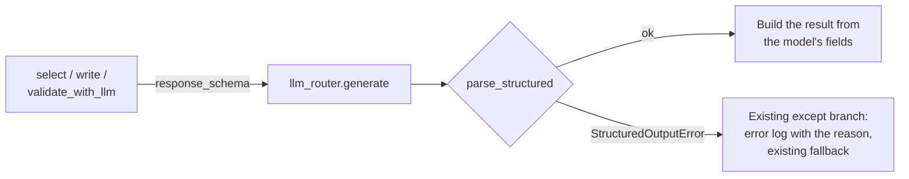

# MH-4: The resume pipeline asks for its JSON schema and parses strictly

This is a spec handoff: it gives the behavior and the tests to write, not the code. Read `AGENT.md` first.

## Why

Three call sites of the resume pipeline take LLM JSON with the regex `\{.*\}` and read keys with `dict.get`, so an answer with missing keys or a wrong shape goes through with default values. After this handoff, each site sends its output model's JSON schema (the router gives it to Ollama as `format`, from MH-3) and parses the whole answer with `parse_structured` (MH-1). An answer that does not match goes to the site's existing fallback, and the existing error log names the reason.

In the baseline run (2026-11-01) these three sites gave a strict answer 15 of 15 times, so on a normal answer the result does not change.



## Files

- `apps/backend-py/src/generation/selector.py` (change)
- `apps/backend-py/src/generation/resume_writer.py` (change)
- `apps/backend-py/src/generation/validator.py` (change)
- `apps/backend-py/tests/unit/test_structured_resume_pipeline.py` (new)
- `apps/backend-py/tests/unit/test_resume_selector_keywords.py` (change one test, Step 1.2)
- `apps/backend-py/tests/unit/test_resume_writer_skills.py` (change one test, Step 1.2)

Do not change other files.

## Required behavior

The output models and the parser are in `src/llm/structured.py`: `SelectionAnswer`, `ResumeWritingAnswer`, `ResumeValidationAnswer`, `parse_structured`, and `StructuredOutputError`.

1. `ResumeSelector.select` (`selector.py`):
   - Add `response_schema=SelectionAnswer.model_json_schema()` to its `self.llm_router.generate(...)` call. Keep the other arguments.
   - Parse with `answer = parse_structured(response.content, SelectionAnswer)`.
   - Build the `SelectionOutput` from `answer`: `selected_projects` is `keep_profile_projects([item.model_dump() for item in answer.selected_projects], profile)`, `keywords_to_emphasize` is `keep_profile_keywords(answer.keywords_to_emphasize, profile)`, and `key_achievements` and `summary_suggestion` come from `answer`. `raw_response` and the token fields stay as now.
2. `ResumeWriter.write` (`resume_writer.py`):
   - Add `response_schema=ResumeWritingAnswer.model_json_schema()` to its `generate` call.
   - Parse with `parse_structured(response.content, ResumeWritingAnswer)`.
   - Build the `GeneratedResume` from the answer: `summary`; `skills` is `keep_profile_skills(flatten_skills(answer.skills), selection.keywords_to_emphasize, profile)`; `experience` and `education` are the items' `model_dump()` dicts; `projects` is `match_project_names([item.model_dump() for item in answer.projects], profile)`. `raw_response`, `model_used`, and `provider_used` stay as now.
3. `ResumeValidator.validate_with_llm` (`validator.py`):
   - Add `response_schema=ResumeValidationAnswer.model_json_schema()` to its `generate` call.
   - Parse with `parse_structured(response.content, ResumeValidationAnswer)`.
   - Build the `ValidationResult` from the answer's 7 fields, with `issues=[]` as now.
4. In all three methods, remove the regex `re.search(r"\{.*\}", ...)`, its `if not json_match` check, the `json.loads`, and the local `import json` and `import re` lines. Keep the module-level `import re` in `resume_writer.py` (another function uses it). Import the models and `parse_structured` at the top of each file.
5. Do not add a new `try` or a new fallback. `StructuredOutputError` is a `ValueError`, so the existing `except Exception as e` branch of each method logs it (`self.logger.error(...)` with `str(e)`, which starts with the reason, for example `not_json`) and returns the existing fallback: the rule-based selection (`raw_response` is `""`), the template resume (`model_used` is `"template_fallback"`), or `self.validate(...)`.
6. Do not change the prompts.

## Step 1: write the tests, run them, and see the named tests fail

### 1.1 The new test file `tests/unit/test_structured_resume_pipeline.py`

Use the fixtures `sample_job_listing` and `sample_user_profile` from `tests/conftest.py`. Define these module constants:

```python
SELECTION_ANSWER = {
    "selected_projects": [{"name": "Ledger", "reason": "Payments work"}],
    "keywords_to_emphasize": ["Python"],
    "key_achievements": ["Built a ledger"],
    "summary_suggestion": "Backend engineer with payment APIs.",
}
WRITING_ANSWER = {
    "summary": "Backend engineer.",
    "skills": ["Python"],
    "experience": [
        {
            "title": "Engineer",
            "company": "Acme",
            "dates": "2024 - 2025",
            "highlights": ["Built an API"],
        }
    ],
    "projects": [],
    "education": [{"degree": "BSc", "school": "NUS", "year": "2025"}],
}
VALIDATION_ANSWER = {
    "is_valid": True,
    "missing_projects": [],
    "missing_keywords": [],
    "fabricated_content": [],
    "date_inconsistencies": [],
    "overall_score": 85,
    "recommendation": "approve",
}
```

Write these helpers (with docstrings and type hints):

- `router_returning(content)`: a `MagicMock` router whose `generate` returns `LLMResponse(content=content, model="qwen2.5:7b", provider="ollama", prompt_tokens=10, completion_tokens=5)`.
- `empty_selection()`: a `SelectionOutput` with empty lists, `summary_suggestion=""`, and `raw_response="{}"`.
- `small_resume()`: a `GeneratedResume` with `summary="Backend engineer."`, `skills=["Python"]`, empty `experience`, `projects`, and `education`, `raw_response=""`, and `model_used="fake"`.
- `logged_errors(component)`: the text of all calls to `component.logger.error` as one string. A test sets `component.logger = MagicMock()` after it makes the component.

Write these 13 tests:

| Test | Input | Check |
|------|-------|-------|
| `test_selection_sends_its_schema` | `json.dumps(SELECTION_ANSWER)` | `router.generate.call_args.kwargs["response_schema"] == SelectionAnswer.model_json_schema()` |
| `test_selection_parses_a_strict_answer` | `json.dumps(SELECTION_ANSWER)` | `summary_suggestion == "Backend engineer with payment APIs."` and `raw_response` is the answer text |
| `test_selection_falls_back_on_text_around_the_json` | `"Here it is: " + json.dumps(SELECTION_ANSWER)` | `raw_response == ""` and `"not_json"` is in `logged_errors(selector)` |
| `test_selection_falls_back_on_a_missing_field` | `SELECTION_ANSWER` without `summary_suggestion` | `raw_response == ""` |
| `test_resume_writing_sends_its_schema` | `json.dumps(WRITING_ANSWER)` | the schema is `ResumeWritingAnswer.model_json_schema()` |
| `test_resume_writing_parses_a_strict_answer` | `json.dumps(WRITING_ANSWER)` | `summary == "Backend engineer."`, `model_used != "template_fallback"`, `experience == WRITING_ANSWER["experience"]`, `education == WRITING_ANSWER["education"]` |
| `test_resume_writing_falls_back_on_text_around_the_json` | `"Sure:\n" + json.dumps(WRITING_ANSWER)` | `model_used == "template_fallback"` and `"not_json"` is in `logged_errors(writer)` |
| `test_resume_writing_falls_back_on_grouped_skills` | `WRITING_ANSWER` with `skills=[{"category": "Languages", "skills": ["Python"]}]` | `model_used == "template_fallback"` |
| `test_resume_validation_sends_its_schema` | `json.dumps(VALIDATION_ANSWER)` | the schema is `ResumeValidationAnswer.model_json_schema()` |
| `test_resume_validation_parses_a_strict_answer` | `json.dumps(VALIDATION_ANSWER)` | `overall_score == 85`, `recommendation == "approve"`, `issues == []` |
| `test_resume_validation_falls_back_on_text_around_the_json` | `"Result: " + json.dumps(VALIDATION_ANSWER)`; `validator.validate = MagicMock(return_value=rule_result)` | the result `is rule_result` and `"not_json"` is in `logged_errors(validator)` |
| `test_resume_validation_falls_back_on_an_unknown_recommendation` | `VALIDATION_ANSWER` with `recommendation="Approve"`; `validate` replaced as above | the result `is rule_result` |
| `test_no_regex_json_parsing_left` | the text of `selector.py`, `resume_writer.py`, and `validator.py` | `r're.search(r"\{.*\}"'` is not in any of them |

Call the components as `ResumeSelector(router).select(job, profile)`, `ResumeWriter(router).write(job, profile, empty_selection())`, and `ResumeValidator(llm_router=router).validate_with_llm(small_resume(), job, profile, empty_selection())`.

### 1.2 Change two existing tests

Both send an answer that the new schema refuses. Change only these lines:

1. `tests/unit/test_resume_selector_keywords.py`, `test_keywords_are_only_profile_skills`: in the payload, remove the `7` from `keywords_to_emphasize` (the schema allows strings only), and add `"key_achievements": []` and `"summary_suggestion": ""`. The expected keywords stay `["Python", "FastAPI"]`.
2. `tests/unit/test_resume_writer_skills.py`, `test_writer_returns_a_flat_skill_list`: change the payload's `skills` to `["Python", "Django"]`, and change the docstring to `"""The writer returns a flat skill list, and the prompt asks for a flat list."""`. The other lines stay. (Grouped skills now fall back to the template; the new test `test_resume_writing_falls_back_on_grouped_skills` covers that.)

### 1.3 Run the tests

Run the new file. Exactly 3 tests pass (the three `parses_a_strict_answer` tests) and the other 10 fail (`FAILED`, not `ERROR`), because the code still uses the regex and sends no schema. `pytest.ini` stops a run after 5 failures, so this command raises the limit:

```bash
.venv/bin/python -m pytest tests/unit/test_structured_resume_pipeline.py -q --maxfail=20
```

Run the two changed files. They pass on the current code:

```bash
.venv/bin/python -m pytest tests/unit/test_resume_selector_keywords.py tests/unit/test_resume_writer_skills.py -q
```

## Step 2: change the three methods

Change `selector.py`, `resume_writer.py`, and `validator.py` as "Required behavior" says.

## Done when

Run the new tests. All 13 pass:

```bash
.venv/bin/python -m pytest tests/unit/test_structured_resume_pipeline.py -q
```

Run the other tests of these components. All pass:

```bash
.venv/bin/python -m pytest tests/unit/test_resume_selector.py tests/unit/test_resume_selector_keywords.py tests/unit/test_resume_validator.py tests/unit/test_resume_writer_fallback.py tests/unit/test_resume_writer_profile_skills.py tests/unit/test_resume_writer_projects.py tests/unit/test_resume_writer_skills.py tests/unit/test_pipeline_stages.py tests/unit/test_structured_suite.py tests/integration/test_pipeline.py -q
```

Check that the regex is gone. The command must print `no regex JSON parsing`:

```bash
grep -n "DOTALL" src/generation/selector.py src/generation/resume_writer.py src/generation/validator.py || echo "no regex JSON parsing"
```

Format the changed files:

```bash
.venv/bin/python -m black src/generation/selector.py src/generation/resume_writer.py src/generation/validator.py tests/unit/test_structured_resume_pipeline.py tests/unit/test_resume_selector_keywords.py tests/unit/test_resume_writer_skills.py
```

Check the lint:

```bash
.venv/bin/python -m ruff check src/generation/selector.py src/generation/resume_writer.py src/generation/validator.py tests/unit/test_structured_resume_pipeline.py tests/unit/test_resume_selector_keywords.py tests/unit/test_resume_writer_skills.py
```

Run the mypy gate. It must report 0 new errors. It can also say that some baseline errors are fixed; do nothing about that. Do not add `--update`:

```bash
.venv/bin/python scripts/mypy_gate.py
```

The working tree has other changed files that are not part of this handoff. Do not stage them. Do not use `git add -A`, `git add .`, or `git commit -a`. Stage only your six files:

```bash
git add src/generation/selector.py src/generation/resume_writer.py src/generation/validator.py tests/unit/test_structured_resume_pipeline.py tests/unit/test_resume_selector_keywords.py tests/unit/test_resume_writer_skills.py
```

Check that only these six files are staged:

```bash
git diff --cached --name-only
```

Commit with this message:

```text
feat(generation): use the JSON schema and the strict parser in the resume pipeline

The selector, the resume writer, and the LLM resume validation send
their output model's JSON schema and parse the whole answer with
parse_structured instead of the regex. An answer that does not match
goes to the existing fallback, and the error log names the reason.
Two tests now send answers in the schema's shape (Step 3.7, MH-4).
```
