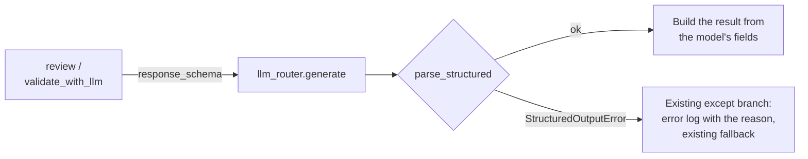

# MH-5: The cover-letter review and validation ask for their JSON schema and parse strictly

This is a spec handoff: it gives the behavior and the tests to write, not the code. Read `AGENT.md` first.

## Why

Two cover-letter call sites take LLM JSON with the regex `\{.*\}`: the reviewer (`CoverLetterReviewer.review`) and the LLM path of the validator (`CoverLetterValidator.validate_with_llm`). In the baseline run (2026-11-01) the review gave a strict answer 15 of 15 times, but the validation (`qwen2.5:3b`, temperature 0) gave a strict answer only 6 of 15 times: 6 answers had the JSON inside prose ("Here is the evaluation of the cover letter ..."), and 3 had no JSON at all, so the validator used its rule result.

After this handoff, both sites send their output model's JSON schema (the router gives it to Ollama as `format`) and parse the whole answer with `parse_structured`. An answer that does not match goes to the site's existing fallback, and the existing error log names the reason.



## Files

- `apps/backend-py/src/generation/cover_letter_reviewer.py` (change)
- `apps/backend-py/src/generation/cover_letter_validator.py` (change)
- `apps/backend-py/tests/unit/test_structured_cover_letters.py` (new)
- `apps/backend-py/tests/unit/test_cover_letter_reviewer.py` (remove one test, Step 1.2)

Do not change other files.

## Required behavior

The output models and the parser are in `src/llm/structured.py`: `CoverLetterReviewAnswer`, `CoverLetterValidationAnswer`, `parse_structured`, and `StructuredOutputError`.

1. `CoverLetterReviewer.review` (`cover_letter_reviewer.py`):
   - Add `response_schema=CoverLetterReviewAnswer.model_json_schema()` to its `self.llm_router.generate(...)` call. Keep the other arguments.
   - Parse with `answer = parse_structured(response.content, CoverLetterReviewAnswer)`.
   - `critique` is `answer.critique.strip()`, and `rewrite_needed` is `answer.rewrite_needed`. The rest of the method (model, tokens, info log, result) stays as now.
   - The module-level `import json` and `import re` are then not used. Remove them.
2. `CoverLetterValidator.validate_with_llm` (`cover_letter_validator.py`):
   - Add `response_schema=CoverLetterValidationAnswer.model_json_schema()` to its `generate` call. Keep the other arguments and their comments.
   - Parse with `answer = parse_structured(response.content, CoverLetterValidationAnswer)`.
   - Return `CoverLetterValidationResult(is_valid=answer.is_valid, score=answer.overall_score, issues=[], word_count=cover_letter.word_count, structure_score=answer.structure_score, content_score=answer.content_score, tone_score=answer.tone_score, recommendation=answer.recommendation, details={"llm_feedback": answer.issues})`.
   - Remove the local `import json`, the regex and its check, `json.loads`, and the recommendation normalization block (its comment, `raw_recommendation`, and `recommendation`). The model's `recommendation` field accepts only `approve`, `needs_revision`, or `reject`, so the normalization is not needed. Keep the module-level `import re` (other code in the file uses it).
3. Do not add a new `try` or a new fallback. `StructuredOutputError` is a `ValueError`, so the existing `except` branch of each method logs it (its text starts with the reason, for example `not_json`) and returns the existing fallback: the unavailable review (`critique="Review unavailable."`, `model_used="error"`) or `self.validate(...)`.
4. Do not change the prompts. Do not change the code before the LLM call in `validate_with_llm` (the rule check and the hard-fail return).

## Step 1: write the tests, run them, and see the named tests fail

### 1.1 The new test file `tests/unit/test_structured_cover_letters.py`

Use the fixtures `sample_job_listing` and `sample_user_profile` from `tests/conftest.py`. Define these module constants:

```python
REVIEW_ANSWER = {
    "critique": "  Name the role in the first line.  ",
    "rewrite_needed": True,
}
VALIDATION_ANSWER = {
    "structure_score": 80,
    "content_score": 75,
    "tone_score": 90,
    "overall_score": 82,
    "is_valid": True,
    "recommendation": "approve",
    "issues": ["Generic opening"],
}
```

Write these helpers (with docstrings and type hints):

- `router_returning(content)`: a `MagicMock` router whose `generate` returns `LLMResponse(content=content, model="qwen2.5:3b", provider="ollama", prompt_tokens=10, completion_tokens=5)`.
- `empty_selection()`: a `SelectionOutput` with empty lists, `summary_suggestion=""`, and `raw_response="{}"`.
- `short_letter()`: a `GeneratedCoverLetter` with `content="Dear Hiring Team, I build Python services. Thank you."`, `highlighted_experiences=[]`, `word_count` set to the number of words, and `model_used="fake"`.
- `logged_errors(component)`: the text of all calls to `component.logger.error` as one string. A test sets `component.logger = MagicMock()` after it makes the component.
- `validator_with_rules(content)`: a `CoverLetterValidator(llm_router=router_returning(content))` whose `validate` is replaced by a `MagicMock` that returns `rule_result`, a `MagicMock` with `issues = []` (no hard fail, so the LLM call runs). Return the validator and `rule_result`.

Call the components as `CoverLetterReviewer(router).review(short_letter(), job, profile, empty_selection())` and `validator.validate_with_llm(short_letter(), job, profile, empty_selection())`.

Write these 9 tests:

| Test | Input | Check |
|------|-------|-------|
| `test_review_sends_its_schema` | `json.dumps(REVIEW_ANSWER)` | `router.generate.call_args.kwargs["response_schema"] == CoverLetterReviewAnswer.model_json_schema()` |
| `test_review_parses_a_strict_answer` | `json.dumps(REVIEW_ANSWER)` | `critique == "Name the role in the first line."` (stripped), `rewrite_needed is True`, `model_used != "error"` |
| `test_review_falls_back_on_text_around_the_json` | `"Review: " + json.dumps(REVIEW_ANSWER)` | `model_used == "error"`, `critique == "Review unavailable."`, and `"not_json"` is in `logged_errors(reviewer)` |
| `test_review_falls_back_on_a_missing_field` | `{"critique": "Fine."}` as JSON | `model_used == "error"` |
| `test_letter_validation_sends_its_schema` | `json.dumps(VALIDATION_ANSWER)` | the schema is `CoverLetterValidationAnswer.model_json_schema()` |
| `test_letter_validation_parses_a_strict_answer` | `json.dumps(VALIDATION_ANSWER)` | the result `is not rule_result`, `score == 82`, `structure_score == 80`, `recommendation == "approve"`, `details == {"llm_feedback": ["Generic opening"]}` |
| `test_letter_validation_falls_back_on_text_around_the_json` | `"Here is the evaluation of the cover letter:\n" + json.dumps(VALIDATION_ANSWER)` | the result `is rule_result` and `"not_json"` is in `logged_errors(validator)` |
| `test_letter_validation_falls_back_on_an_unknown_recommendation` | `VALIDATION_ANSWER` with `recommendation="Needs Revision"` | the result `is rule_result` |
| `test_no_regex_json_parsing_left` | the text of `cover_letter_reviewer.py` and `cover_letter_validator.py` | `r're.search(r"\{.*\}"'` is not in either |

### 1.2 Remove one existing test

`tests/unit/test_cover_letter_reviewer.py` has `TestCoverLetterReviewer.test_review_extracts_json_from_extra_text`. It checks the old behavior that this handoff removes (JSON taken from inside explanatory text). Remove that one method, from its `def` line to the line before `def test_review_graceful_on_missing_json`. The new `test_review_falls_back_on_text_around_the_json` checks the new behavior. Do not change the other tests in that file.

### 1.3 Run the tests

Run the new file. Exactly 2 tests pass (the two `parses_a_strict_answer` tests) and the other 7 fail (`FAILED`, not `ERROR`), because the code still uses the regex and sends no schema:

```bash
.venv/bin/python -m pytest tests/unit/test_structured_cover_letters.py -q --maxfail=20
```

## Step 2: change the two methods

Change `cover_letter_reviewer.py` and `cover_letter_validator.py` as "Required behavior" says.

## Done when

Run the new tests. All 9 pass:

```bash
.venv/bin/python -m pytest tests/unit/test_structured_cover_letters.py -q
```

Run the other cover-letter tests. All pass:

```bash
.venv/bin/python -m pytest tests/test_cover_letter_validator.py tests/test_cover_letter_writer.py tests/unit/test_cover_letter_reviewer.py tests/unit/test_cover_letter_instructions.py tests/unit/test_cover_letter_manual.py tests/unit/test_cover_letter_service.py tests/unit/test_cover_letter_off_loop.py tests/unit/test_cover_letter_assess.py tests/unit/test_cover_letter_explain.py tests/unit/test_grounding_sentence_labels.py tests/unit/test_jobs_cover_letter.py tests/unit/test_structured_suite.py -q
```

Check that the regex is gone. The command must print `no regex JSON parsing`:

```bash
grep -n "DOTALL" src/generation/cover_letter_reviewer.py src/generation/cover_letter_validator.py || echo "no regex JSON parsing"
```

Format the changed files:

```bash
.venv/bin/python -m black src/generation/cover_letter_reviewer.py src/generation/cover_letter_validator.py tests/unit/test_structured_cover_letters.py tests/unit/test_cover_letter_reviewer.py
```

Check the lint:

```bash
.venv/bin/python -m ruff check src/generation/cover_letter_reviewer.py src/generation/cover_letter_validator.py tests/unit/test_structured_cover_letters.py tests/unit/test_cover_letter_reviewer.py
```

Run the mypy gate. It must report 0 new errors. It can also say that some baseline errors are fixed; do nothing about that. Do not add `--update`:

```bash
.venv/bin/python scripts/mypy_gate.py
```

The working tree has other changed files that are not part of this handoff. Do not stage them. Do not use `git add -A`, `git add .`, or `git commit -a`. Stage only your four files:

```bash
git add src/generation/cover_letter_reviewer.py src/generation/cover_letter_validator.py tests/unit/test_structured_cover_letters.py tests/unit/test_cover_letter_reviewer.py
```

Check that only these four files are staged:

```bash
git diff --cached --name-only
```

Commit with this message:

```text
feat(generation): use the JSON schema and the strict parser for cover letters

The cover-letter review and the LLM cover-letter validation send their
output model's JSON schema and parse the whole answer with
parse_structured instead of the regex. An answer that does not match
goes to the existing fallback, and the error log names the reason. The
recommendation normalization goes, because the schema allows only the
three values. The test of the old prose rescue is removed (Step 3.7,
MH-5).
```
