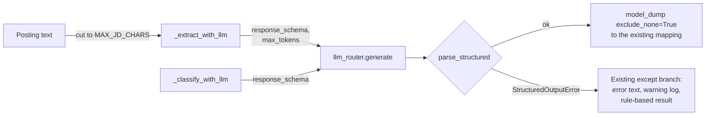

# MH-6: JD extraction and job classification ask for their JSON schema and parse strictly

This is a spec handoff: it gives the behavior and the tests to write, not the code. Read `AGENT.md` first.

## Why

Two call sites take LLM JSON with the regex `\{.*\}`: the JD extractor (`JDExtractor._extract_with_llm`) and the job classifier (`JobClassifier._classify_with_llm`). In the baseline run (2026-11-01) the classifier (`qwen2.5:7b`) gave a strict answer only 4 of 15 times: 11 answers were a fenced JSON object followed by a prose explanation of each field, which only the regex took. The JD extractor cuts a posting at 50,000 characters (about 12,500 tokens), far more than its context of 8,192 tokens (MH-3), so Ollama cuts a long prompt without a message. When the model leaves `experience_level` empty (`null`), the extractor calls `.title()` on `None`, and the run ends in the rule-based parser without a clear reason.

After this handoff, both sites send their output model's JSON schema and parse the whole answer with `parse_structured`. The JD extractor cuts the posting to fit its context and limits the answer length. A parse failure goes to the existing rule-based fallback, with the reason in the result's `errors` and in a warning log.



## Files

- `apps/backend-py/src/extractors/jd_extractor.py` (change)
- `apps/backend-py/src/classifiers/job_classifier.py` (change)
- `apps/backend-py/tests/unit/test_structured_extraction.py` (new)

Do not change other files.

## Required behavior

The output models and the parser are in `src/llm/structured.py`: `JDExtractionAnswer`, `JobClassificationAnswer`, `parse_structured`, and `StructuredOutputError`. The logger helper is `get_logger` with `Components.LLM` from `src/utils/logger.py`.

1. `jd_extractor.py`:
   - Add a module logger, `logger = get_logger(Components.LLM)`, and two module constants with a comment: `MAX_JD_CHARS = 18_000` and `JD_MAX_TOKENS = 1_500`. The comment says why: JD extraction runs with a context of 8,192 tokens (router, Step 3.7); the answer gets at most `JD_MAX_TOKENS` and the prompt about 400 tokens, so the posting gets about 6,000 tokens, and 18,000 characters stay below that at 3 characters a token.
   - In `_extract_with_llm`, replace `max_length = 50000` with `MAX_JD_CHARS`. Keep the existing warning text: `f"Text truncated from {len(text)} to {MAX_JD_CHARS} characters"`.
   - Add `max_tokens=JD_MAX_TOKENS` and `response_schema=JDExtractionAnswer.model_json_schema()` to its `generate` call.
   - Parse with `parse_structured(response.content, JDExtractionAnswer)`, and give `answer.model_dump(exclude_none=True)` to `_create_job_listing_from_dict`. (Without `exclude_none`, a `null` level reaches `.title()`.)
   - Remove the local `import json`, the regex, and the `if not json_match` branch that returned `success=False`. A parse failure now raises, and the existing `except` branch adds `"LLM extraction failed: ..."` to `errors` and returns the rule-based result. Keep the module-level `import re` (other code uses it).
   - In that `except` branch, also log `logger.warning("JD extraction fell back to rules: %s", e)`.
   - Type the two lists at the start of `_extract_with_llm`: `errors: List[str] = []` and `warnings: List[str] = []`. (mypy cannot infer them after the branch goes.)
2. `job_classifier.py`:
   - Add a module logger, `logger = get_logger(Components.LLM)`.
   - Add `response_schema=JobClassificationAnswer.model_json_schema()` to its `generate` call in `_classify_with_llm`.
   - Parse with `parse_structured(response.content, JobClassificationAnswer)`, and give `answer.model_dump(exclude_none=True)` to `_create_classification_from_dict`.
   - Remove the local `import re`, the regex, and the `if not json_match` branch that returned `success=False`. The module-level `import json` is then not used; remove it.
   - In the existing `except` branch, also log `logger.warning("Job classification fell back to rules: %s", e)`.
   - Type the two lists at the start of `_classify_with_llm`: `errors: List[str] = []` and `warnings: List[str] = []`.
3. Do not add a new `try` or a new fallback. Do not change the prompts or the mapping functions.

## Step 1: write the tests, run them, and see the named tests fail

### The new test file `tests/unit/test_structured_extraction.py`

Define these module constants:

```python
JD_TEXT = (
    "Backend Engineer\nAcme - Singapore\n\nWe build payment APIs in Python.\n"
    "Requirements: 3 years of Python.\n"
)
JD_ANSWER = {
    "title": "Backend Engineer",
    "company": "Acme",
    "location": "Singapore",
    "requirements": ["3 years of Python"],
    "responsibilities": ["Build APIs"],
    "skills": ["Python"],
    "experience_level": "Mid",
    "salary_range": None,
}
CLASSIFICATION_ANSWER = {
    "industry": "Technology",
    "role_category": "Engineering",
    "company_size": "Unknown",
    "company_stage": None,
    "work_pace": "Unknown",
    "team_structure": "Unknown",
    "technical_skills": [
        {
            "name": "Python",
            "proficiency": "Advanced",
            "is_required": True,
            "category": "programming_language",
        }
    ],
    "soft_skills": [],
    "domain_skills": [],
    "experience_level_confidence": 0.8,
    "actual_experience_years": [3.0, 5.0],
    "management_level": None,
    "impact_scope": None,
    "classification_confidence": 0.7,
    "tags": ["backend"],
    "red_flags": [],
}
```

Write the helper `router_returning(content)` (with a docstring and type hints): a `MagicMock` router whose `generate` returns `LLMResponse(content=content, model="qwen2.5:7b", provider="ollama", prompt_tokens=10, completion_tokens=5)`. Call the components as `JDExtractor(llm_router=router).extract_from_text(text)` and `JobClassifier(llm_router=router).classify(sample_job_listing, use_llm=True)` (fixture `sample_job_listing` from `tests/conftest.py`). To check a warning log, replace the module logger with `monkeypatch.setattr("src.extractors.jd_extractor.logger", log)` (or `src.classifiers.job_classifier.logger`), where `log` is a `MagicMock`.

Write these 11 tests:

| Test | Input | Check |
|------|-------|-------|
| `test_jd_extraction_sends_its_schema_and_answer_limit` | `json.dumps(JD_ANSWER)`, `JD_TEXT` | `response_schema == JDExtractionAnswer.model_json_schema()` and `max_tokens == 1500` in `router.generate.call_args.kwargs` |
| `test_jd_extraction_parses_a_strict_answer` | `json.dumps(JD_ANSWER)` | `success is True`, `job_listing.title == "Backend Engineer"`, `errors == []` |
| `test_jd_extraction_accepts_a_null_level` | `JD_ANSWER` with `experience_level=None` | `errors == []` and `job_listing.title == "Backend Engineer"` |
| `test_jd_extraction_falls_back_on_text_around_the_json` | `"Here is the JSON:\n" + json.dumps(JD_ANSWER)`; logger replaced | an item of `errors` contains `"not_json"`, and `"not_json"` is in `str(log.warning.call_args)` |
| `test_jd_extraction_falls_back_on_a_missing_field` | `JD_ANSWER` without `skills` | an item of `errors` contains `"schema"` |
| `test_jd_extraction_cuts_a_long_posting` | text `"A" * 30000`; answer `json.dumps(JD_ANSWER)` | the user message (`router.generate.call_args.kwargs["messages"][1].content`) contains `"A" * 18000` and not `"A" * 18001`, and `warnings` contains `"Text truncated from 30000 to 18000 characters"` |
| `test_classification_sends_its_schema` | `json.dumps(CLASSIFICATION_ANSWER)` | `response_schema == JobClassificationAnswer.model_json_schema()` |
| `test_classification_parses_a_strict_answer` | `json.dumps(CLASSIFICATION_ANSWER)` | `success is True`, `errors == []`, `classification.tags == ["backend"]` |
| `test_classification_falls_back_on_text_after_the_fence` | `"```json\n" + json.dumps(CLASSIFICATION_ANSWER) + "\n```\n- **Industry**: the posting names payments."`; logger replaced | an item of `errors` contains `"not_json"`, and `"not_json"` is in `str(log.warning.call_args)` |
| `test_classification_falls_back_on_a_confidence_above_1` | `CLASSIFICATION_ANSWER` with `classification_confidence=1.5` | an item of `errors` contains `"schema"` |
| `test_no_regex_json_parsing_left` | the text of `src/extractors/jd_extractor.py` and `src/classifiers/job_classifier.py` | `r're.search(r"\{.*\}"'` is not in either |

### Run the tests

Run the new file. Exactly 2 tests pass (the two `parses_a_strict_answer` tests) and the other 9 fail (`FAILED`, not `ERROR`):

```bash
.venv/bin/python -m pytest tests/unit/test_structured_extraction.py -q --maxfail=20
```

## Step 2: change the two files

Change `jd_extractor.py` and `job_classifier.py` as "Required behavior" says.

## Done when

Run the new tests. All 11 pass:

```bash
.venv/bin/python -m pytest tests/unit/test_structured_extraction.py -q
```

Run the other tests of these components and the eval suite. All pass:

```bash
.venv/bin/python -m pytest tests/unit/test_job_classifier.py tests/unit/test_paste_job.py tests/unit/test_structured_suite.py -q
```

Check that the regex is gone. The command must print `no regex JSON parsing`:

```bash
grep -n "DOTALL" src/extractors/jd_extractor.py src/classifiers/job_classifier.py || echo "no regex JSON parsing"
```

Format the changed files:

```bash
.venv/bin/python -m black src/extractors/jd_extractor.py src/classifiers/job_classifier.py tests/unit/test_structured_extraction.py
```

Check the lint:

```bash
.venv/bin/python -m ruff check src/extractors/jd_extractor.py src/classifiers/job_classifier.py tests/unit/test_structured_extraction.py
```

Run the mypy gate. It must report 0 new errors. It can also say that some baseline errors are fixed; do nothing about that. Do not add `--update`:

```bash
.venv/bin/python scripts/mypy_gate.py
```

The working tree has other changed files that are not part of this handoff. Do not stage them. Do not use `git add -A`, `git add .`, or `git commit -a`. Stage only your three files:

```bash
git add src/extractors/jd_extractor.py src/classifiers/job_classifier.py tests/unit/test_structured_extraction.py
```

Check that only these three files are staged:

```bash
git diff --cached --name-only
```

Commit with this message:

```text
feat(extractors): use the JSON schema and the strict parser for JD extraction and classification

The JD extractor and the job classifier send their output model's JSON
schema and parse the whole answer with parse_structured instead of the
regex. A parse failure goes to the rule-based result with the reason in
errors and a warning log. The JD extractor cuts a posting to 18,000
characters and limits the answer to 1,500 tokens, to fit its context of
8,192 tokens, and a null experience level no longer ends in the rules
(Step 3.7, MH-6).
```
