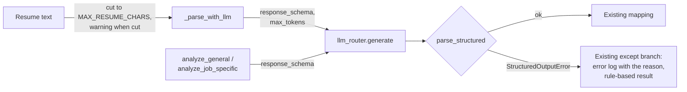

# MH-7: Resume parsing and resume analysis ask for their JSON schema and parse strictly

This is a spec handoff: it gives the behavior and the tests to write, not the code. Read `AGENT.md` first.

## Why

Two files take LLM JSON with the regex `\{.*\}`: the resume parser (`ResumeParser._parse_with_llm`) and the resume analyzer (`ResumeAnalyzer._parse_llm_assessment`, used by `analyze_general` and `analyze_job_specific`). In the baseline run (2026-11-01) both gave a strict answer every time, but the parser's model wrote "not provided" for missing URLs, because the prompt says "URL if present". The parser sends at most 8,000 characters of the resume (its comment says "For models with 32K context"; resume parsing now runs with 8,192 tokens, MH-3), cuts longer text without a message, and sets no answer limit, so the default of 4,096 answer tokens shares the 8,192-token context with the prompt.

After this handoff, both files send their output model's JSON schema and parse the whole answer with `parse_structured`. The parser sets an answer limit, logs a warning when it cuts a resume, and its prompt asks for `null` for missing URLs and for grouped skills only. A parse failure goes to the existing rule-based fallback, and the existing error log names the reason.



## Files

- `apps/backend-py/src/extractors/resume_parser.py` (change)
- `apps/backend-py/src/generation/resume_analyzer.py` (change)
- `apps/backend-py/tests/unit/test_structured_resume_parsing.py` (new)

Do not change other files.

## Required behavior

The output models and the parser are in `src/llm/structured.py`: `ResumeParsingAnswer`, `ResumeAnalysisAnswer`, `parse_structured`, and `StructuredOutputError`.

1. `resume_parser.py`:
   - After `logger = logging.getLogger(__name__)`, add two module constants with a comment: `MAX_RESUME_CHARS = 8_000` and `RESUME_MAX_TOKENS = 3_000`. The comment says why: resume parsing runs with a context of 8,192 tokens (router, Step 3.7); the prompt takes about 1,100 tokens and the answer at most `RESUME_MAX_TOKENS`, so the resume text gets about 4,000 tokens, and `MAX_RESUME_CHARS` stays below that.
   - In `_parse_with_llm`, replace `max_length = 8000  # For models with 32K context` and its line with: `llm_text` is the first `MAX_RESUME_CHARS` characters of `text`, and when `text` is longer, log `logger.warning(...)` with the original length and `MAX_RESUME_CHARS` (for example `"Resume text cut from %d to %d characters for the LLM"`). `full_text` stays the whole text.
   - Add `max_tokens=RESUME_MAX_TOKENS` and `response_schema=ResumeParsingAnswer.model_json_schema()` to its `generate` call.
   - Parse with `answer = parse_structured(response.content, ResumeParsingAnswer)` and `data = answer.model_dump()`. Remove the regex, its check, the local `import json`, `json.loads`, and the `isinstance(data, dict)` check. Keep the module-level `import re` (other code uses it). The existing `except` branch logs the error (its text starts with the reason, for example `not_json`) and returns the rule-based profile.
   - In the prompt, change these four lines (keep the indentation):
     - `"linkedin": "LinkedIn URL if present",` becomes `"linkedin": "LinkedIn URL, or null",`
     - `"github": "GitHub URL if present"` becomes `"github": "GitHub URL, or null"`
     - `"url": "URL if present",` becomes `"url": "URL, or null",`
     - `"gpa": "GPA if present"` becomes `"gpa": "GPA, or null"`
   - In the prompt line that starts with `IMPORTANT: For skills,`, remove the last sentence, ` A flat skills array is also acceptable.` (The schema allows the grouped skills object only.)
2. `resume_analyzer.py`:
   - Add `response_schema=ResumeAnalysisAnswer.model_json_schema()` to both `generate` calls (in `analyze_general` and in `analyze_job_specific`).
   - In `_parse_llm_assessment`, parse with `answer = parse_structured(response_content, ResumeAnalysisAnswer)` and return the same 11 keys as now, each from the answer's field of the same name (`overall_score`, `summary`, `key_strengths`, `key_improvements`, `resume_improvements`, `skill_gaps`, `next_steps`, `target_alignment_score`, `competitive_advantages`, `competitive_gaps`, `metadata`). Update its docstring with a `Raises:` line for `StructuredOutputError`.
   - The module-level `import json` and `import re` are then not used. Remove them.
3. Do not add a new `try` or a new fallback. Do not change other prompt lines, the YAML prompt templates, or the mapping functions.

## Step 1: write the tests, run them, and see the named tests fail

### The new test file `tests/unit/test_structured_resume_parsing.py`

Define these module constants:

```python
RESUME_TEXT = (
    "Mara Chen\nSingapore, Singapore\nmara@example.com\n\n"
    "TECHNICAL SKILLS\nPython, FastAPI, PostgreSQL\n\n"
    "EXPERIENCE\nEngineer - Acme\nJan 2024 - Present\n- Built an API\n"
)
PARSING_ANSWER = {
    "basics": {
        "name": "Mara Chen",
        "email": "mara@example.com",
        "phone": None,
        "location": "Singapore, Singapore",
        "linkedin": None,
        "github": None,
    },
    "summary": None,
    "skills": {
        "programming_languages": ["Python"],
        "frameworks": ["FastAPI"],
        "tools": [],
        "databases": ["PostgreSQL"],
        "cloud": [],
        "domains": [],
    },
    "experience": [
        {
            "title": "Engineer",
            "company": "Acme",
            "location": None,
            "start_date": "2024-01",
            "end_date": "present",
            "highlights": ["Built an API"],
        }
    ],
    "projects": [],
    "education": [],
    "certifications": [],
    "target_job": {
        "keywords": ["Software Engineer"],
        "locations": ["Singapore"],
        "experience_levels": ["Entry Level"],
        "remote_preference": None,
        "industries": ["Technology"],
    },
    "apprenticeship": None,
}
ANALYSIS_ANSWER = {
    "overall_score": 73,
    "summary": "Strong backend profile.",
    "key_strengths": ["Python"],
    "key_improvements": ["Add metrics"],
    "resume_improvements": ["Quantify results"],
    "skill_gaps": ["Kubernetes"],
    "next_steps": ["Build a cloud project"],
}
```

Write these helpers (with docstrings and type hints):

- `router_returning(content)`: a `MagicMock` router whose `generate` returns `LLMResponse(content=content, model="qwen2.5:7b", provider="ollama", prompt_tokens=10, completion_tokens=5)`.
- `parse_method(profile)`: `profile.metadata["resume_parse"]["method"]` as a string (`"llm"` or `"rule_based"`).

Call the components as `ResumeParser(llm_router=router).parse_text(text)`, `ResumeAnalyzer(router).analyze_general(sample_user_profile)`, and `ResumeAnalyzer(router).analyze_job_specific(sample_user_profile, sample_job_listing)` (fixtures from `tests/conftest.py`). To check the parser's logs, replace its module logger with `monkeypatch.setattr("src.extractors.resume_parser.logger", log)`, where `log` is a `MagicMock`. To check the analyzer's error log, set `analyzer.logger = MagicMock()` after you make it.

Write these 12 tests:

| Test | Input | Check |
|------|-------|-------|
| `test_resume_parsing_sends_its_schema_and_answer_limit` | `json.dumps(PARSING_ANSWER)`, `RESUME_TEXT` | `response_schema == ResumeParsingAnswer.model_json_schema()` and `max_tokens == 3000` |
| `test_resume_parsing_parses_a_strict_answer` | `json.dumps(PARSING_ANSWER)` | `profile.name == "Mara Chen"` and `parse_method(profile) == "llm"` |
| `test_resume_parsing_falls_back_on_text_after_the_fence` | `"```json\n" + json.dumps(PARSING_ANSWER) + "\n```\nI extracted the fields."`; logger replaced | `parse_method(profile) == "rule_based"` and `"not_json"` is in `str(log.error.call_args)` |
| `test_resume_parsing_falls_back_on_flat_skills` | `PARSING_ANSWER` with `skills=["Python", "FastAPI"]` | `parse_method(profile) == "rule_based"` |
| `test_resume_parsing_cuts_a_long_resume` | text `"y" * 20000`; answer `json.dumps(PARSING_ANSWER)`; logger replaced | the user message (`router.generate.call_args.kwargs["messages"][1].content`) contains `"y" * 8000` and not `"y" * 8001`, and `str(log.warning.call_args)` contains `"20000"` and `"8000"` |
| `test_resume_parsing_prompt_asks_for_null` | `json.dumps(PARSING_ANSWER)` | the user message contains `'"linkedin": "LinkedIn URL, or null"'` and `'"github": "GitHub URL, or null"'`, and not `"A flat skills array is also acceptable"` |
| `test_general_analysis_sends_its_schema` | `json.dumps(ANALYSIS_ANSWER)` | `response_schema == ResumeAnalysisAnswer.model_json_schema()` |
| `test_job_analysis_sends_its_schema` | `json.dumps(ANALYSIS_ANSWER)` | the same, for `analyze_job_specific` |
| `test_analysis_parses_a_strict_answer` | `json.dumps(ANALYSIS_ANSWER)` | `overall_score == 73` and `summary == "Strong backend profile."` |
| `test_analysis_falls_back_on_text_around_the_json` | `"Analysis:\n" + json.dumps(ANALYSIS_ANSWER)`; `analyzer.logger` replaced | `summary != "Strong backend profile."` and `"not_json"` is in the text of the `analyzer.logger.error` calls |
| `test_analysis_falls_back_on_a_score_above_100` | `ANALYSIS_ANSWER` with `overall_score=150` | `summary != "Strong backend profile."` |
| `test_no_regex_json_parsing_left` | the text of `src/extractors/resume_parser.py` and `src/generation/resume_analyzer.py` | `r're.search(r"\{.*\}"'` is not in either |

### Run the tests

Run the new file. Exactly 2 tests pass (`test_resume_parsing_parses_a_strict_answer` and `test_analysis_parses_a_strict_answer`) and the other 10 fail (`FAILED`, not `ERROR`):

```bash
.venv/bin/python -m pytest tests/unit/test_structured_resume_parsing.py -q --maxfail=20
```

## Step 2: change the two files

Change `resume_parser.py` and `resume_analyzer.py` as "Required behavior" says.

## Done when

Run the new tests. All 12 pass:

```bash
.venv/bin/python -m pytest tests/unit/test_structured_resume_parsing.py -q
```

Run the other tests of these components and the eval suite. All pass:

```bash
.venv/bin/python -m pytest tests/test_resume_analyzer.py tests/unit/test_cli.py tests/unit/test_resume_parse_metadata.py tests/unit/test_resume_profile_mapping.py tests/unit/test_resume_skills_extraction.py tests/unit/test_structured_suite.py -q
```

Check that the regex is gone. The command must print `no regex JSON parsing`:

```bash
grep -n "DOTALL" src/extractors/resume_parser.py src/generation/resume_analyzer.py || echo "no regex JSON parsing"
```

Format the changed files:

```bash
.venv/bin/python -m black src/extractors/resume_parser.py src/generation/resume_analyzer.py tests/unit/test_structured_resume_parsing.py
```

Check the lint:

```bash
.venv/bin/python -m ruff check src/extractors/resume_parser.py src/generation/resume_analyzer.py tests/unit/test_structured_resume_parsing.py
```

Run the mypy gate. It must report 0 new errors. It can also say that some baseline errors are fixed; do nothing about that. Do not add `--update`:

```bash
.venv/bin/python scripts/mypy_gate.py
```

The working tree has other changed files that are not part of this handoff. Do not stage them. Do not use `git add -A`, `git add .`, or `git commit -a`. Stage only your three files:

```bash
git add src/extractors/resume_parser.py src/generation/resume_analyzer.py tests/unit/test_structured_resume_parsing.py
```

Check that only these three files are staged:

```bash
git diff --cached --name-only
```

Commit with this message:

```text
feat(extractors): use the JSON schema and the strict parser for resume parsing and analysis

The resume parser and the resume analyzer send their output model's JSON
schema and parse the whole answer with parse_structured instead of the
regex. The parser limits the answer to 3,000 tokens, logs a warning when
it cuts a resume to 8,000 characters, and asks for null when a URL or
GPA is missing and for grouped skills only (Step 3.7, MH-7).
```
