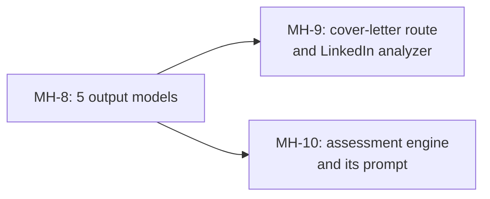

# MH-8: Output models for the prep sheet, score explanation, LinkedIn analysis, and assessments

## Apply with the runner

The handoff runner applies this file: it writes the test file, runs the red command (it must fail), adds the models, runs the "Done when" checks (they must pass), and commits. See `docs/handoff-runner.md`.

Apply this handoff (WSL, from `apps/backend-py`):

```bash
.venv/bin/python scripts/run_handoff.py ../../tasks/active/step-3-7-structured-output/mh-8-more-output-models.md
```

## Why

After MH-4 to MH-7, three more places parse LLM JSON in their own way, outside the 9 call sites of review item R13: the cover-letter route (`_parse_json_object`, for the prep sheet and the score explanation), the LinkedIn analyzer (`_extract_json`, a code-fence regex and brace matching), and the assessment engine (a fence removal and `json.loads`, for question generation and answer scoring). This handoff adds their output models to `src/llm/structured.py`. MH-9 and MH-10 change the call sites.



- The question generation answers with a JSON array today. Ollama's `format` and `parse_structured` take one JSON object, so `AssessmentQuestionsAnswer` holds the list in `questions`; MH-10 changes the prompt to match.
- A question needs no hint, options, or time limit (a free-form question has no options), and a score needs no `is_correct` (only the multiple-choice prompt asks for it). These fields have defaults. The question types are the four technical types of the prompt; `disc` is not one of them.
- The new models are not in `OUTPUT_MODELS`, because the `structured` eval suite has no cases for them.

## Files

- `apps/backend-py/src/llm/structured.py` (change)
- `apps/backend-py/tests/unit/test_structured_output_other_tasks.py` (new)

## Step 1: add the test file, run it, and see it fail

```python new=apps/backend-py/tests/unit/test_structured_output_other_tasks.py
"""Tests for the output models of the prep sheet, score explanation, LinkedIn analysis, and assessments (Step 3.7, MH-8)."""

import json
from typing import Any, Dict, Set, Type

import pytest
from pydantic import BaseModel

from src.llm.structured import (
    AssessmentQuestionsAnswer,
    AssessmentScoreAnswer,
    LinkedInAnalysisAnswer,
    PrepSheetAnswer,
    ScoreExplanationAnswer,
    StructuredOutputError,
    parse_structured,
)

LINKEDIN_ANSWER: Dict[str, Any] = {
    "overall_score": 85,
    "summary": "Strong profile.",
    "section_scores": [
        {"section_name": "Headline", "score": 90, "weight": 0.25, "feedback": "Clear."}
    ],
    "insights": [
        {
            "category": "headline",
            "observation": "Headline is strong.",
            "recommendation": "Keep it.",
            "priority": "low",
        }
    ],
    "keyword_recommendations": ["Python"],
    "action_plan": ["Step 1"],
    "generated_headline_options": ["Backend engineer"],
    "summary_rewrite_suggestions": ["Name the domain."],
    "competitive_edge": "Strong",
}
QUESTION: Dict[str, Any] = {
    "question_type": "coding",
    "answer_format": "multiple_choice",
    "difficulty": "advanced",
    "topic": "algorithms",
    "question_text": "Which search is O(log n)?",
    "options": [
        {"label": "A", "text": "Binary search", "is_correct": True},
        {"label": "B", "text": "Linear search", "is_correct": False},
    ],
    "correct_answer_hint": "Binary search halves the range.",
    "time_limit_seconds": 120,
}
SCORE_ANSWER: Dict[str, Any] = {
    "score": 80,
    "feedback": "Good answer.",
    "strengths": ["Clear"],
    "improvements": ["Add an example"],
    "model_answer": "Binary search.",
}

SAMPLES = [
    (
        PrepSheetAnswer,
        {"likely_questions": ["Why us?"], "gaps_to_address": [], "talking_points": []},
    ),
    (
        ScoreExplanationAnswer,
        {"strengths": ["Python"], "concerns": [], "improvements": ["Add Go"]},
    ),
    (LinkedInAnalysisAnswer, LINKEDIN_ANSWER),
    (AssessmentQuestionsAnswer, {"questions": [QUESTION]}),
    (AssessmentScoreAnswer, SCORE_ANSWER),
]

REQUIRED: Dict[Type[BaseModel], Set[str]] = {
    PrepSheetAnswer: {"likely_questions", "gaps_to_address", "talking_points"},
    ScoreExplanationAnswer: {"strengths", "concerns", "improvements"},
    LinkedInAnalysisAnswer: {
        "overall_score",
        "summary",
        "section_scores",
        "insights",
        "keyword_recommendations",
        "action_plan",
        "generated_headline_options",
        "summary_rewrite_suggestions",
        "competitive_edge",
    },
    AssessmentQuestionsAnswer: {"questions"},
    AssessmentScoreAnswer: {
        "score",
        "feedback",
        "strengths",
        "improvements",
        "model_answer",
    },
}


@pytest.mark.parametrize("model, sample", SAMPLES)
def test_each_model_accepts_the_shape_of_its_prompt(
    model: Type[BaseModel], sample: Dict[str, Any]
) -> None:
    """A sample answer in the shape that each prompt asks for validates."""
    assert isinstance(parse_structured(json.dumps(sample), model), model)


@pytest.mark.parametrize("model", list(REQUIRED))
def test_each_schema_requires_the_prompt_fields(model: Type[BaseModel]) -> None:
    """Each schema is an object schema that requires exactly the prompt's fields."""
    schema = model.model_json_schema()

    assert schema["type"] == "object"
    assert set(schema["required"]) == REQUIRED[model]


def test_linkedin_priority_has_three_values() -> None:
    """An insight priority outside high, medium, and low does not match."""
    answer = json.loads(json.dumps(LINKEDIN_ANSWER))
    answer["insights"][0]["priority"] = "urgent"

    with pytest.raises(StructuredOutputError) as caught:
        parse_structured(json.dumps(answer), LinkedInAnalysisAnswer)

    assert caught.value.reason == "schema"


def test_linkedin_section_score_is_at_most_100() -> None:
    """A section score above 100 does not match."""
    answer = json.loads(json.dumps(LINKEDIN_ANSWER))
    answer["section_scores"][0]["score"] = 120

    with pytest.raises(StructuredOutputError):
        parse_structured(json.dumps(answer), LinkedInAnalysisAnswer)


def test_linkedin_metadata_is_optional() -> None:
    """The analysis needs no metadata."""
    parsed = parse_structured(json.dumps(LINKEDIN_ANSWER), LinkedInAnalysisAnswer)

    assert parsed.metadata == {}


def test_a_question_needs_no_hint_options_or_time_limit() -> None:
    """A free-form question without a hint, options, or a time limit matches."""
    question = {
        k: v
        for k, v in QUESTION.items()
        if k not in ("options", "correct_answer_hint", "time_limit_seconds")
    }

    parsed = parse_structured(
        json.dumps({"questions": [question]}), AssessmentQuestionsAnswer
    )

    item = parsed.questions[0]
    assert item.options == []
    assert item.correct_answer_hint == ""
    assert item.time_limit_seconds is None


def test_a_disc_question_type_does_not_match() -> None:
    """Generated questions are technical; ``disc`` is not one of their types."""
    question = dict(QUESTION, question_type="disc")

    with pytest.raises(StructuredOutputError):
        parse_structured(
            json.dumps({"questions": [question]}), AssessmentQuestionsAnswer
        )


def test_a_bare_question_list_is_not_an_object() -> None:
    """A JSON array of questions is a ``not_object`` failure."""
    with pytest.raises(StructuredOutputError) as caught:
        parse_structured(json.dumps([QUESTION]), AssessmentQuestionsAnswer)

    assert caught.value.reason == "not_object"


def test_a_free_form_score_needs_no_correct_flag() -> None:
    """A free-form score has no ``is_correct``; a multiple-choice score has one."""
    free_form = parse_structured(json.dumps(SCORE_ANSWER), AssessmentScoreAnswer)
    choice = parse_structured(
        json.dumps(dict(SCORE_ANSWER, is_correct=True)), AssessmentScoreAnswer
    )

    assert free_form.is_correct is None
    assert choice.is_correct is True


def test_a_score_above_100_does_not_match() -> None:
    """A score above 100 does not match."""
    with pytest.raises(StructuredOutputError):
        parse_structured(
            json.dumps(dict(SCORE_ANSWER, score=150)), AssessmentScoreAnswer
        )
```

Run it. It must fail (the models do not exist yet):

```bash red cwd=apps/backend-py
.venv/bin/python -m pytest tests/unit/test_structured_output_other_tasks.py -q
```

## Step 2: add the models to `src/llm/structured.py`

Add the models before `OUTPUT_MODELS`:

```python edit=apps/backend-py/src/llm/structured.py
<<<<<<< OLD
OUTPUT_MODELS: Dict[str, Type[BaseModel]] = {
=======
class PrepSheetAnswer(BaseModel):
    """Answer of the interview prep sheet (``api/routes/cover_letter.py``)."""

    likely_questions: List[str]
    gaps_to_address: List[str]
    talking_points: List[str]


class ScoreExplanationAnswer(BaseModel):
    """Answer of the match-score explanation (``api/routes/cover_letter.py``)."""

    strengths: List[str]
    concerns: List[str]
    improvements: List[str]


class LinkedInSectionScore(BaseModel):
    """Score of one LinkedIn profile section."""

    section_name: str
    score: int = Field(ge=0, le=100)
    weight: float = Field(ge=0, le=1)
    feedback: str


class LinkedInInsight(BaseModel):
    """One observation and recommendation about a LinkedIn profile."""

    category: str
    observation: str
    recommendation: str
    priority: Literal["high", "medium", "low"]


class LinkedInAnalysisAnswer(BaseModel):
    """Answer of the LinkedIn profile analysis (``linkedin_analyzer.py``)."""

    overall_score: int = Field(ge=0, le=100)
    summary: str
    section_scores: List[LinkedInSectionScore]
    insights: List[LinkedInInsight]
    keyword_recommendations: List[str]
    action_plan: List[str]
    generated_headline_options: List[str]
    summary_rewrite_suggestions: List[str]
    competitive_edge: str
    metadata: Dict[str, str] = Field(default_factory=dict)


class AssessmentOption(BaseModel):
    """One option of a multiple-choice assessment question."""

    label: str
    text: str
    is_correct: bool


class AssessmentQuestion(BaseModel):
    """One generated assessment question."""

    question_type: Literal["conceptual", "scenario", "coding", "system_design"]
    answer_format: Literal["freeform", "multiple_choice"]
    difficulty: Literal["beginner", "intermediate", "advanced", "expert"]
    topic: str
    question_text: str
    options: List[AssessmentOption] = Field(default_factory=list)
    correct_answer_hint: str = ""
    time_limit_seconds: Optional[int] = None


class AssessmentQuestionsAnswer(BaseModel):
    """Answer of the assessment question generation (``assessment/engine.py``).

    The questions are inside an object, because Ollama's ``format`` and
    ``parse_structured`` take one JSON object.
    """

    questions: List[AssessmentQuestion]


class AssessmentScoreAnswer(BaseModel):
    """Answer of the free-form and multiple-choice answer scoring (``assessment/engine.py``)."""

    score: float = Field(ge=0, le=100)
    feedback: str
    strengths: List[str]
    improvements: List[str]
    model_answer: str
    is_correct: Optional[bool] = None


OUTPUT_MODELS: Dict[str, Type[BaseModel]] = {
>>>>>>> NEW
```

## Done when

Run the new tests and the tests of the first models and the eval suite:

```bash check cwd=apps/backend-py
.venv/bin/python -m pytest tests/unit/test_structured_output_other_tasks.py tests/unit/test_structured_output.py tests/unit/test_structured_suite.py -q
```

Format the changed files:

```bash check cwd=apps/backend-py
.venv/bin/python -m black src/llm/structured.py tests/unit/test_structured_output_other_tasks.py
```

Check the lint:

```bash check cwd=apps/backend-py
.venv/bin/python -m ruff check src/llm/structured.py tests/unit/test_structured_output_other_tasks.py
```

Run the mypy gate (no new errors):

```bash check cwd=apps/backend-py
.venv/bin/python scripts/mypy_gate.py
```

Commit message:

```text commit
feat(llm): add output models for the prep sheet, explanations, LinkedIn, and assessments

Three more places parse LLM JSON in their own way. src/llm/structured.py
gets their output models: PrepSheetAnswer, ScoreExplanationAnswer,
LinkedInAnalysisAnswer, AssessmentQuestionsAnswer (the question list
inside an object, for Ollama's format), and AssessmentScoreAnswer. No
call site changes yet (Step 3.7, MH-8).
```
