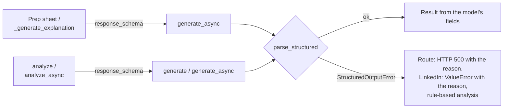

# MH-9: The cover-letter route helpers and the LinkedIn analyzer ask for their JSON schema and parse strictly

This is a spec handoff: it gives the behavior and the tests to write, not the code. Read `AGENT.md` first. MH-8 must be in the repository (it adds the output models).

## Why

Two more places take LLM JSON with lenient code:

- `src/api/routes/cover_letter.py`: `_parse_json_object` removes a code fence and takes the text from the first `{` to the last `}`. Two helpers use it: the prep sheet (in the prep-sheet route) and `_generate_explanation` (fit and letter explanations). Their callers already answer HTTP 500 on any error.
- `src/generation/linkedin_analyzer.py`: `_extract_json` searches for a code fence with a regex, then matches braces. `_parse_llm_analysis` fills missing keys with defaults. `analyze` and `analyze_async` fall back to the rule-based analysis on an error.

After this handoff, these calls send their output model's JSON schema (the router gives it to Ollama as `format`) and parse the whole answer with `parse_structured`. Lenient search code goes.



## Files

- `apps/backend-py/src/api/routes/cover_letter.py` (change)
- `apps/backend-py/src/generation/linkedin_analyzer.py` (change)
- `apps/backend-py/tests/unit/test_structured_route_and_linkedin.py` (new)
- `apps/backend-py/tests/unit/test_linkedin_analyzer.py` (change one test, Step 1.2)

Do not change other files.

## Required behavior

The output models and the parser are in `src/llm/structured.py`: `PrepSheetAnswer`, `ScoreExplanationAnswer`, `LinkedInAnalysisAnswer`, `parse_structured`, and `StructuredOutputError`.

1. `cover_letter.py`:
   - In the prep-sheet code, change the `generate_async` call to also pass `response_schema=PrepSheetAnswer.model_json_schema()`, and parse with `answer = parse_structured(response.content, PrepSheetAnswer)`. Build the response with `_string_list(answer.likely_questions)`, `_string_list(answer.gaps_to_address)`, and `_string_list(answer.talking_points)`.
   - In `_generate_explanation`, pass `response_schema=ScoreExplanationAnswer.model_json_schema()`, parse with `parse_structured(response.content, ScoreExplanationAnswer)`, and build the response with `_string_list` of `answer.strengths`, `answer.concerns`, and `answer.improvements`.
   - Remove the function `_parse_json_object`. Keep the module-level `import json` and `import re` (other code uses them). Keep the existing `try`/`except` blocks: a parse failure becomes HTTP 500 with the error text, which starts with the reason (for example `not_json`).
2. `linkedin_analyzer.py`:
   - Add `response_schema=LinkedInAnalysisAnswer.model_json_schema()` to the `generate` call in `analyze` and to the `generate_async` call in `analyze_async`.
   - Remove the method `_extract_json`.
   - In `_parse_llm_analysis`, parse with `answer = parse_structured(response_content, LinkedInAnalysisAnswer)`. Catch `StructuredOutputError` as `e` and raise `ValueError(f"Failed to extract JSON from analysis response: {e}")` from it (the existing tests match "Failed to extract JSON"; the reason follows it). Return the same 10 keys as now: `section_scores` and `insights` as lists of `model_dump()` dicts, the other keys from the answer's fields of the same name, and `metadata` from `answer.metadata`. Update the `Raises:` line of its docstring.
   - The module-level `import json` and `import re` are then not used. Remove them.
3. Do not add a new fallback. Do not change the prompts.

## Step 1: write the tests, run them, and see the named tests fail

### 1.1 The new test file `tests/unit/test_structured_route_and_linkedin.py`

Define these module constants:

```python
EXPLANATION_ANSWER = {
    "strengths": ["Names the role"],
    "concerns": ["Generic close"],
    "improvements": ["Add a metric"],
}
LINKEDIN_ANSWER = {
    "overall_score": 82,
    "summary": "Clear backend profile.",
    "section_scores": [
        {"section_name": "Headline", "score": 90, "weight": 0.25, "feedback": "Clear."}
    ],
    "insights": [
        {
            "category": "headline",
            "observation": "Headline names the stack.",
            "recommendation": "Add the domain.",
            "priority": "medium",
        }
    ],
    "keyword_recommendations": ["Python"],
    "action_plan": ["Step 1"],
    "generated_headline_options": ["Backend engineer"],
    "summary_rewrite_suggestions": ["Name the domain."],
    "competitive_edge": "Strong",
}
```

Write these helpers (with docstrings and type hints):

- `async_router_returning(content)`: a `MagicMock` router whose `generate_async` is an `AsyncMock` that returns `LLMResponse(content=content, model="qwen2.5:7b", provider="ollama")`.
- `explain(monkeypatch, content)`: replace `create_router` in `src.api.routes.cover_letter` (import the module as `route`) with `lambda prefer_local: router`, where `router` is `async_router_returning(content)`, run `asyncio.run(route._generate_explanation("system", "user"))`, and return the result and the router.

For the LinkedIn tests, make the analyzer as `LinkedInAnalyzer(MagicMock(spec=LLMRouter))`; for the two "sends its schema" tests, give that router `generate` (a return value) or `generate_async` (an `AsyncMock`) that returns `LLMResponse(content=json.dumps(LINKEDIN_ANSWER), model="qwen2.5:7b", provider="ollama")`, and call `analyze` or `analyze_async` with `LinkedInProfileInput(raw_text="Backend engineer, Python.")`.

Write these 11 tests:

| Test | Input | Check |
|------|-------|-------|
| `test_explanation_sends_its_schema` | `json.dumps(EXPLANATION_ANSWER)` | `router.generate_async.call_args.kwargs["response_schema"] == ScoreExplanationAnswer.model_json_schema()` |
| `test_explanation_parses_a_strict_answer` | `json.dumps(EXPLANATION_ANSWER)` | `strengths == ["Names the role"]` and `improvements == ["Add a metric"]` |
| `test_explanation_refuses_text_around_the_json` | `"Sure: " + json.dumps(EXPLANATION_ANSWER)` | `pytest.raises(ValueError, match="not_json")` |
| `test_explanation_refuses_a_missing_list` | `EXPLANATION_ANSWER` without `concerns` | `pytest.raises(ValueError, match="schema")` |
| `test_route_has_no_lenient_json_helper` | the text of `src/api/routes/cover_letter.py` | `"_parse_json_object"` is not in it, and `"response_schema=PrepSheetAnswer.model_json_schema()"` is in it |
| `test_linkedin_analysis_sends_its_schema` | `analyze`, answer `json.dumps(LINKEDIN_ANSWER)` | `router.generate.call_args.kwargs["response_schema"] == LinkedInAnalysisAnswer.model_json_schema()` |
| `test_linkedin_async_analysis_sends_its_schema` | `analyze_async`, the same answer | `router.generate_async.call_args.kwargs["response_schema"]` is the same schema |
| `test_linkedin_parses_a_strict_answer` | `_parse_llm_analysis(json.dumps(LINKEDIN_ANSWER))` | `overall_score == 82`, `section_scores[0]["section_name"] == "Headline"`, `insights[0]["priority"] == "medium"`, `metadata == {}` |
| `test_linkedin_refuses_text_around_the_json` | `"Here is the analysis: " + json.dumps(LINKEDIN_ANSWER)` | `pytest.raises(ValueError, match="Failed to extract JSON.*not_json")` |
| `test_linkedin_refuses_an_unknown_priority` | `LINKEDIN_ANSWER` with `insights[0]["priority"] = "urgent"` | `pytest.raises(ValueError, match="schema")` |
| `test_no_regex_or_brace_search_left` | the text of `src/generation/linkedin_analyzer.py` | `"_extract_json"` and `"re.search"` are not in it |

### 1.2 Change one existing test

In `tests/unit/test_linkedin_analyzer.py`, `TestLinkedInAnalyzerParseLLM.test_parse_json_with_markdown` sends only `overall_score` and `summary`, which the new schema refuses. Replace its `response_data` line with this dictionary; keep the rest of the test:

```python
        response_data = {
            "overall_score": 75,
            "summary": "Good profile.",
            "section_scores": [],
            "insights": [],
            "keyword_recommendations": [],
            "action_plan": [],
            "generated_headline_options": [],
            "summary_rewrite_suggestions": [],
            "competitive_edge": "Fair",
        }
```

### 1.3 Run the tests

Run the new file. Exactly 2 tests pass (`test_explanation_parses_a_strict_answer` and `test_linkedin_parses_a_strict_answer`) and the other 9 fail (`FAILED`, not `ERROR`):

```bash
.venv/bin/python -m pytest tests/unit/test_structured_route_and_linkedin.py -q --maxfail=20
```

## Step 2: change the two files

Change `cover_letter.py` and `linkedin_analyzer.py` as "Required behavior" says.

## Done when

Run the new tests. All 11 pass:

```bash
.venv/bin/python -m pytest tests/unit/test_structured_route_and_linkedin.py -q
```

Run the other tests of these files. All pass:

```bash
.venv/bin/python -m pytest tests/unit/test_linkedin_analyzer.py tests/unit/test_cover_letter_explain.py tests/unit/test_cover_letter_instructions.py tests/unit/test_jobs_cover_letter.py tests/unit/test_cover_letter_manual.py -q
```

Format the changed files:

```bash
.venv/bin/python -m black src/api/routes/cover_letter.py src/generation/linkedin_analyzer.py tests/unit/test_structured_route_and_linkedin.py tests/unit/test_linkedin_analyzer.py
```

Check the lint:

```bash
.venv/bin/python -m ruff check src/api/routes/cover_letter.py src/generation/linkedin_analyzer.py tests/unit/test_structured_route_and_linkedin.py tests/unit/test_linkedin_analyzer.py
```

Run the mypy gate. It must report 0 new errors. It can also say that some baseline errors are fixed; do nothing about that. Do not add `--update`:

```bash
.venv/bin/python scripts/mypy_gate.py
```

The working tree has other changed files that are not part of this handoff. Do not stage them. Do not use `git add -A`, `git add .`, or `git commit -a`. Stage only your four files:

```bash
git add src/api/routes/cover_letter.py src/generation/linkedin_analyzer.py tests/unit/test_structured_route_and_linkedin.py tests/unit/test_linkedin_analyzer.py
```

Check that only these four files are staged:

```bash
git diff --cached --name-only
```

Commit with this message:

```text
feat(api): use the JSON schema and the strict parser for prep sheets, explanations, and LinkedIn

The prep sheet, the score explanations, and the LinkedIn analysis send
their output model's JSON schema and parse the whole answer with
parse_structured. The lenient helpers _parse_json_object (first brace
to last brace) and _extract_json (fence regex and brace matching) are
removed; a parse failure keeps its existing path (HTTP 500 or the
rule-based analysis) with the reason in the message (Step 3.7, MH-9).
```
