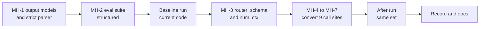

# Task: Step 3.7 Structured Output and Context Size

## Goal
Every LLM task that returns JSON asks Ollama for that JSON with a schema (Ollama `format`) and parses it with a Pydantic model, not with the regex `\{.*\}`. Each task sets its context size (`num_ctx`) and cuts its input to fit. The parse-failure rate of each task is measured on a fixed local set before and after the change (review items R13 and R14; plan in `tasks/active/step-3-measurable-claims/notes.md`).

## Constraints & Context
- Measure first: the baseline runs on the current code with the same suite and set as the after run.
- The fixed set uses committed synthetic fixtures only (grounding profiles, jobs, and letters; `tests/fixtures/jd_paste/`; synthetic resume texts). No personal data.
- The suite needs Ollama, so it runs locally and logs to MLflow, not in CI. Its unit tests use a fake router and run in CI.
- GPU: one model at a time, models of 7B or smaller, unload after each model group, VRAM well below 8 GB. A larger `num_ctx` uses more VRAM, so the after run records the peak VRAM.
- The existing fallbacks (rule-based selection, template resume, and so on) stay. A parse failure is logged with the task and the reason.
- Cloud fallback providers ignore the schema; the parser accepts their JSON (also inside a code fence) without a regex.

## Acceptance Criteria
- [x] MH-1: output models for the 9 JSON tasks and one strict parser (`json.loads` and `model_validate`, code fences removed), with tests. (`8e9aadf`, 2026-10-31; 35 tests; 13 of 13 mutants caught)
- [x] MH-2: eval suite `structured` and its fixed set: for each task, the share of answers that parse strictly, that only the old regex can rescue, and that fail; prompt tokens against the context size; the model of each task in the run metadata. (`0542129`, 2026-11-01; 43 cases; 29 tests; 18 of 18 mutants caught)
- [ ] Baseline run on the current code, recorded in `notes.md` (command, dataset SHA-256, MLflow run ID, peak VRAM).
- [ ] MH-3: the router passes a JSON schema to Ollama as `format`, sets `num_ctx` for each task, and keeps both in the response-cache key.
- [ ] MH-4 to MH-7: the 9 call sites use the schema and the strict parser; JD extraction and resume parsing cut their input to the task budget and log when they fall back to rule-based parsing.
- [ ] After run on the same set, recorded next to the baseline.
- [ ] Done when: no code parses LLM JSON with a regex (`grep` check), the parse-failure rate per task is recorded before and after, and the full backend gate passes.

## Status
`in-progress` (2026-10-31: plan approved; MH-1 to MH-3 by the runner, MH-4 to MH-7 as spec handoffs for an agent)
