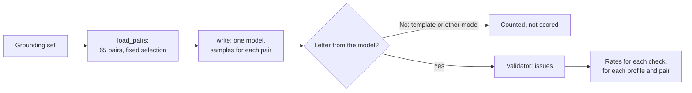

# MH-1: Writer eval suite core

## Apply with the runner

The handoff runner applies this file: it writes the test file, runs the red command (it must fail), adds the suite, runs the "Done when" checks (they must pass), and commits. See `docs/handoff-runner.md`.

Apply this handoff (WSL, from `apps/backend-py`):

```bash
.venv/bin/python scripts/run_handoff.py ../../tasks/active/step-3-8-writer-models/mh-1-writer-suite.md
```

## Why

Step 3.8 compares local writer models on the grounding set. This handoff adds the core of the `writer` suite: the 65 profile-job pairs of the grounding set (each with the fixed selection of the structured suite), `samples` letters for each pair from one model, the deterministic validator on each letter, and the metrics. The writer is a parameter, so the tests use a fake. MH-2 adds the real writer and the command; MH-3 adds the paired comparison.



- Main metric: `ungrounded_claims_rate`, the share of written letters with that issue. On the real letters of Step 3.2, this check has precision 0.875 and recall 0.778 at the letter level.
- The rows keep the count of ungrounded sentences, but no metric ranks on it (precision 0.182 and recall 0.154 at the sentence level).
- A letter from the template fallback (`model_used="template_fallback"`) or from another model is counted as `fallback` or `other_model`; a writer exception is counted as `error`. Only `written` letters enter the rates.

## Files

- `apps/backend-py/src/evaluation/suites/writer.py` (new)
- `apps/backend-py/tests/unit/test_writer_suite.py` (new)

## Step 1: add the test file, run it, and see it fail

```python new=apps/backend-py/tests/unit/test_writer_suite.py
"""Tests for the writer eval suite (Step 3.8, MH-1)."""

import json
import shutil
from pathlib import Path
from types import SimpleNamespace
from typing import Any, Callable, Dict, List, Optional

import pytest

from src.evaluation.suites.writer import (
    CHECKS,
    DEFAULT_DATASET_DIR,
    FALLBACK_MODEL,
    MAIN_CHECK,
    WRITER_TEMPERATURE,
    load_pairs,
    percentile,
    run_writer_suite,
)
from src.generation.cover_letter_writer import GeneratedCoverLetter

MODEL = "qwen2.5:7b"


def small_dataset(tmp_path: Path, count: int = 3) -> Path:
    """
    A copy of the grounding profiles with the first cases of the set.

    Args:
        tmp_path: The test folder.
        count: Cases to keep.

    Returns:
        The dataset folder.
    """
    shutil.copy(DEFAULT_DATASET_DIR / "profiles.json", tmp_path / "profiles.json")
    lines = (DEFAULT_DATASET_DIR / "cases.jsonl").read_text(encoding="utf-8")
    kept = [line for line in lines.splitlines() if line.strip()][:count]
    (tmp_path / "cases.jsonl").write_text("\n".join(kept) + "\n", encoding="utf-8")
    return tmp_path


def job_ids(dataset_dir: Path) -> List[str]:
    """
    The job IDs of a dataset, in the order of the suite (by case ID).

    Args:
        dataset_dir: The dataset folder.

    Returns:
        One job ID for each pair.
    """
    return [pair.job.job_id for pair in load_pairs(dataset_dir)]


def writer_for(models: Optional[Dict[str, str]] = None) -> Callable[..., Any]:
    """
    A fake writer that returns a short letter.

    Args:
        models: Job ID to the ``model_used`` of its letters (default: MODEL).

    Returns:
        The write function.
    """

    def write(job: Any, profile: Any, selection: Any) -> GeneratedCoverLetter:
        """
        Return a fixed letter for the job.

        Args:
            job: The job.
            profile: The profile.
            selection: The selection.

        Returns:
            The letter.
        """
        used = (models or {}).get(job.job_id, MODEL)
        return GeneratedCoverLetter(
            content="Dear team, I built this.",
            highlighted_experiences=[],
            word_count=120,
            model_used=used,
        )

    return write


class FakeValidator:
    """Gives the issues of a map for each job and sample, in call order."""

    def __init__(self, issues_by_job: Dict[str, List[List[str]]]) -> None:
        """
        Keep the issues.

        Args:
            issues_by_job: Job ID to the issues of sample 0, sample 1, and so on.
        """
        self.issues_by_job = issues_by_job
        self.seen: Dict[str, int] = {}

    def validate(self, letter: Any, job: Any, profile: Any, selection: Any) -> Any:
        """
        Return the next issues for the job.

        Args:
            letter: The letter.
            job: The job.
            profile: The profile.
            selection: The selection.

        Returns:
            A result with ``issues``, ``is_valid``, ``score``, and ``details``.
        """
        sample = self.seen.get(job.job_id, 0)
        self.seen[job.job_id] = sample + 1
        per_sample = self.issues_by_job.get(job.job_id, [])
        issues = per_sample[sample] if sample < len(per_sample) else []
        return SimpleNamespace(
            issues=[SimpleNamespace(value=issue) for issue in issues],
            is_valid=not issues,
            score=100 - 10 * len(issues),
            details={"ungrounded_sentences": ["x"] * issues.count(MAIN_CHECK)},
        )


def test_load_pairs_gives_one_pair_for_each_grounding_case() -> None:
    """Each grounding case is one pair, ordered by case ID, with a fixed selection."""
    pairs = load_pairs()

    assert len(pairs) == 65
    assert [p.case_id for p in pairs] == sorted(p.case_id for p in pairs)
    assert {p.profile_id for p in pairs} == {"ml", "backend", "grad"}
    for pair in pairs:
        names = [project.name for project in pair.profile.projects[:3]]
        assert [s["name"] for s in pair.selection.selected_projects] == names


def test_load_pairs_rejects_an_unknown_profile(tmp_path: Path) -> None:
    """A case with a profile that is not in profiles.json stops the run."""
    dataset = small_dataset(tmp_path, count=1)
    case = json.loads((dataset / "cases.jsonl").read_text(encoding="utf-8"))
    case["profile_id"] = "nobody"
    (dataset / "cases.jsonl").write_text(json.dumps(case) + "\n", encoding="utf-8")

    with pytest.raises(ValueError, match="unknown profile_id"):
        load_pairs(dataset)


def test_each_pair_gets_each_sample(tmp_path: Path) -> None:
    """Each pair is written once for each sample."""
    dataset = small_dataset(tmp_path)
    calls: List[str] = []
    inner = writer_for()

    def write(job: Any, profile: Any, selection: Any) -> GeneratedCoverLetter:
        """Record the job, then write."""
        calls.append(job.job_id)
        return inner(job, profile, selection)

    report = run_writer_suite(
        dataset, model=MODEL, write=write, samples=2, validator=FakeValidator({})
    )

    assert len(calls) == 6
    rows = report.details["rows"]
    assert [(r["case_id"], r["sample"]) for r in rows] == [
        (pair.case_id, sample) for pair in load_pairs(dataset) for sample in range(2)
    ]
    assert report.metrics["letters"] == 6
    assert report.metrics["written"] == 6


def test_rates_count_the_flagged_letters(tmp_path: Path) -> None:
    """Each check's rate is the share of written letters that it flags."""
    dataset = small_dataset(tmp_path)
    first, second, _ = job_ids(dataset)
    validator = FakeValidator(
        {
            first: [[MAIN_CHECK], []],
            second: [
                [MAIN_CHECK, "fabricated_technology"],
                [MAIN_CHECK, "fabricated_technology"],
            ],
        }
    )

    report = run_writer_suite(
        dataset, model=MODEL, write=writer_for(), samples=2, validator=validator
    )

    assert report.metrics["ungrounded_claims_rate"] == 0.5
    assert report.metrics["fabricated_technology_rate"] == 0.333
    assert report.metrics["fabricated_experience_rate"] == 0.0
    assert report.metrics["scope_inflation_rate"] == 0.0
    assert report.metrics["valid_rate"] == 0.5
    assert report.metrics["mean_score"] == round(
        (90 + 100 + 80 + 80 + 100 + 100) / 6, 2
    )


def test_fallback_and_other_model_letters_are_counted_not_scored(
    tmp_path: Path,
) -> None:
    """Template letters and letters from another model do not enter the rates."""
    dataset = small_dataset(tmp_path)
    first, second, third = job_ids(dataset)
    write = writer_for({first: FALLBACK_MODEL, second: "qwen3.5:4b"})
    validator = FakeValidator({third: [[MAIN_CHECK], []]})

    report = run_writer_suite(
        dataset, model=MODEL, write=write, samples=2, validator=validator
    )

    assert report.metrics["fallback"] == 2
    assert report.metrics["other_model"] == 2
    assert report.metrics["written"] == 2
    assert report.metrics["ungrounded_claims_rate"] == 0.5
    assert set(validator.seen) == {third}


def test_writer_errors_are_counted(tmp_path: Path) -> None:
    """A writer that raises gives an error row, and the run goes on."""
    dataset = small_dataset(tmp_path)
    first = job_ids(dataset)[0]
    inner = writer_for()

    def write(job: Any, profile: Any, selection: Any) -> GeneratedCoverLetter:
        """Raise for the first job, else write."""
        if job.job_id == first:
            raise RuntimeError("model not loaded")
        return inner(job, profile, selection)

    report = run_writer_suite(
        dataset, model=MODEL, write=write, samples=2, validator=FakeValidator({})
    )

    assert report.metrics["error"] == 2
    assert report.metrics["written"] == 4
    errors = [r for r in report.details["rows"] if r["outcome"] == "error"]
    assert {r["error"] for r in errors} == {"RuntimeError"}


def test_issues_outside_the_checks_do_not_change_the_rates(tmp_path: Path) -> None:
    """Structure issues stay in the rows but are not grounding rates."""
    dataset = small_dataset(tmp_path, count=1)
    first = job_ids(dataset)[0]
    validator = FakeValidator({first: [["too_long"]]})

    report = run_writer_suite(
        dataset, model=MODEL, write=writer_for(), samples=1, validator=validator
    )

    assert all(report.metrics[f"{check}_rate"] == 0.0 for check in CHECKS)
    assert report.details["rows"][0]["issues"] == ["too_long"]
    assert report.metrics["valid_rate"] == 0.0


def test_pair_counts_for_the_paired_comparison(tmp_path: Path) -> None:
    """For each pair, the report counts written and flagged letters."""
    dataset = small_dataset(tmp_path)
    first, second, _ = job_ids(dataset)
    pairs = load_pairs(dataset)
    write = writer_for({second: FALLBACK_MODEL})
    validator = FakeValidator({first: [[MAIN_CHECK], [MAIN_CHECK, "scope_inflation"]]})

    report = run_writer_suite(
        dataset, model=MODEL, write=write, samples=2, validator=validator
    )

    counts = report.details["pairs"]
    assert counts[pairs[0].case_id]["written"] == 2
    assert counts[pairs[0].case_id]["flagged"][MAIN_CHECK] == 2
    assert counts[pairs[0].case_id]["flagged"]["scope_inflation"] == 1
    assert counts[pairs[1].case_id]["written"] == 0
    assert counts[pairs[1].case_id]["profile_id"] == pairs[1].profile_id


def test_profile_rates_give_the_main_check_for_each_profile(tmp_path: Path) -> None:
    """The report gives the main-check share of written letters for each profile."""
    dataset = small_dataset(tmp_path, count=65)
    pairs = load_pairs(dataset)
    flagged = [p.job.job_id for p in pairs if p.profile_id == "grad"]
    validator = FakeValidator({job_id: [[MAIN_CHECK]] for job_id in flagged})
    write = writer_for({flagged[0]: FALLBACK_MODEL})

    report = run_writer_suite(
        dataset, model=MODEL, write=write, samples=1, validator=validator
    )

    assert report.details["profiles"] == {"backend": 0.0, "grad": 1.0, "ml": 0.0}
    assert report.metrics["ungrounded_claims_rate"] == round(14 / 64, 3)


def test_latency_uses_the_clock(tmp_path: Path) -> None:
    """The latency of each letter comes from the clock."""
    dataset = small_dataset(tmp_path, count=2)
    ticks = iter([0.0, 2.0, 10.0, 11.0])

    report = run_writer_suite(
        dataset,
        model=MODEL,
        write=writer_for(),
        samples=1,
        validator=FakeValidator({}),
        clock=lambda: next(ticks),
    )

    assert [r["latency_ms"] for r in report.details["rows"]] == [2000.0, 1000.0]
    assert report.metrics["latency_p50_ms"] == 1000.0
    assert report.metrics["latency_p95_ms"] == 2000.0
    assert report.metrics["words_p50"] == 120.0


@pytest.mark.parametrize(
    ("values", "share", "expected"),
    [
        ([1.0, 2.0, 3.0, 4.0], 0.5, 2.0),
        ([1.0, 2.0, 3.0, 4.0], 0.95, 4.0),
        ([4.0, 1.0, 3.0], 0.5, 3.0),
        ([5.0], 0.95, 5.0),
        ([], 0.5, None),
    ],
)
def test_percentile_is_nearest_rank(
    values: List[float], share: float, expected: Optional[float]
) -> None:
    """The percentile is the nearest-rank value."""
    assert percentile(values, share) == expected


def test_metadata_names_the_model_and_temperature(tmp_path: Path) -> None:
    """The run metadata gives the suite, the model, the temperature, and the pairs."""
    dataset = small_dataset(tmp_path)

    report = run_writer_suite(
        dataset, model=MODEL, write=writer_for(), samples=1, validator=FakeValidator({})
    )

    assert report.suite == "writer"
    assert report.metadata.model == MODEL
    assert report.metadata.temperature == WRITER_TEMPERATURE == 0.8
    assert report.metadata.case_count == 3
    assert report.details["samples"] == 1
    assert report.details["main_check"] == MAIN_CHECK


def test_samples_below_one_are_refused(tmp_path: Path) -> None:
    """A run needs at least one sample."""
    with pytest.raises(ValueError, match="samples"):
        run_writer_suite(
            small_dataset(tmp_path), model=MODEL, write=writer_for(), samples=0
        )


def test_default_validator_has_no_llm(
    tmp_path: Path, monkeypatch: pytest.MonkeyPatch
) -> None:
    """Without a validator, the suite makes the deterministic one."""
    made: List[Dict[str, Any]] = []

    def make(**kwargs: Any) -> FakeValidator:
        """Record the arguments and return a fake."""
        made.append(kwargs)
        return FakeValidator({})

    monkeypatch.setattr("src.evaluation.suites.writer.CoverLetterValidator", make)

    run_writer_suite(
        small_dataset(tmp_path, count=1), model=MODEL, write=writer_for(), samples=1
    )

    assert made == [{"llm_router": None, "strict_mode": False}]
```

Run it. It must fail (the module does not exist yet):

```bash red cwd=apps/backend-py
.venv/bin/python -m pytest tests/unit/test_writer_suite.py -q
```

## Step 2: add `src/evaluation/suites/writer.py`

```python new=apps/backend-py/src/evaluation/suites/writer.py
"""
Writer suite: one cover-letter writer model on the grounding set (Step 3.8).

Each profile-job pair of the grounding set gets ``samples`` letters from one
writer model. The deterministic validator checks each letter (no LLM, as in
the grounding suite), and the report gives the share of letters that each
grounding check flags. The labels of the grounding cases belong to their
fixed letters, so this suite uses only the jobs and the profiles.

The main metric is the share of letters with ``ungrounded_claims``: on the
real letters of Step 3.2, this check has precision 0.875 and recall 0.778 at
the letter level. The rows keep the count of ungrounded sentences, but the
metrics do not rank on it (precision 0.182 and recall 0.154 at the sentence
level). The validator does not find analogical claims in real letters.

One run uses one model. Letters from the writer's template fallback or from
another model are counted, not scored. Tests pass a fake writer.
"""

from __future__ import annotations

import math
import statistics
import time
from dataclasses import dataclass, field
from pathlib import Path
from typing import Any, Callable, Dict, List, Optional, Sequence

from ...generation.cover_letter_validator import CoverLetterValidator
from ...generation.cover_letter_writer import GeneratedCoverLetter
from ...generation.selector import SelectionOutput
from ...models.job_listing import JobListing
from ...models.user_profile import UserProfile
from ..report import EvalReport
from ..run_metadata import build_run_metadata
from .grounding import DEFAULT_DATASET_DIR as GROUNDING_DIR
from .structured import fixed_selection, load_suite_data

SUITE = "writer"
DEFAULT_DATASET_DIR = GROUNDING_DIR
DEFAULT_SAMPLES = 3
WRITER_TEMPERATURE = 0.8  # The temperature of ``CoverLetterWriter.write``.
FALLBACK_MODEL = "template_fallback"  # ``model_used`` of the template letter.
MAIN_CHECK = "ungrounded_claims"
CHECKS: tuple[str, ...] = (
    MAIN_CHECK,
    "fabricated_technology",
    "fabricated_experience",
    "scope_inflation",
)

WriteFn = Callable[[JobListing, UserProfile, SelectionOutput], GeneratedCoverLetter]
Clock = Callable[[], float]


@dataclass(frozen=True)
class WriterPair:
    """One profile-job pair of the grounding set, with its fixed selection."""

    case_id: str
    profile_id: str
    job: JobListing
    profile: UserProfile
    selection: SelectionOutput


@dataclass
class LetterRow:
    """One letter of one pair and its validator result."""

    case_id: str
    profile_id: str
    sample: int
    outcome: str = "written"
    model_used: Optional[str] = None
    issues: List[str] = field(default_factory=list)
    is_valid: Optional[bool] = None
    score: Optional[float] = None
    word_count: int = 0
    ungrounded_sentences: int = 0
    latency_ms: float = 0.0
    error: Optional[str] = None


def load_pairs(dataset_dir: Path = DEFAULT_DATASET_DIR) -> List[WriterPair]:
    """
    Load the profile-job pairs of the grounding set, ordered by case ID.

    Args:
        dataset_dir: The grounding dataset folder.

    Returns:
        One pair for each case, with the fixed selection for its job.

    Raises:
        ValueError: When a case names an unknown profile.
    """
    data = load_suite_data(Path(dataset_dir))
    pairs: List[WriterPair] = []
    for case_id in sorted(data.grounding):
        case = data.grounding[case_id]
        profile = data.profiles.get(case.profile_id)
        if profile is None:
            raise ValueError(f"case {case_id}: unknown profile_id {case.profile_id!r}")
        job = JobListing.model_validate(case.job)
        pairs.append(
            WriterPair(
                case_id=case_id,
                profile_id=case.profile_id,
                job=job,
                profile=profile,
                selection=fixed_selection(profile, job),
            )
        )
    return pairs


def write_and_check(
    pair: WriterPair,
    sample: int,
    model: str,
    write: WriteFn,
    validator: Any,
    clock: Clock = time.perf_counter,
) -> LetterRow:
    """
    Write one letter for a pair and check it with the validator.

    Args:
        pair: The profile-job pair.
        sample: The sample number of this letter.
        model: The model that must write the letter.
        write: Writes a letter for a job, a profile, and a selection.
        validator: Has ``validate(letter, job, profile, selection)``.
        clock: Gives the time in seconds (tests pass a fake).

    Returns:
        The row. Its outcome is ``written``, ``fallback`` (the template
        letter), ``other_model``, or ``error`` (the writer raised).
    """
    row = LetterRow(case_id=pair.case_id, profile_id=pair.profile_id, sample=sample)
    started = clock()
    try:
        letter = write(pair.job, pair.profile, pair.selection)
    except Exception as exc:  # noqa: BLE001 - count, then go on
        row.outcome = "error"
        row.error = type(exc).__name__
        return row
    row.latency_ms = round((clock() - started) * 1000.0, 1)
    row.model_used = letter.model_used
    row.word_count = letter.word_count
    if letter.model_used == FALLBACK_MODEL:
        row.outcome = "fallback"
        return row
    if letter.model_used != model:
        row.outcome = "other_model"
        return row
    result = validator.validate(letter, pair.job, pair.profile, pair.selection)
    row.issues = sorted(
        issue.value if hasattr(issue, "value") else str(issue)
        for issue in result.issues
    )
    row.is_valid = bool(result.is_valid)
    row.score = float(result.score)
    row.ungrounded_sentences = len(
        (result.details or {}).get("ungrounded_sentences") or []
    )
    return row


def percentile(values: Sequence[float], share: float) -> Optional[float]:
    """
    The nearest-rank percentile of a list of numbers.

    Args:
        values: The numbers.
        share: The percentile as a share, from 0 to 1 (0.5 is the median).

    Returns:
        The smallest value with at least ``share`` of the values at or below
        it, or None when the list is empty.
    """
    if not values:
        return None
    ordered = sorted(values)
    rank = max(1, math.ceil(share * len(ordered)))
    return ordered[rank - 1]


def _rate(count: int, total: int) -> Optional[float]:
    """
    A share rounded to 3 places.

    Args:
        count: The part.
        total: The whole.

    Returns:
        ``count / total``, or None when ``total`` is 0.
    """
    return round(count / total, 3) if total else None


def summarize(rows: Sequence[LetterRow]) -> Dict[str, Optional[float]]:
    """
    The metrics of one run.

    Args:
        rows: All rows of the run.

    Returns:
        The counts of each outcome, and for the written letters: the share
        that each check flags, the share of valid letters, the mean score,
        the median word count, and the median and 95th-percentile latency.
    """
    written = [row for row in rows if row.outcome == "written"]
    metrics: Dict[str, Optional[float]] = {
        "letters": float(len(rows)),
        "written": float(len(written)),
    }
    for outcome in ("fallback", "other_model", "error"):
        metrics[outcome] = float(sum(1 for row in rows if row.outcome == outcome))
    for check in CHECKS:
        flagged = sum(1 for row in written if check in row.issues)
        metrics[f"{check}_rate"] = _rate(flagged, len(written))
    metrics["valid_rate"] = _rate(
        sum(1 for row in written if row.is_valid), len(written)
    )
    scores = [row.score for row in written if row.score is not None]
    metrics["mean_score"] = round(statistics.fmean(scores), 2) if scores else None
    metrics["words_p50"] = percentile([float(row.word_count) for row in written], 0.5)
    latencies = [row.latency_ms for row in written]
    metrics["latency_p50_ms"] = percentile(latencies, 0.5)
    metrics["latency_p95_ms"] = percentile(latencies, 0.95)
    return metrics


def pair_counts(rows: Sequence[LetterRow]) -> Dict[str, Dict[str, Any]]:
    """
    For each pair: the written letters and the letters that each check flags.

    Args:
        rows: All rows of the run.

    Returns:
        Case ID to ``{"profile_id", "written", "flagged": {check: count}}``.
        The paired comparison of two runs uses this.
    """
    counts: Dict[str, Dict[str, Any]] = {}
    for row in rows:
        entry = counts.setdefault(
            row.case_id,
            {
                "profile_id": row.profile_id,
                "written": 0,
                "flagged": {check: 0 for check in CHECKS},
            },
        )
        if row.outcome != "written":
            continue
        entry["written"] += 1
        for check in CHECKS:
            if check in row.issues:
                entry["flagged"][check] += 1
    return counts


def profile_rates(rows: Sequence[LetterRow]) -> Dict[str, Optional[float]]:
    """
    The share of written letters with the main check, for each profile.

    Args:
        rows: All rows of the run.

    Returns:
        Profile ID to the share of its written letters with ``ungrounded_claims``.
    """
    rates: Dict[str, Optional[float]] = {}
    for profile_id in sorted({row.profile_id for row in rows}):
        written = [
            row
            for row in rows
            if row.profile_id == profile_id and row.outcome == "written"
        ]
        flagged = sum(1 for row in written if MAIN_CHECK in row.issues)
        rates[profile_id] = _rate(flagged, len(written))
    return rates


def run_writer_suite(
    dataset_dir: Path = DEFAULT_DATASET_DIR,
    *,
    model: str,
    write: WriteFn,
    samples: int = DEFAULT_SAMPLES,
    validator: Optional[Any] = None,
    clock: Clock = time.perf_counter,
) -> EvalReport:
    """
    Write ``samples`` letters for each pair with one model and check them.

    Args:
        dataset_dir: The grounding dataset folder.
        model: The writer model of this run.
        write: Writes a letter for a job, a profile, and a selection with
            ``model``.
        samples: Letters for each pair.
        validator: The letter validator; the default is the deterministic
            validator of the grounding suite (no LLM).
        clock: Gives the time in seconds (tests pass a fake).

    Returns:
        Report with the metrics of ``summarize``, the main-check share for
        each profile, the counts for each pair, and one row for each letter.

    Raises:
        ValueError: When ``samples`` is below 1 or a case names an unknown
            profile.
    """
    if samples < 1:
        raise ValueError("samples must be 1 or more")
    dataset_dir = Path(dataset_dir)
    pairs = load_pairs(dataset_dir)
    checker = validator or CoverLetterValidator(llm_router=None, strict_mode=False)
    rows: List[LetterRow] = []
    for pair in pairs:
        for sample in range(samples):
            rows.append(write_and_check(pair, sample, model, write, checker, clock))

    metadata = build_run_metadata(
        SUITE,
        [dataset_dir / "profiles.json", dataset_dir / "cases.jsonl"],
        len(pairs),
        model=model,
        temperature=WRITER_TEMPERATURE,
    )
    return EvalReport(
        suite=SUITE,
        metadata=metadata,
        metrics=summarize(rows),
        details={
            "model": model,
            "samples": samples,
            "main_check": MAIN_CHECK,
            "profiles": profile_rates(rows),
            "pairs": pair_counts(rows),
            "rows": [row.__dict__ for row in rows],
        },
    )
```

## Done when

Run the new tests and the structured suite tests (the suite uses its helpers):

```bash check cwd=apps/backend-py
.venv/bin/python -m pytest tests/unit/test_writer_suite.py tests/unit/test_structured_suite.py -q
```

Format the new files:

```bash check cwd=apps/backend-py
.venv/bin/python -m black src/evaluation/suites/writer.py tests/unit/test_writer_suite.py
```

Check the lint:

```bash check cwd=apps/backend-py
.venv/bin/python -m ruff check src/evaluation/suites/writer.py tests/unit/test_writer_suite.py
```

Run the mypy gate (no new errors):

```bash check cwd=apps/backend-py
.venv/bin/python scripts/mypy_gate.py
```

Commit message:

```text commit
feat(eval): add the writer suite core for the model comparison

src/evaluation/suites/writer.py loads the 65 profile-job pairs of the
grounding set with a fixed selection, writes N letters for each pair
with one model through an injected writer, and checks each letter with
the deterministic validator. The report gives the share of letters that
each grounding check flags (main: ungrounded_claims), for each profile
and pair. Template and other-model letters are counted, not scored. Not
in the registry yet (Step 3.8, MH-1).
```
