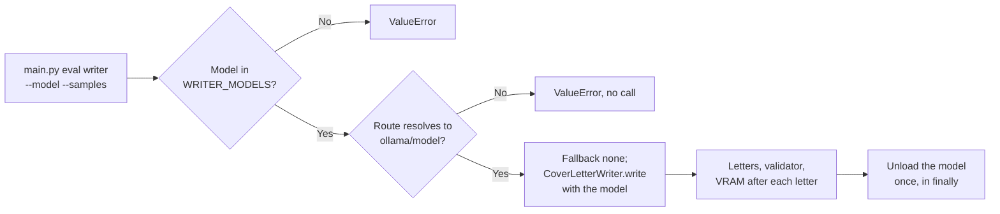

# MH-2: The writer suite runs the real writer, local only, from `main.py eval writer`

This is a spec handoff: it gives the behavior and the tests to write, not the code. Read `AGENT.md` first. MH-1 must be in the repository (it adds `src/evaluation/suites/writer.py`).

## Why

MH-1 added the core of the `writer` suite with an injected writer. This handoff lets the suite run the production cover-letter writer for one local model, from the command line:

- Only the four approved models can run (`WRITER_MODELS`).
- The run stays local. `LLMRouter` uses the writer's `model` override only when the Settings route for cover letters has Ollama as its primary provider, and a failed call goes to the route's fallback provider. So the run stops before any call when the route does not resolve to `ollama/<model>`, and it sets the route's fallback provider to `none`.
- The response cache is off (the structured suite's `default_router`), so the samples of a pair differ.
- The model is unloaded once at the end, also when the run stops with an error, and the peak VRAM is recorded.



## Files

- `apps/backend-py/src/evaluation/suites/writer.py` (change)
- `apps/backend-py/src/evaluation/suites/__init__.py` (change)
- `apps/backend-py/main.py` (change)
- `apps/backend-py/tests/unit/test_writer_command.py` (new)
- `apps/backend-py/tests/unit/test_scam_suite.py` (change one line of an existing test; see 4. below)

Do not change other files. Do not change `src/evaluation/cover_letter_compare.py`: the Settings compare keeps its own pair of models.

## Required behavior

### 1. `src/evaluation/suites/writer.py`

- Imports: `CoverLetterWriter` (with `GeneratedCoverLetter`) from `...generation.cover_letter_writer`, `TaskType` from `...llm.router`, and `default_router`, `gpu_memory_used_mib`, and `unload_ollama_model` from `.structured` (with the two names that MH-1 already imports from there).
- Add after `CHECKS`:

  ```python
  # Local models of 7B or smaller that the user approved for this host (Step 3.8).
  WRITER_MODELS: tuple[str, ...] = ("qwen2.5:7b", "qwen3.5:4b", "qwen2.5:3b", "gemma3:4b")
  ```

  and the type names `UnloadFn = Callable[[str], None]` and `VramProbe = Callable[[], Optional[int]]` after `Clock`.
- New function `check_model(model: str) -> None`: raises `ValueError` when `model` is not in `WRITER_MODELS`. The message contains the words `writer allow-list`.
- New function `local_writer(router: Any, model: str) -> WriteFn`:
  - `provider, resolved = router.resolve_primary_model(TaskType.COVER_LETTER_WRITING, model)`.
  - When `provider != "ollama"` or `resolved != model`, raise `ValueError` with the text `f"The cover-letter route uses {provider}/{resolved}, not ollama/{model}. "` followed by `"Set the cover-letter writing route to Ollama in Settings."`. No call to `generate` happens before this check.
  - Set `router.routes[TaskType.COVER_LETTER_WRITING].fallback_provider = "none"`.
  - Make one `CoverLetterWriter(router)` and return a function `write(job, profile, selection)` that returns `writer.write(job=job, profile=profile, selection=selection, model=model)`.
- `run_writer_suite`:
  - `write` becomes `Optional[WriteFn] = None`. New keyword arguments: `router: Optional[Any] = None`, `unload: Optional[UnloadFn] = None`, `vram_probe: Optional[VramProbe] = None`.
  - After the `samples` check, call `check_model(model)` (for every run, also with a given writer).
  - When `write` is `None`: the router is `router` or `default_router()`; `write = local_writer(router, model)`; when `unload` is `None`, it unloads with `unload_ollama_model(router, name)`; when `vram_probe` is `None`, it is `gpu_memory_used_mib`. Read `default_router`, `unload_ollama_model`, and `gpu_memory_used_mib` from the module at call time (the tests replace them with `monkeypatch`).
  - With a given `write`, there is no unload and no VRAM reading unless the caller gives `unload` or `vram_probe`.
  - Write the letters inside `try`/`finally`. After each letter, take one VRAM reading (when there is a probe) and keep the highest. In `finally`, call `unload(model)` once when there is an unload function.
  - Add the metric `peak_vram_mib`: the highest reading as a float, or `None` when there is no reading.
  - Update the docstrings (module, function, `Args:`, and `Raises:`) for the new behavior.

### 2. `src/evaluation/suites/__init__.py`

- Add `"writer"` at the end of `SUITE_NAMES`.
- In `get_suite`, before the `KeyError`, return `(run_writer_suite, DEFAULT_DATASET_DIR)` from `.writer` for `"writer"` (import inside the branch, as for the other suites).
- Add the line `Step 3.8 adds ``writer`` (local only; it needs Ollama).` to the module docstring.

### 3. `main.py`

- The `eval` parser gets two options after `--part`: `--model` (`str`, default `None`, help `"Writer model (writer only; required there)"`) and `--samples` (`int`, default `3`, help `"Letters for each profile-job pair (writer only; default: 3)"`).
- In `run_eval_command`, after the `emscad` lines: for the `writer` suite, when `args.model` is empty, print and log the message `"The writer suite needs --model, for example --model qwen2.5:7b."` and return `1` before the suite runs. Else set `runner_kwargs["model"] = args.model` and `runner_kwargs["samples"] = args.samples`. Other suites get no new arguments.
- Update the `run_eval_command` docstring (`args` has `model` and `samples`).
- Add this example to the `eval` epilog, before the "Use another dataset folder" example:

  ```text
  # Compare one cover-letter writer model on the grounding set (local; needs Ollama)
  python main.py eval writer --model qwen2.5:7b
  ```

### 4. The existing test `test_registry_lists_scam_and_emscad`

In `tests/unit/test_scam_suite.py`, this test pins the suite names. Change only its first assertion to:

```python
assert SUITE_NAMES == ("grounding", "scam", "emscad", "dedupe", "structured", "writer")
```

Change it in Step 2, with the code, not in Step 1. Do not change other lines of this file.

## Step 1: write the tests, run them, and see them fail

### The new test file `tests/unit/test_writer_command.py`

Import the module as `import src.evaluation.suites.writer as writer_suite` and read `writer_suite.WRITER_MODELS` through it, so that the file loads before the change (the red step must show `FAILED`, not `ERROR`). Reuse `MODEL`, `FakeValidator`, `small_dataset`, and `writer_for` from `tests.unit.test_writer_suite`, and `parse` from `tests.unit.test_cli`.

Write these helpers (with docstrings and type hints):

- `fake_router(provider="ollama", resolved=MODEL)`: a `MagicMock` whose `resolve_primary_model` returns `(provider, resolved)`, whose `routes` is `{TaskType.COVER_LETTER_WRITING: SimpleNamespace(primary_model=resolved, fallback_provider="anthropic", fallback_model="claude-x")}`, and whose `generate` returns `LLMResponse(content="Dear team, I built a data pipeline in Python.", model=resolved, provider=provider)`.
- `fake_report(tmp_path)`: an `EvalReport` for `"writer"` with `build_run_metadata("writer", [a one-line cases.jsonl in tmp_path], 1, repo_dir=tmp_path)`, metrics `{"written": 1.0}`, and empty details (as in `test_cli_routes_eval_dedupe_to_the_suite` of `test_dedupe_suite.py`).

Write these tests (16 with the parameters):

| Test | Input | Check |
|------|-------|-------|
| `test_writer_is_a_registered_suite` | `get_suite("writer")` | `"writer"` in `SUITE_NAMES`; the runner is `run_writer_suite`; the folder is `DEFAULT_DATASET_DIR` |
| `test_writer_allow_list_has_the_four_approved_models` | | `writer_suite.WRITER_MODELS == ("qwen2.5:7b", "qwen3.5:4b", "qwen2.5:3b", "gemma3:4b")` |
| `test_a_model_outside_the_allow_list_is_refused` (parameters `"gemma4:e4b"`, `"qwen3.5:9b"`, `"qwen2.5:14b"`) | a given `writer_for()` | `ValueError` that matches `"allow-list"` |
| `test_a_cloud_route_stops_the_run_before_any_call` | `fake_router(provider="anthropic", resolved="claude-x")`, no writer, `unload` and `vram_probe` that do nothing | `ValueError` that matches `"anthropic/claude-x"`; `router.generate` not called |
| `test_a_route_that_ignores_the_model_stops_the_run` | `fake_router(resolved="qwen2.5:3b")`, model `MODEL` | `ValueError` that matches `"ollama/qwen2.5:3b"`; `router.generate` not called |
| `test_the_real_writer_writes_with_the_model_and_no_fallback` | `fake_router()`, 1 case, 2 samples, `FakeValidator({})` | the route's `fallback_provider == "none"`; `generate` called 2 times, with `model=MODEL` and `task_type=TaskType.COVER_LETTER_WRITING`; `written == 2` |
| `test_the_model_is_unloaded_once_after_the_letters` | `writer_for()`, 3 cases, 2 samples, `unload=list.append` | the list is `[MODEL]` |
| `test_the_model_is_unloaded_when_the_run_stops` | a `MagicMock` validator whose `validate` raises `RuntimeError` | `RuntimeError`; the unload list is `[MODEL]` |
| `test_peak_vram_is_the_highest_reading` | 3 cases, 1 sample, readings 5000, 6400, 6100 | `peak_vram_mib == 6400.0` |
| `test_a_given_writer_reads_no_vram` | `writer_for()`, no probe | `peak_vram_mib is None` |
| `test_the_default_writer_uses_the_app_router_unload_and_probe` | `monkeypatch` of `writer.default_router` (returns `fake_router()`), `writer.unload_ollama_model` (records `(router, name)`), and `writer.gpu_memory_used_mib` (returns 4000); no writer | the router is made once; the unload list is `[(router, MODEL)]`; `peak_vram_mib == 4000.0` |
| `test_eval_writer_passes_model_and_samples` | `monkeypatch` of `src.evaluation.suites.get_suite` (a fake suite that records its keyword arguments); `parse(["eval", "writer", "--model", "gemma3:4b", "--samples", "2", "--out", <tmp>, "--no-mlflow"])` | `run_eval_command` returns 0; the arguments are `{"model": "gemma3:4b", "samples": 2}` |
| `test_eval_writer_needs_a_model` | the same fake; `parse(["eval", "writer", "--out", <tmp>, "--no-mlflow"])` | returns 1; the suite is not called; the printed output contains `"--model"` |
| `test_other_suites_get_no_writer_options` | the same fake; `eval grounding --model gemma3:4b --samples 5` | returns 0; the arguments are `{}` |

### Run the tests

Run the new file. All 16 tests fail (`FAILED`, not `ERROR`):

```bash
.venv/bin/python -m pytest tests/unit/test_writer_command.py -q --maxfail=30
```

## Step 2: change the code

Change `writer.py`, `__init__.py`, and `main.py` as "Required behavior" says, and the one assertion in `test_scam_suite.py` (4.).

## Done when

Run the new tests and the MH-1 tests. All pass:

```bash
.venv/bin/python -m pytest tests/unit/test_writer_command.py tests/unit/test_writer_suite.py -q
```

Run the other command and suite tests. All pass:

```bash
.venv/bin/python -m pytest tests/unit/test_cli.py tests/unit/test_dedupe_suite.py tests/unit/test_structured_suite.py tests/unit/test_scam_suite.py -q
```

Format the changed files:

```bash
.venv/bin/python -m black main.py src/evaluation/suites/writer.py src/evaluation/suites/__init__.py tests/unit/test_writer_command.py tests/unit/test_scam_suite.py
```

Check the lint:

```bash
.venv/bin/python -m ruff check main.py src/evaluation/suites/writer.py src/evaluation/suites/__init__.py tests/unit/test_writer_command.py tests/unit/test_scam_suite.py
```

Run the mypy gate. It must report 0 new errors. It can also say that some baseline errors are fixed; do nothing about that. Do not add `--update`:

```bash
.venv/bin/python scripts/mypy_gate.py
```

Do not run `main.py eval writer` without `--help`: a real run loads a model on the GPU.

The working tree has other changed files that are not part of this handoff. Do not stage them. Do not use `git add -A`, `git add .`, or `git commit -a`. Stage only your five files:

```bash
git add main.py src/evaluation/suites/writer.py src/evaluation/suites/__init__.py tests/unit/test_writer_command.py tests/unit/test_scam_suite.py
```

Check that only these five files are staged:

```bash
git diff --cached --name-only
```

Commit with this message:

```text
feat(eval): run the writer suite with the real writer from main.py

The writer suite can now run CoverLetterWriter for one approved local
model (WRITER_MODELS: qwen2.5:7b, qwen3.5:4b, qwen2.5:3b, gemma3:4b)
on the app's router with the response cache off. The run stops before
any call when the cover-letter route does not resolve to ollama/<model>,
sets the route's fallback to none, records the peak VRAM, and unloads
the model once at the end. main.py eval writer takes --model and
--samples (Step 3.8, MH-2).
```
