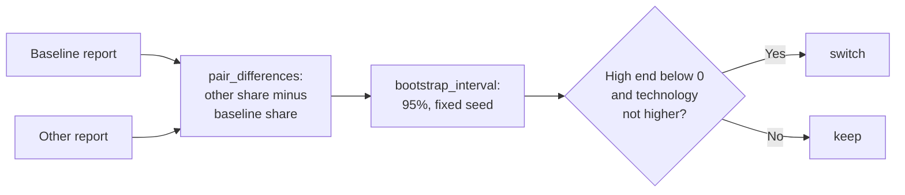

# MH-3: Paired comparison of two writer reports

This is a spec handoff: it gives the behavior and the tests to write, not the code. Read `AGENT.md` first. MH-1 must be in the repository (MH-2 is not needed: this handoff reads report files).

## Why

`main.py eval writer --model <tag>` writes one JSON report for each model (`data/eval/writer/<time>.json`). Its `details.pairs` gives, for each profile-job pair, the written letters and the letters that each check flags. Step 3.8 decides with a rule that was fixed before the runs: compare each model with the baseline `qwen2.5:7b` pair by pair, and change the default writer only when the 95% bootstrap interval of the mean difference in the `ungrounded_claims` share is below 0 and the model's `fabricated_technology` rate is not higher. This handoff adds that comparison and a script for it.



## Files

- `apps/backend-py/src/evaluation/writer_compare.py` (new)
- `apps/backend-py/scripts/compare_writer_reports.py` (new)
- `apps/backend-py/tests/unit/test_writer_compare.py` (new)

Do not change other files.

## Required behavior

### 1. `src/evaluation/writer_compare.py`

A module docstring that states the decision rule above. Constants `DEFAULT_ROUNDS = 2000` and `DEFAULT_SEED = 0`. Import `MAIN_CHECK` and `percentile` from `.suites.writer` (do not write a second percentile function). Use `random.Random(seed)` and `statistics.fmean`.

- `load_writer_report(path: Path) -> Dict[str, Any]`: read the JSON file. When its `suite` is not `"writer"`, raise `ValueError` with a message that contains `not a writer report`.
- `pair_differences(baseline, other, check=MAIN_CHECK) -> List[float]`: for each case ID that is in `details.pairs` of both reports, in sorted case-ID order, skip the pair when `written` is 0 in either report; else add `other flagged[check] / other written - baseline flagged[check] / baseline written`.
- `bootstrap_interval(values, rounds=DEFAULT_ROUNDS, seed=DEFAULT_SEED) -> Tuple[Optional[float], Optional[float]]`: `(None, None)` for no values. Else make `rounds` resamples with `rng.choices(values, k=len(values))` from one `random.Random(seed)`, take the mean of each, and return `(percentile(means, 0.025), percentile(means, 0.975))`.
- `compare_reports(baseline, other, rounds=DEFAULT_ROUNDS, seed=DEFAULT_SEED) -> Dict[str, Any]`:
  - When `metadata.dataset_sha256` differs, raise `ValueError` with a message that contains `different datasets`.
  - Return these keys: `baseline_model` and `other_model` (from `details.model`), `pairs` (the number of differences), `baseline_rate` and `other_rate` (`metrics["ungrounded_claims_rate"]`), `mean_difference` (the mean of the differences, rounded to 3 places, or `None`), `ci_low` and `ci_high` (the interval, rounded to 3 places, or `None`), `baseline_fabricated_technology_rate` and `other_fabricated_technology_rate` (from `metrics`), and `decision`.
  - `decision` is `"switch"` only when `ci_high` (before rounding) is below 0 and both technology rates exist and the other rate is lower than or equal to the baseline rate. Else it is `"keep"`.

### 2. `scripts/compare_writer_reports.py`

Copy the header style and the `sys.path` lines of `scripts/compare_cover_letter_models.py`. `main(argv: Optional[Sequence[str]] = None) -> int` parses two positional paths, `baseline` and `other`, and the options `--rounds` and `--seed` (defaults from the module). It prints each key of `compare_reports` as `key: value`, one per line, and returns 0. When loading or comparing raises `OSError`, `ValueError`, or `KeyError`, it prints a line that starts with `Cannot compare the reports:` and returns 1. End the file with `if __name__ == "__main__": sys.exit(main())`.

## Step 1: write the tests, run them, and see them fail

### The new test file `tests/unit/test_writer_compare.py`

Import the module as `import src.evaluation.writer_compare as writer_compare`. In the two script tests, import `main` from `scripts.compare_writer_reports` inside the test.

Write one helper, `report(model, pairs, tech_rate=0.1, sha="a" * 64)`, with a docstring and type hints. `pairs` maps a case ID to `(written, flagged)`. It returns a dictionary in the shape of a writer report: `suite` `"writer"`; `metadata` with `dataset_sha256` and `model`; `metrics` with `ungrounded_claims_rate` (all flagged divided by all written, rounded to 3 places) and `fabricated_technology_rate`; `details` with `model` and `pairs` (each pair: `profile_id` `"ml"`, `written`, and `flagged` with `ungrounded_claims` set and the other three checks at 0).

Write these 12 tests:

| Test | Input | Check |
|------|-------|-------|
| `test_pair_differences_are_other_minus_baseline_by_case_id` | baseline `{"b": (3, 3), "a": (3, 0)}`, other `{"a": (3, 1), "b": (3, 0)}` | `pytest.approx([1/3, -1.0])` |
| `test_pairs_without_written_letters_in_both_are_left_out` | baseline `{"a": (3, 1), "b": (3, 1), "c": (3, 3), "e": (0, 0)}`, other `{"a": (2, 2), "b": (0, 0), "d": (3, 0), "e": (3, 1)}` | `pytest.approx([1.0 - 1/3])` |
| `test_bootstrap_interval_repeats_with_the_seed` | `[i / 10 - 1.0 for i in range(20)]`, 500 rounds, seed 7, two times | the two intervals are equal; `-1.0 <= low <= high <= 0.9` |
| `test_bootstrap_interval_of_equal_values_is_that_value` | `[-0.5] * 10`, 50 rounds | `(-0.5, -0.5)` |
| `test_bootstrap_interval_without_values_is_empty` | `[]` | `(None, None)` |
| `test_switch_when_the_interval_is_below_zero_and_tech_is_not_worse` | 10 pairs `c0`..`c9`: baseline `(3, 3)`, other `(3, 1)`, both `tech_rate=0.2` | `decision == "switch"`, `pairs == 10`, `mean_difference == -0.667`, `ci_high == -0.667`, the two models, `baseline_rate == 1.0`, `other_rate == 0.333` |
| `test_keep_when_fabricated_technology_is_higher` | the same pairs; baseline `tech_rate=0.1`, other `0.2` | `decision == "keep"` |
| `test_keep_when_the_interval_crosses_zero` | 10 pairs: odd `i` baseline `(3, 1)` and other `(3, 2)`; even `i` baseline `(3, 2)` and other `(3, 1)` | `ci_low < 0 < ci_high`; `decision == "keep"` |
| `test_reports_of_different_datasets_are_refused` | the other report with `sha="b" * 64` | `ValueError` that matches `"different datasets"` |
| `test_load_writer_report_refuses_another_suite` | a file with `{"suite": "grounding"}` | `ValueError` that matches `"not a writer report"` |
| `test_script_prints_the_decision` | two files: 5 pairs, baseline `(3, 3)`, other `(3, 1)` | `main([...]) == 0`; the output contains `"decision: switch"` |
| `test_script_stops_on_a_wrong_report` | a file with `{"suite": "grounding"}`, given two times | `main([...]) == 1`; the output contains `"Cannot compare"` |

### Run the tests

Run the new file. It must fail. Here the red step is one collection error (`ModuleNotFoundError: No module named 'src.evaluation.writer_compare'`), because the module is new. For this handoff, that error is the expected failure:

```bash
.venv/bin/python -m pytest tests/unit/test_writer_compare.py -q
```

## Step 2: add the module and the script

Add `writer_compare.py` and `compare_writer_reports.py` as "Required behavior" says.

## Done when

Run the new tests and the MH-1 tests. All pass:

```bash
.venv/bin/python -m pytest tests/unit/test_writer_compare.py tests/unit/test_writer_suite.py -q
```

Format the new files:

```bash
.venv/bin/python -m black src/evaluation/writer_compare.py scripts/compare_writer_reports.py tests/unit/test_writer_compare.py
```

Check the lint:

```bash
.venv/bin/python -m ruff check src/evaluation/writer_compare.py scripts/compare_writer_reports.py tests/unit/test_writer_compare.py
```

Run the mypy gate. It must report 0 new errors. It can also say that some baseline errors are fixed; do nothing about that. Do not add `--update`:

```bash
.venv/bin/python scripts/mypy_gate.py
```

The working tree has other changed files that are not part of this handoff. Do not stage them. Do not use `git add -A`, `git add .`, or `git commit -a`. Stage only your three files:

```bash
git add src/evaluation/writer_compare.py scripts/compare_writer_reports.py tests/unit/test_writer_compare.py
```

Check that only these three files are staged:

```bash
git diff --cached --name-only
```

Commit with this message:

```text
feat(eval): add the paired comparison of two writer reports

src/evaluation/writer_compare.py compares a writer report with the
baseline pair by pair: the difference in the share of letters with
ungrounded_claims, a 95% bootstrap interval over the pairs with a fixed
seed, and the Step 3.8 decision rule (switch only when the interval is
below 0 and fabricated_technology is not higher). The script
scripts/compare_writer_reports.py prints the result (Step 3.8, MH-3).
```
