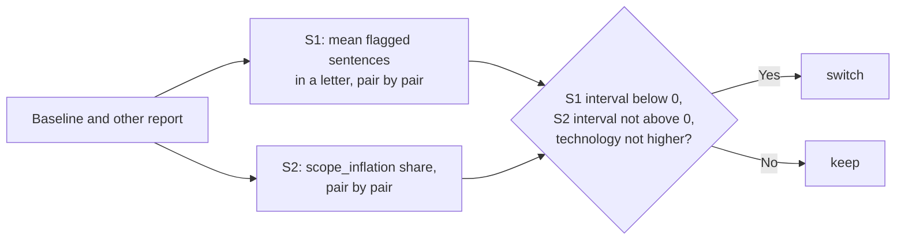

# MH-4: Secondary analysis of the writer comparison

## Apply with the runner

The handoff runner applies this file: it writes the test file, runs the red command (it must fail), makes the four edits, runs the "Done when" checks (they must pass), and commits. See `docs/handoff-runner.md`.

Apply this handoff (WSL, from `apps/backend-py`):

```bash
.venv/bin/python scripts/run_handoff.py ../../tasks/active/step-3-8-writer-models/mh-4-secondary-analysis.md
```

## Why

The baseline run (`qwen2.5:7b`) showed that the validator flags at least one ungrounded sentence in every letter, so the main metric of the plan (the share of letters with `ungrounded_claims`) is at its ceiling. The user chose the secondary analysis that Claude fixed after the baseline and before the other results (`notes.md`, commit `b442783`). This handoff adds it to `src/evaluation/writer_compare.py` and adds `--secondary` to the comparison script, so its numbers come from a command in the repository.



- S1: for each pair, the mean count of flagged ungrounded sentences in a written letter (from the report rows); the other model's mean minus the baseline's, with the same bootstrap as the original rule (2,000 resamples, seed 0).
- S2: for each pair, the share of written letters with `scope_inflation` (from `details.pairs`), with `pair_differences(check="scope_inflation")`.
- Rule: `switch` only when the S1 interval is below 0, the S2 low end is not above 0, and the `fabricated_technology` rate is not higher. The original comparison stays the default of the script.

## Files

- `apps/backend-py/src/evaluation/writer_compare.py` (change)
- `apps/backend-py/scripts/compare_writer_reports.py` (change)
- `apps/backend-py/tests/unit/test_writer_compare_secondary.py` (new)

## Step 1: add the test file, run it, and see it fail

```python new=apps/backend-py/tests/unit/test_writer_compare_secondary.py
"""Tests for the secondary analysis of the writer comparison (Step 3.8, MH-4)."""

import json
from pathlib import Path
from typing import Any, Dict, List, Optional

import pytest

import src.evaluation.writer_compare as writer_compare

SHA = "a" * 64


def report(
    model: str,
    letters: Dict[str, List[int]],
    scope: Optional[Dict[str, int]] = None,
    tech_rate: float = 0.0,
    sha: str = SHA,
) -> Dict[str, Any]:
    """
    A small writer report with rows.

    Args:
        model: The writer model.
        letters: Case ID to the flagged sentence count of each written letter.
        scope: Case ID to its letters with scope_inflation (default: none).
        tech_rate: The fabricated_technology rate.
        sha: The dataset SHA-256.

    Returns:
        The report as a dictionary, in the shape of ``main.py eval writer``.
    """
    scope = scope or {}
    rows = [
        {
            "case_id": case_id,
            "sample": sample,
            "outcome": "written",
            "ungrounded_sentences": count,
        }
        for case_id, counts in letters.items()
        for sample, count in enumerate(counts)
    ]
    written = len(rows)
    flagged = sum(scope.values())
    return {
        "suite": "writer",
        "metadata": {"dataset_sha256": sha, "model": model},
        "metrics": {
            "ungrounded_claims_rate": 1.0,
            "scope_inflation_rate": round(flagged / written, 3) if written else None,
            "fabricated_technology_rate": tech_rate,
            "words_p50": 240.0,
        },
        "details": {
            "model": model,
            "pairs": {
                case_id: {
                    "profile_id": "ml",
                    "written": len(counts),
                    "flagged": {
                        "ungrounded_claims": len(counts),
                        "fabricated_technology": 0,
                        "fabricated_experience": 0,
                        "scope_inflation": scope.get(case_id, 0),
                    },
                }
                for case_id, counts in letters.items()
            },
            "rows": rows,
        },
    }


def ten_pairs(count: int) -> Dict[str, List[int]]:
    """
    Ten pairs with three letters each, all with the same sentence count.

    Args:
        count: The flagged sentence count of each letter.

    Returns:
        Case ID to the counts.
    """
    return {f"c{i}": [count, count, count] for i in range(10)}


def test_sentence_means_use_written_letters_only() -> None:
    """Rows that are not written letters do not enter the mean."""
    data = report("qwen2.5:7b", {"a": [2, 4]})
    data["details"]["rows"].append(
        {"case_id": "a", "sample": 2, "outcome": "fallback", "ungrounded_sentences": 0}
    )
    data["details"]["rows"].append(
        {"case_id": "b", "sample": 0, "outcome": "error", "ungrounded_sentences": 0}
    )

    assert writer_compare.sentence_means(data) == {"a": 3.0}
    assert writer_compare.mean_sentences(data) == 3.0


def test_sentence_differences_are_other_minus_baseline_by_case_id() -> None:
    """Each difference is the other mean minus the baseline mean, by case ID."""
    base = report("qwen2.5:7b", {"b": [4, 4], "a": [2, 2], "c": [1]})
    other = report("gemma3:4b", {"a": [1, 1], "b": [4, 6], "d": [9]})

    assert writer_compare.sentence_differences(base, other) == [-1.0, 1.0]


def test_secondary_switch_when_sentences_drop_and_nothing_rises() -> None:
    """Fewer flagged sentences, no more scope inflation or technology: switch."""
    result = writer_compare.compare_secondary(
        report("qwen2.5:7b", ten_pairs(4)), report("gemma3:4b", ten_pairs(2))
    )

    assert result["decision"] == "switch"
    assert result["pairs"] == 10
    assert result["baseline_sentences"] == 4.0
    assert result["other_sentences"] == 2.0
    assert result["s1_mean_difference"] == -2.0
    assert result["s1_ci_low"] == result["s1_ci_high"] == -2.0
    assert result["s2_mean_difference"] == 0.0
    assert result["baseline_model"] == "qwen2.5:7b"
    assert result["other_model"] == "gemma3:4b"


def test_secondary_keep_when_scope_inflation_rises() -> None:
    """Fewer flagged sentences but more scope inflation on every pair: keep."""
    scope = {f"c{i}": 3 for i in range(10)}

    result = writer_compare.compare_secondary(
        report("qwen2.5:7b", ten_pairs(4)),
        report("gemma3:4b", ten_pairs(2), scope=scope),
    )

    assert result["s2_ci_low"] == 1.0
    assert result["other_scope_inflation_rate"] == 1.0
    assert result["decision"] == "keep"


def test_secondary_switch_when_scope_inflation_may_fall() -> None:
    """An S2 interval that reaches below 0 does not block a switch."""
    scope_base = {f"c{i}": 3 for i in range(10)}

    result = writer_compare.compare_secondary(
        report("qwen2.5:7b", ten_pairs(4), scope=scope_base),
        report("gemma3:4b", ten_pairs(2)),
    )

    assert result["s2_ci_high"] == -1.0
    assert result["decision"] == "switch"


def test_secondary_switch_when_scope_inflation_is_unclear() -> None:
    """An S2 interval that crosses 0 does not block a switch."""
    scope_base = {f"c{i}": 3 for i in range(10) if i % 2}
    scope_other = {f"c{i}": 3 for i in range(10) if not i % 2}

    result = writer_compare.compare_secondary(
        report("qwen2.5:7b", ten_pairs(4), scope=scope_base),
        report("gemma3:4b", ten_pairs(2), scope=scope_other),
    )

    assert result["s2_ci_low"] < 0 < result["s2_ci_high"]
    assert result["decision"] == "switch"


def test_secondary_keep_when_sentences_do_not_drop() -> None:
    """Some pairs better and some worse: the S1 interval crosses 0, so keep."""
    base = {f"c{i}": [2 if i % 2 else 4] * 3 for i in range(10)}
    other = {f"c{i}": [4 if i % 2 else 2] * 3 for i in range(10)}

    result = writer_compare.compare_secondary(
        report("qwen2.5:7b", base), report("gemma3:4b", other)
    )

    assert result["s1_ci_low"] < 0 < result["s1_ci_high"]
    assert result["decision"] == "keep"


def test_secondary_keep_when_fabricated_technology_is_higher() -> None:
    """Fewer flagged sentences but more fabricated technology: keep."""
    result = writer_compare.compare_secondary(
        report("qwen2.5:7b", ten_pairs(4), tech_rate=0.0),
        report("gemma3:4b", ten_pairs(2), tech_rate=0.05),
    )

    assert result["decision"] == "keep"


def test_secondary_refuses_different_datasets() -> None:
    """Reports of two datasets cannot be compared."""
    with pytest.raises(ValueError, match="different datasets"):
        writer_compare.compare_secondary(
            report("qwen2.5:7b", ten_pairs(4)),
            report("gemma3:4b", ten_pairs(2), sha="b" * 64),
        )


def write_pair(tmp_path: Path) -> List[str]:
    """
    Write a baseline and an other report for the script tests.

    Args:
        tmp_path: The test folder.

    Returns:
        The two file paths, the baseline first.
    """
    paths: List[str] = []
    for name, count in (("base", 4), ("other", 2)):
        path = tmp_path / f"{name}.json"
        path.write_text(json.dumps(report(name, ten_pairs(count))), encoding="utf-8")
        paths.append(str(path))
    return paths


def test_script_secondary_prints_the_secondary_result(
    tmp_path: Path, capsys: pytest.CaptureFixture
) -> None:
    """With --secondary, the script prints S1, S2, and their decision."""
    from scripts.compare_writer_reports import main

    assert main([*write_pair(tmp_path), "--secondary"]) == 0
    out = capsys.readouterr().out
    assert "s1_mean_difference: -2.0" in out
    assert "s2_ci_high: 0.0" in out
    assert "decision: switch" in out


def test_script_default_is_the_original_rule(
    tmp_path: Path, capsys: pytest.CaptureFixture
) -> None:
    """Without --secondary, the script prints the original comparison."""
    from scripts.compare_writer_reports import main

    assert main(write_pair(tmp_path)) == 0
    out = capsys.readouterr().out
    assert "mean_difference: 0.0" in out
    assert "s1_" not in out
    assert "decision: keep" in out
```

Run it. It must fail (the secondary analysis does not exist yet; one test of the default output passes):

```bash red cwd=apps/backend-py
.venv/bin/python -m pytest tests/unit/test_writer_compare_secondary.py -q --maxfail=30
```

## Step 2: add the secondary analysis to `src/evaluation/writer_compare.py`

Add a paragraph to the module docstring:

```python edit=apps/backend-py/src/evaluation/writer_compare.py
<<<<<<< OLD
high end of that interval is below 0 and the other model's
``fabricated_technology`` rate is not higher than the baseline's. Otherwise
keep the baseline.
"""
=======
high end of that interval is below 0 and the other model's
``fabricated_technology`` rate is not higher than the baseline's. Otherwise
keep the baseline.

The baseline run showed that the validator flags every letter, so the share
above is at its ceiling. The secondary analysis (``compare_secondary``) was
fixed after the baseline, before the other results: S1 compares the mean
count of flagged ungrounded sentences in a letter, S2 the share of letters
with ``scope_inflation``, both pair by pair with the same bootstrap.
"""
>>>>>>> NEW
```

Add the functions after `compare_reports`:

```python edit=apps/backend-py/src/evaluation/writer_compare.py
<<<<<<< OLD
        "decision": "switch" if switch else "keep",
    }
=======
        "decision": "switch" if switch else "keep",
    }


def sentence_means(report: Dict[str, Any]) -> Dict[str, float]:
    """
    For each pair: the mean count of flagged ungrounded sentences in a letter.

    Args:
        report: A writer report.

    Returns:
        Case ID to the mean count over the pair's written letters. Pairs
        with no written letter are left out.
    """
    counts: Dict[str, List[int]] = {}
    for row in report["details"]["rows"]:
        if row["outcome"] == "written":
            counts.setdefault(row["case_id"], []).append(row["ungrounded_sentences"])
    return {case_id: statistics.fmean(values) for case_id, values in counts.items()}


def sentence_differences(
    baseline: Dict[str, Any], other: Dict[str, Any]
) -> List[float]:
    """
    For each pair: the other model's mean sentence count minus the baseline's.

    Args:
        baseline: The baseline writer report.
        other: The other writer report of the same dataset.

    Returns:
        One difference for each pair with written letters in both reports,
        in case-ID order.
    """
    base = sentence_means(baseline)
    mine = sentence_means(other)
    return [mine[case_id] - base[case_id] for case_id in sorted(set(base) & set(mine))]


def mean_sentences(report: Dict[str, Any]) -> Optional[float]:
    """
    The mean count of flagged ungrounded sentences in a written letter.

    Args:
        report: A writer report.

    Returns:
        The mean over all written letters, rounded to 3 places, or None.
    """
    counts = [
        row["ungrounded_sentences"]
        for row in report["details"]["rows"]
        if row["outcome"] == "written"
    ]
    return round(statistics.fmean(counts), 3) if counts else None


def _round3(value: Optional[float]) -> Optional[float]:
    """
    A number rounded to 3 places.

    Args:
        value: The number, or None.

    Returns:
        The rounded number, or None.
    """
    return round(value, 3) if value is not None else None


def _summary(
    values: Sequence[float], rounds: int, seed: int
) -> Tuple[Optional[float], Optional[float], Optional[float]]:
    """
    The mean of the values and its 95% bootstrap interval, rounded.

    Args:
        values: The pair differences.
        rounds: Bootstrap resamples.
        seed: Bootstrap seed.

    Returns:
        ``(mean, low, high)``, each rounded to 3 places, or None when there
        are no values.
    """
    low, high = bootstrap_interval(values, rounds=rounds, seed=seed)
    mean = statistics.fmean(values) if values else None
    return _round3(mean), _round3(low), _round3(high)


def compare_secondary(
    baseline: Dict[str, Any],
    other: Dict[str, Any],
    rounds: int = DEFAULT_ROUNDS,
    seed: int = DEFAULT_SEED,
) -> Dict[str, Any]:
    """
    The secondary analysis of Step 3.8: S1, S2, and their rule.

    S1 compares the mean count of flagged ungrounded sentences in a letter,
    pair by pair. S2 compares the share of letters with ``scope_inflation``,
    pair by pair. Both use the bootstrap of ``bootstrap_interval``. The rule:
    change the default writer only when the S1 interval is below 0, the S2
    interval is not above 0, and the ``fabricated_technology`` rate is not
    higher. The analysis was fixed after the baseline, before the other
    results, because the main metric of the plan was at its ceiling.

    Args:
        baseline: The baseline writer report.
        other: The other writer report of the same dataset.
        rounds: Bootstrap resamples.
        seed: Bootstrap seed.

    Returns:
        The models, the pairs, the mean sentence counts, the S1 difference
        and interval, the two ``scope_inflation`` rates, the S2 difference
        and interval, the two median word counts, the two
        ``fabricated_technology`` rates, and the decision (``switch`` or
        ``keep``).

    Raises:
        ValueError: When the reports come from different datasets.
        KeyError: When a report lacks a field that the analysis needs.
    """
    if baseline["metadata"]["dataset_sha256"] != other["metadata"]["dataset_sha256"]:
        raise ValueError("The reports come from different datasets.")
    s1 = sentence_differences(baseline, other)
    s2 = pair_differences(baseline, other, check="scope_inflation")
    s1_mean, s1_low, s1_high = _summary(s1, rounds, seed)
    s2_mean, s2_low, s2_high = _summary(s2, rounds, seed)
    base_tech = baseline["metrics"].get("fabricated_technology_rate")
    other_tech = other["metrics"].get("fabricated_technology_rate")
    switch = (
        s1_high is not None
        and s1_high < 0
        and (s2_low is None or s2_low <= 0)
        and base_tech is not None
        and other_tech is not None
        and other_tech <= base_tech
    )
    return {
        "baseline_model": baseline["details"]["model"],
        "other_model": other["details"]["model"],
        "pairs": len(s1),
        "baseline_sentences": mean_sentences(baseline),
        "other_sentences": mean_sentences(other),
        "s1_mean_difference": s1_mean,
        "s1_ci_low": s1_low,
        "s1_ci_high": s1_high,
        "baseline_scope_inflation_rate": baseline["metrics"].get(
            "scope_inflation_rate"
        ),
        "other_scope_inflation_rate": other["metrics"].get("scope_inflation_rate"),
        "s2_mean_difference": s2_mean,
        "s2_ci_low": s2_low,
        "s2_ci_high": s2_high,
        "baseline_words_p50": baseline["metrics"].get("words_p50"),
        "other_words_p50": other["metrics"].get("words_p50"),
        "baseline_fabricated_technology_rate": base_tech,
        "other_fabricated_technology_rate": other_tech,
        "decision": "switch" if switch else "keep",
    }
>>>>>>> NEW
```

## Step 3: add `--secondary` to `scripts/compare_writer_reports.py`

Import `compare_secondary`:

```python edit=apps/backend-py/scripts/compare_writer_reports.py
<<<<<<< OLD
    DEFAULT_SEED,
    compare_reports,
    load_writer_report,
)
=======
    DEFAULT_SEED,
    compare_reports,
    compare_secondary,
    load_writer_report,
)
>>>>>>> NEW
```

Add the option, and use the secondary analysis when it is given:

```python edit=apps/backend-py/scripts/compare_writer_reports.py
<<<<<<< OLD
        help=f"Bootstrap seed (default: {DEFAULT_SEED})",
    )
    args = parser.parse_args(argv)
    try:
        result = compare_reports(
=======
        help=f"Bootstrap seed (default: {DEFAULT_SEED})",
    )
    parser.add_argument(
        "--secondary",
        action="store_true",
        help="Use the secondary analysis of Step 3.8 (S1 and S2)",
    )
    args = parser.parse_args(argv)
    compare = compare_secondary if args.secondary else compare_reports
    try:
        result = compare(
>>>>>>> NEW
```

## Done when

Run the new tests and the other writer tests:

```bash check cwd=apps/backend-py
.venv/bin/python -m pytest tests/unit/test_writer_compare_secondary.py tests/unit/test_writer_compare.py tests/unit/test_writer_suite.py -q
```

Format the changed files:

```bash check cwd=apps/backend-py
.venv/bin/python -m black src/evaluation/writer_compare.py scripts/compare_writer_reports.py tests/unit/test_writer_compare_secondary.py
```

Check the lint:

```bash check cwd=apps/backend-py
.venv/bin/python -m ruff check src/evaluation/writer_compare.py scripts/compare_writer_reports.py tests/unit/test_writer_compare_secondary.py
```

Run the mypy gate (no new errors):

```bash check cwd=apps/backend-py
.venv/bin/python scripts/mypy_gate.py
```

Commit message:

```text commit
feat(eval): add the secondary analysis of the writer comparison

The validator flags every baseline letter, so the planned letter-level
metric is at its ceiling. compare_secondary compares the mean count of
flagged ungrounded sentences in a letter (S1) and the scope_inflation
share (S2), pair by pair with the same bootstrap, and switches only
when S1 drops, S2 does not rise, and fabricated_technology is not
higher. scripts/compare_writer_reports.py takes --secondary
(Step 3.8, MH-4).
```
