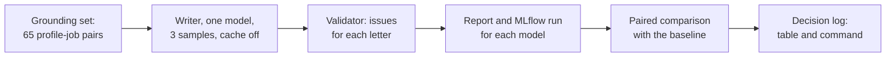

# Task: Step 3.8 Writer Model Comparison on the Grounding Set

## Goal
Choose the local cover-letter writer model on the grounding set, not on 3 synthetic cases. Each allowed model writes letters for the 65 profile-job pairs of the grounding set (3 samples each), the validator checks each letter, and each model is one MLflow run with the Step 3.1 metadata. The table and the command go to `docs/decision-log.md` (review item M3; plan in `tasks/active/step-3-measurable-claims/notes.md`).

## Constraints & Context
- GPU: models of 7B or smaller, one model at a time, unload after each model, VRAM watchdog at 7,700 MiB, no other model loaded and no pipeline running. The runs start only after the user approves the GPU time.
- The writer runs as in production: `CoverLetterWriter.write` (temperature 0.8, `think=False`, modern style, no mission brief, no review pass). Every model gets the same fixed selection for each pair (`fixed_selection` of the structured suite).
- The response cache is off for the runs. With the cache on, the 3 samples of a pair are one letter.
- The measure is the validator's issues for each letter, not its sentence counts: on the 10 real letters of Step 3.2, the letter-level `ungrounded_claims` check has precision 0.875 and recall 0.778, but the sentence-level count has 0.182 and 0.154. The validator does not find analogical claims (0 of 7 on the real letters), which is the most common error in real letters; the decision log states this limit.
- The decision rule is fixed before the runs (see `notes.md`).
- Committed data is synthetic only (the grounding profiles and jobs). Reports go to `apps/backend-py/data/eval/writer/` (gitignored).
- The unit tests use a fake writer and run in CI. The real runs are local.
- The Settings compare (API route, frontend card, and `scripts/compare_cover_letter_models.py`) keeps its 3 quick cases and its two models. The suite has its own allow-list (`WRITER_MODELS`, the four approved models), because `ALLOWED_MODELS` is also the Settings compare's default model list (change of 2026-11-02; see `notes.md`).

## Acceptance Criteria
- [x] Plan and decisions approved by the user (models, extra check). (2026-11-02: `qwen3.5:4b`, `qwen2.5:3b`, and `gemma3:4b` against `qwen2.5:7b`; validator only)
- [x] MH-1: eval suite `writer`: the 65 pairs, N samples for each pair with one model, letter-level metrics for each check, with tests (fake writer). (`c84adc9`, runner, 18 tests, 11 of 11 mutants)
- [x] MH-2: `main.py eval writer --model <tag> --samples <n>`, the real writer with the cache off, unload after the model, peak VRAM, and the allow-list check. (`0566703`, Claude Haiku 5.5 in opencode, 16 tests, 11 of 11 mutants)
- [x] MH-3: paired comparison of two writer reports (for each pair: the share of flagged samples; difference with a bootstrap 95% interval). (`97ac87d`, Claude Haiku 5.5 in opencode, 12 tests, 11 of 11 mutants; full gate 1994 passed)
- [ ] Baseline run `qwen2.5:7b`, then one run for each other approved model, recorded in `notes.md` (command, dataset SHA-256, MLflow run ID, peak VRAM).
- [ ] Decision: the comparison table, the decision rule result, the command, and the limits in `docs/decision-log.md`; the suite in `docs/usage.md`.
- [ ] Done when: the model choice in the decision log rests on the grounding set, not on 3 synthetic cases, and the full backend gate passes.

## Status
`in-progress` (2026-11-02: MH-1 to MH-3 in the repo; next: the four GPU runs, after the user approves the GPU time)
