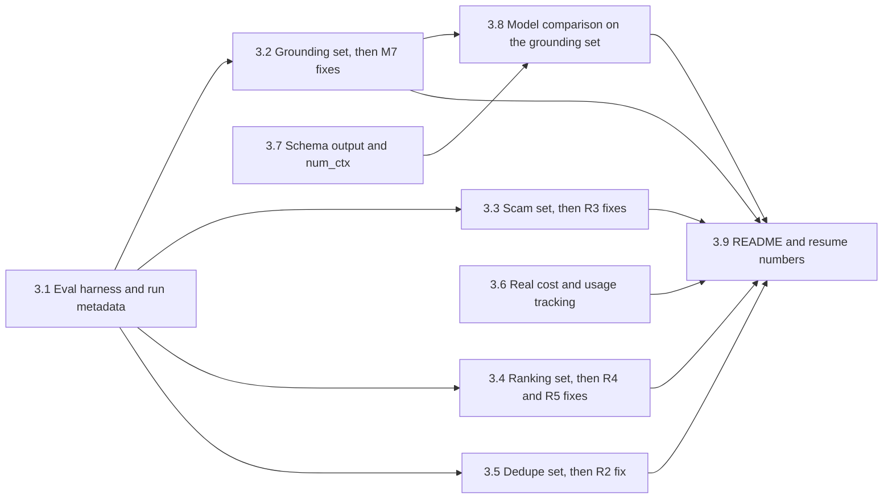

# Notes: Step 3, Make Claims Measurable

This text moved here from `tasks/todo.md` on 2026-10-24, without changes. Paths in it are as of that date: a reference to a section of `tasks/todo.md` now means a section of this file or of another task's `notes.md`, and a `tasks/handoff-*.md` file is now in its step's task folder (Step 2 and Step 3.2 handoffs are in `tasks/archive/`). `tasks/lessons.md` is now `docs/lessons.md`.

#### Step 3 plan: Make claims measurable

**Goal:** Every number in the README and in the resume framing (review section 7) comes from a command in this repository that anyone can run again. Each fix in this step is measured on a labeled set before and after the change.

**Constraints:**

- Measure first. For each fix (R2, R3, R4, R5, M7), record the baseline numbers before the change and the numbers after it.
- No personal data in committed fixtures. Use a synthetic profile and public job postings (the source fixtures under `tests/fixtures/`). Runs with the real profile stay local; their outputs stay in `apps/backend-py/data/` (gitignored).
- Deterministic suites (grounding, scam rules, dedupe, heuristic ranking, BM25) run in CI without Ollama. Suites that need Ollama or embeddings (dense and hybrid ranking, LLM output, model comparison) run locally and log to MLflow.
- Keep dry run as the default. Do not make auto-submit reachable (Step 5).
- Each sub-step is one commit (or PR) with its own tests. Run all local checks before each push.
- Line numbers below were checked on 2026-10-22.

##### Step 3.3: Scam set, then the R3 fixes (effort: M) — R3, M4

- [ ] `tests/fixtures/eval/scam/cases.jsonl` with at least 40 postings: legitimate postings from the source fixtures; written scam texts for each indicator group (Payment, Contact, Urgency, Compensation, Listing quality); and legitimate texts that the current rules flag ("signal processing", "competitive pay and the chance to work", a WhatsApp Business API integration role, an engineering role at a bitcoin exchange).
- [ ] Baseline on that set, and locally on the Kaggle EMSCAD set (`fake_job_postings.csv`, used by `notebooks/scam_detector_evaluation.ipynb`; `data/kaggle/` is empty today). Split EMSCAD into a tuning part and a held-out part with a fixed seed (Question 3).
- [ ] Fix R3 after the baseline: word boundaries and phrase context for the patterns at `scam_detector.py:118-140` (`pay.*to.*work`, `signal`, `kik`, `telegram`, `whatsapp`) and the keyword list at `:591-594` (a plain `bitcoin` match). Tune the threshold on the tuning part. Report the held-out numbers only.
- [ ] CI gate on the committed set (thresholds file). The EMSCAD run stays local and logs to MLflow. Change the notebook to call `python main.py eval scam`, so that the logic exists only once.
- [ ] Done when: the README states precision and recall on the held-out EMSCAD part, and the committed set guards the false-positive cases.

##### Step 3.4: Ranking set, then the R4 and R5 fixes (effort: M) — R4, R5

- [ ] `tests/fixtures/eval/ranking/`: one or two synthetic profiles, and 30 to 50 public jobs for each profile from the source fixtures, with a label per pair: 0 (not relevant), 1 (maybe), 2 (apply) (Questions 1 and 2).
- [ ] Baseline NDCG@10 and recall@10 for the heuristic matcher, BM25 only, dense only, and hybrid (RRF). The heuristic and BM25 runs are in CI; dense and hybrid need the embedding model and run locally.
- [ ] Fix R4 after the baseline: whole-word matching for keywords and skills (`matcher.py:228-245` and `:315-326`; "ai" matches "email" today), and a skill score that does not go down when matches go up (0 matches score 20 of 40; 1 match of many can score 10 of 40).
- [ ] Fix R5 after the baseline: dense results use `job_id` (`ranker.py:408`) and BM25 results use chunk IDs (`ranker.py:160`), so RRF (`ranker.py:436-442`) never fuses them. Fuse at job level (best chunk rank per job before RRF). Put jobs inside and outside the hybrid result on one score scale (`ranker.py:292-296`).
- [ ] Done when: the README states NDCG@10 for heuristic, BM25, dense, and hybrid on the labeled set, measured after the R5 fix.

##### Step 3.5: Dedupe set, then the R2 fix (effort: S) — R2

- [ ] `tests/fixtures/eval/dedupe/` with about 30 pairs of listings from the source fixtures: the same job from two sources, reposts, and different jobs with the same title at the same company. Label each pair "same" or "different".
- [ ] Baseline: `JobListingCollection.deduplicate` (`job_listing.py:397-416`) compares `job_id` only, and IDs carry a source prefix, so it never merges a job across sources.
- [ ] Fix: also merge on the URL when present, and on normalized company, title, and location. Keep the order that `AppliedGuard` uses (ID, URL, company and title). Report precision and recall before and after. CI gate.

##### Step 3.6: Real cost and usage tracking (effort: S) — M1, M8

- [ ] `CostTracker.track_call` (`cost_tracker.py:200`) has no caller. Call it from `LLMRouter` after each response (primary, fallback, and cache hit), through one process-wide tracker that `routes/metrics.py:24` also reads.
- [ ] Record provider, model, prompt and completion tokens, latency, cache hit, and cost (0 for Ollama). Update the cloud prices in `MODEL_PRICING` with the date of the source, or label them as estimates.
- [ ] At the end of a pipeline run, log the cost summary to MLflow (`MLflowTracker.log_cost_summary` at `mlflow_tracker.py:216` has no caller).
- [ ] Tests: one mocked call is tracked one time; a cache hit is tracked as a cache hit; a fallback call is tracked with the fallback provider.
- [ ] Done when: the Metrics page shows real token counts after a run. No cost-saving claim goes back into the README unless this data supports it.

##### Step 3.7: Schema-constrained output and context size (effort: M) — R13, R14

- [ ] Use Ollama `format` with the JSON schema of a Pydantic model for each JSON task, and parse with `model_validate_json`. 9 files still parse LLM JSON with the regex `\{.*\}`: `validator.py`, `selector.py`, `resume_writer.py`, `resume_analyzer.py`, `cover_letter_reviewer.py`, `cover_letter_validator.py` (in `src/generation/`), `resume_parser.py`, `jd_extractor.py` (in `src/extractors/`), and `classifiers/job_classifier.py`.
- [ ] Set `num_ctx` per task in the routes; no code sets it today. `jd_extractor.py:233` sends up to 50,000 characters. Cut the input to the task budget and log when the extractor falls back to rule-based parsing.
- [ ] Measure the parse-failure rate per task on a fixed local set, before and after (local; needs Ollama; MLflow).
- [ ] Done when: no code parses LLM JSON with a regex, and the parse-failure rate is recorded.

##### Step 3.8: Model comparison on the grounding set (effort: S to M) — M3

- [ ] Point `cover_letter_compare.py` at the jobs and profiles of the grounding set (`build_fixtures()` at line 127 builds its own few cases today). Use a fixed temperature, at least 3 samples per case, and the validator metrics from Step 3.2.
- [ ] Compare the installed local models with `qwen2.5:7b`. Log each model as one MLflow run with the Step 3.1 metadata. Add the table and the command to `docs/decision-log.md`.
- [ ] Done when: the model choice in the decision log rests on the grounding set, not on 3 synthetic cases.

##### Step 3.9: README and resume numbers (effort: S)

- [ ] In `README.md`, `docs/index.md`, and `docs/architecture.md`, add or change numbers only from the Step 3.2 to 3.8 reports, each with its command and date. Remove each number that no report supports.
- [ ] Update the bullets in section 7 of `tasks/review-2026-10-18.md` with the real values of N and of each metric.

##### Out of scope for Step 3

- Demo mode and the static deploy (Step 4).
- The sidebar, pruning, and the Easy Apply decision (Step 5).
- Hard-coded scoring weights and outcome feedback into scoring (M5). Change the weights only if the Step 3.4 eval shows that a change helps.

##### Decisions (2026-10-22)

All five recommendations were accepted.

1. **Labels:** the user labels the ranking pairs (about 40 for each profile, 0/1/2) and about 15 real generated cover letters. The agent writes the constructed cases and a short labeling guide.
2. **Profile in committed fixtures:** a synthetic profile with no personal data in `tests/fixtures/eval/`. The real profile is used only in local runs, with outputs in `data/` (gitignored).
3. **EMSCAD dataset:** the user downloads `fake_job_postings.csv` from Kaggle with their account into `apps/backend-py/data/kaggle/` and checks the license first. It is not committed.
4. **CI gates:** the deterministic suites (grounding, scam, dedupe, heuristic ranking, BM25) fail CI when a metric drops below its thresholds file.
5. **MLflow store:** a local store under `apps/backend-py/data/` when `MLFLOW_TRACKING_URI` is not set; the shared MLflow server (`http://localhost:5000` on the host, `http://mlflow:5000` in Compose) when it is set. Change from the plan: the local store is SQLite (`data/mlflow.db`, artifacts in `data/mlartifacts`), not a file store in `data/mlruns`. The installed MLflow 3.14.0 raises an exception for the file store unless `MLFLOW_ALLOW_FILE_STORE=true` is set, because that backend is in maintenance mode.

Suggested order: Step 3.1 first. Then Steps 3.2, 3.3, 3.5, and 3.6, which are deterministic and can go to Cursor. Step 3.4 needs your labels. Steps 3.7 and 3.8 need Ollama on your machine.

## Status before the restructure (2026-10-24)

Step 3.2: the D5 fix, Baseline 3b, and the one holdout run are done (see "Holdout run (2026-10-24)"). The CI gate for the grounding suite is done (count pins from Baseline 3b; see its item). Left in Step 3.2: the user-labeled set of about 15 real generated letters (decision 1 of 2026-10-22), which is the realistic false-positive measure. F1 to F3 are `972bdde`, `9b48608`, `635a1ed`. F4 to F7 are `b10e04e`, `b0ca3aa`, `20b472d`, `115fcd9`. F5a, F6a, and S1 are `27bd81f`, `ec82fb2`, `aaf0fdf`. F5b and F6b are `96d0f94`, `cfca1a0`. D5 and D6 are `5a408f8`, `dee440d`, `7dc3128`. The D5 fix and the holdout labels are `4ddbb5f`, `8508922`. Step 3.1 is pushed (`2a1f202`). The Step 3.2 work up to the CI gate is pushed (`2a1f202..9ef70c5`, 44 commits, 2026-10-24): CI run `40063301388` passed every job (Build Docker Image skipped as usual); the 6 grounding gate tests passed in CI; backend 1209 passed; CI mypy gate 180 known errors and 0 new (182 locally on Python 3.12); vitest 46 files passed; E2E 42 passed with 0 flaky and 0 retries.
