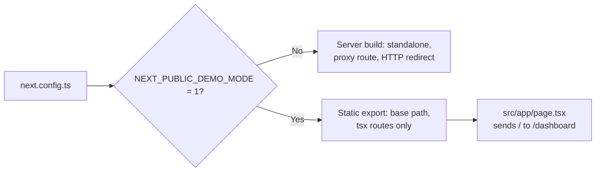

# MH-1: Two builds, the server app and the static demo

## Apply with the runner

The handoff runner applies this file: it writes the test files, runs the red command (it must fail), makes the changes, runs the "Done when" checks (they must pass), and commits. See `docs/handoff-runner.md`.

Apply this handoff (WSL, from `apps/backend-py`):

```bash
.venv/bin/python scripts/run_handoff.py ../../tasks/active/step-4-demo/mh-1-two-builds.md
```

## Why

Step 4 needs a static site for GitHub Pages, and the app needs a Next.js server today. This handoff adds a second build and leaves the server build as it is.



- The demo build sets `pageExtensions` to `["tsx"]`. Pages and layouts are all `.tsx`, and the proxy is `route.ts`, so it drops out with no change to that file.
- A static export has no `redirects`, so `src/app/page.tsx` sends `/` to `/dashboard` there. The server build keeps its `redirects` entry, which answers first with an HTTP 307. Without that entry, Next prerenders `/` and the server answers 200 with a client redirect.
- The demo has no data yet: MSW comes in MH-3. Each API call fails in the demo build until then.
- The checks here do not run a build, because a build in the repository is slow. The clone check in `notes.md` ran both builds and a browser on the base path.

## Files

- `apps/frontend-ts/tests/lib/next-config.test.ts` (new)
- `apps/frontend-ts/tests/app/home/page.test.tsx` (new)
- `apps/frontend-ts/next.config.ts` (change)
- `apps/frontend-ts/src/app/page.tsx` (new)
- `apps/frontend-ts/package.json` (change)

## Step 1: add the tests, run them, and see them fail

```ts new=apps/frontend-ts/tests/lib/next-config.test.ts
/**
 * Tests for the two builds in `next.config.ts` (Step 4, MH-1).
 *
 * The server build must stay as it was. The demo build is a static site, so
 * it must leave out the proxy route, which needs a server.
 */

import { existsSync } from "node:fs";
import { resolve } from "node:path";

import type { NextConfig } from "next";
import { afterEach, describe, expect, it, vi } from "vitest";

const PROXY_ROUTE = resolve(
  __dirname,
  "../../src/app/api/proxy/[...path]/route.ts",
);

/**
 * Load `next.config.ts` again, so it reads the current environment.
 *
 * @returns The config.
 */
async function loadConfig(): Promise<NextConfig> {
  vi.resetModules();
  const loaded = await import("../../next.config");
  return loaded.default;
}

/**
 * Check that a config is the server build.
 *
 * @param config - The config.
 */
async function expectServerBuild(config: NextConfig): Promise<void> {
  expect(config.output).toBe("standalone");
  expect(config.basePath).toBeUndefined();
  expect(config.pageExtensions).toBeUndefined();
  expect(await config.redirects?.()).toEqual([
    { source: "/", destination: "/dashboard", permanent: false },
  ]);
}

describe("next.config", () => {
  afterEach(() => {
    vi.unstubAllEnvs();
  });

  it("builds the server app by default", async () => {
    vi.stubEnv("NEXT_PUBLIC_DEMO_MODE", "");
    await expectServerBuild(await loadConfig());
  });

  it("builds the server app when the demo flag is not 1", async () => {
    vi.stubEnv("NEXT_PUBLIC_DEMO_MODE", "0");
    await expectServerBuild(await loadConfig());
  });

  it("exports a static site in demo mode", async () => {
    vi.stubEnv("NEXT_PUBLIC_DEMO_MODE", "1");
    const config = await loadConfig();
    expect(config.output).toBe("export");
    expect(config.basePath).toBe("");
    expect(config.redirects).toBeUndefined();
  });

  it("uses the base path of the host in demo mode", async () => {
    vi.stubEnv("NEXT_PUBLIC_DEMO_MODE", "1");
    vi.stubEnv("NEXT_PUBLIC_BASE_PATH", "/job-raider");
    expect((await loadConfig()).basePath).toBe("/job-raider");
  });

  it("leaves the proxy route out of the demo routes", async () => {
    vi.stubEnv("NEXT_PUBLIC_DEMO_MODE", "1");
    const config = await loadConfig();
    expect(existsSync(PROXY_ROUTE)).toBe(true);
    expect(config.pageExtensions).toEqual(["tsx"]);
  });
});
```

```tsx new=apps/frontend-ts/tests/app/home/page.test.tsx
/**
 * Tests for the root page (Step 4, MH-1).
 */

import { redirect } from "next/navigation";
import { describe, expect, it, vi } from "vitest";

import Home from "@/app/page";

vi.mock("next/navigation", () => ({ redirect: vi.fn() }));

describe("Home", () => {
  it("sends the root path to the dashboard", () => {
    Home();
    expect(redirect).toHaveBeenCalledWith("/dashboard");
  });
});
```

Run them. They must fail (the demo build and the root page do not exist yet):

```bash red cwd=apps/frontend-ts
source ~/.nvm/nvm.sh && nvm use 24 && npx vitest run --no-cache tests/lib/next-config.test.ts tests/app/home/page.test.tsx
```

## Step 2: add the second build

```ts edit=apps/frontend-ts/next.config.ts
<<<<<<< OLD
import type { NextConfig } from "next";

const nextConfig: NextConfig = {
  output: "standalone",
  async redirects() {
    return [
      {
        source: "/",
        destination: "/dashboard",
        permanent: false,
      },
    ];
  },
};

export default nextConfig;
=======
import type { NextConfig } from "next";

/**
 * The demo build is a static site with no Next.js server. Only `.tsx` files
 * are routes in it, so the server-only proxy
 * (`src/app/api/proxy/[...path]/route.ts`) is left out. Pages and layouts are
 * all `.tsx`, so they stay. A static export has no `redirects`, so
 * `src/app/page.tsx` does that work in the demo.
 */
const isDemo = process.env.NEXT_PUBLIC_DEMO_MODE === "1";

const nextConfig: NextConfig = isDemo
  ? {
      output: "export",
      basePath: process.env.NEXT_PUBLIC_BASE_PATH ?? "",
      pageExtensions: ["tsx"],
    }
  : {
      output: "standalone",
      async redirects() {
        return [
          {
            source: "/",
            destination: "/dashboard",
            permanent: false,
          },
        ];
      },
    };

export default nextConfig;
>>>>>>> NEW
```

```tsx new=apps/frontend-ts/src/app/page.tsx
import { redirect } from "next/navigation";

/**
 * Send the root path to the dashboard in the static demo build.
 *
 * A static export does not support `redirects` in `next.config.ts`. In the
 * server build, that config answers first, with an HTTP redirect.
 *
 * @returns Never: the redirect ends the render.
 */
export default function Home(): never {
  redirect("/dashboard");
}
```

```json edit=apps/frontend-ts/package.json
<<<<<<< OLD
    "build": "next build",
=======
    "build": "next build",
    "build:demo": "NEXT_PUBLIC_DEMO_MODE=1 next build",
>>>>>>> NEW
```

## Done when

Run the new tests and the other frontend unit tests:

```bash check cwd=apps/frontend-ts
source ~/.nvm/nvm.sh && nvm use 24 && npx vitest run --no-cache
```

Format, lint, and type-check:

```bash check cwd=apps/frontend-ts
source ~/.nvm/nvm.sh && nvm use 24 && npx prettier --check next.config.ts src/app/page.tsx tests/lib/next-config.test.ts tests/app/home/page.test.tsx
```

```bash check cwd=apps/frontend-ts
source ~/.nvm/nvm.sh && nvm use 24 && npx eslint next.config.ts src/app/page.tsx tests/lib/next-config.test.ts tests/app/home/page.test.tsx
```

```bash check cwd=apps/frontend-ts
source ~/.nvm/nvm.sh && nvm use 24 && npx tsc --noEmit
```

Commit message:

```text commit
feat(frontend): add a static demo build next to the server build

NEXT_PUBLIC_DEMO_MODE=1 gives a static export for GitHub Pages, with a
base path and only tsx routes, so the server-only proxy route drops out.
A root page sends / to /dashboard there, because a static export has no
redirects. The server build does not change (Step 4, MH-1).

Co-Authored-By: Claude Opus 5.5 <noreply@anthropic.com>
```
