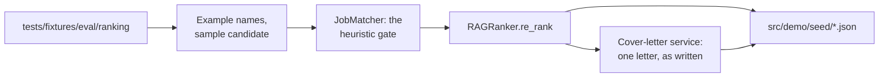

# MH-2: The demo seed script and its data

## Apply with the runner

The handoff runner applies this file: it writes the test file, runs the red command (it must fail), writes the script and the data, runs the "Done when" checks (they must pass), and commits. See `docs/handoff-runner.md`.

Apply this handoff after MH-2a (WSL, from `apps/backend-py`):

```bash
.venv/bin/python scripts/run_handoff.py ../../tasks/active/step-4-demo/mh-2-demo-data.md
```

## Why

The demo shows real output on synthetic input. The script runs the real matcher, the hybrid ranker, the cover-letter service, and the API serializers on the `fresh_ml` profile and the constructed jobs, and it writes JSON for the frontend. MH-3 serves this JSON with MSW.



- The data in this handoff came from one run on a clean clone with `qwen2.5:7b` (idle GPU 1,669 MiB, peak 6,367 MiB, no model loaded after).
- An earlier run stopped on the script's own check (MH-2a). It was not repeated to pick a better letter.
- The script stops when `data/` has files, so no personal data and no saved setting can reach the output.
- The letter stays as written. The validator approved it, but it has claims with no support: the profile does not say "deployed", and neither the profile nor the job says "robust" or "scalable". MH-3 shows a note about this on the Cover Letter page.
- Application records and metrics are constructed sample data. The token counts are real.
- `.prettierignore` gets the data folder, because this JSON is generated.

## Files

- `apps/backend-py/tests/unit/test_demo_data.py` (new)
- `apps/backend-py/scripts/build_demo_data.py` (new)
- `apps/frontend-ts/src/demo/seed/*.json` (6 new files)
- `apps/frontend-ts/.prettierignore` (change)

## Step 1: add the test file, run it, and see it fail

```python new=apps/backend-py/tests/unit/test_demo_data.py
"""Tests for the demo seed and its committed data (Step 4, MH-2)."""

import json
import re
from pathlib import Path
from typing import Any, Dict, Iterator, List

import pytest

from scripts import build_demo_data as seed
from src.api.routes import profile as profile_route
from src.evaluation.suites import ranking
from src.generation.cover_letter_grounding import flag_unfilled_placeholders
from src.scoring.matcher import JobMatcher

FILES = ("applications", "history", "letter", "metrics", "profile", "shortlist")


def load(stem: str) -> Dict[str, Any]:
    """
    Load one committed data file.

    Args:
        stem: The file name without its extension.

    Returns:
        The parsed file.
    """
    return json.loads((seed.OUTPUT_DIR / f"{stem}.json").read_text(encoding="utf-8"))


def strings(value: Any) -> Iterator[str]:
    """
    Walk every string in a JSON value, keys included.

    Args:
        value: The parsed JSON value.

    Yields:
        Each string.
    """
    if isinstance(value, str):
        yield value
    elif isinstance(value, dict):
        for key, item in value.items():
            yield str(key)
            yield from strings(item)
    elif isinstance(value, list):
        for item in value:
            yield from strings(item)


def test_every_constructed_company_has_a_clear_demo_name() -> None:
    """A new company in the ranking set must get a demo name too."""
    names = {job.company for job in ranking.load_ranking_set().jobs}
    assert all(
        name in seed.COMPANY_NAMES or name.startswith("Fictional") for name in names
    )
    assert all(new.startswith("Example") for new in seed.COMPANY_NAMES.values())


def test_demo_jobs_lose_the_constructed_names_and_get_a_fixed_time() -> None:
    """Names go from every field, and the output is stable between runs."""
    jobs = seed.demo_jobs(ranking.load_ranking_set().jobs)
    text = " ".join(job.model_dump_json() for job in jobs)

    assert not [name for name in seed.COMPANY_NAMES if name in text]
    assert {job.scraped_at.isoformat() for job in jobs} == {seed.FIXED_TIME}


def test_demo_profile_has_the_sample_identity() -> None:
    """The profile has no name of the fixture and no constructed company."""
    source = ranking.load_ranking_set().profiles[seed.PROFILE_ID]
    profile = seed.demo_profile(source)
    text = profile.model_dump_json()

    assert (profile.name, profile.contact.email) == (
        seed.SAMPLE_NAME,
        seed.SAMPLE_EMAIL,
    )
    assert seed.SOURCE_NAME not in text and seed.SOURCE_EMAIL not in text
    assert not [name for name in seed.COMPANY_NAMES if name in text]


def test_the_script_stops_when_the_data_folder_has_a_file(tmp_path: Path) -> None:
    """A file under data/ could be personal data."""
    target = tmp_path / "data" / "profiles" / "store.json"
    target.parent.mkdir(parents=True)
    target.write_text("{}", encoding="utf-8")

    with pytest.raises(SystemExit, match="clean clone"):
        seed.require_clean_clone(tmp_path)


def test_the_script_runs_with_no_data_or_empty_folders(tmp_path: Path) -> None:
    """A clean clone has no data folder; the app makes empty folders on import."""
    seed.require_clean_clone(tmp_path)
    (tmp_path / "data" / "profiles").mkdir(parents=True)
    seed.require_clean_clone(tmp_path)


def letter_with(provider: Any, model: str, mission: str) -> Dict[str, Any]:
    """
    A small cover-letter response.

    Args:
        provider: The provider.
        model: The model.
        mission: The mission status.

    Returns:
        The response.
    """
    return {
        "cover_letter": {"provider_used": provider, "model_used": model},
        "mission_context": {"status": mission},
    }


def test_check_letter_accepts_the_local_writer() -> None:
    """The expected provider, model, and mission status pass."""
    seed.check_letter(letter_with("ollama", seed.WRITER_MODEL, "disabled"))


@pytest.mark.parametrize(
    "letter",
    [
        letter_with("anthropic", seed.WRITER_MODEL, "disabled"),
        letter_with(None, seed.WRITER_MODEL, "disabled"),
        letter_with("ollama", "other-model", "disabled"),
        letter_with("ollama", seed.WRITER_MODEL, "pass"),
    ],
)
def test_check_letter_refuses_any_other_source(letter: Dict[str, Any]) -> None:
    """A cloud letter or a web search must not reach the demo."""
    with pytest.raises(ValueError):
        seed.check_letter(letter)


def test_rank_jobs_uses_the_heuristic_gate(monkeypatch: pytest.MonkeyPatch) -> None:
    """Only the jobs that pass the gate reach the ranker, as in the pipeline."""
    data = ranking.load_ranking_set()
    profile = seed.demo_profile(data.profiles[seed.PROFILE_ID])
    jobs = seed.demo_jobs(data.jobs)
    seen: List[Any] = []

    class FakeRanker:
        """A ranker that records its input."""

        def re_rank(self, scored: List[Any], given: Any) -> List[Any]:
            """
            Record the scored jobs.

            Args:
                scored: The scored jobs.
                given: The profile.

            Returns:
                No jobs.
            """
            seen.extend(scored)
            return []

    monkeypatch.setattr(ranking, "default_embedding_client", lambda config: None)
    monkeypatch.setattr(ranking, "rag_ranker", lambda *args: FakeRanker())

    seed.rank_jobs(profile, jobs, data.modes[seed.PROFILE_ID])

    assert 0 < len(seen) < len(jobs)
    assert all(score.passed_threshold for _, score in seen)


def test_unload_model_asks_ollama_to_unload(monkeypatch: pytest.MonkeyPatch) -> None:
    """The script unloads each model, so one model is on the GPU."""
    calls: List[Dict[str, Any]] = []
    monkeypatch.setattr(
        seed.requests, "post", lambda url, json, timeout: calls.append(json)
    )

    seed.unload_model("a-model")

    assert calls == [{"model": "a-model", "keep_alive": 0}]


def test_profile_payload_does_not_change_the_route_state() -> None:
    """The real route serves the demo profile, and its state comes back."""
    source = ranking.load_ranking_set().profiles[seed.PROFILE_ID]
    before = (profile_route.active_profile_id, profile_route.stored_profiles)

    payload = seed.profile_payload(seed.demo_profile(source))

    assert payload["contact_info"]["name"] == seed.SAMPLE_NAME
    assert payload["created_at"] == seed.FIXED_TIME
    assert (profile_route.active_profile_id, profile_route.stored_profiles) == before


def test_write_files_gives_stable_json(tmp_path: Path) -> None:
    """Sorted keys and a final newline keep the diff small."""
    seed.write_files({"one": {"b": 1, "a": "é"}}, tmp_path / "out")

    text = (tmp_path / "out" / "one.json").read_text(encoding="utf-8")
    assert text == '{\n  "a": "é",\n  "b": 1\n}\n'


def test_each_file_is_committed() -> None:
    """The handlers of MH-3 read these files."""
    assert sorted(path.stem for path in seed.OUTPUT_DIR.glob("*.json")) == list(FILES)


def test_the_data_is_synthetic() -> None:
    """No constructed name, no other mail domain, and no web address."""
    text = " ".join(string for stem in FILES for string in strings(load(stem)))

    assert not [name for name in seed.COMPANY_NAMES if name in text]
    assert seed.SOURCE_NAME not in text
    assert set(re.findall(r"[\w.+-]+@([\w.-]+)", text)) == {"example.com"}
    assert not re.findall(r"https?://", text)


def test_the_shortlist_has_clear_fictional_companies() -> None:
    """A public page must not look like a real listing."""
    jobs = load("shortlist")["jobs"]

    assert len(jobs) >= 10
    assert all(job["job_id"].startswith("rk-") for job in jobs)
    assert all(job["company"].startswith(("Example", "Fictional")) for job in jobs)


def test_the_shortlist_is_best_first() -> None:
    """The order is the order of the ranker."""
    scores = [job["relevance_score"] for job in load("shortlist")["jobs"]]
    assert scores == sorted(scores, reverse=True)


def test_the_scores_are_real_matcher_output() -> None:
    """Each committed breakdown is what the matcher gives today.

    A failure here after a matcher change means: run the seed again.
    """
    data = ranking.load_ranking_set()
    profile = seed.demo_profile(data.profiles[seed.PROFILE_ID])
    jobs = {job.job_id: job for job in seed.demo_jobs(data.jobs)}
    matcher = JobMatcher(fresh_grad_mode=True)

    for row in load("shortlist")["jobs"]:
        score = matcher.score_job(jobs[row["job_id"]], profile)
        assert row["match_breakdown"] == score.breakdown, row["job_id"]
        # The matcher builds this list from a set, so its order changes.
        assert sorted(row["missing_skills"]) == sorted(score.missing_skills)


def test_the_letter_comes_from_the_local_writer_for_the_top_job() -> None:
    """The letter is for the first job, from the default writer."""
    letter = load("letter")
    top = load("shortlist")["jobs"][0]

    seed.check_letter(letter)
    assert letter["job_id"] == top["job_id"]
    assert top["company"] in letter["cover_letter"]["content"]
    assert flag_unfilled_placeholders(letter["cover_letter"]["content"]) == []


def test_the_constructed_files_follow_the_shortlist_and_the_letter() -> None:
    """Applications, metrics, and history stay in step with their sources."""
    expected = seed.derived_files(load("shortlist"), load("letter"))

    assert expected == {stem: load(stem) for stem in expected}


def test_the_sample_rates_come_from_the_applications() -> None:
    """Two of five sample applications reached screening."""
    metrics = load("metrics")
    summary = load("applications")["summary"]

    assert summary["total_applications"] == len(seed.SAMPLE_APPLICATIONS)
    assert metrics["outcomes"]["screening_rate"] == 0.4
    assert metrics["cost"]["total_tokens"] > 0
```

Run it. It must fail (the script does not exist yet):

```bash red cwd=apps/backend-py
.venv/bin/python -m pytest tests/unit/test_demo_data.py -q
```

## Step 2: add the script

```python new=apps/backend-py/scripts/build_demo_data.py
"""
Build the data of the public demo (Step 4).

The demo shows real output on synthetic input: this script runs the real
matcher, the hybrid ranker, the cover-letter service, and the API serializers
on the synthetic `fresh_ml` profile and the constructed jobs of the ranking
set. It writes JSON files for the frontend. Application records and metrics
are constructed sample data, because a demo has no real applications.

Every company gets an `Example` name, and the profile gets a sample name, so a
public page cannot look like a real employer or a real person. The ranking set
itself does not change.

The script needs `nomic-embed-text` and `qwen2.5:7b` in Ollama, and it loads
one model at a time. Close other GPU-heavy apps first. It runs by hand, not
in CI.

It must run on a clean clone. The app reads `data/` from the working folder,
and a clean clone has no such folder, so no personal data and no saved setting
can reach the output. The script stops when it finds files there. A run writes
files to `data/`, so each run needs a new clone.

Run it from `apps/backend-py` of a clean clone:

    python -m scripts.build_demo_data
"""

from __future__ import annotations

import asyncio
import json
import tempfile
from collections import Counter
from datetime import datetime
from pathlib import Path
from typing import Any, Dict, Iterable, List, Sequence

import requests

from src.evaluation.run_metadata import BACKEND_DIR
from src.evaluation.suites import ranking
from src.models.job_listing import JobListing
from src.models.user_profile import UserProfile
from src.pipeline.shortlist import save_latest_shortlist
from src.rag.config import RAGConfig
from src.rag.ranker import RAGMatchScore
from src.scoring.matcher import JobMatcher

OUTPUT_DIR = BACKEND_DIR.parent / "frontend-ts" / "src" / "demo" / "seed"
PROFILE_ID = "fresh_ml"
WRITER_MODEL = "qwen2.5:7b"
OLLAMA_URL = "http://localhost:11434"
RUN_ID = "demo-run"
FIXED_TIME = "2026-11-04T12:00:00"
SAMPLE_NAME = "Sample Candidate"
SAMPLE_EMAIL = "sample.candidate@example.com"
SOURCE_NAME = "Rina Tan"
SOURCE_EMAIL = "rina.tan@example.com"
SAMPLE_RESUME = "sample-resume.pdf"

# Each constructed company gets a name that cannot be read as a real employer.
# Names that start with "Fictional" are clear already.
COMPANY_NAMES: Dict[str, str] = {
    "Brightloop Software": "Example Software",
    "Coralpoint Hotels": "Example Hotels",
    "Corvid Cloud": "Example Cloud",
    "Crestline Payments": "Example Payments",
    "Fleetbridge": "Example Fleet",
    "Harbourline Logistics": "Example Logistics",
    "Harrowgate Bank": "Example Bank",
    "Kestrel Insurance": "Example Insurance",
    "Lumen Analytics": "Example Analytics",
    "Meridian Capital": "Example Capital",
    "Northgate Institute for AI": "Example AI Institute",
    "Orchid Mobility": "Example Mobility",
    "Pinewave Media": "Example Media",
    "Seastar Retail Group": "Example Retail",
    "Tidepool Cloud": "Example Hosting",
    "Visiontrack Robotics": "Example Robotics",
    "Wordwise Labs": "Example Labs",
}

# Constructed sample: one status for each of the first shortlist jobs, with the
# days since the application.
SAMPLE_APPLICATIONS = (
    ("technical_scheduled", 14),
    ("screening_completed", 10),
    ("under_review", 6),
    ("applied", 2),
    ("rejected", 21),
)
SCREENED_STATUSES = frozenset({"technical_scheduled", "screening_completed"})
PIPELINE_STAGES = ("scrape", "deduplicate", "filter_scams", "score", "rag_rank")


def require_clean_clone(folder: Path) -> None:
    """
    Stop when the working folder has app data.

    Args:
        folder: The working folder.

    Raises:
        SystemExit: When a file exists under ``data/``.
    """
    data = folder / "data"
    if data.exists() and any(path.is_file() for path in data.rglob("*")):
        raise SystemExit(
            f"{data} has files. Run this script on a clean clone, so that no "
            "personal data and no saved setting can reach the demo."
        )


def rename_text(text: str) -> str:
    """
    Replace each constructed company name.

    Args:
        text: Any text.

    Returns:
        The text with the `Example` names.
    """
    for old, new in COMPANY_NAMES.items():
        text = text.replace(old, new)
    return text


def demo_jobs(jobs: Iterable[JobListing]) -> List[JobListing]:
    """
    Copy the jobs with the demo company names and a fixed time.

    Args:
        jobs: The jobs of the ranking set.

    Returns:
        New jobs. A fixed `scraped_at` keeps the output stable between runs.
    """
    result: List[JobListing] = []
    for job in jobs:
        data = json.loads(rename_text(job.model_dump_json()))
        data["scraped_at"] = FIXED_TIME
        result.append(JobListing.model_validate(data))
    return result


def demo_profile(profile: UserProfile) -> UserProfile:
    """
    Copy the profile with the sample name and the demo company names.

    Args:
        profile: The synthetic profile.

    Returns:
        A new profile.
    """
    text = rename_text(profile.model_dump_json())
    text = text.replace(SOURCE_NAME, SAMPLE_NAME).replace(SOURCE_EMAIL, SAMPLE_EMAIL)
    return UserProfile.model_validate(json.loads(text))


def rank_jobs(
    profile: UserProfile, jobs: Sequence[JobListing], mode: Dict[str, bool]
) -> List[RAGMatchScore]:
    """
    Rank the jobs as the pipeline does: the heuristic gate, then the hybrid ranker.

    Args:
        profile: The demo profile.
        jobs: The demo jobs.
        mode: The profile's matcher settings.

    Returns:
        The ranked jobs, best first.
    """
    matcher = JobMatcher(fresh_grad_mode=bool(mode.get("fresh_grad_mode", False)))
    scored = [(job, matcher.score_job(job, profile)) for job in jobs]
    passed = [item for item in scored if item[1].passed_threshold]
    config = RAGConfig.from_yaml(str(ranking.RAG_CONFIG_PATH))
    client = ranking.default_embedding_client(config)
    with tempfile.TemporaryDirectory(ignore_cleanup_errors=True) as folder:
        ranker = ranking.rag_ranker(config, client, Path(folder))
        return ranker.re_rank(passed, profile)


def unload_model(model: str) -> None:
    """
    Unload a model from Ollama, so one model at a time is on the GPU.

    Args:
        model: The model name.
    """
    requests.post(
        f"{OLLAMA_URL}/api/generate",
        json={"model": model, "keep_alive": 0},
        timeout=60,
    )


def check_letter(payload: Dict[str, Any]) -> None:
    """
    Stop when the letter does not come from the local writer alone.

    Args:
        payload: The cover-letter response.

    Raises:
        ValueError: When another model wrote the letter, or when a web search
            for the company mission ran.
    """
    letter = payload["cover_letter"]
    used = (letter.get("provider_used"), letter.get("model_used"))
    if used != ("ollama", WRITER_MODEL):
        raise ValueError(f"expected ollama and {WRITER_MODEL}, got {used}")
    status = (payload.get("mission_context") or {}).get("status")
    if status != "disabled":
        raise ValueError(f"the company mission must be off, got {status}")


def letter_payload(job: JobListing, profile: UserProfile) -> Dict[str, Any]:
    """
    Write one letter with the real service, with the validator result.

    The letter stays as the service gives it, flags included: the demo must
    show the validator as it is.

    Args:
        job: The job.
        profile: The demo profile.

    Returns:
        The API response for a cover letter.
    """
    from src.generation.cover_letter_service import generate_cover_letter_sync

    response = generate_cover_letter_sync(job, profile, writer_model=WRITER_MODEL)
    payload = response.model_dump(mode="json")
    check_letter(payload)
    return payload


def profile_payload(profile: UserProfile) -> Dict[str, Any]:
    """
    Serialize the profile with the real route.

    The route module is imported here, not at the top of this file, because it
    reads `data/` on import, and `require_clean_clone` must run first.

    Args:
        profile: The demo profile.

    Returns:
        The API response of ``GET /profile``.
    """
    from src.api.routes import profile as route

    saved = (route.active_profile_id, route.stored_profiles)
    route.active_profile_id = "demo"
    route.stored_profiles = {
        "demo": {
            "profile": profile,
            "resume_path": SAMPLE_RESUME,
            "original_filename": SAMPLE_RESUME,
            "created_at": datetime.fromisoformat(FIXED_TIME),
            "updated_at": datetime.fromisoformat(FIXED_TIME),
        }
    }
    try:
        return asyncio.run(route.get_profile())
    finally:
        route.active_profile_id, route.stored_profiles = saved


def shortlist_payload(
    results: Sequence[RAGMatchScore], profile: UserProfile, jobs_scraped: int
) -> Dict[str, Any]:
    """
    Serialize the ranked jobs with the real shortlist code.

    Args:
        results: The ranked jobs.
        profile: The demo profile.
        jobs_scraped: The size of the job pool.

    Returns:
        The API response of ``GET /pipeline/shortlist/latest``.
    """
    with tempfile.TemporaryDirectory() as folder:
        path = save_latest_shortlist(
            run_id=RUN_ID,
            mode="discover",
            keywords=profile.targets.keywords,
            locations=profile.targets.locations,
            scored_listings=list(results),
            results_dir=folder,
            jobs_scraped=jobs_scraped,
        )
        payload = json.loads(path.read_text(encoding="utf-8"))
    payload["created_at"] = FIXED_TIME
    return payload


def applications_payload(shortlist: Dict[str, Any]) -> Dict[str, Any]:
    """
    Construct the sample application records from the first shortlist jobs.

    Args:
        shortlist: The shortlist response.

    Returns:
        The API response of ``GET /applications/dashboard``.
    """
    applications = [
        {
            "application_id": f"demo-{job['job_id']}",
            "job_title": job["title"],
            "company": job["company"],
            "applied_date": FIXED_TIME,
            "current_status": status,
            "custom_status": None,
            "is_bookmarked": False,
            "is_hidden": False,
            "days_since_application": days,
            "source_url": None,
            "listing_status": "active",
            "has_job_description": True,
            "previous_status": None,
            "application_method": "external",
        }
        for job, (status, days) in zip(shortlist["jobs"], SAMPLE_APPLICATIONS)
    ]
    return {
        "applications": applications,
        "summary": {
            "total_applications": len(applications),
            "bookmarked": 0,
            "hidden": 0,
            "external": len(applications),
            "expired": 0,
            "by_status": dict(Counter(row["current_status"] for row in applications)),
        },
        "custom_statuses": [],
        "filters_applied": {},
    }


def metrics_payload(
    applications: Dict[str, Any], letter: Dict[str, Any]
) -> Dict[str, Any]:
    """
    Construct the sample metrics.

    The token counts are real, from the demo letter. The outcome rates come
    from the sample applications.

    Args:
        applications: The applications response.
        letter: The cover-letter response.

    Returns:
        The API response of ``GET /metrics/summary``.
    """
    usage = letter["cover_letter"].get("token_usage") or {}
    prompt_tokens = int(usage.get("prompt_tokens") or 0)
    completion_tokens = int(usage.get("completion_tokens") or 0)
    total_tokens = int(usage.get("total_tokens") or 0)
    rows = applications["applications"]
    screened = sum(row["current_status"] in SCREENED_STATUSES for row in rows)
    return {
        "cost": {
            "total_usd": 0.0,
            "per_application": 0.0,
            "total_calls": 1,
            "local_usage_percent": 100,
            "prompt_tokens": prompt_tokens,
            "completion_tokens": completion_tokens,
            "total_tokens": total_tokens,
            "estimated_counts": 0,
            "last_run": {
                "run_id": RUN_ID,
                "end_time": FIXED_TIME,
                "calls": 1,
                "total_tokens": total_tokens,
                "prompt_tokens": prompt_tokens,
                "completion_tokens": completion_tokens,
            },
        },
        "outcomes": {
            "total_applications": len(rows),
            "screening_rate": screened / len(rows),
            "offer_rate": 0.0,
            "acceptance_rate": 0.0,
        },
        "health": {"status": "healthy", "healthy": 4, "degraded": 0, "unhealthy": 0},
        "recent_calls": [
            {
                "task_type": "cover_letter_writing",
                "provider": "ollama",
                "model": WRITER_MODEL,
                "cost_usd": 0.0,
                "timestamp": FIXED_TIME,
                "prompt_tokens": prompt_tokens,
                "completion_tokens": completion_tokens,
                "total_tokens": total_tokens,
            }
        ],
    }


def history_payload(shortlist: Dict[str, Any]) -> Dict[str, Any]:
    """
    Construct the sample run history: one discover run.

    Args:
        shortlist: The shortlist response.

    Returns:
        The API response of ``GET /pipeline/history``.
    """
    return {
        "runs": [
            {
                "run_id": RUN_ID,
                "status": "completed",
                "created_at": FIXED_TIME,
                "completed_at": FIXED_TIME,
                "jobs_scraped": shortlist["jobs_scraped"],
                "jobs_scored": shortlist["jobs_scraped"],
                "jobs_applied": 0,
                "mode": "discover",
                "stages_completed": list(PIPELINE_STAGES),
            }
        ],
        "total": 1,
    }


def derived_files(
    shortlist: Dict[str, Any], letter: Dict[str, Any]
) -> Dict[str, Dict[str, Any]]:
    """
    Build the files that follow from the shortlist and the letter.

    Args:
        shortlist: The shortlist response.
        letter: The cover-letter response.

    Returns:
        File stem to content.
    """
    applications = applications_payload(shortlist)
    return {
        "applications": applications,
        "metrics": metrics_payload(applications, letter),
        "history": history_payload(shortlist),
    }


def write_files(files: Dict[str, Dict[str, Any]], folder: Path) -> None:
    """
    Write each file as stable JSON.

    Args:
        files: File stem to content.
        folder: The output folder.
    """
    folder.mkdir(parents=True, exist_ok=True)
    for stem, content in files.items():
        text = json.dumps(content, indent=2, sort_keys=True, ensure_ascii=False)
        (folder / f"{stem}.json").write_text(text + "\n", encoding="utf-8")


def main() -> None:
    """Build every demo file."""
    require_clean_clone(Path.cwd())
    data = ranking.load_ranking_set()
    profile = demo_profile(data.profiles[PROFILE_ID])
    jobs = demo_jobs(data.jobs)
    profile_file = profile_payload(profile)  # Before any model loads.
    results = rank_jobs(profile, jobs, data.modes[PROFILE_ID])
    unload_model(RAGConfig.from_yaml(str(ranking.RAG_CONFIG_PATH)).embedding.model)
    letter = letter_payload(results[0].job, profile)
    unload_model(WRITER_MODEL)
    shortlist = shortlist_payload(results, profile, len(jobs))
    write_files(
        {
            "profile": profile_file,
            "shortlist": shortlist,
            "letter": letter,
            **derived_files(shortlist, letter),
        },
        OUTPUT_DIR,
    )


if __name__ == "__main__":
    main()
```

## Step 3: add the data

```json new=apps/frontend-ts/src/demo/seed/applications.json
{
  "applications": [
    {
      "application_id": "demo-rk-012",
      "application_method": "external",
      "applied_date": "2026-11-04T12:00:00",
      "company": "Example AI Institute",
      "current_status": "technical_scheduled",
      "custom_status": null,
      "days_since_application": 14,
      "has_job_description": true,
      "is_bookmarked": false,
      "is_hidden": false,
      "job_title": "Research Engineer, Machine Learning",
      "listing_status": "active",
      "previous_status": null,
      "source_url": null
    },
    {
      "application_id": "demo-rk-004",
      "application_method": "external",
      "applied_date": "2026-11-04T12:00:00",
      "company": "Example Labs",
      "current_status": "screening_completed",
      "custom_status": null,
      "days_since_application": 10,
      "has_job_description": true,
      "is_bookmarked": false,
      "is_hidden": false,
      "job_title": "Associate NLP Engineer",
      "listing_status": "active",
      "previous_status": null,
      "source_url": null
    },
    {
      "application_id": "demo-rk-026",
      "application_method": "external",
      "applied_date": "2026-11-04T12:00:00",
      "company": "Example Media",
      "current_status": "under_review",
      "custom_status": null,
      "days_since_application": 6,
      "has_job_description": true,
      "is_bookmarked": false,
      "is_hidden": false,
      "job_title": "Graduate Software Engineer, Python",
      "listing_status": "active",
      "previous_status": null,
      "source_url": null
    },
    {
      "application_id": "demo-rk-003",
      "application_method": "external",
      "applied_date": "2026-11-04T12:00:00",
      "company": "Example Software",
      "current_status": "applied",
      "custom_status": null,
      "days_since_application": 2,
      "has_job_description": true,
      "is_bookmarked": false,
      "is_hidden": false,
      "job_title": "AI Engineer, LLM Applications",
      "listing_status": "active",
      "previous_status": null,
      "source_url": null
    },
    {
      "application_id": "demo-rk-005",
      "application_method": "external",
      "applied_date": "2026-11-04T12:00:00",
      "company": "Example Mobility",
      "current_status": "rejected",
      "custom_status": null,
      "days_since_application": 21,
      "has_job_description": true,
      "is_bookmarked": false,
      "is_hidden": false,
      "job_title": "Machine Learning Engineer",
      "listing_status": "active",
      "previous_status": null,
      "source_url": null
    }
  ],
  "custom_statuses": [],
  "filters_applied": {},
  "summary": {
    "bookmarked": 0,
    "by_status": {
      "applied": 1,
      "rejected": 1,
      "screening_completed": 1,
      "technical_scheduled": 1,
      "under_review": 1
    },
    "expired": 0,
    "external": 5,
    "hidden": 0,
    "total_applications": 5
  }
}
```

```json new=apps/frontend-ts/src/demo/seed/history.json
{
  "runs": [
    {
      "completed_at": "2026-11-04T12:00:00",
      "created_at": "2026-11-04T12:00:00",
      "jobs_applied": 0,
      "jobs_scored": 70,
      "jobs_scraped": 70,
      "mode": "discover",
      "run_id": "demo-run",
      "stages_completed": [
        "scrape",
        "deduplicate",
        "filter_scams",
        "score",
        "rag_rank"
      ],
      "status": "completed"
    }
  ],
  "total": 1
}
```

```json new=apps/frontend-ts/src/demo/seed/letter.json
{
  "cover_letter": {
    "content": "At Example AI Institute, I am excited about the opportunity to contribute to your cutting-edge research in machine learning. My project, the Plant Disease Classifier, aligns closely with the institute's focus on developing robust and scalable solutions for data analysis tasks. \n\nIn my role, I successfully trained and deployed an image classifier for plant diseases using PyTorch, achieving 91% accuracy on a held-out set of 2,000 images. This project not only honed my skills in PyTorch but also underscored my ability to apply machine learning techniques to real-world problems. By leveraging PyTorch, I was able to develop a more robust and scalable solution for data analysis, which is a critical skill for this position.\n\nAdditionally, my project, the Review Sentiment Tagger, fine-tuned a BERT model on 20,000 labeled reviews, significantly improving the accuracy and efficiency of product review tagging. This experience with Hugging Face Transformers and Python demonstrated my proficiency in implementing advanced ML models, aligning well with the Research Engineer role's requirement to work with new learning methods and large-scale training.\n\nThese projects, coupled with my background in Python and PyTorch, make me confident in my ability to contribute to your team's mission of advancing machine learning methods and turning them into reproducible experiments. I look forward to the possibility of working with your team and further developing my skills in this exciting field.\n\nThank you for considering my application. I am eager to discuss how my experience can contribute to the success of the Research Engineer role at Example AI Institute.",
    "highlighted_experiences": [
      {
        "name": "Plant Disease Classifier",
        "reason": "Focuses on ML research in PyTorch, aligns with required skills and job requirements."
      },
      {
        "name": "Review Sentiment Tagger",
        "reason": "Uses Hugging Face Transformers, relevant to ML research and Python skills."
      }
    ],
    "model_used": "qwen2.5:7b",
    "provider_used": "ollama",
    "style": "modern",
    "timing": {
      "generation_ms": 19244.0,
      "grounding_rewrite_ms": null,
      "mission_ms": null,
      "review_ms": null,
      "rewrite_ms": null,
      "selection_ms": 15521.9,
      "total_ms": 34827.0,
      "validation_ms": 60.6
    },
    "token_usage": {
      "completion_tokens": 637,
      "generation_tokens": 1728,
      "grounding_rewrite_tokens": null,
      "prompt_tokens": 1882,
      "review_tokens": null,
      "rewrite_tokens": null,
      "selection_tokens": 791,
      "total_tokens": 2519
    },
    "word_count": 253
  },
  "instructions_context": {
    "detected": {
      "inclusions": [],
      "why_interest": null
    },
    "inclusion_checks": [],
    "inclusion_urls": {},
    "length_count": null,
    "length_ok": null,
    "short_answer_mode": false
  },
  "job_id": "rk-012",
  "mission_context": {
    "status": "disabled"
  },
  "success": true,
  "validation": {
    "content_score": 80,
    "details": {
      "analogical_claims": [],
      "claim_overclaims": [],
      "company_mentioned": true,
      "fabricated_technologies": [],
      "grounding_penalty": {
        "analogical_claim": 0,
        "capped_penalty": 0,
        "fabricated_tech": 0,
        "hard_ungrounded": 0,
        "inconsistent_metric": 0,
        "inflated_duration": 0,
        "raw_penalty": 0,
        "scope_inflation": 0,
        "soft_ungrounded": 0,
        "technique_mismatch": 0,
        "weights": {
          "analogical_claim": 12,
          "fabricated_tech": 10,
          "hard_ungrounded": 10,
          "inconsistent_metric": 10,
          "inflated_duration": 10,
          "max_penalty": 50,
          "scope_inflation": 12,
          "soft_ungrounded": 3,
          "technique_mismatch": 10
        }
      },
      "has_call_to_action": true,
      "has_generic_opening": false,
      "inconsistent_percent_claims": [],
      "inflated_duration_claims": [],
      "instructions_context": {
        "detected": {
          "inclusions": [],
          "why_interest": null
        },
        "inclusion_checks": [],
        "inclusion_urls": {},
        "length_count": null,
        "length_ok": null,
        "short_answer_mode": false
      },
      "jd_coverage": {
        "matched": [
          "Python",
          "PyTorch"
        ],
        "missing": [
          "Machine Learning Research"
        ],
        "source": "structured"
      },
      "job_title_mentioned": false,
      "mission_context": {
        "status": "disabled"
      },
      "paragraph_count": 5,
      "referenced_projects": [
        "Plant Disease Classifier",
        "Review Sentiment Tagger"
      ],
      "short_answer_mode": false,
      "style": "modern",
      "unfilled_placeholders": [],
      "ungrounded_sentences": [],
      "word_count": 253
    },
    "is_valid": true,
    "issues": [
      "missing_job_title"
    ],
    "recommendation": "approve",
    "score": 92,
    "structure_score": 100,
    "tone_score": 100,
    "word_count": 253
  }
}
```

```json new=apps/frontend-ts/src/demo/seed/metrics.json
{
  "cost": {
    "completion_tokens": 637,
    "estimated_counts": 0,
    "last_run": {
      "calls": 1,
      "completion_tokens": 637,
      "end_time": "2026-11-04T12:00:00",
      "prompt_tokens": 1882,
      "run_id": "demo-run",
      "total_tokens": 2519
    },
    "local_usage_percent": 100,
    "per_application": 0.0,
    "prompt_tokens": 1882,
    "total_calls": 1,
    "total_tokens": 2519,
    "total_usd": 0.0
  },
  "health": {
    "degraded": 0,
    "healthy": 4,
    "status": "healthy",
    "unhealthy": 0
  },
  "outcomes": {
    "acceptance_rate": 0.0,
    "offer_rate": 0.0,
    "screening_rate": 0.4,
    "total_applications": 5
  },
  "recent_calls": [
    {
      "completion_tokens": 637,
      "cost_usd": 0.0,
      "model": "qwen2.5:7b",
      "prompt_tokens": 1882,
      "provider": "ollama",
      "task_type": "cover_letter_writing",
      "timestamp": "2026-11-04T12:00:00",
      "total_tokens": 2519
    }
  ]
}
```

```json new=apps/frontend-ts/src/demo/seed/profile.json
{
  "apprenticeship": null,
  "certifications": [],
  "contact_info": {
    "email": "sample.candidate@example.com",
    "github_url": null,
    "linkedin_url": null,
    "location": "Singapore",
    "name": "Sample Candidate",
    "phone": null,
    "portfolio_url": null,
    "website_url": null
  },
  "core_skills": [
    "Python",
    "PyTorch",
    "Machine Learning",
    "SQL"
  ],
  "created_at": "2026-11-04T12:00:00",
  "education": [
    {
      "coursework": [
        "Machine Learning",
        "Databases",
        "Data Structures"
      ],
      "degree": "Bachelor of Computing in Computer Science",
      "field_of_study": null,
      "gpa": null,
      "graduation_date": "2025-06-01T00:00:00",
      "honors": [],
      "institution": "Fictional Marina University"
    }
  ],
  "languages": [],
  "notice_period_weeks": null,
  "original_filename": "sample-resume.pdf",
  "preferred_work_locations": [],
  "profile_id": "demo",
  "projects": [
    {
      "description": "A retrieval-augmented question answering app over lecture notes.",
      "end_date": "2025-04-01T00:00:00",
      "highlights": [
        "Indexed 400 pages of notes and answered questions with source links."
      ],
      "name": "Course Notes Assistant",
      "role": "Developer",
      "start_date": "2025-01-01T00:00:00",
      "technologies": [
        "Python",
        "LangChain",
        "FAISS",
        "FastAPI"
      ],
      "url": null
    },
    {
      "description": "An image classifier for leaf diseases, trained in PyTorch.",
      "end_date": "2024-12-01T00:00:00",
      "highlights": [
        "Reached 91% accuracy on a held-out set of 2,000 images."
      ],
      "name": "Plant Disease Classifier",
      "role": "Developer",
      "start_date": "2024-08-01T00:00:00",
      "technologies": [
        "Python",
        "PyTorch"
      ],
      "url": null
    },
    {
      "description": "A fine-tuned transformer that tags product reviews by sentiment.",
      "end_date": "2025-05-01T00:00:00",
      "highlights": [
        "Fine-tuned a small BERT model on 20,000 labeled reviews."
      ],
      "name": "Review Sentiment Tagger",
      "role": "Developer",
      "start_date": "2025-02-01T00:00:00",
      "technologies": [
        "Python",
        "Hugging Face Transformers"
      ],
      "url": null
    }
  ],
  "resume_parse": null,
  "resume_path": "sample-resume.pdf",
  "salary_currency": "USD",
  "salary_expectation_max": null,
  "salary_expectation_min": null,
  "skills": [
    {
      "category": "programming_language",
      "name": "Python",
      "proficiency": "Advanced",
      "years_of_experience": 4.0
    },
    {
      "category": "framework",
      "name": "PyTorch",
      "proficiency": "Intermediate",
      "years_of_experience": 2.0
    },
    {
      "category": "framework",
      "name": "scikit-learn",
      "proficiency": "Intermediate",
      "years_of_experience": 2.0
    },
    {
      "category": "framework",
      "name": "Pandas",
      "proficiency": "Advanced",
      "years_of_experience": 3.0
    },
    {
      "category": "programming_language",
      "name": "SQL",
      "proficiency": "Intermediate",
      "years_of_experience": 2.0
    },
    {
      "category": "framework",
      "name": "FastAPI",
      "proficiency": "Intermediate",
      "years_of_experience": 1.0
    },
    {
      "category": "framework",
      "name": "LangChain",
      "proficiency": "Intermediate",
      "years_of_experience": 1.0
    },
    {
      "category": "framework",
      "name": "Hugging Face Transformers",
      "proficiency": "Intermediate",
      "years_of_experience": 1.0
    },
    {
      "category": "tool",
      "name": "Docker",
      "proficiency": "Beginner",
      "years_of_experience": 1.0
    },
    {
      "category": "tool",
      "name": "Git",
      "proficiency": "Intermediate",
      "years_of_experience": 3.0
    },
    {
      "category": "domain",
      "name": "Machine Learning",
      "proficiency": "Intermediate",
      "years_of_experience": 2.0
    },
    {
      "category": "domain",
      "name": "Natural Language Processing",
      "proficiency": "Intermediate",
      "years_of_experience": 1.0
    }
  ],
  "summary": "Computer science graduate who builds machine learning and retrieval applications in Python, from data preparation to a small API.",
  "target_job": {
    "constraint_mode": "boost",
    "exclude_internships": false,
    "experience_levels": [
      "Entry Level"
    ],
    "industries": [],
    "keywords": [
      "machine learning engineer",
      "data scientist",
      "AI"
    ],
    "locations": [
      "Singapore"
    ],
    "remote_preference": true,
    "salary_min": null
  },
  "updated_at": "2026-11-04T12:00:00",
  "visa_expiration_date": null,
  "visa_status": null,
  "willing_to_relocate": false,
  "work_experience": [
    {
      "company": "Example Logistics",
      "current": false,
      "description": "Built demand forecasts for the warehouse planning team.",
      "end_date": "2024-11-01T00:00:00",
      "highlights": [
        "Built a gradient boosting forecast in scikit-learn for weekly parcel volume.",
        "Cleaned two years of shipment records in Pandas and SQL."
      ],
      "location": "Singapore",
      "start_date": "2024-05-01T00:00:00",
      "technologies": [
        "Python",
        "scikit-learn",
        "Pandas",
        "SQL"
      ],
      "title": "Data Science Intern"
    }
  ],
  "years_of_experience": 0.5
}
```

```json new=apps/frontend-ts/src/demo/seed/shortlist.json
{
  "created_at": "2026-11-04T12:00:00",
  "jobs": [
    {
      "already_applied": false,
      "application_deadline": null,
      "apply_method": "easy_apply",
      "company": "Example AI Institute",
      "days_since_posted": null,
      "description": "Work with research scientists to turn new learning methods into reproducible experiments. You will implement papers in PyTorch, run large-scale training, and co-author publications. A master's or PhD with two to four years of research experience is preferred.",
      "experience_level": "Mid Level",
      "is_remote": false,
      "job_id": "rk-012",
      "job_type": "Full-time",
      "last_seen_at": "2026-11-04T12:00:00",
      "listing_status": "active",
      "location": "Singapore, SG",
      "match_breakdown": {
        "education": 15,
        "experience": 4,
        "location": 5,
        "projects": 16,
        "skills": 20
      },
      "matched_keywords": [],
      "missing_skills": [
        "machine learning research"
      ],
      "passed_threshold": true,
      "posted_date": null,
      "reasoning": "Strong match (60/100). Keywords and skills align well. Strong semantic alignment between profile and job description.",
      "recommendation": "apply",
      "relevance_score": 84.0,
      "remote": false,
      "salary_range": null,
      "scraped_at": "2026-11-04T12:00:00",
      "scraped_today": false,
      "skills": [
        {
          "category": null,
          "is_required": true,
          "name": "Python",
          "proficiency": null
        },
        {
          "category": null,
          "is_required": true,
          "name": "PyTorch",
          "proficiency": null
        },
        {
          "category": null,
          "is_required": true,
          "name": "Machine Learning Research",
          "proficiency": null
        }
      ],
      "source": "other",
      "source_url": null,
      "title": "Research Engineer, Machine Learning",
      "url": null
    },
    {
      "already_applied": false,
      "application_deadline": null,
      "apply_method": "easy_apply",
      "company": "Example Labs",
      "days_since_posted": null,
      "description": "Help us build text classification and entity extraction models for legal documents. You will fine-tune transformer models with Hugging Face Transformers and PyTorch, clean and label training data, and measure model quality. A degree in computing and a natural language processing project are required.",
      "experience_level": "Entry Level",
      "is_remote": false,
      "job_id": "rk-004",
      "job_type": "Full-time",
      "last_seen_at": "2026-11-04T12:00:00",
      "listing_status": "active",
      "location": "Singapore, SG",
      "match_breakdown": {
        "education": 15,
        "experience": 10,
        "location": 5,
        "projects": 18,
        "skills": 30
      },
      "matched_keywords": [],
      "missing_skills": [],
      "passed_threshold": true,
      "posted_date": null,
      "reasoning": "Strong match (78/100). Keywords and skills align well. Strong semantic alignment between profile and job description.",
      "recommendation": "apply",
      "relevance_score": 80.22549940382058,
      "remote": false,
      "salary_range": null,
      "scraped_at": "2026-11-04T12:00:00",
      "scraped_today": false,
      "skills": [
        {
          "category": null,
          "is_required": true,
          "name": "Python",
          "proficiency": null
        },
        {
          "category": null,
          "is_required": true,
          "name": "Hugging Face Transformers",
          "proficiency": null
        },
        {
          "category": null,
          "is_required": true,
          "name": "PyTorch",
          "proficiency": null
        },
        {
          "category": null,
          "is_required": true,
          "name": "Natural Language Processing",
          "proficiency": null
        }
      ],
      "source": "other",
      "source_url": null,
      "title": "Associate NLP Engineer",
      "url": null
    },
    {
      "already_applied": false,
      "application_deadline": null,
      "apply_method": "easy_apply",
      "company": "Example Media",
      "days_since_posted": null,
      "description": "Join a product team that builds data tools for editors. You will write Python services, small APIs, and tests, and work with data scientists on the features they need. Any computing graduate with Python projects is welcome.",
      "experience_level": "Entry Level",
      "is_remote": false,
      "job_id": "rk-026",
      "job_type": "Full-time",
      "last_seen_at": "2026-11-04T12:00:00",
      "listing_status": "active",
      "location": "Singapore, SG",
      "match_breakdown": {
        "education": 15,
        "experience": 10,
        "location": 5,
        "projects": 16,
        "skills": 30
      },
      "matched_keywords": [],
      "missing_skills": [],
      "passed_threshold": true,
      "posted_date": null,
      "reasoning": "Strong match (76/100). Keywords and skills align well. Strong semantic alignment between profile and job description.",
      "recommendation": "apply",
      "relevance_score": 76.64693461832766,
      "remote": false,
      "salary_range": null,
      "scraped_at": "2026-11-04T12:00:00",
      "scraped_today": false,
      "skills": [
        {
          "category": null,
          "is_required": true,
          "name": "Python",
          "proficiency": null
        },
        {
          "category": null,
          "is_required": false,
          "name": "FastAPI",
          "proficiency": null
        },
        {
          "category": null,
          "is_required": false,
          "name": "SQL",
          "proficiency": null
        }
      ],
      "source": "other",
      "source_url": null,
      "title": "Graduate Software Engineer, Python",
      "url": null
    },
    {
      "already_applied": false,
      "application_deadline": null,
      "apply_method": "easy_apply",
      "company": "Example Software",
      "days_since_posted": null,
      "description": "We build assistants for customer service teams on top of large language models. As an AI engineer you will design retrieval-augmented generation pipelines, write prompt and evaluation code in Python, and expose features through FastAPI services. Experience with LangChain or a similar framework, and with vector search, is a strong plus. This role suits a graduate with zero to two years of experience and real projects.",
      "experience_level": "Entry Level",
      "is_remote": false,
      "job_id": "rk-003",
      "job_type": "Full-time",
      "last_seen_at": "2026-11-04T12:00:00",
      "listing_status": "active",
      "location": "Singapore, SG",
      "match_breakdown": {
        "education": 15,
        "experience": 10,
        "location": 5,
        "projects": 8,
        "skills": 22
      },
      "matched_keywords": [],
      "missing_skills": [],
      "passed_threshold": true,
      "posted_date": null,
      "reasoning": "Strong match (60/100). Keywords and skills align well. Strong semantic alignment between profile and job description.",
      "recommendation": "apply",
      "relevance_score": 75.1753651643856,
      "remote": false,
      "salary_range": null,
      "scraped_at": "2026-11-04T12:00:00",
      "scraped_today": false,
      "skills": [],
      "source": "other",
      "source_url": null,
      "title": "AI Engineer, LLM Applications",
      "url": null
    },
    {
      "already_applied": false,
      "application_deadline": null,
      "apply_method": "easy_apply",
      "company": "Example Mobility",
      "days_since_posted": null,
      "description": "We need a machine learning engineer with at least three years of experience to own our demand forecasting and dispatch models in production. You will run training jobs on Kubernetes, build MLOps tooling for model monitoring, and work with backend engineers on low-latency serving. Strong PyTorch and production experience required.",
      "experience_level": "Mid Level",
      "is_remote": false,
      "job_id": "rk-005",
      "job_type": "Full-time",
      "last_seen_at": "2026-11-04T12:00:00",
      "listing_status": "active",
      "location": "Singapore, SG",
      "match_breakdown": {
        "education": 15,
        "experience": 4,
        "location": 5,
        "projects": 16,
        "skills": 15
      },
      "matched_keywords": [],
      "missing_skills": [
        "kubernetes",
        "mlops"
      ],
      "passed_threshold": true,
      "posted_date": null,
      "reasoning": "Good match (55/100). Meets minimum threshold. Strong semantic alignment between profile and job description.",
      "recommendation": "apply",
      "relevance_score": 70.21772919793494,
      "remote": false,
      "salary_range": null,
      "scraped_at": "2026-11-04T12:00:00",
      "scraped_today": false,
      "skills": [
        {
          "category": null,
          "is_required": true,
          "name": "Python",
          "proficiency": null
        },
        {
          "category": null,
          "is_required": true,
          "name": "PyTorch",
          "proficiency": null
        },
        {
          "category": null,
          "is_required": true,
          "name": "MLOps",
          "proficiency": null
        },
        {
          "category": null,
          "is_required": true,
          "name": "Kubernetes",
          "proficiency": null
        }
      ],
      "source": "other",
      "source_url": null,
      "title": "Machine Learning Engineer",
      "url": null
    },
    {
      "already_applied": false,
      "application_deadline": null,
      "apply_method": "easy_apply",
      "company": "Fictional General Hospital",
      "days_since_posted": null,
      "description": "Build models that predict hospital readmission and explain them to clinicians. You will use Python, Pandas, scikit-learn, and SQL on anonymised patient records. A degree and machine learning projects are required; healthcare knowledge is a plus.",
      "experience_level": "Entry Level",
      "is_remote": false,
      "job_id": "rk-032",
      "job_type": "Full-time",
      "last_seen_at": "2026-11-04T12:00:00",
      "listing_status": "active",
      "location": "Singapore, SG",
      "match_breakdown": {
        "education": 15,
        "experience": 10,
        "location": 5,
        "projects": 14,
        "skills": 30
      },
      "matched_keywords": [],
      "missing_skills": [],
      "passed_threshold": true,
      "posted_date": null,
      "reasoning": "Strong match (74/100). Keywords and skills align well. Moderate semantic similarity detected.",
      "recommendation": "maybe",
      "relevance_score": 68.8189014672297,
      "remote": false,
      "salary_range": null,
      "scraped_at": "2026-11-04T12:00:00",
      "scraped_today": false,
      "skills": [
        {
          "category": null,
          "is_required": true,
          "name": "Python",
          "proficiency": null
        },
        {
          "category": null,
          "is_required": true,
          "name": "Pandas",
          "proficiency": null
        },
        {
          "category": null,
          "is_required": true,
          "name": "scikit-learn",
          "proficiency": null
        },
        {
          "category": null,
          "is_required": true,
          "name": "SQL",
          "proficiency": null
        }
      ],
      "source": "other",
      "source_url": null,
      "title": "Junior Data Scientist, Healthcare",
      "url": null
    },
    {
      "already_applied": false,
      "application_deadline": null,
      "apply_method": "easy_apply",
      "company": "Example Mobility",
      "days_since_posted": null,
      "description": "Lead the design of our next forecasting platform. You bring seven or more years of building machine learning systems, have led a team of engineers, and can set technical direction for model training, evaluation, and serving at scale.",
      "experience_level": "Senior",
      "is_remote": false,
      "job_id": "rk-006",
      "job_type": "Full-time",
      "last_seen_at": "2026-11-04T12:00:00",
      "listing_status": "active",
      "location": "Singapore, SG",
      "match_breakdown": {
        "education": 15,
        "experience": 1,
        "location": 5,
        "projects": 16,
        "skills": 22
      },
      "matched_keywords": [],
      "missing_skills": [
        "distributed systems"
      ],
      "passed_threshold": true,
      "posted_date": null,
      "reasoning": "Good match (59/100). Meets minimum threshold. Strong semantic alignment between profile and job description.",
      "recommendation": "maybe",
      "relevance_score": 68.30092790777383,
      "remote": false,
      "salary_range": null,
      "scraped_at": "2026-11-04T12:00:00",
      "scraped_today": false,
      "skills": [
        {
          "category": null,
          "is_required": true,
          "name": "Python",
          "proficiency": null
        },
        {
          "category": null,
          "is_required": true,
          "name": "PyTorch",
          "proficiency": null
        },
        {
          "category": null,
          "is_required": true,
          "name": "Machine Learning",
          "proficiency": null
        },
        {
          "category": null,
          "is_required": true,
          "name": "Distributed Systems",
          "proficiency": null
        }
      ],
      "source": "other",
      "source_url": null,
      "title": "Senior Machine Learning Engineer",
      "url": null
    },
    {
      "already_applied": false,
      "application_deadline": null,
      "apply_method": "easy_apply",
      "company": "Example Labs",
      "days_since_posted": null,
      "description": "Build models that sort customer messages in English and Chinese. You will clean text data, fine-tune transformer models, and measure accuracy for each language. Zero to two years of experience, Python, and a natural language processing project are required.",
      "experience_level": "Entry Level",
      "is_remote": false,
      "job_id": "rk-027",
      "job_type": "Full-time",
      "last_seen_at": "2026-11-04T12:00:00",
      "listing_status": "active",
      "location": "Singapore, SG",
      "match_breakdown": {
        "education": 15,
        "experience": 10,
        "location": 5,
        "projects": 8,
        "skills": 20
      },
      "matched_keywords": [],
      "missing_skills": [],
      "passed_threshold": true,
      "posted_date": null,
      "reasoning": "Good match (58/100). Meets minimum threshold. Strong semantic alignment between profile and job description.",
      "recommendation": "maybe",
      "relevance_score": 66.12875042823114,
      "remote": false,
      "salary_range": null,
      "scraped_at": "2026-11-04T12:00:00",
      "scraped_today": false,
      "skills": [],
      "source": "other",
      "source_url": null,
      "title": "NLP Data Scientist",
      "url": null
    },
    {
      "already_applied": false,
      "application_deadline": null,
      "apply_method": "easy_apply",
      "company": "Example Bank",
      "days_since_posted": null,
      "description": "A two-year rotation programme for new graduates across fraud, marketing, and credit analytics. Each rotation builds models in Python and SQL with a senior data scientist as your mentor. We look for strong statistics, machine learning coursework, and at least one end-to-end project.",
      "experience_level": "Entry Level",
      "is_remote": false,
      "job_id": "rk-014",
      "job_type": "Full-time",
      "last_seen_at": "2026-11-04T12:00:00",
      "listing_status": "active",
      "location": "Singapore, SG",
      "match_breakdown": {
        "education": 15,
        "experience": 10,
        "location": 5,
        "projects": 14,
        "skills": 22
      },
      "matched_keywords": [],
      "missing_skills": [
        "statistics"
      ],
      "passed_threshold": true,
      "posted_date": null,
      "reasoning": "Strong match (66/100). Keywords and skills align well. Moderate semantic similarity detected.",
      "recommendation": "maybe",
      "relevance_score": 65.7806876187592,
      "remote": false,
      "salary_range": null,
      "scraped_at": "2026-11-04T12:00:00",
      "scraped_today": false,
      "skills": [
        {
          "category": null,
          "is_required": true,
          "name": "Python",
          "proficiency": null
        },
        {
          "category": null,
          "is_required": true,
          "name": "SQL",
          "proficiency": null
        },
        {
          "category": null,
          "is_required": true,
          "name": "Machine Learning",
          "proficiency": null
        },
        {
          "category": null,
          "is_required": true,
          "name": "Statistics",
          "proficiency": null
        }
      ],
      "source": "other",
      "source_url": null,
      "title": "Data Science Graduate Programme",
      "url": null
    },
    {
      "already_applied": false,
      "application_deadline": null,
      "apply_method": "easy_apply",
      "company": "Example Analytics",
      "days_since_posted": null,
      "description": "Our platform team is hiring a graduate to automate model training and deployment. You will write Python tooling, maintain CI/CD pipelines, build Docker images, and run workloads on Kubernetes. Interest in machine learning systems is expected; deep modelling skills are not.",
      "experience_level": "Entry Level",
      "is_remote": false,
      "job_id": "rk-010",
      "job_type": "Full-time",
      "last_seen_at": "2026-11-04T12:00:00",
      "listing_status": "active",
      "location": "Singapore, SG",
      "match_breakdown": {
        "education": 15,
        "experience": 10,
        "location": 5,
        "projects": 14,
        "skills": 15
      },
      "matched_keywords": [],
      "missing_skills": [
        "kubernetes",
        "ci/cd"
      ],
      "passed_threshold": true,
      "posted_date": null,
      "reasoning": "Good match (59/100). Meets minimum threshold. Moderate semantic similarity detected.",
      "recommendation": "maybe",
      "relevance_score": 63.50326696537194,
      "remote": false,
      "salary_range": null,
      "scraped_at": "2026-11-04T12:00:00",
      "scraped_today": false,
      "skills": [
        {
          "category": null,
          "is_required": true,
          "name": "Python",
          "proficiency": null
        },
        {
          "category": null,
          "is_required": true,
          "name": "Docker",
          "proficiency": null
        },
        {
          "category": null,
          "is_required": true,
          "name": "Kubernetes",
          "proficiency": null
        },
        {
          "category": null,
          "is_required": true,
          "name": "CI/CD",
          "proficiency": null
        }
      ],
      "source": "other",
      "source_url": null,
      "title": "Graduate MLOps Engineer",
      "url": null
    },
    {
      "already_applied": false,
      "application_deadline": null,
      "apply_method": "easy_apply",
      "company": "Example Media",
      "days_since_posted": null,
      "description": "Improve the ranking models behind our video feed. You will design experiments, build features, and train deep learning recommenders in PyTorch. We expect three to five years of applied machine learning experience and strong statistics.",
      "experience_level": "Mid Level",
      "is_remote": false,
      "job_id": "rk-017",
      "job_type": "Full-time",
      "last_seen_at": "2026-11-04T12:00:00",
      "listing_status": "active",
      "location": "Singapore, SG",
      "match_breakdown": {
        "education": 15,
        "experience": 4,
        "location": 5,
        "projects": 16,
        "skills": 15
      },
      "matched_keywords": [],
      "missing_skills": [
        "recommender systems",
        "statistics"
      ],
      "passed_threshold": true,
      "posted_date": null,
      "reasoning": "Good match (55/100). Meets minimum threshold. Moderate semantic similarity detected.",
      "recommendation": "maybe",
      "relevance_score": 62.352708921297406,
      "remote": false,
      "salary_range": null,
      "scraped_at": "2026-11-04T12:00:00",
      "scraped_today": false,
      "skills": [
        {
          "category": null,
          "is_required": true,
          "name": "Python",
          "proficiency": null
        },
        {
          "category": null,
          "is_required": true,
          "name": "PyTorch",
          "proficiency": null
        },
        {
          "category": null,
          "is_required": true,
          "name": "Recommender Systems",
          "proficiency": null
        },
        {
          "category": null,
          "is_required": true,
          "name": "Statistics",
          "proficiency": null
        }
      ],
      "source": "other",
      "source_url": null,
      "title": "Applied Scientist, Recommendations",
      "url": null
    },
    {
      "already_applied": false,
      "application_deadline": null,
      "apply_method": "easy_apply",
      "company": "Example Cloud",
      "days_since_posted": null,
      "description": "Help customers build their first generative AI features. You will build demos in Python that call large language model APIs, write small retrieval prototypes, and explain them to client teams. Clear speaking and a portfolio of AI projects matter more than years of experience.",
      "experience_level": "Entry Level",
      "is_remote": false,
      "job_id": "rk-018",
      "job_type": "Full-time",
      "last_seen_at": "2026-11-04T12:00:00",
      "listing_status": "active",
      "location": "Singapore, SG",
      "match_breakdown": {
        "education": 15,
        "experience": 10,
        "location": 5,
        "projects": 8,
        "skills": 17
      },
      "matched_keywords": [],
      "missing_skills": [],
      "passed_threshold": true,
      "posted_date": null,
      "reasoning": "Good match (55/100). Meets minimum threshold. Moderate semantic similarity detected.",
      "recommendation": "maybe",
      "relevance_score": 58.87396746282866,
      "remote": false,
      "salary_range": null,
      "scraped_at": "2026-11-04T12:00:00",
      "scraped_today": false,
      "skills": [],
      "source": "other",
      "source_url": null,
      "title": "Junior AI Solutions Engineer",
      "url": null
    },
    {
      "already_applied": false,
      "application_deadline": null,
      "apply_method": "easy_apply",
      "company": "Example Software",
      "days_since_posted": null,
      "description": "Own A/B testing for our product teams. You will design experiments, analyse results in Python and SQL, and coach product managers on statistics. Two to four years of data science experience are required.",
      "experience_level": "Mid Level",
      "is_remote": false,
      "job_id": "rk-025",
      "job_type": "Full-time",
      "last_seen_at": "2026-11-04T12:00:00",
      "listing_status": "active",
      "location": "Singapore, SG",
      "match_breakdown": {
        "education": 15,
        "experience": 4,
        "location": 5,
        "projects": 14,
        "skills": 15
      },
      "matched_keywords": [],
      "missing_skills": [
        "statistics",
        "experimentation"
      ],
      "passed_threshold": true,
      "posted_date": null,
      "reasoning": "Good match (53/100). Meets minimum threshold. Moderate semantic similarity detected.",
      "recommendation": "maybe",
      "relevance_score": 57.17128864072658,
      "remote": false,
      "salary_range": null,
      "scraped_at": "2026-11-04T12:00:00",
      "scraped_today": false,
      "skills": [
        {
          "category": null,
          "is_required": true,
          "name": "Python",
          "proficiency": null
        },
        {
          "category": null,
          "is_required": true,
          "name": "SQL",
          "proficiency": null
        },
        {
          "category": null,
          "is_required": true,
          "name": "Statistics",
          "proficiency": null
        },
        {
          "category": null,
          "is_required": true,
          "name": "Experimentation",
          "proficiency": null
        }
      ],
      "source": "other",
      "source_url": null,
      "title": "Data Scientist, Experimentation",
      "url": null
    },
    {
      "already_applied": false,
      "application_deadline": null,
      "apply_method": "easy_apply",
      "company": "Example Robotics",
      "days_since_posted": null,
      "description": "Make our models run on small devices. You will quantise PyTorch models, convert them to TensorFlow Lite, and write C++ code to call them on embedded boards. A graduate with machine learning projects and some C++ is ideal.",
      "experience_level": "Entry Level",
      "is_remote": false,
      "job_id": "rk-030",
      "job_type": "Full-time",
      "last_seen_at": "2026-11-04T12:00:00",
      "listing_status": "active",
      "location": "Singapore, SG",
      "match_breakdown": {
        "education": 15,
        "experience": 10,
        "location": 5,
        "projects": 16,
        "skills": 10
      },
      "matched_keywords": [],
      "missing_skills": [
        "tensorflow lite",
        "c++"
      ],
      "passed_threshold": true,
      "posted_date": null,
      "reasoning": "Good match (56/100). Meets minimum threshold. Partial semantic overlap with job requirements.",
      "recommendation": "maybe",
      "relevance_score": 50.83954455087657,
      "remote": false,
      "salary_range": null,
      "scraped_at": "2026-11-04T12:00:00",
      "scraped_today": false,
      "skills": [
        {
          "category": null,
          "is_required": true,
          "name": "PyTorch",
          "proficiency": null
        },
        {
          "category": null,
          "is_required": true,
          "name": "TensorFlow Lite",
          "proficiency": null
        },
        {
          "category": null,
          "is_required": true,
          "name": "C++",
          "proficiency": null
        },
        {
          "category": null,
          "is_required": false,
          "name": "Python",
          "proficiency": null
        }
      ],
      "source": "other",
      "source_url": null,
      "title": "Junior ML Engineer, Edge Devices",
      "url": null
    },
    {
      "already_applied": false,
      "application_deadline": null,
      "apply_method": "easy_apply",
      "company": "Example Media",
      "days_since_posted": null,
      "description": "Build and maintain the batch pipelines that feed our recommendation models. You will write Spark jobs in Python, schedule them with Airflow, and model tables in SQL. This is a junior role for someone with up to two years of experience who enjoys data quality work.",
      "experience_level": "Entry Level",
      "is_remote": false,
      "job_id": "rk-009",
      "job_type": "Full-time",
      "last_seen_at": "2026-11-04T12:00:00",
      "listing_status": "active",
      "location": "Singapore, SG",
      "match_breakdown": {
        "education": 15,
        "experience": 10,
        "location": 5,
        "projects": 14,
        "skills": 15
      },
      "matched_keywords": [],
      "missing_skills": [
        "spark",
        "airflow"
      ],
      "passed_threshold": true,
      "posted_date": null,
      "reasoning": "Good match (59/100). Meets minimum threshold. Partial semantic overlap with job requirements.",
      "recommendation": "skip",
      "relevance_score": 47.81215669866234,
      "remote": false,
      "salary_range": null,
      "scraped_at": "2026-11-04T12:00:00",
      "scraped_today": false,
      "skills": [
        {
          "category": null,
          "is_required": true,
          "name": "Python",
          "proficiency": null
        },
        {
          "category": null,
          "is_required": true,
          "name": "Spark",
          "proficiency": null
        },
        {
          "category": null,
          "is_required": true,
          "name": "Airflow",
          "proficiency": null
        },
        {
          "category": null,
          "is_required": true,
          "name": "SQL",
          "proficiency": null
        }
      ],
      "source": "other",
      "source_url": null,
      "title": "Junior Data Engineer",
      "url": null
    },
    {
      "already_applied": false,
      "application_deadline": null,
      "apply_method": "easy_apply",
      "company": "Example AI Institute",
      "days_since_posted": null,
      "description": "Label images and short texts that train our AI models. You will follow detailed guidelines, maintain labeling quality above our target, and flag unclear cases. No programming is needed; care and consistency are.",
      "experience_level": "Entry Level",
      "is_remote": false,
      "job_id": "rk-019",
      "job_type": "Full-time",
      "last_seen_at": "2026-11-04T12:00:00",
      "listing_status": "active",
      "location": "Singapore, SG",
      "match_breakdown": {
        "education": 15,
        "experience": 10,
        "location": 5,
        "projects": 8,
        "skills": 15
      },
      "matched_keywords": [],
      "missing_skills": [],
      "passed_threshold": true,
      "posted_date": null,
      "reasoning": "Good match (53/100). Meets minimum threshold. Partial semantic overlap with job requirements.",
      "recommendation": "skip",
      "relevance_score": 40.781601301283224,
      "remote": false,
      "salary_range": null,
      "scraped_at": "2026-11-04T12:00:00",
      "scraped_today": false,
      "skills": [],
      "source": "other",
      "source_url": null,
      "title": "Data Annotation Specialist",
      "url": null
    },
    {
      "already_applied": false,
      "application_deadline": null,
      "apply_method": "easy_apply",
      "company": "Example Labs",
      "days_since_posted": null,
      "description": "Check the quality of our language model outputs. You will write test prompts, score answers against guidelines, and script simple checks in Python. A background in linguistics or computing suits this role.",
      "experience_level": "Entry Level",
      "is_remote": false,
      "job_id": "rk-035",
      "job_type": "Full-time",
      "last_seen_at": "2026-11-04T12:00:00",
      "listing_status": "active",
      "location": "Singapore, SG",
      "match_breakdown": {
        "education": 15,
        "experience": 10,
        "location": 5,
        "projects": 14,
        "skills": 17
      },
      "matched_keywords": [],
      "missing_skills": [],
      "passed_threshold": true,
      "posted_date": null,
      "reasoning": "Strong match (61/100). Keywords and skills align well. Low semantic similarity between profile and job.",
      "recommendation": "skip",
      "relevance_score": 39.85731124728823,
      "remote": false,
      "salary_range": null,
      "scraped_at": "2026-11-04T12:00:00",
      "scraped_today": false,
      "skills": [
        {
          "category": null,
          "is_required": false,
          "name": "Python",
          "proficiency": null
        }
      ],
      "source": "other",
      "source_url": null,
      "title": "LLM Evaluation Analyst",
      "url": null
    },
    {
      "already_applied": false,
      "application_deadline": null,
      "apply_method": "easy_apply",
      "company": "Example Retail",
      "days_since_posted": null,
      "description": "Turn sales and inventory data into weekly reports for store managers. You will write SQL queries, build Tableau dashboards, and answer ad hoc questions from the merchandising team. Strong Excel skills and attention to detail are needed; Python is a bonus.",
      "experience_level": "Entry Level",
      "is_remote": false,
      "job_id": "rk-008",
      "job_type": "Full-time",
      "last_seen_at": "2026-11-04T12:00:00",
      "listing_status": "active",
      "location": "Singapore, SG",
      "match_breakdown": {
        "education": 15,
        "experience": 10,
        "location": 5,
        "projects": 14,
        "skills": 10
      },
      "matched_keywords": [],
      "missing_skills": [
        "excel",
        "tableau"
      ],
      "passed_threshold": true,
      "posted_date": null,
      "reasoning": "Good match (54/100). Meets minimum threshold. Low semantic similarity between profile and job.",
      "recommendation": "skip",
      "relevance_score": 36.99540885646074,
      "remote": false,
      "salary_range": null,
      "scraped_at": "2026-11-04T12:00:00",
      "scraped_today": false,
      "skills": [
        {
          "category": null,
          "is_required": true,
          "name": "SQL",
          "proficiency": null
        },
        {
          "category": null,
          "is_required": true,
          "name": "Tableau",
          "proficiency": null
        },
        {
          "category": null,
          "is_required": true,
          "name": "Excel",
          "proficiency": null
        },
        {
          "category": null,
          "is_required": false,
          "name": "Python",
          "proficiency": null
        }
      ],
      "source": "other",
      "source_url": null,
      "title": "Data Analyst",
      "url": null
    },
    {
      "already_applied": false,
      "application_deadline": null,
      "apply_method": "easy_apply",
      "company": "Fictional Government Technology Office",
      "days_since_posted": null,
      "description": "Our graduate programme takes engineers in any language. You will rotate through two product teams, mostly writing Java services, and learn our engineering practices. A computing degree and coding projects are needed.",
      "experience_level": "Entry Level",
      "is_remote": false,
      "job_id": "rk-062",
      "job_type": "Full-time",
      "last_seen_at": "2026-11-04T12:00:00",
      "listing_status": "active",
      "location": "Singapore, SG",
      "match_breakdown": {
        "education": 15,
        "experience": 10,
        "location": 5,
        "projects": 8,
        "skills": 15
      },
      "matched_keywords": [],
      "missing_skills": [],
      "passed_threshold": true,
      "posted_date": null,
      "reasoning": "Good match (53/100). Meets minimum threshold. Low semantic similarity between profile and job.",
      "recommendation": "skip",
      "relevance_score": 35.5179677913381,
      "remote": false,
      "salary_range": null,
      "scraped_at": "2026-11-04T12:00:00",
      "scraped_today": false,
      "skills": [
        {
          "category": null,
          "is_required": false,
          "name": "Java",
          "proficiency": null
        }
      ],
      "source": "other",
      "source_url": null,
      "title": "Graduate Software Engineer",
      "url": null
    },
    {
      "already_applied": false,
      "application_deadline": null,
      "apply_method": "easy_apply",
      "company": "Example Insurance",
      "days_since_posted": null,
      "description": "Model our warehouse tables in dbt and SQL so that analysts get clean, tested data. You will write transformations, document models, and add data tests. Up to two years of experience.",
      "experience_level": "Entry Level",
      "is_remote": false,
      "job_id": "rk-034",
      "job_type": "Full-time",
      "last_seen_at": "2026-11-04T12:00:00",
      "listing_status": "active",
      "location": "Singapore, SG",
      "match_breakdown": {
        "education": 15,
        "experience": 10,
        "location": 5,
        "projects": 8,
        "skills": 15
      },
      "matched_keywords": [],
      "missing_skills": [
        "dbt"
      ],
      "passed_threshold": true,
      "posted_date": null,
      "reasoning": "Good match (53/100). Meets minimum threshold. Low semantic similarity between profile and job.",
      "recommendation": "skip",
      "relevance_score": 34.227941935005894,
      "remote": false,
      "salary_range": null,
      "scraped_at": "2026-11-04T12:00:00",
      "scraped_today": false,
      "skills": [
        {
          "category": null,
          "is_required": true,
          "name": "SQL",
          "proficiency": null
        },
        {
          "category": null,
          "is_required": true,
          "name": "dbt",
          "proficiency": null
        }
      ],
      "source": "other",
      "source_url": null,
      "title": "Analytics Engineer",
      "url": null
    }
  ],
  "jobs_scraped": 70,
  "keywords": [
    "machine learning engineer",
    "data scientist",
    "AI"
  ],
  "locations": [
    "Singapore"
  ],
  "mode": "discover",
  "run_id": "demo-run",
  "total": 20
}
```

## Step 4: leave the generated data out of Prettier

```text edit=apps/frontend-ts/.prettierignore
<<<<<<< OLD
package-lock.json
=======
package-lock.json
src/demo/seed
>>>>>>> NEW
```

## Done when

Run the tests:

```bash check cwd=apps/backend-py
.venv/bin/python -m pytest tests/unit/test_demo_data.py tests/unit/test_ranking_suite.py -q
```

Format and lint:

```bash check cwd=apps/backend-py
.venv/bin/python -m black scripts/build_demo_data.py tests/unit/test_demo_data.py
```

```bash check cwd=apps/backend-py
.venv/bin/python -m ruff check scripts/build_demo_data.py tests/unit/test_demo_data.py
```

Check that Prettier leaves the data alone:

```bash check cwd=apps/frontend-ts
source ~/.nvm/nvm.sh && nvm use 24 && npx prettier --check src/demo .prettierignore --ignore-unknown
```

Commit message:

```text commit
feat(demo): add the seed script and the demo data

The script runs the real scoring, ranking, and cover-letter code on the
synthetic ranking set, and writes JSON for the demo. It stops when data/
has files, so no personal data can reach the output. Every company gets
an Example name, and the letter stays as the service wrote it. Tests
check that the data is synthetic and matches the matcher (Step 4, MH-2).

Co-Authored-By: Claude Opus 5.5 <noreply@anthropic.com>
```
