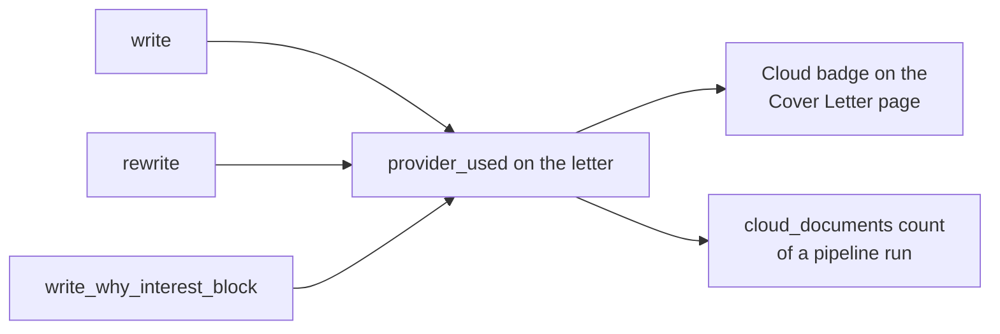

# MH-2a: A rewrite keeps its provider

## Apply with the runner

The handoff runner applies this file: it writes the test file, runs the red command (it must fail), makes the edits, runs the "Done when" checks (they must pass), and commits. See `docs/handoff-runner.md`.

Apply this handoff (WSL, from `apps/backend-py`):

```bash
.venv/bin/python scripts/run_handoff.py ../../tasks/active/step-4-demo/mh-2a-rewrite-provider.md
```

## Why

The demo seed stopped on its own check: a rewritten letter had no provider. Only `CoverLetterWriter.write` records it. `rewrite` and `write_why_interest_block` drop it, so a letter that a cloud model rewrites shows no Cloud badge, and the pipeline's count of cloud documents is too low. The placeholder check makes rewrites more common, so this matters more now.



The two template fallbacks keep no provider, because no LLM wrote them.

## Files

- `apps/backend-py/tests/unit/test_cover_letter_provider.py` (new)
- `apps/backend-py/src/generation/cover_letter_writer.py` (change)

## Step 1: add the test file, run it, and see it fail

```python new=apps/backend-py/tests/unit/test_cover_letter_provider.py
"""Each letter from an LLM records its provider, so the Cloud badge stays true."""

from typing import Any
from unittest.mock import Mock

from src.generation.cover_letter_instructions import WhyInterestSpec
from src.generation.cover_letter_writer import CoverLetterWriter, GeneratedCoverLetter
from src.generation.selector import SelectionOutput
from src.llm.base import LLMResponse
from tests.unit.test_ranking_suite import job_with, profile_with

JOB = job_with("a", "Engineer", "Build Python services.")
PROFILE = profile_with(["Python"])
SELECTION = SelectionOutput(
    selected_projects=[],
    keywords_to_emphasize=[],
    key_achievements=[],
    summary_suggestion="",
    raw_response="",
)
DRAFT = GeneratedCoverLetter(
    content="Draft letter",
    highlighted_experiences=[],
    word_count=2,
    model_used="test-model",
    provider_used="ollama",
)


def writer_for(provider: str) -> CoverLetterWriter:
    """
    A writer whose router answers from one provider.

    Args:
        provider: The provider of each answer.

    Returns:
        The writer.
    """
    router: Any = Mock()
    router.generate.return_value = LLMResponse(
        content="A letter with enough words.",
        model="test-model",
        provider=provider,
        tokens_used=10,
        cost=0.0,
    )
    return CoverLetterWriter(router)


def test_write_records_the_provider() -> None:
    """A first draft names its provider."""
    result = writer_for("anthropic").write(JOB, PROFILE, SELECTION)
    assert result.provider_used == "anthropic"


def test_rewrite_records_the_provider_of_the_rewrite() -> None:
    """A rewrite names the provider that wrote it, not the provider of the draft."""
    result = writer_for("anthropic").rewrite(JOB, PROFILE, SELECTION, DRAFT, "Fix it")
    assert result.provider_used == "anthropic"


def test_why_interest_records_the_provider() -> None:
    """A short why-interest answer names its provider."""
    spec = WhyInterestSpec(min_n=3, max_n=4, unit="lines", matched_span="3-4 lines")
    result = writer_for("anthropic").write_why_interest_block(
        JOB, PROFILE, SELECTION, spec
    )
    assert result.model_used == "test-model"
    assert result.provider_used == "anthropic"


def test_a_template_letter_has_no_provider() -> None:
    """When the LLM fails, the template letter names no provider."""
    writer = writer_for("anthropic")
    writer.llm_router.generate.side_effect = RuntimeError("LLM unavailable")
    assert writer.write(JOB, PROFILE, SELECTION).provider_used is None
```

Run it. It must fail (2 tests: the rewrite and the why-interest answer):

```bash red cwd=apps/backend-py
.venv/bin/python -m pytest tests/unit/test_cover_letter_provider.py -q
```

## Step 2: keep the provider

```python edit=apps/backend-py/src/generation/cover_letter_writer.py
<<<<<<< OLD
                highlighted_experiences=[],
                word_count=word_count,
                model_used=model_used,
                prompt_tokens=prompt_tokens,
=======
                highlighted_experiences=[],
                word_count=word_count,
                model_used=model_used,
                provider_used=getattr(response, "provider", None),
                prompt_tokens=prompt_tokens,
>>>>>>> NEW
```

```python edit=apps/backend-py/src/generation/cover_letter_writer.py
<<<<<<< OLD
                highlighted_experiences=highlighted,
                word_count=word_count,
                model_used=model_used,
                prompt_tokens=prompt_tokens,
=======
                highlighted_experiences=highlighted,
                word_count=word_count,
                model_used=model_used,
                provider_used=getattr(response, "provider", None),
                prompt_tokens=prompt_tokens,
>>>>>>> NEW
```

## Done when

Run the tests:

```bash check cwd=apps/backend-py
.venv/bin/python -m pytest tests/unit/test_cover_letter_provider.py tests/test_cover_letter_writer.py tests/unit/test_jobs_cover_letter.py -q
```

Format and lint:

```bash check cwd=apps/backend-py
.venv/bin/python -m black src/generation/cover_letter_writer.py tests/unit/test_cover_letter_provider.py
```

```bash check cwd=apps/backend-py
.venv/bin/python -m ruff check src/generation/cover_letter_writer.py tests/unit/test_cover_letter_provider.py
```

Commit message:

```text commit
fix(writer): keep the provider on a rewritten letter

Only write recorded the provider. A letter from rewrite or from the
why-interest answer had none, so a cloud rewrite showed no Cloud badge,
and the pipeline's count of cloud documents was too low. The demo seed
found this with its own check.

Co-Authored-By: Claude Opus 5.5 <noreply@anthropic.com>
```
