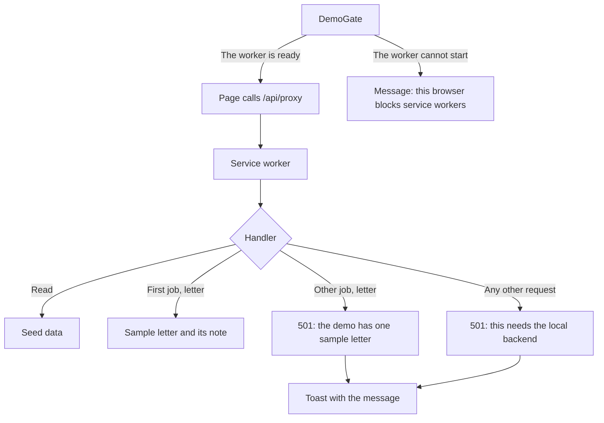

# MH-3: The demo answers in the browser

## Apply with the runner

The handoff runner applies this file: it writes the test files, runs the red commands (they must fail), makes the changes, runs the checks, and commits. The runner does not push.

Apply this handoff (WSL, from `apps/backend-py`):

```bash
.venv/bin/python scripts/run_handoff.py ../../tasks/active/step-4-demo/mh-3-demo-handlers.md
```

## Why

The demo build has no backend. In this handoff, a service worker from MSW answers each `/api/proxy` request in the browser with the seed data from MH-2. The visitor sees a banner on each page, and a note on the sample letter that says what the rule checks missed.



A check in Chromium, on a local server that acts like GitHub Pages, found four defects. This handoff fixes them:

1. A job score showed as `80.22549940382058/100`. Each job row and the job panel now show a whole number.
2. The Jobs page replaced the API message with a fixed text. A letter for a second job said "Upload a resume first", which was false. The five actions now use `getApiErrorMessage`, and so does the Cover Letter page. A real backend already sends the resume hint in its detail.
3. Each sample application had the date of the demo run, next to an age such as "14d ago". The date now agrees with the age. The script calculates this file from the shortlist, so no model runs.
4. The server build kept a 298 KB chunk with MSW and the seed data. Next.js does not write an undefined `NEXT_PUBLIC_*` variable into the bundle, so the check stayed a runtime read, and the bundler kept the import. The server build now sets an empty flag.

## Decisions

- Each write returns a 501 with a message. The demo keeps no state, because a demo must not pretend that an action took effect.
- The API client does not retry a 501, so no page waits.
- `getApiErrorMessage` was already in `client.ts`, so this handoff adds no new helper.
- The Applications and Settings pages keep their fixed messages, such as "Failed to update status". These messages are true, and the banner says why.
- The letter stays as the model wrote it. A test keeps the note true: the letter says "deployed", and the profile does not.
- `tests/demo/handlers.test.ts` adds the handlers to the global MSW test server for each test.
- One Cover Letter test has a limit of 20 s. It types a long job description one key at a time and takes 6 to 7 s, so a cold start can pass the normal 10 s limit. A failed check makes the runner undo all changes.
- Unit tests do not cover the three wires in `providers.tsx`, `AppShell.tsx`, and `SidebarContent.tsx`. The E2E tests of MH-4 cover them.

## Files

- `apps/frontend-ts/tests/demo/mode.test.ts` (new)
- `apps/frontend-ts/tests/demo/handlers.test.ts` (new)
- `apps/frontend-ts/tests/demo/start.test.ts` (new)
- `apps/frontend-ts/tests/demo/demo-components.test.tsx` (new)
- `apps/frontend-ts/tests/demo/failure-messages.test.tsx` (new)
- `apps/frontend-ts/tests/components/job-list-item.test.tsx` (new)
- `apps/frontend-ts/src/demo/mode.ts` (new)
- `apps/frontend-ts/src/demo/data.ts` (new)
- `apps/frontend-ts/src/demo/handlers.ts` (new)
- `apps/frontend-ts/src/demo/start.ts` (new)
- `apps/frontend-ts/src/components/demo/demo-gate.tsx` (new)
- `apps/frontend-ts/src/components/demo/demo-notes.tsx` (new)
- `apps/backend-py/scripts/build_demo_data.py` (change)
- `apps/backend-py/tests/unit/test_demo_data.py` (change)
- `apps/frontend-ts/.gitignore` (change)
- `apps/frontend-ts/.prettierignore` (change)
- `apps/frontend-ts/next.config.ts` (change)
- `apps/frontend-ts/package.json` (change)
- `apps/frontend-ts/src/app/cover-letter/page.tsx` (change)
- `apps/frontend-ts/src/app/providers.tsx` (change)
- `apps/frontend-ts/src/components/jobs/job-detail.tsx` (change)
- `apps/frontend-ts/src/components/jobs/job-list-item.tsx` (change)
- `apps/frontend-ts/src/components/layout/AppShell.tsx` (change)
- `apps/frontend-ts/src/components/layout/SidebarContent.tsx` (change)
- `apps/frontend-ts/src/demo/seed/applications.json` (change)
- `apps/frontend-ts/src/lib/hooks/use-jobs.ts` (change)
- `apps/frontend-ts/tests/app/cover-letter/page.test.tsx` (change)
- `apps/frontend-ts/tests/components/job-detail.test.tsx` (change)
- `apps/frontend-ts/tests/lib/next-config.test.ts` (change)

## Step 1: add the tests, run them, and see them fail

Add the new test files:

```ts new=apps/frontend-ts/tests/demo/mode.test.ts
/**
 * Tests for the demo mode rules (Step 4, MH-3).
 */

import { afterEach, describe, expect, it, vi } from "vitest";

import { DEMO_HIDDEN_ROUTES, isDemoMode, visibleNavItems } from "@/demo/mode";

const ITEMS = [
  { href: "/dashboard", label: "Dashboard" },
  { href: "/jobs", label: "Jobs" },
  { href: "/career-coach", label: "Career Coach" },
  { href: "/assessment", label: "Assessment" },
  { href: "/resume-analysis", label: "Resume Analysis" },
  { href: "/linkedin-analysis", label: "LinkedIn Analysis" },
  { href: "/logs", label: "Logs" },
];

describe("demo mode", () => {
  afterEach(() => {
    vi.unstubAllEnvs();
  });

  it("is off unless the flag is 1", () => {
    vi.stubEnv("NEXT_PUBLIC_DEMO_MODE", "");
    expect(isDemoMode()).toBe(false);
    vi.stubEnv("NEXT_PUBLIC_DEMO_MODE", "0");
    expect(isDemoMode()).toBe(false);
    vi.stubEnv("NEXT_PUBLIC_DEMO_MODE", "1");
    expect(isDemoMode()).toBe(true);
  });

  it("keeps every sidebar item in the server build", () => {
    vi.stubEnv("NEXT_PUBLIC_DEMO_MODE", "");
    expect(visibleNavItems(ITEMS)).toEqual(ITEMS);
  });

  it("hides the pages that need a backend in the demo", () => {
    vi.stubEnv("NEXT_PUBLIC_DEMO_MODE", "1");
    expect(visibleNavItems(ITEMS).map((item) => item.href)).toEqual([
      "/dashboard",
      "/jobs",
    ]);
  });

  it("keeps the core pages in the demo", () => {
    for (const href of [
      "/dashboard",
      "/pipeline",
      "/jobs",
      "/applications",
      "/cover-letter",
      "/metrics",
      "/settings",
    ]) {
      expect(DEMO_HIDDEN_ROUTES.has(href)).toBe(false);
    }
  });
});
```

```ts new=apps/frontend-ts/tests/demo/handlers.test.ts
/**
 * Tests for the MSW handlers of the demo (Step 4, MH-3).
 */

import { beforeEach, describe, expect, it } from "vitest";

import {
  demoApplications,
  demoHealth,
  demoHistory,
  demoLetter,
  demoMetrics,
  demoModels,
  demoProfile,
  demoResources,
  demoSettings,
  demoShortlist,
} from "@/demo/data";
import { handlers, NOT_IN_DEMO, ONE_SAMPLE_LETTER } from "@/demo/handlers";
import { canRetry } from "@/lib/api/client";

import { server } from "../setup/globals";

const BASE = "http://localhost:3000/job-raider/api/proxy";
const NO_BASE = "http://localhost:3000/api/proxy";

/**
 * Call the demo API.
 *
 * @param method - The HTTP method.
 * @param path - The backend path.
 * @returns The status and the parsed body.
 */
async function call(
  method: string,
  path: string,
): Promise<{ status: number; body: unknown }> {
  const response = await fetch(`${NO_BASE}${path}`, { method });
  return { status: response.status, body: await response.json() };
}

describe("demo handlers", () => {
  beforeEach(() => {
    server.use(...handlers);
  });

  it.each([
    ["/health", demoHealth],
    ["/health/resources", demoResources],
    ["/metrics/summary", demoMetrics],
    ["/pipeline/history", demoHistory],
    ["/pipeline/shortlist/latest", demoShortlist],
    ["/profile", demoProfile],
    ["/settings/", demoSettings],
    ["/settings/models", demoModels],
    ["/applications/dashboard", demoApplications],
    ["/jobs/sources", { sources: ["sample"] }],
  ])("serves %s", async (path, expected) => {
    expect(await call("GET", path)).toEqual({ status: 200, body: expected });
  });

  it("serves a request with a base path in front", async () => {
    const response = await fetch(`${BASE}/health`);
    expect(response.status).toBe(200);
  });

  it("reports no invented host readings", () => {
    expect(demoResources.gpu).toBeNull();
    expect(demoResources.cpu.percent).toBeNull();
    expect(demoSettings.api_config.cloud_fallback_provider).toBe("none");
  });

  it("serves one job of the shortlist", async () => {
    const job = demoShortlist.jobs[3];
    expect(await call("GET", `/jobs/${job.job_id}`)).toEqual({
      status: 200,
      body: job,
    });
  });

  it("serves the shortlist as the job search", async () => {
    expect(await call("POST", "/jobs/search")).toEqual({
      status: 200,
      body: { total: demoShortlist.jobs.length, jobs: demoShortlist.jobs },
    });
  });

  it("serves one application with empty history", async () => {
    const row = demoApplications.applications[1];
    const { status, body } = await call(
      "GET",
      `/applications/${row.application_id}`,
    );
    expect(status).toBe(200);
    expect(body).toEqual({
      ...row,
      interviews: [],
      timeline_notes: [],
      metadata: {},
    });
  });

  it("serves the sample letter for its own job only", async () => {
    const own = await call("POST", `/jobs/${demoLetter.job_id}/cover-letter`);
    const other = await call(
      "POST",
      `/jobs/${demoShortlist.jobs[1].job_id}/cover-letter`,
    );

    expect(own).toEqual({ status: 200, body: demoLetter });
    expect(other).toEqual({
      status: 501,
      body: { detail: ONE_SAMPLE_LETTER },
    });
  });

  it("points a pasted job at the sample letter", async () => {
    expect(await call("POST", "/cover-letter/manual")).toEqual({
      status: 501,
      body: { detail: ONE_SAMPLE_LETTER },
    });
  });

  it.each([
    ["GET", "/jobs/rk-999"],
    ["GET", "/applications/none"],
    ["GET", "/logs"],
    ["POST", "/pipeline/start"],
    ["PUT", "/settings/"],
    ["POST", "/applications/status"],
    ["DELETE", "/pipeline/demo-run"],
  ])("refuses %s %s with a message", async (method, path) => {
    expect(await call(method, path)).toEqual({
      status: 501,
      body: { detail: NOT_IN_DEMO },
    });
  });

  it("uses a status that the API client does not retry", () => {
    expect(canRetry("GET", 0, 501)).toBe(false);
  });
});
```

```ts new=apps/frontend-ts/tests/demo/start.test.ts
/**
 * Tests for the start of the demo's service worker (Step 4, MH-3).
 */

import { afterEach, describe, expect, it, vi } from "vitest";

import { startDemo } from "@/demo/start";

const start = vi.hoisted(() => vi.fn());
vi.mock("msw/browser", () => ({ setupWorker: () => ({ start }) }));

describe("startDemo", () => {
  afterEach(() => {
    vi.unstubAllEnvs();
    start.mockReset();
  });

  it("finds the worker on the base path, with the site as its scope", async () => {
    vi.stubEnv("NEXT_PUBLIC_BASE_PATH", "/job-raider");

    await startDemo();

    expect(start).toHaveBeenCalledWith(
      expect.objectContaining({
        serviceWorker: {
          url: "/job-raider/mockServiceWorker.js",
          options: { scope: "/job-raider/" },
        },
      }),
    );
  });

  it("sends a static file request to the network", async () => {
    await startDemo();

    expect(start).toHaveBeenCalledWith(
      expect.objectContaining({ onUnhandledRequest: "bypass" }),
    );
  });

  it("stops when the worker cannot start", async () => {
    start.mockRejectedValue(new Error("blocked"));

    await expect(startDemo()).rejects.toThrow("blocked");
  });
});
```

```tsx new=apps/frontend-ts/tests/demo/demo-components.test.tsx
/**
 * Tests for the demo gate, banner, and letter note (Step 4, MH-3).
 */

import { render, screen, waitFor } from "@testing-library/react";
import { afterEach, beforeEach, describe, expect, it, vi } from "vitest";

import { DemoGate } from "@/components/demo/demo-gate";
import { DemoBanner, DemoLetterNote } from "@/components/demo/demo-notes";
import { demoLetter, demoProfile } from "@/demo/data";

const startDemo = vi.hoisted(() => vi.fn());
vi.mock("@/demo/start", () => ({ startDemo }));

describe("DemoGate", () => {
  beforeEach(() => {
    startDemo.mockReset();
  });

  afterEach(() => {
    vi.unstubAllEnvs();
  });

  it("renders the app at once in the server build", async () => {
    vi.stubEnv("NEXT_PUBLIC_DEMO_MODE", "");

    render(<DemoGate>the app</DemoGate>);

    expect(screen.getByText("the app")).toBeInTheDocument();
    await vi.dynamicImportSettled();
    expect(startDemo).not.toHaveBeenCalled();
  });

  it("holds the app until the worker is ready", async () => {
    vi.stubEnv("NEXT_PUBLIC_DEMO_MODE", "1");
    let ready = () => {};
    startDemo.mockReturnValue(
      new Promise<void>((resolve) => {
        ready = resolve;
      }),
    );

    render(<DemoGate>the app</DemoGate>);

    expect(screen.queryByText("the app")).not.toBeInTheDocument();
    expect(screen.getByRole("status")).toHaveTextContent("Starting the demo");
    await waitFor(() => expect(startDemo).toHaveBeenCalledOnce());

    ready();

    expect(await screen.findByText("the app")).toBeInTheDocument();
  });

  it("says so when the worker cannot start", async () => {
    vi.stubEnv("NEXT_PUBLIC_DEMO_MODE", "1");
    startDemo.mockRejectedValue(new Error("blocked"));

    render(<DemoGate>the app</DemoGate>);

    await waitFor(() =>
      expect(screen.getByRole("status")).toHaveTextContent("service workers"),
    );
    expect(screen.queryByText("the app")).not.toBeInTheDocument();
  });
});

describe("demo notes", () => {
  afterEach(() => {
    vi.unstubAllEnvs();
  });

  it("shows nothing in the server build", () => {
    vi.stubEnv("NEXT_PUBLIC_DEMO_MODE", "");

    const { container } = render(
      <>
        <DemoBanner />
        <DemoLetterNote />
      </>,
    );

    expect(container).toBeEmptyDOMElement();
  });

  it("says that the data is sample data and stays in the browser", () => {
    vi.stubEnv("NEXT_PUBLIC_DEMO_MODE", "1");

    render(<DemoBanner />);

    const note = screen.getByRole("note");
    expect(note).toHaveTextContent("sample data");
    expect(note).toHaveTextContent("fictional");
    expect(note).toHaveTextContent("nothing leaves your browser");
  });

  it("says what the rule checks missed", () => {
    vi.stubEnv("NEXT_PUBLIC_DEMO_MODE", "1");

    render(<DemoLetterNote />);

    expect(screen.getByRole("note")).toHaveTextContent("they miss real errors");
    expect(screen.getByRole("note")).toHaveTextContent("deployed");
  });

  it("stays true for the sample letter", () => {
    const letter = demoLetter.cover_letter.content.toLowerCase();
    const profile = JSON.stringify(demoProfile).toLowerCase();

    expect(letter).toContain("deployed");
    expect(profile).not.toContain("deployed");
    expect(demoLetter.validation.recommendation).toBe("approve");
  });
});
```

```tsx new=apps/frontend-ts/tests/demo/failure-messages.test.tsx
/**
 * Tests for the messages of refused actions on the Jobs page (Step 4, MH-3).
 */

import { QueryClient, QueryClientProvider } from "@tanstack/react-query";
import { act, renderHook, waitFor } from "@testing-library/react";
import type { ReactNode } from "react";
import { toast } from "sonner";
import { beforeEach, describe, expect, it, vi } from "vitest";

import { demoShortlist } from "@/demo/data";
import { handlers, NOT_IN_DEMO, ONE_SAMPLE_LETTER } from "@/demo/handlers";
import {
  useAnalyzeTrust,
  useClassifyJob,
  useExplainJobFit,
  useGenerateCoverLetter,
  useSaveJob,
} from "@/lib/hooks/use-jobs";

import { server } from "../setup/globals";

vi.mock("sonner", () => ({ toast: { success: vi.fn(), error: vi.fn() } }));

const job = demoShortlist.jobs[1];
const target = { id: job.job_id, job };
const client = new QueryClient({
  defaultOptions: { mutations: { retry: false } },
});

/**
 * Give a hook the query client.
 *
 * @param props - The component props.
 * @param props.children - The hook test component.
 * @returns The children inside the provider.
 */
function wrapper({ children }: { children: ReactNode }) {
  return <QueryClientProvider client={client}>{children}</QueryClientProvider>;
}

/**
 * Run an action and read its failure message.
 *
 * @param useAction - The mutation hook.
 * @param input - The mutation input.
 * @param message - The message that the visitor must see.
 * @returns Nothing.
 */
async function expectMessage(
  useAction: () => { mutate: (input: never) => void },
  input: unknown,
  message: string,
): Promise<void> {
  const { result } = renderHook(useAction, { wrapper });

  act(() => result.current.mutate(input as never));

  await waitFor(() => expect(toast.error).toHaveBeenCalledWith(message));
}

describe("refused actions on the Jobs page", () => {
  beforeEach(() => {
    vi.mocked(toast.error).mockClear();
    server.use(...handlers);
  });

  it("explains a letter for another job", async () => {
    await expectMessage(useGenerateCoverLetter, target, ONE_SAMPLE_LETTER);
  });

  it("explains a saved job", async () => {
    await expectMessage(
      useSaveJob,
      { id: job.job_id, saved: true },
      NOT_IN_DEMO,
    );
  });

  it("explains a job analysis", async () => {
    await expectMessage(useClassifyJob, target, NOT_IN_DEMO);
  });

  it("explains a trust analysis", async () => {
    await expectMessage(useAnalyzeTrust, target, NOT_IN_DEMO);
  });

  it("explains a fit explanation", async () => {
    await expectMessage(useExplainJobFit, target, NOT_IN_DEMO);
  });
});
```

```tsx new=apps/frontend-ts/tests/components/job-list-item.test.tsx
/**
 * Tests for the score badge on a job row.
 */

import { render, screen } from "@testing-library/react";
import { describe, expect, it, vi } from "vitest";

import { JobListItem } from "@/components/jobs/job-list-item";
import type { JobListing } from "@/lib/types/api";

const job: JobListing = {
  job_id: "job-1",
  title: "Machine Learning Engineer",
  company: "Example Labs",
  location: "Singapore",
  description: "Build machine learning services.",
  source: "other",
  is_remote: false,
  skills: [],
  relevance_score: 80.22549940382058,
};

describe("JobListItem", () => {
  it("shows a whole relevance score", () => {
    render(
      <JobListItem
        job={job}
        isSelected={false}
        isSaved={false}
        isAppliedExternally={false}
        onClick={vi.fn()}
        onSave={vi.fn()}
      />,
    );

    expect(screen.getByText("80/100")).toBeInTheDocument();
  });
});
```

Add the tests to the existing files:

```ts edit=apps/frontend-ts/tests/lib/next-config.test.ts
<<<<<<< OLD
  expect(config.pageExtensions).toBeUndefined();
=======
  expect(config.pageExtensions).toBeUndefined();
  expect(config.env).toEqual({ NEXT_PUBLIC_DEMO_MODE: "" });
>>>>>>> NEW
```

```ts edit=apps/frontend-ts/tests/lib/next-config.test.ts
<<<<<<< OLD
    expect(config.redirects).toBeUndefined();
=======
    expect(config.redirects).toBeUndefined();
    expect(config.env).toBeUndefined();
>>>>>>> NEW
```

```tsx edit=apps/frontend-ts/tests/components/job-detail.test.tsx
<<<<<<< OLD
let cachedExplainFitData: ScoreExplanation | null = null;
=======
let cachedExplainFitData: ScoreExplanation | null = null;
let cachedCoverLetterData: { content: string; validation: null } | null = null;
>>>>>>> NEW
```

```tsx edit=apps/frontend-ts/tests/components/job-detail.test.tsx
<<<<<<< OLD
  useCachedCoverLetter: () => ({ data: null }),
=======
  useCachedCoverLetter: () => ({ data: cachedCoverLetterData }),
>>>>>>> NEW
```

```tsx edit=apps/frontend-ts/tests/components/job-detail.test.tsx
<<<<<<< OLD
    cachedExplainFitData = null;
=======
    cachedExplainFitData = null;
    cachedCoverLetterData = null;
    vi.unstubAllEnvs();
>>>>>>> NEW
```

```tsx edit=apps/frontend-ts/tests/components/job-detail.test.tsx
<<<<<<< OLD
  it("shows an indeterminate wait bar while generating a cover letter", () => {
=======
  it("shows a whole relevance score", () => {
    render(
      <JobDetail
        job={{ ...baseJob, relevance_score: 80.22549940382058 }}
        {...noopHandlers}
      />,
    );

    expect(screen.getByText("80/100")).toBeInTheDocument();
  });

  it("shows the demo note with the sample letter", () => {
    vi.stubEnv("NEXT_PUBLIC_DEMO_MODE", "1");
    cachedCoverLetterData = { content: "Dear team", validation: null };

    render(<JobDetail job={baseJob} {...noopHandlers} />);

    expect(screen.getByRole("note")).toHaveTextContent("they miss real errors");
  });

  it("shows an indeterminate wait bar while generating a cover letter", () => {
>>>>>>> NEW
```

```tsx edit=apps/frontend-ts/tests/app/cover-letter/page.test.tsx
<<<<<<< OLD
import CoverLetterPage from "@/app/cover-letter/page";
=======
import { toast } from "sonner";
import CoverLetterPage from "@/app/cover-letter/page";
import { ApiError } from "@/lib/api/client";
>>>>>>> NEW
```

```tsx edit=apps/frontend-ts/tests/app/cover-letter/page.test.tsx
<<<<<<< OLD
  });

  it("hides Sources when mission_context has no citations", async () => {
=======
  }, 20_000);

  it("hides Sources when mission_context has no citations", async () => {
>>>>>>> NEW
```

```tsx edit=apps/frontend-ts/tests/app/cover-letter/page.test.tsx
<<<<<<< OLD
  it("shows an indeterminate wait bar while generating", async () => {
=======
  it("shows the API detail when generation is refused", async () => {
    mockGenerate.mockRejectedValue(new ApiError(501, "Open the first job."));
    const user = userEvent.setup();
    renderWithClient(<CoverLetterPage />);

    await user.type(screen.getByLabelText(/job title/i), "Engineer");
    await user.type(screen.getByLabelText(/company/i), "Example Labs");
    await user.type(
      getJdTextarea(),
      "We are seeking an engineer to build machine learning services in Python.",
    );
    const generateButton = screen.getByRole("button", {
      name: /generate cover letter/i,
    });
    await waitFor(() => expect(generateButton).not.toBeDisabled());
    await user.click(generateButton);

    await waitFor(() =>
      expect(toast.error).toHaveBeenCalledWith("Open the first job."),
    );
  });

  it("shows an indeterminate wait bar while generating", async () => {
>>>>>>> NEW
```

```python edit=apps/backend-py/tests/unit/test_demo_data.py
<<<<<<< OLD
import re
from pathlib import Path
=======
import re
from datetime import datetime, timedelta
from pathlib import Path
>>>>>>> NEW
```

```python edit=apps/backend-py/tests/unit/test_demo_data.py
<<<<<<< OLD
def test_the_sample_rates_come_from_the_applications() -> None:
=======
def test_each_application_date_matches_its_age() -> None:
    """A sample date and its age in days agree."""
    fixed = datetime.fromisoformat(seed.FIXED_TIME)

    for row in load("applications")["applications"]:
        age = fixed - datetime.fromisoformat(row["applied_date"])
        assert age == timedelta(days=row["days_since_application"])


def test_the_sample_rates_come_from_the_applications() -> None:
>>>>>>> NEW
```

Run them. They must fail (the demo code does not exist yet):

```bash red cwd=apps/frontend-ts
source ~/.nvm/nvm.sh && nvm use 24 && npx vitest run --no-cache tests/demo tests/components/job-list-item.test.tsx tests/components/job-detail.test.tsx tests/app/cover-letter/page.test.tsx tests/lib/next-config.test.ts
```

```bash red cwd=apps/backend-py
.venv/bin/python -m pytest tests/unit/test_demo_data.py -q -k each_application_date
```

## Step 2: add the demo code

Add the demo files:

```ts new=apps/frontend-ts/src/demo/mode.ts
/**
 * Demo mode rules (Step 4).
 *
 * The public demo is a static build with no backend. Each read of the
 * environment here is written out in full, because Next.js inlines
 * `NEXT_PUBLIC_*` only in that form.
 */

/** Routes that need a backend, so the demo leaves them out of the sidebar. */
export const DEMO_HIDDEN_ROUTES: ReadonlySet<string> = new Set([
  "/career-coach",
  "/assessment",
  "/resume-analysis",
  "/linkedin-analysis",
  "/logs",
]);

/**
 * Tell whether this is the demo build.
 *
 * @returns True in the demo build.
 */
export function isDemoMode(): boolean {
  return process.env.NEXT_PUBLIC_DEMO_MODE === "1";
}

/**
 * Keep the sidebar items that work in this build.
 *
 * @param items - The sidebar items.
 * @returns All items, or in the demo only the items with data.
 */
export function visibleNavItems<T extends { href: string }>(
  items: readonly T[],
): readonly T[] {
  return isDemoMode()
    ? items.filter((item) => !DEMO_HIDDEN_ROUTES.has(item.href))
    : items;
}
```

```ts new=apps/frontend-ts/src/demo/data.ts
/**
 * Typed demo data (Step 4).
 *
 * The files in `seed/` come from `scripts/build_demo_data.py`, which runs the
 * real code on synthetic input. The values below have no backend behind them,
 * so they say so: the demo shows no invented GPU or host readings.
 */

import type {
  ApplicationDashboardResponse,
  AppSettings,
  AvailableModelsResponse,
  CoverLetterResponse,
  DiscoverShortlistResponse,
  HealthResponse,
  MetricsSummaryResponse,
  PipelineHistoryResponse,
  SystemResourcesResponse,
  UserProfile,
} from "@/lib/types/api";

import applications from "./seed/applications.json";
import history from "./seed/history.json";
import letter from "./seed/letter.json";
import metrics from "./seed/metrics.json";
import profile from "./seed/profile.json";
import shortlist from "./seed/shortlist.json";

const LOCAL_MODELS = ["qwen2.5:3b", "qwen2.5:7b"];

export const demoApplications = applications as ApplicationDashboardResponse;
export const demoHistory = history as PipelineHistoryResponse;
export const demoLetter = letter as unknown as CoverLetterResponse;
export const demoMetrics = metrics as MetricsSummaryResponse;
export const demoProfile = profile as unknown as UserProfile;
export const demoShortlist = shortlist as unknown as DiscoverShortlistResponse;

/** Health of the demo: there is no backend to check. */
export const demoHealth: HealthResponse = {
  status: "healthy",
  timestamp: "2026-11-04T12:00:00",
  checks: [
    {
      name: "demo",
      status: "healthy",
      message: "Sample data in your browser; no backend",
    },
  ],
  summary: { healthy: 1 },
};

/** The demo has no host, so it reports no reading. */
export const demoResources: SystemResourcesResponse = {
  cpu: { percent: null },
  ram: { used_mb: null, total_mb: null, percent: null },
  gpu: null,
};

/** The default local setup, with no cloud fallback. */
export const demoSettings: AppSettings = {
  routing: {
    selection: {
      primary_provider: "ollama",
      primary_model: "qwen2.5:3b",
      fallback_provider: null,
      fallback_model: null,
    },
    cover_letter_writing: {
      primary_provider: "ollama",
      primary_model: "qwen2.5:7b",
      fallback_provider: null,
      fallback_model: null,
    },
  },
  api_config: {
    has_anthropic_key: false,
    has_gemini_key: false,
    cloud_fallback_provider: "none",
    ollama_host: "http://localhost:11434",
  },
  model_params: { temperature: 0.7, max_tokens: 4096, top_p: 0.9 },
  cost_limits: {
    max_api_cost_per_run: 0,
    enable_cache: true,
    cache_ttl: 3600,
  },
};

/** The recommended local models. */
export const demoModels: AvailableModelsResponse = {
  ollama: LOCAL_MODELS,
  ollama_installed: LOCAL_MODELS,
};
```

```ts new=apps/frontend-ts/src/demo/handlers.ts
/**
 * MSW handlers of the demo (Step 4).
 *
 * Reads return the demo data. Any other request gets a 501 with a readable
 * message: the API client does not retry a 501, so no page waits. Nothing
 * changes state, because a demo must not pretend that an action took effect.
 */

import { http, HttpResponse } from "msw";

import {
  demoApplications,
  demoHealth,
  demoHistory,
  demoLetter,
  demoMetrics,
  demoModels,
  demoProfile,
  demoResources,
  demoSettings,
  demoShortlist,
} from "./data";

export const NOT_IN_DEMO =
  "This needs the local backend, so it is not in the demo.";
export const ONE_SAMPLE_LETTER =
  "The demo has one sample letter. Open the first job on the Jobs page.";

/**
 * Match a path of the API proxy, on any host and base path.
 *
 * @param path - The backend path.
 * @returns The MSW path pattern.
 */
function api(path: string): string {
  return `*/api/proxy${path}`;
}

/**
 * Answer a request that the demo cannot serve.
 *
 * @param detail - The message for the user.
 * @returns The response.
 */
function notInDemo(detail: string = NOT_IN_DEMO): HttpResponse<{
  detail: string;
}> {
  return HttpResponse.json({ detail }, { status: 501 });
}

export const handlers = [
  http.get(api("/health"), () => HttpResponse.json(demoHealth)),
  http.get(api("/health/resources"), () => HttpResponse.json(demoResources)),
  http.get(api("/metrics/summary"), () => HttpResponse.json(demoMetrics)),
  http.get(api("/pipeline/history"), () => HttpResponse.json(demoHistory)),
  http.get(api("/pipeline/shortlist/latest"), () =>
    HttpResponse.json(demoShortlist),
  ),
  http.get(api("/profile"), () => HttpResponse.json(demoProfile)),
  http.get(api("/settings/"), () => HttpResponse.json(demoSettings)),
  http.get(api("/settings/models"), () => HttpResponse.json(demoModels)),
  http.get(api("/applications/dashboard"), () =>
    HttpResponse.json(demoApplications),
  ),
  http.get(api("/applications/:applicationId"), ({ params }) => {
    const row = demoApplications.applications.find(
      (item) => item.application_id === params.applicationId,
    );
    if (!row) {
      return notInDemo();
    }
    return HttpResponse.json({
      ...row,
      interviews: [],
      timeline_notes: [],
      metadata: {},
    });
  }),
  http.get(api("/jobs/sources"), () =>
    HttpResponse.json({ sources: ["sample"] }),
  ),
  http.get(api("/jobs/:jobId"), ({ params }) => {
    const job = demoShortlist.jobs.find((item) => item.job_id === params.jobId);
    return job ? HttpResponse.json(job) : notInDemo();
  }),
  http.post(api("/jobs/search"), () =>
    HttpResponse.json({
      total: demoShortlist.jobs.length,
      jobs: demoShortlist.jobs,
    }),
  ),
  http.post(api("/jobs/:jobId/cover-letter"), ({ params }) =>
    params.jobId === demoLetter.job_id
      ? HttpResponse.json(demoLetter)
      : notInDemo(ONE_SAMPLE_LETTER),
  ),
  http.post(api("/cover-letter/manual"), () => notInDemo(ONE_SAMPLE_LETTER)),
  http.all(api("/*"), () => notInDemo()),
];
```

```ts new=apps/frontend-ts/src/demo/start.ts
/**
 * Start the service worker of the demo (Step 4).
 *
 * Only the demo build loads this file. `DemoGate` imports it behind a literal
 * check of `NEXT_PUBLIC_DEMO_MODE`, so the server build drops it.
 */

import { setupWorker } from "msw/browser";

import { handlers } from "./handlers";

/**
 * Start the worker, and wait until it answers requests.
 *
 * The worker file is at the base path of the host. The API client calls
 * `/api/proxy/*` with no base path, but a worker sees each request from the
 * pages in its scope, so it answers those calls too.
 *
 * @returns A promise that resolves when the worker is active.
 */
export async function startDemo(): Promise<void> {
  const base = process.env.NEXT_PUBLIC_BASE_PATH ?? "";
  await setupWorker(...handlers).start({
    quiet: true,
    onUnhandledRequest: "bypass",
    serviceWorker: {
      url: `${base}/mockServiceWorker.js`,
      options: { scope: `${base}/` },
    },
  });
}
```

```tsx new=apps/frontend-ts/src/components/demo/demo-gate.tsx
"use client";

import { useEffect, useState } from "react";
import type { ReactNode } from "react";

interface DemoGateProps {
  /** The app. */
  children: ReactNode;
}

/**
 * Hold the app until the demo's service worker answers requests.
 *
 * In the server build this renders its children and nothing else. The checks
 * of `NEXT_PUBLIC_DEMO_MODE` are written out in full, so that build drops the
 * import of the demo code.
 *
 * @param children - The app.
 * @returns The app, or a message while the demo starts or when it cannot.
 */
export function DemoGate({ children }: DemoGateProps) {
  const [state, setState] = useState<"starting" | "ready" | "failed">(
    process.env.NEXT_PUBLIC_DEMO_MODE === "1" ? "starting" : "ready",
  );

  useEffect(() => {
    if (process.env.NEXT_PUBLIC_DEMO_MODE === "1") {
      import("@/demo/start")
        .then(({ startDemo }) => startDemo())
        .then(
          () => setState("ready"),
          () => setState("failed"),
        );
    }
  }, []);

  if (state === "ready") {
    return children;
  }
  return (
    <div
      role="status"
      className="flex h-screen items-center justify-center p-6 text-center text-sm text-muted-foreground"
    >
      {state === "starting"
        ? "Starting the demo..."
        : "The demo needs service workers, and this browser blocks them. Try a normal window in another browser."}
    </div>
  );
}
```

```tsx new=apps/frontend-ts/src/components/demo/demo-notes.tsx
import { isDemoMode } from "@/demo/mode";

const REPOSITORY = "https://github.com/neoncircuit/job-raider#measured-results";

/**
 * Say on each page that this is a demo with sample data.
 *
 * @returns The banner in the demo build, and nothing in the server build.
 */
export function DemoBanner() {
  if (!isDemoMode()) {
    return null;
  }
  return (
    <p
      role="note"
      className="border-b border-border bg-muted px-4 py-2 text-center text-xs text-muted-foreground"
    >
      Demo with sample data. The candidate, jobs, and companies are fictional,
      and nothing leaves your browser.{" "}
      <a href={REPOSITORY} className="underline">
        See the measured results
      </a>
      .
    </p>
  );
}

/**
 * Say what the rule checks missed in the sample letter.
 *
 * A test keeps this text true: the letter says "deployed", and the profile
 * does not.
 *
 * @returns The note in the demo build, and nothing in the server build.
 */
export function DemoLetterNote() {
  if (!isDemoMode()) {
    return null;
  }
  return (
    <p role="note" className="rounded-md border p-3 text-xs">
      Sample letter, written once by the default local model and not edited. The
      rule checks approved it, but they miss real errors: this letter says
      &quot;deployed&quot;, and the profile does not. Read each letter before
      you send it.
    </p>
  );
}
```

Connect them, and fix the four defects:

```tsx edit=apps/frontend-ts/src/app/providers.tsx
<<<<<<< OLD
import { Toaster } from "@/components/ui/sonner";
=======
import { DemoGate } from "@/components/demo/demo-gate";
import { Toaster } from "@/components/ui/sonner";
>>>>>>> NEW
```

```tsx edit=apps/frontend-ts/src/app/providers.tsx
<<<<<<< OLD
          {children}
          <Toaster richColors position="top-right" />
=======
          <DemoGate>{children}</DemoGate>
          <Toaster richColors position="top-right" />
>>>>>>> NEW
```

```tsx edit=apps/frontend-ts/src/components/layout/AppShell.tsx
<<<<<<< OLD
import { Suspense } from "react";
=======
import { Suspense } from "react";
import { DemoBanner } from "@/components/demo/demo-notes";
>>>>>>> NEW
```

```tsx edit=apps/frontend-ts/src/components/layout/AppShell.tsx
<<<<<<< OLD
        <main className="flex-1 overflow-y-auto p-4 md:p-6">
=======
        <DemoBanner />
        <main className="flex-1 overflow-y-auto p-4 md:p-6">
>>>>>>> NEW
```

```tsx edit=apps/frontend-ts/src/components/layout/SidebarContent.tsx
<<<<<<< OLD
import { BrandLockup } from "./BrandLockup";
=======
import { BrandLockup } from "./BrandLockup";
import { visibleNavItems } from "@/demo/mode";
>>>>>>> NEW
```

```tsx edit=apps/frontend-ts/src/components/layout/SidebarContent.tsx
<<<<<<< OLD
              {section.items.map((item) => (
=======
              {visibleNavItems(section.items).map((item) => (
>>>>>>> NEW
```

```tsx edit=apps/frontend-ts/src/components/jobs/job-detail.tsx
<<<<<<< OLD
            {coverLetterData.validation && (
              <div>
                <p className="text-xs font-semibold uppercase tracking-wide text-muted-foreground mb-2">
=======
            <DemoLetterNote />
            {coverLetterData.validation && (
              <div>
                <p className="text-xs font-semibold uppercase tracking-wide text-muted-foreground mb-2">
>>>>>>> NEW
```

```tsx edit=apps/frontend-ts/src/components/jobs/job-detail.tsx
<<<<<<< OLD
import { CoverLetterValidationDisplay } from "@/components/cover-letter-validation";
=======
import { CoverLetterValidationDisplay } from "@/components/cover-letter-validation";
import { DemoLetterNote } from "@/components/demo/demo-notes";
>>>>>>> NEW
```

```json edit=apps/frontend-ts/package.json
<<<<<<< OLD
    "build:demo": "NEXT_PUBLIC_DEMO_MODE=1 next build",
=======
    "build:demo": "msw init public --no-save && NEXT_PUBLIC_DEMO_MODE=1 next build",
>>>>>>> NEW
```

```text edit=apps/frontend-ts/.prettierignore
<<<<<<< OLD
src/demo/seed
=======
src/demo/seed
public/mockServiceWorker.js
>>>>>>> NEW
```

```text edit=apps/frontend-ts/.gitignore
<<<<<<< OLD
/out/
=======
/out/
/public/mockServiceWorker.js
>>>>>>> NEW
```

```ts edit=apps/frontend-ts/src/lib/hooks/use-jobs.ts
<<<<<<< OLD
import { jobsApi } from "@/lib/api/jobs";
=======
import { getApiErrorMessage } from "@/lib/api/client";
import { jobsApi } from "@/lib/api/jobs";
>>>>>>> NEW
```

```ts edit=apps/frontend-ts/src/lib/hooks/use-jobs.ts
<<<<<<< OLD
    onError: () => {
      toast.error("Action failed");
=======
    onError: (error: Error) => {
      toast.error(getApiErrorMessage(error, "Action failed"));
>>>>>>> NEW
```

```ts edit=apps/frontend-ts/src/lib/hooks/use-jobs.ts
<<<<<<< OLD
    onError: () => {
      toast.error("Failed to classify job");
=======
    onError: (error: Error) => {
      toast.error(getApiErrorMessage(error, "Failed to classify job"));
>>>>>>> NEW
```

```ts edit=apps/frontend-ts/src/lib/hooks/use-jobs.ts
<<<<<<< OLD
    onError: () => {
      toast.error("Failed to analyze trust");
=======
    onError: (error: Error) => {
      toast.error(getApiErrorMessage(error, "Failed to analyze trust"));
>>>>>>> NEW
```

```ts edit=apps/frontend-ts/src/lib/hooks/use-jobs.ts
<<<<<<< OLD
    onError: () => {
      toast.error("Failed to generate cover letter. Upload a resume first.");
=======
    onError: (error: Error) => {
      toast.error(getApiErrorMessage(error, "Failed to generate cover letter"));
>>>>>>> NEW
```

```ts edit=apps/frontend-ts/src/lib/hooks/use-jobs.ts
<<<<<<< OLD
    onError: () => {
      toast.error("Failed to explain fit");
=======
    onError: (error: Error) => {
      toast.error(getApiErrorMessage(error, "Failed to explain fit"));
>>>>>>> NEW
```

```tsx edit=apps/frontend-ts/src/app/cover-letter/page.tsx
<<<<<<< OLD
      toast.error(err.message || "Failed to generate cover letter");
=======
      toast.error(getApiErrorMessage(err, "Failed to generate cover letter"));
>>>>>>> NEW
```

```tsx edit=apps/frontend-ts/src/components/jobs/job-list-item.tsx
<<<<<<< OLD
              {job.relevance_score}/100
=======
              {Math.round(job.relevance_score)}/100
>>>>>>> NEW
```

```tsx edit=apps/frontend-ts/src/components/jobs/job-detail.tsx
<<<<<<< OLD
              {job.relevance_score}/100
=======
              {Math.round(job.relevance_score)}/100
>>>>>>> NEW
```

```ts edit=apps/frontend-ts/next.config.ts
<<<<<<< OLD
 * `src/app/page.tsx` does that work in the demo.
 */
=======
 * `src/app/page.tsx` does that work in the demo.
 *
 * The server build writes an empty flag into the bundle. With no value,
 * Next.js leaves `process.env.NEXT_PUBLIC_DEMO_MODE` as a runtime read, and
 * the bundler then keeps the demo code.
 */
>>>>>>> NEW
```

```ts edit=apps/frontend-ts/next.config.ts
<<<<<<< OLD
      output: "standalone",
=======
      output: "standalone",
      env: { NEXT_PUBLIC_DEMO_MODE: "" },
>>>>>>> NEW
```

```python edit=apps/backend-py/scripts/build_demo_data.py
<<<<<<< OLD
from datetime import datetime
=======
from datetime import datetime, timedelta
>>>>>>> NEW
```

```python edit=apps/backend-py/scripts/build_demo_data.py
<<<<<<< OLD
            "applied_date": FIXED_TIME,
=======
            "applied_date": (
                datetime.fromisoformat(FIXED_TIME) - timedelta(days=days)
            ).isoformat(),
>>>>>>> NEW
```

```json edit=apps/frontend-ts/src/demo/seed/applications.json
<<<<<<< OLD
      "application_id": "demo-rk-012",
      "application_method": "external",
      "applied_date": "2026-11-04T12:00:00",
=======
      "application_id": "demo-rk-012",
      "application_method": "external",
      "applied_date": "2026-10-21T12:00:00",
>>>>>>> NEW
```

```json edit=apps/frontend-ts/src/demo/seed/applications.json
<<<<<<< OLD
      "application_id": "demo-rk-004",
      "application_method": "external",
      "applied_date": "2026-11-04T12:00:00",
=======
      "application_id": "demo-rk-004",
      "application_method": "external",
      "applied_date": "2026-10-25T12:00:00",
>>>>>>> NEW
```

```json edit=apps/frontend-ts/src/demo/seed/applications.json
<<<<<<< OLD
      "application_id": "demo-rk-026",
      "application_method": "external",
      "applied_date": "2026-11-04T12:00:00",
=======
      "application_id": "demo-rk-026",
      "application_method": "external",
      "applied_date": "2026-10-29T12:00:00",
>>>>>>> NEW
```

```json edit=apps/frontend-ts/src/demo/seed/applications.json
<<<<<<< OLD
      "application_id": "demo-rk-003",
      "application_method": "external",
      "applied_date": "2026-11-04T12:00:00",
=======
      "application_id": "demo-rk-003",
      "application_method": "external",
      "applied_date": "2026-11-02T12:00:00",
>>>>>>> NEW
```

```json edit=apps/frontend-ts/src/demo/seed/applications.json
<<<<<<< OLD
      "application_id": "demo-rk-005",
      "application_method": "external",
      "applied_date": "2026-11-04T12:00:00",
=======
      "application_id": "demo-rk-005",
      "application_method": "external",
      "applied_date": "2026-10-14T12:00:00",
>>>>>>> NEW
```

## Done when

Run the frontend unit tests:

```bash check cwd=apps/frontend-ts
source ~/.nvm/nvm.sh && nvm use 24 && npx vitest run --no-cache
```

Format, lint, and type-check the frontend:

```bash check cwd=apps/frontend-ts
source ~/.nvm/nvm.sh && nvm use 24 && npx prettier --check next.config.ts src/demo/mode.ts src/demo/data.ts src/demo/handlers.ts src/demo/start.ts src/components/demo src/app/providers.tsx src/app/cover-letter/page.tsx src/components/layout/AppShell.tsx src/components/layout/SidebarContent.tsx src/components/jobs/job-detail.tsx src/components/jobs/job-list-item.tsx src/lib/hooks/use-jobs.ts tests/demo tests/components/job-list-item.test.tsx tests/components/job-detail.test.tsx tests/app/cover-letter/page.test.tsx tests/lib/next-config.test.ts
```

```bash check cwd=apps/frontend-ts
source ~/.nvm/nvm.sh && nvm use 24 && npx eslint next.config.ts src/demo/mode.ts src/demo/data.ts src/demo/handlers.ts src/demo/start.ts src/components/demo src/app/providers.tsx src/app/cover-letter/page.tsx src/components/layout/AppShell.tsx src/components/layout/SidebarContent.tsx src/components/jobs/job-detail.tsx src/components/jobs/job-list-item.tsx src/lib/hooks/use-jobs.ts tests/demo tests/components/job-list-item.test.tsx tests/components/job-detail.test.tsx tests/app/cover-letter/page.test.tsx tests/lib/next-config.test.ts
```

```bash check cwd=apps/frontend-ts
source ~/.nvm/nvm.sh && nvm use 24 && npx tsc --noEmit
```

Run the seed tests, then format and lint them:

```bash check cwd=apps/backend-py
.venv/bin/python -m pytest tests/unit/test_demo_data.py -q
```

```bash check cwd=apps/backend-py
.venv/bin/python -m black --check scripts/build_demo_data.py tests/unit/test_demo_data.py
```

```bash check cwd=apps/backend-py
.venv/bin/python -m ruff check scripts/build_demo_data.py tests/unit/test_demo_data.py
```

Commit message:

```text commit
feat(demo): answer the API in the browser

Add the MSW handlers, the worker start, the gate that holds the app
until the worker is ready, the banner, the note on the sample letter,
and the demo sidebar. Reads return the seed data. Any other request
gets a 501 with a message, so the demo never pretends that an action
took effect.

A check in Chromium found four defects, fixed here:

- A job score showed all its decimals.
- The Jobs page hid the API message, and a letter for a second job
  said "Upload a resume first", which was false.
- A sample application had the date of the run next to its real age.
- The server build kept a chunk with MSW and the seed data, because
  Next.js does not inline an undefined variable.

Co-Authored-By: Claude Opus 5.5 <noreply@anthropic.com>
```
