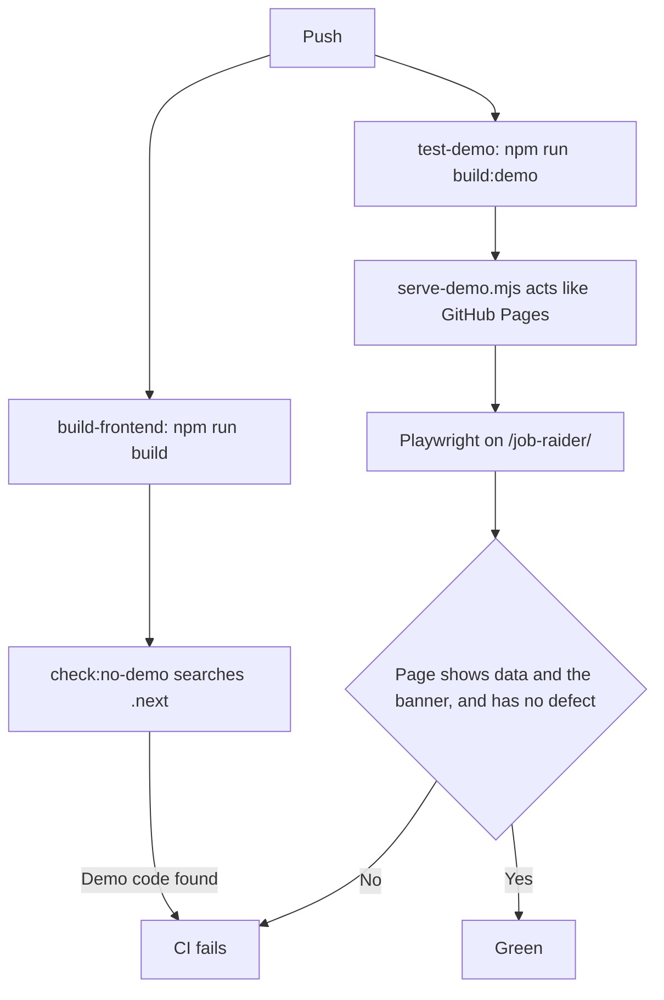

# MH-4: Test the exported demo in CI

## Apply with the runner

The handoff runner applies this file: it writes the test file, runs the red command (it must fail), makes the changes, runs the checks, and commits. The runner does not push.

Apply this handoff (WSL, from `apps/backend-py`):

```bash
.venv/bin/python scripts/run_handoff.py ../../tasks/active/step-4-demo/mh-4-demo-ci.md
```

## Why

Unit tests cannot prove that the static site works: a service worker runs only in a browser. Three wires of MH-3 have no unit test. MH-3 also found that the server build can keep the demo code with no error. This handoff adds two checks to CI, so a later change cannot break these points without a failure.



## What the E2E tests prove

- Each core page shows data and the banner. The test watches for a page error, a failed request, and a status of 400 or more. A 501 from the API is the demo's own answer, so the test accepts it.
- Each API answer comes from the service worker.
- No request leaves the site. This test keeps the banner true: "nothing leaves your browser".
- The sidebar leaves out the five pages that need a backend, and its links keep the base path.
- The first job has the sample letter and its note. Other actions show their message.

## Decisions

- The new tests are in `tests/e2e-demo/`, with their own config. The tests in `tests/e2e/` use a mock of the API, and these tests must not have one.
- `scripts/serve-demo.mjs` acts like GitHub Pages: `/job-raider/x` serves `x`, `x.html`, or `x/index.html`.
- `check:no-demo` stops with an error when it finds no build, so a wrong path cannot pass.
- `PLAYWRIGHT_CHROMIUM_PATH` is an option for a machine that has another Chromium build. CI leaves it unset.
- The runner does not run the builds or the E2E tests in this handoff. A build on the hard disk is slow. They ran on a clone in WSL, and the new CI job runs them after the push.

## Files

- `apps/frontend-ts/scripts/serve-demo.mjs` (new)
- `apps/frontend-ts/scripts/find-demo-code.mjs` (new)
- `apps/frontend-ts/playwright.demo.config.ts` (new)
- `apps/frontend-ts/tests/lib/find-demo-code.test.ts` (new)
- `apps/frontend-ts/tests/e2e-demo/demo.spec.ts` (new)
- `.github/workflows/ci.yml` (change)
- `apps/frontend-ts/package.json` (change)
- `apps/frontend-ts/vitest.config.ts` (change)

## Step 1: add the test, run it, and see it fail

```ts new=apps/frontend-ts/tests/lib/find-demo-code.test.ts
/**
 * Tests for the check that the server build has no demo code (Step 4, MH-4).
 */

import { mkdirSync, mkdtempSync, rmSync, writeFileSync } from "node:fs";
import { tmpdir } from "node:os";
import { join } from "node:path";

import { afterEach, beforeEach, describe, expect, it } from "vitest";

import { DEMO_MARKERS, findDemoCode } from "../../scripts/find-demo-code.mjs";

describe("findDemoCode", () => {
  let folder = "";

  beforeEach(() => {
    folder = mkdtempSync(join(tmpdir(), "demo-code-"));
    mkdirSync(join(folder, "chunks"));
    writeFileSync(join(folder, "chunks", "clean.js"), "const page = 1;");
  });

  afterEach(() => {
    rmSync(folder, { recursive: true });
  });

  it("passes a clean build, and counts its files", () => {
    expect(findDemoCode([folder])).toEqual({ files: 1, found: [] });
  });

  it.each(DEMO_MARKERS)("finds %s in a subfolder", (marker) => {
    const file = join(folder, "chunks", "demo.js");
    writeFileSync(file, `const text = "${marker}";`);

    expect(findDemoCode([folder]).found).toEqual([`${file}: ${marker}`]);
  });

  it("reads no files in a folder that does not exist", () => {
    expect(findDemoCode([join(folder, "none")])).toEqual({
      files: 0,
      found: [],
    });
  });

  it("searches each folder", () => {
    const other = join(folder, "other");
    mkdirSync(other);
    writeFileSync(join(other, "demo.js"), "setupWorker();");

    const result = findDemoCode([join(folder, "chunks"), other]);

    expect(result.files).toBe(2);
    expect(result.found).toHaveLength(1);
  });
});
```

Run it. It must fail (the script does not exist yet):

```bash red cwd=apps/frontend-ts
source ~/.nvm/nvm.sh && nvm use 24 && npx vitest run --no-cache tests/lib/find-demo-code.test.ts
```

## Step 2: add the scripts, the E2E tests, and the CI job

```js new=apps/frontend-ts/scripts/serve-demo.mjs
/**
 * Serve the static demo as GitHub Pages does (Step 4, MH-4).
 *
 * Under the base path, `/x` serves `x`, `x.html`, or `x/index.html`. Any other
 * path gets `404.html`. Run `npm run build:demo` first, with
 * `NEXT_PUBLIC_BASE_PATH=/job-raider`.
 *
 * Usage: node scripts/serve-demo.mjs
 */

import { existsSync, readFileSync, statSync } from "node:fs";
import { createServer } from "node:http";
import { extname, join } from "node:path";

const ROOT = "out";
const BASE_PATH = "/job-raider";
const PORT = Number(process.env.DEMO_PORT ?? 4599);
const TYPES = {
  ".css": "text/css",
  ".html": "text/html",
  ".ico": "image/x-icon",
  ".js": "text/javascript",
  ".json": "application/json",
  ".png": "image/png",
  ".svg": "image/svg+xml",
  ".txt": "text/plain",
  ".woff2": "font/woff2",
};

/**
 * Find the file for a URL path.
 *
 * @param {string} pathname - The URL path.
 * @returns {string | null} The file, or null when there is no file.
 */
function findFile(pathname) {
  if (!pathname.startsWith(BASE_PATH)) {
    return null;
  }
  const inside = pathname.slice(BASE_PATH.length);
  const options = [inside, `${inside}.html`, join(inside, "index.html")];
  for (const option of options) {
    const file = join(ROOT, option);
    if (existsSync(file) && statSync(file).isFile()) {
      return file;
    }
  }
  return null;
}

createServer((request, response) => {
  const url = new URL(request.url ?? "/", "http://localhost");
  const file = findFile(decodeURIComponent(url.pathname));
  response.writeHead(file ? 200 : 404, {
    "content-type": TYPES[extname(file ?? ".html")] ?? "text/html",
  });
  response.end(readFileSync(file ?? join(ROOT, "404.html")));
}).listen(PORT);
```

```js new=apps/frontend-ts/scripts/find-demo-code.mjs
/**
 * Check that the server build has no demo code (Step 4, MH-4).
 *
 * Next.js drops the demo code only when `NEXT_PUBLIC_DEMO_MODE` has a value at
 * build time. This check keeps that true. Run it after `npm run build`.
 *
 * Usage: node scripts/find-demo-code.mjs
 */

import { existsSync, readdirSync, readFileSync, statSync } from "node:fs";
import { join } from "node:path";
import { pathToFileURL } from "node:url";

const BUILD_FOLDERS = [".next/static", ".next/server"];

/** Text that occurs only in MSW and in the demo code. */
export const DEMO_MARKERS = [
  "mockServiceWorker",
  "setupWorker",
  "demo-rk-012",
  "needs the local backend",
];

/**
 * List the files in a folder and its subfolders.
 *
 * @param {string} folder - The folder.
 * @returns {string[]} The file paths, or none when the folder does not exist.
 */
function listFiles(folder) {
  if (!existsSync(folder)) {
    return [];
  }
  return readdirSync(folder).flatMap((name) => {
    const path = join(folder, name);
    return statSync(path).isDirectory() ? listFiles(path) : [path];
  });
}

/**
 * Search build folders for demo code.
 *
 * @param {string[]} folders - The build folders.
 * @returns {{ files: number, found: string[] }} The number of files read, and
 *   one line for each marker in each file.
 */
export function findDemoCode(folders) {
  const files = folders.flatMap(listFiles);
  const found = files.flatMap((file) => {
    const text = readFileSync(file, "utf-8");
    return DEMO_MARKERS.filter((marker) => text.includes(marker)).map(
      (marker) => `${file}: ${marker}`,
    );
  });
  return { files: files.length, found };
}

/**
 * Run the check on the server build, and set the exit code.
 *
 * @returns {void}
 */
function main() {
  const { files, found } = findDemoCode(BUILD_FOLDERS);
  if (files === 0) {
    console.error("No build found. Run npm run build first.");
    process.exitCode = 2;
    return;
  }
  if (found.length > 0) {
    console.error(`Demo code in the server build:\n${found.join("\n")}`);
    process.exitCode = 1;
    return;
  }
  console.log(`No demo code in ${files} files.`);
}

if (import.meta.url === pathToFileURL(process.argv[1]).href) {
  main();
}
```

```ts new=apps/frontend-ts/playwright.demo.config.ts
/**
 * Playwright configuration for the exported demo (Step 4, MH-4).
 *
 * The tests run on the static site with no backend and no API mock, on the
 * base path of GitHub Pages. Run `npm run build:demo` first, with
 * `NEXT_PUBLIC_BASE_PATH=/job-raider`.
 *
 * Set `PLAYWRIGHT_CHROMIUM_PATH` to use a browser that is already installed.
 * CI leaves it unset and installs the browser of this Playwright version.
 */

import { defineConfig, devices } from "@playwright/test";

const PORT = Number(process.env.DEMO_PORT ?? 4599);

export default defineConfig({
  testDir: "./tests/e2e-demo",
  timeout: 30000,
  expect: { timeout: 8000 },
  forbidOnly: !!process.env.CI,
  retries: process.env.CI ? 2 : 0,
  workers: process.env.CI ? 1 : undefined,
  reporter: [
    ["html", { outputFolder: "playwright-report", open: "never" }],
    ["list"],
  ],
  use: {
    // The final slash keeps the base path in a relative `page.goto`.
    baseURL: `http://localhost:${PORT}/job-raider/`,
    trace: "on-first-retry",
    screenshot: "only-on-failure",
    viewport: { width: 1280, height: 720 },
    launchOptions: {
      executablePath: process.env.PLAYWRIGHT_CHROMIUM_PATH || undefined,
    },
  },
  projects: [{ name: "chromium", use: { ...devices["Desktop Chrome"] } }],
  webServer: {
    command: "node scripts/serve-demo.mjs",
    url: `http://localhost:${PORT}/job-raider/`,
    reuseExistingServer: !process.env.CI,
  },
});
```

```ts new=apps/frontend-ts/tests/e2e-demo/demo.spec.ts
/**
 * E2E tests on the exported demo (Step 4, MH-4).
 *
 * The service worker of the real build answers each API request here, so
 * these tests have no mock layer. They also prove the wires that unit tests
 * do not cover: the gate in `providers.tsx`, the banner in `AppShell.tsx`, and
 * the sidebar filter in `SidebarContent.tsx`.
 */

import { expect, test } from "@playwright/test";
import type { Page } from "@playwright/test";

const CORE_PAGES = [
  { name: "Dashboard", path: "dashboard", data: "70 scraped" },
  { name: "Pipeline", path: "pipeline", data: "Start Discover" },
  {
    name: "Jobs",
    path: "jobs",
    data: "Research Engineer, Machine Learning",
  },
  {
    name: "Applications",
    path: "applications",
    data: "Associate NLP Engineer",
  },
  { name: "Cover Letter", path: "cover-letter", data: "sample-resume.pdf" },
  { name: "Profile", path: "profile", data: "sample.candidate@example.com" },
  { name: "Metrics", path: "metrics", data: "demo-run" },
  { name: "Settings", path: "settings", data: "Model Parameters" },
];
const HIDDEN_LINKS = [
  "Career Coach",
  "Assessment",
  "Resume Analysis",
  "LinkedIn Analysis",
  "Logs",
];
const NOT_IN_DEMO = "This needs the local backend, so it is not in the demo.";
const ONE_SAMPLE_LETTER =
  "The demo has one sample letter. Open the first job on the Jobs page.";

/**
 * Collect each defect that a visitor can meet on a page.
 *
 * A 501 from the API is the demo's own answer, so it is not a defect. A
 * request that the browser cancels on a change of page is not a defect.
 *
 * @param page - The Playwright page.
 * @returns A list that fills while the test runs.
 */
function watchProblems(page: Page): string[] {
  const problems: string[] = [];
  const origin = new URL(test.info().project.use.baseURL ?? "").origin;
  page.on("pageerror", (error) => problems.push(`error: ${error.message}`));
  page.on("request", (request) => {
    const url = request.url();
    if (/^https?:/.test(url) && !url.startsWith(origin)) {
      problems.push(`left the browser: ${url}`);
    }
  });
  page.on("requestfailed", (request) => {
    if (request.failure()?.errorText !== "net::ERR_ABORTED") {
      problems.push(`failed: ${request.url()}`);
    }
  });
  page.on("response", (response) => {
    const url = response.url();
    const isApi = url.includes("/api/proxy/");
    if (isApi && !response.fromServiceWorker()) {
      problems.push(`no worker: ${url}`);
    }
    if (response.status() >= 400 && !(isApi && response.status() === 501)) {
      problems.push(`${response.status()}: ${url}`);
    }
  });
  return problems;
}

/**
 * Open the panel of a job.
 *
 * @param page - The Playwright page.
 * @param title - The start of the job title.
 * @returns Nothing.
 */
async function openJob(page: Page, title: string): Promise<void> {
  await page.getByRole("button", { name: `View ${title}` }).click();
}

test.describe("demo pages", () => {
  for (const { name, path, data } of CORE_PAGES) {
    test(`${name} shows data and the banner`, async ({ page }) => {
      const problems = watchProblems(page);

      await page.goto(path);

      await expect(page.getByRole("main")).toContainText(data);
      await expect(page.getByRole("note").first()).toContainText(
        "Demo with sample data",
      );
      await expect(page.getByRole("note").first()).toContainText(
        "nothing leaves your browser",
      );
      expect(problems).toEqual([]);
    });
  }

  test("the root opens the dashboard", async ({ page }) => {
    await page.goto("./");

    await expect(page).toHaveURL(/\/job-raider\/dashboard$/);
    await expect(page.getByRole("main")).toContainText("70 scraped");
  });

  test("a reload keeps the data", async ({ page }) => {
    await page.goto("jobs");
    await expect(page.getByRole("main")).toContainText("Research Engineer");

    await page.reload();

    await expect(page.getByRole("main")).toContainText("Research Engineer");
  });

  test("the sidebar links work and keep the base path", async ({ page }) => {
    await page.goto("dashboard");

    await page.getByRole("link", { name: "Applications" }).click();

    await expect(page).toHaveURL(/\/job-raider\/applications$/);
    await expect(page.getByRole("main")).toContainText(
      "Associate NLP Engineer",
    );
  });

  test("the sidebar leaves out the pages that need a backend", async ({
    page,
  }) => {
    await page.goto("dashboard");
    await expect(page.getByRole("link", { name: "Metrics" })).toBeVisible();

    for (const name of HIDDEN_LINKS) {
      await expect(page.getByRole("link", { name })).toHaveCount(0);
    }
  });

  test("a phone width has no sideways scroll", async ({ page }) => {
    await page.setViewportSize({ width: 390, height: 780 });
    await page.goto("dashboard");
    await expect(page.getByRole("main")).toContainText("70 scraped");

    const wide = await page.evaluate(
      () => document.documentElement.scrollWidth > window.innerWidth,
    );

    expect(wide).toBe(false);
  });
});

test.describe("demo actions", () => {
  test("the first job has the sample letter and its note", async ({ page }) => {
    const problems = watchProblems(page);
    await page.goto("jobs");

    await openJob(page, "Research Engineer");
    await page.getByRole("button", { name: "Generate Cover Letter" }).click();

    await expect(page.getByRole("main")).toContainText("they miss real errors");
    await expect(page.getByRole("main")).toContainText(
      "At Example AI Institute",
    );
    expect(problems).toEqual([]);
  });

  test("another job explains the limit", async ({ page }) => {
    await page.goto("jobs");

    await openJob(page, "Associate NLP Engineer");
    await page.getByRole("button", { name: "Generate Cover Letter" }).click();

    await expect(page.getByText(ONE_SAMPLE_LETTER)).toBeVisible();
  });

  test("a job analysis explains the limit", async ({ page }) => {
    await page.goto("jobs");

    await openJob(page, "Associate NLP Engineer");
    await page.getByRole("button", { name: "Analyze with AI" }).click();

    await expect(page.getByText(NOT_IN_DEMO)).toBeVisible();
  });

  test("a pipeline start explains the limit", async ({ page }) => {
    await page.goto("pipeline");

    await page.getByRole("textbox").first().fill("machine learning engineer");
    await page.getByRole("button", { name: "Start Discover" }).click();

    await expect(page.getByText(NOT_IN_DEMO)).toBeVisible();
  });
});
```

```json edit=apps/frontend-ts/package.json
<<<<<<< OLD
    "test:e2e:debug": "playwright test --debug"
=======
    "test:e2e:debug": "playwright test --debug",
    "test:e2e:demo": "playwright test --config playwright.demo.config.ts",
    "check:no-demo": "node scripts/find-demo-code.mjs"
>>>>>>> NEW
```

```ts edit=apps/frontend-ts/vitest.config.ts
<<<<<<< OLD
      "tests/e2e/**",
    ],

    // Watch mode configuration
=======
      "tests/e2e/**",
      "tests/e2e-demo/**",
    ],

    // Watch mode configuration
>>>>>>> NEW
```

```yaml edit=.github/workflows/ci.yml
<<<<<<< OLD
      - name: Build Next.js application
        run: |
          npm run build
=======
      - name: Build Next.js application
        run: |
          npm run build

      - name: Check that the server build has no demo code
        run: |
          npm run check:no-demo
>>>>>>> NEW
```

```yaml edit=.github/workflows/ci.yml
<<<<<<< OLD
  security:
    name: Security Scan
=======
  test-demo:
    name: Test Demo (E2E on the Static Site)
    # Pinned for the same reason as test-frontend-e2e.
    runs-on: ubuntu-24.04
    defaults:
      run:
        working-directory: apps/frontend-ts

    steps:
      - uses: actions/checkout@v7

      - name: Set up Node.js
        uses: actions/setup-node@v7
        with:
          node-version-file: '.nvmrc'
          cache: 'npm'
          cache-dependency-path: apps/frontend-ts/package-lock.json

      - name: Install dependencies
        run: |
          npm ci

      - name: Install Playwright browsers
        run: |
          npx playwright install --with-deps chromium

      - name: Build the demo
        run: |
          npm run build:demo
        env:
          NEXT_PUBLIC_BASE_PATH: /job-raider

      - name: Run E2E tests on the exported site
        run: |
          npm run test:e2e:demo
        env:
          CI: true

      - name: Upload Playwright report
        if: always()
        uses: actions/upload-artifact@v7
        with:
          name: playwright-report-demo
          path: apps/frontend-ts/playwright-report/
          retention-days: 7
        continue-on-error: true

  security:
    name: Security Scan
>>>>>>> NEW
```

## Done when

Run the frontend unit tests:

```bash check cwd=apps/frontend-ts
source ~/.nvm/nvm.sh && nvm use 24 && npx vitest run --no-cache
```

Format, lint, and type-check:

```bash check cwd=apps/frontend-ts
source ~/.nvm/nvm.sh && nvm use 24 && npx prettier --check scripts playwright.demo.config.ts tests/lib/find-demo-code.test.ts tests/e2e-demo vitest.config.ts package.json
```

```bash check cwd=apps/frontend-ts
source ~/.nvm/nvm.sh && nvm use 24 && npx eslint scripts playwright.demo.config.ts tests/lib/find-demo-code.test.ts tests/e2e-demo vitest.config.ts
```

```bash check cwd=apps/frontend-ts
source ~/.nvm/nvm.sh && nvm use 24 && npx tsc --noEmit
```

Check that the workflow is valid YAML:

```bash check cwd=apps/backend-py
.venv/bin/python -c "import yaml; yaml.safe_load(open('../../.github/workflows/ci.yml'))"
```

Commit message:

```text commit
ci(demo): test the exported site and search the server build

Add Playwright tests that run on the static demo, on the base path of
GitHub Pages, with no API mock. They check that each core page shows
data and the banner, that each API answer comes from the service
worker, and that no request leaves the site.

Add check:no-demo after the server build, because Next.js keeps the
demo code with no error when the flag has no value at build time.

Co-Authored-By: Claude Opus 5.5 <noreply@anthropic.com>
```
