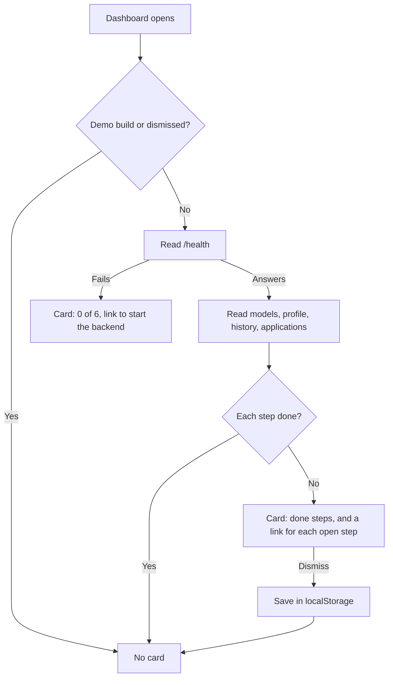

# MH-5: Onboarding checklist

## Apply with the runner

The handoff runner applies this file: it writes the test files, runs the red command (it must fail), makes the changes, runs the checks, and commits. The runner does not push.

Apply this handoff (WSL, from `apps/backend-py`):

```bash
.venv/bin/python scripts/run_handoff.py ../../tasks/active/step-4-demo/mh-5-onboarding.md
```

## Why

A new user who clones the project sees a dashboard with no guide. This card shows what to set up next, and it reads the real state from existing endpoints. It is for real users, so the demo leaves it out.



## The six steps

| Step | Done when | Link |
|---|---|---|
| Start the local backend | `GET /health` answers | `/settings` |
| Pull a local model | `GET /settings/ollama/models` is reachable and lists a model | `/settings` |
| Upload your resume | `GET /profile` answers | `/profile` |
| Run a first discover | `GET /pipeline/history` has a run | `/pipeline` |
| Review the shortlist: save or hide a job | A row is saved, hidden, or tracked | `/jobs` |
| Track a first application | A row is tracked | `/applications` |

## Decisions

- The backend does not record that a user read the shortlist. A saved, hidden, or tracked job is the proof of a review, and the step says so.
- The model read lists models. It does not load a model, so it adds no GPU load.
- The other reads wait for `/health`. A user with no backend sees the card at once, with no wait for each read to fail.
- A failed read leaves its step open. The card shows nothing while a read runs, so no step flashes as open.
- A user who works with cloud models only sees the model step as open. That user can dismiss the card.
- The dismiss stays in `localStorage`, in this browser only. With blocked storage, the card comes back on the next visit.
- The dashboard renders the card on the client only, as it does its other data, so the server render and the first client render match.

## Files

- `apps/frontend-ts/src/lib/onboarding.ts` (new)
- `apps/frontend-ts/src/components/onboarding-checklist.tsx` (new)
- `apps/frontend-ts/tests/lib/onboarding.test.ts` (new)
- `apps/frontend-ts/tests/components/onboarding-checklist.test.tsx` (new)
- `apps/frontend-ts/tests/app/dashboard/page.test.tsx` (new)
- `apps/frontend-ts/src/app/dashboard/page.tsx` (change)
- `apps/frontend-ts/tests/e2e-demo/demo.spec.ts` (change)
- `apps/frontend-ts/tests/e2e/dashboard.spec.ts` (change)

## Step 1: add the tests, run them, and see them fail

```ts new=apps/frontend-ts/tests/lib/onboarding.test.ts
/**
 * Tests for the onboarding rules (Step 4, MH-5).
 */

import { afterEach, describe, expect, it, vi } from "vitest";

import {
  hasReviewedShortlist,
  onboardingSteps,
  readOnboardingDismissed,
  saveOnboardingDismissed,
} from "@/lib/onboarding";
import type { OnboardingState } from "@/lib/onboarding";
import type { ApplicationSummary } from "@/lib/types/api";

const NOTHING: OnboardingState = {
  backend: false,
  model: false,
  profile: false,
  search: false,
  reviewed: false,
  tracked: false,
};

/**
 * Build an applications row.
 *
 * @param fields - The fields to change.
 * @returns The row.
 */
function row(fields: Partial<ApplicationSummary>): ApplicationSummary {
  return {
    current_status: "saved_bookmarked",
    is_bookmarked: false,
    is_hidden: false,
    ...fields,
  } as ApplicationSummary;
}

describe("onboardingSteps", () => {
  it("lists the six steps in order, each with its page", () => {
    expect(onboardingSteps(NOTHING).map((step) => step.href)).toEqual([
      "/settings",
      "/settings",
      "/profile",
      "/pipeline",
      "/jobs",
      "/applications",
    ]);
  });

  it.each(Object.keys(NOTHING) as (keyof OnboardingState)[])(
    "marks only %s as done",
    (field) => {
      const steps = onboardingSteps({ ...NOTHING, [field]: true });

      expect(steps.filter((step) => step.done).map((step) => step.id)).toEqual([
        field,
      ]);
    },
  );
});

describe("hasReviewedShortlist", () => {
  it("is false with no rows", () => {
    expect(hasReviewedShortlist([])).toBe(false);
  });

  it("is true for a saved, a hidden, or a tracked job", () => {
    expect(hasReviewedShortlist([row({ is_bookmarked: true })])).toBe(true);
    expect(hasReviewedShortlist([row({ is_hidden: true })])).toBe(true);
    expect(hasReviewedShortlist([row({ current_status: "applied" })])).toBe(
      true,
    );
  });

  it("is false for a row with no action", () => {
    expect(hasReviewedShortlist([row({})])).toBe(false);
  });
});

describe("dismissed state", () => {
  afterEach(() => {
    vi.restoreAllMocks();
    window.localStorage.clear();
  });

  it("starts as not dismissed, and remembers a dismiss", () => {
    expect(readOnboardingDismissed()).toBe(false);

    saveOnboardingDismissed();

    expect(readOnboardingDismissed()).toBe(true);
  });

  it("works when the browser blocks storage", () => {
    vi.spyOn(Storage.prototype, "getItem").mockImplementation(() => {
      throw new Error("blocked");
    });
    vi.spyOn(Storage.prototype, "setItem").mockImplementation(() => {
      throw new Error("blocked");
    });

    expect(() => saveOnboardingDismissed()).not.toThrow();
    expect(readOnboardingDismissed()).toBe(false);
  });
});
```

```tsx new=apps/frontend-ts/tests/components/onboarding-checklist.test.tsx
/**
 * Tests for the onboarding checklist on the dashboard (Step 4, MH-5).
 */

import { QueryClient, QueryClientProvider } from "@tanstack/react-query";
import { render, screen, waitFor } from "@testing-library/react";
import userEvent from "@testing-library/user-event";
import { delay, http, HttpResponse } from "msw";
import { afterEach, describe, expect, it } from "vitest";

import { OnboardingChecklist } from "@/components/onboarding-checklist";
import { readOnboardingDismissed } from "@/lib/onboarding";

import { server } from "../setup/globals";

const COMPLETE = {
  health: { status: "healthy", checks: [] },
  models: { host: "x", reachable: true, models: [{ name: "m" }], in_use: [] },
  profile: { contact_info: { name: "A" } },
  history: { runs: [{ run_id: "r" }] },
  applications: {
    applications: [
      { is_bookmarked: false, is_hidden: false, current_status: "applied" },
    ],
  },
};
type Answers = typeof COMPLETE;

/**
 * Answer the five reads of the checklist.
 *
 * @param changes - The answers to change. Null makes that read fail.
 * @returns Nothing.
 */
function answer(changes: {
  [Key in keyof Answers]?: unknown;
}): void {
  const reply = (key: keyof Answers) => () => {
    const body = key in changes ? changes[key] : COMPLETE[key];
    return body === null
      ? HttpResponse.json({ detail: "none" }, { status: 404 })
      : HttpResponse.json(body as object);
  };
  server.use(
    http.get("*/api/proxy/health", reply("health")),
    http.get("*/api/proxy/settings/ollama/models", reply("models")),
    http.get("*/api/proxy/profile", reply("profile")),
    http.get("*/api/proxy/pipeline/history", reply("history")),
    http.get("*/api/proxy/applications/dashboard", reply("applications")),
  );
}

/**
 * Render the checklist with a new query client.
 *
 * @returns The render result.
 */
function show() {
  const client = new QueryClient({
    defaultOptions: { queries: { retry: false } },
  });
  return render(
    <QueryClientProvider client={client}>
      <OnboardingChecklist />
    </QueryClientProvider>,
  );
}

describe("OnboardingChecklist", () => {
  afterEach(() => {
    window.localStorage.clear();
  });

  it("links each open step to its page", async () => {
    answer({
      models: { host: "x", reachable: true, models: [], in_use: [] },
      profile: null,
      history: { runs: [] },
      applications: { applications: [] },
    });

    show();

    expect(await screen.findByText("1 of 6 done")).toBeInTheDocument();
    expect(
      screen.getByRole("link", { name: "Pull a local model" }),
    ).toHaveAttribute("href", "/settings");
    expect(
      screen.getByRole("link", { name: "Upload your resume" }),
    ).toHaveAttribute("href", "/profile");
    expect(
      screen.queryByRole("link", { name: "Start the local backend" }),
    ).not.toBeInTheDocument();
    expect(screen.getByText("Start the local backend")).toBeInTheDocument();
  });

  it("hides when each step is done", async () => {
    let reads = 0;
    answer({});
    server.events.on("response:mocked", () => {
      reads += 1;
    });

    const { container } = show();

    await waitFor(() => expect(reads).toBeGreaterThanOrEqual(5));
    await waitFor(() => expect(container).toBeEmptyDOMElement());
    server.events.removeAllListeners();
  });

  it("shows the card with no backend, and reads nothing else", async () => {
    const paths: string[] = [];
    server.use(
      http.all("*/api/proxy/*", ({ request }) => {
        paths.push(new URL(request.url).pathname);
        return HttpResponse.json({ detail: "down" }, { status: 404 });
      }),
    );

    show();

    expect(await screen.findByText("0 of 6 done")).toBeInTheDocument();
    expect(
      screen.getByRole("link", { name: "Start the local backend" }),
    ).toBeInTheDocument();
    expect(paths).toEqual(["/api/proxy/health"]);
  });

  it("keeps the model step open when Ollama does not answer", async () => {
    answer({
      models: {
        host: "x",
        reachable: false,
        models: [{ name: "m" }],
        in_use: [],
      },
    });

    show();

    expect(await screen.findByText("5 of 6 done")).toBeInTheDocument();
    expect(
      screen.getByRole("link", { name: "Pull a local model" }),
    ).toBeInTheDocument();
  });

  it("keeps a step open when its read fails", async () => {
    answer({ history: null });

    show();

    expect(await screen.findByText("5 of 6 done")).toBeInTheDocument();
    expect(
      screen.getByRole("link", { name: "Run a first discover" }),
    ).toBeInTheDocument();
  });

  it("shows nothing until each read has finished", async () => {
    answer({ profile: null });
    server.use(
      http.get("*/api/proxy/pipeline/history", async () => {
        await delay("infinite");
        return HttpResponse.json({});
      }),
    );

    const { container } = show();

    await new Promise((resolve) => setTimeout(resolve, 200));
    expect(container).toBeEmptyDOMElement();
  });

  it("counts a hidden job as a review", async () => {
    answer({ profile: null });
    server.use(
      http.get("*/api/proxy/applications/dashboard", ({ request }) => {
        const hidden = new URL(request.url).searchParams.has("include_hidden");
        return HttpResponse.json({
          applications: hidden
            ? [{ is_hidden: true, current_status: "not_interested" }]
            : [],
        });
      }),
    );

    show();

    expect(await screen.findByText("4 of 6 done")).toBeInTheDocument();
    expect(
      screen.queryByRole("link", { name: /Review the shortlist/ }),
    ).not.toBeInTheDocument();
  });

  it("stays away after a dismiss", async () => {
    answer({ profile: null });
    const first = show();

    await userEvent.click(
      await screen.findByRole("button", { name: "Dismiss" }),
    );

    expect(screen.queryByText("Getting started")).not.toBeInTheDocument();
    expect(readOnboardingDismissed()).toBe(true);
    first.unmount();

    show();

    expect(screen.queryByText("Getting started")).not.toBeInTheDocument();
  });
});
```

```tsx new=apps/frontend-ts/tests/app/dashboard/page.test.tsx
/**
 * Tests for the onboarding checklist on the dashboard page (Step 4, MH-5).
 */

import { QueryClient, QueryClientProvider } from "@tanstack/react-query";
import { render, screen, waitFor } from "@testing-library/react";
import { afterEach, describe, expect, it, vi } from "vitest";

import DashboardPage from "@/app/dashboard/page";

vi.mock("@/components/onboarding-checklist", () => ({
  OnboardingChecklist: () => <p>the checklist</p>,
}));
vi.mock("@/lib/api/health", () => ({
  healthApi: { getHealth: vi.fn().mockResolvedValue({ status: "healthy" }) },
}));
vi.mock("@/lib/api/metrics", () => ({
  metricsApi: { getSummary: vi.fn().mockReturnValue(new Promise(() => {})) },
}));
vi.mock("@/lib/api/pipeline", () => ({
  pipelineApi: {
    getHistory: vi.fn().mockResolvedValue({ runs: [], total: 0 }),
  },
}));

/**
 * Render the dashboard with a new query client.
 *
 * @returns The render result.
 */
function show() {
  return render(
    <QueryClientProvider client={new QueryClient()}>
      <DashboardPage />
    </QueryClientProvider>,
  );
}

describe("DashboardPage", () => {
  afterEach(() => {
    vi.unstubAllEnvs();
  });

  it("shows the checklist to a real user", async () => {
    vi.stubEnv("NEXT_PUBLIC_DEMO_MODE", "");

    show();

    expect(await screen.findByText("the checklist")).toBeInTheDocument();
  });

  it("leaves the checklist out of the demo", async () => {
    vi.stubEnv("NEXT_PUBLIC_DEMO_MODE", "1");

    show();

    await waitFor(() =>
      expect(screen.getByText("healthy")).toBeInTheDocument(),
    );
    expect(screen.queryByText("the checklist")).not.toBeInTheDocument();
  });
});
```

```ts edit=apps/frontend-ts/tests/e2e-demo/demo.spec.ts
<<<<<<< OLD
  test("a reload keeps the data", async ({ page }) => {
=======
  test("the dashboard has no onboarding card", async ({ page }) => {
    await page.goto("dashboard");
    await expect(page.getByRole("main")).toContainText("70 scraped");

    await expect(page.getByText("Getting started")).toHaveCount(0);
  });

  test("a reload keeps the data", async ({ page }) => {
>>>>>>> NEW
```

```ts edit=apps/frontend-ts/tests/e2e/dashboard.spec.ts
<<<<<<< OLD
    await expect(main.getByText("System health")).toBeVisible();
=======
    await expect(main.getByText("System health")).toBeVisible();
    await expect(main.getByText("Getting started")).toBeVisible();
>>>>>>> NEW
```

Run them. They must fail (the checklist does not exist yet):

```bash red cwd=apps/frontend-ts
source ~/.nvm/nvm.sh && nvm use 24 && npx vitest run --no-cache tests/lib/onboarding.test.ts tests/components/onboarding-checklist.test.tsx tests/app/dashboard/page.test.tsx
```

## Step 2: add the checklist

```ts new=apps/frontend-ts/src/lib/onboarding.ts
import { isTrackedApplication } from "@/lib/applications-filters";
import type { ApplicationSummary } from "@/lib/types/api";

const STORAGE_KEY = "job-raider-onboarding-dismissed";

/** What the app knows about a new user's setup. */
export interface OnboardingState {
  /** The backend answered a health request. */
  backend: boolean;
  /** Ollama answered and has at least one model. */
  model: boolean;
  /** The user has an active profile. */
  profile: boolean;
  /** At least one pipeline run exists. */
  search: boolean;
  /** The user saved, hid, or tracked a job. */
  reviewed: boolean;
  /** At least one application is tracked. */
  tracked: boolean;
}

/** One line of the checklist. */
export interface OnboardingStep {
  /** The field of the state that this step reads. */
  id: keyof OnboardingState;
  /** The action for the user. */
  label: string;
  /** The page where the user does the action. */
  href: string;
  /** Whether the state shows that the action is done. */
  done: boolean;
}

/**
 * Build the checklist from the current state.
 *
 * @param state - What the app knows about the setup.
 * @returns The steps, in the order that a new user does them.
 */
export function onboardingSteps(state: OnboardingState): OnboardingStep[] {
  const steps: Omit<OnboardingStep, "done">[] = [
    { id: "backend", label: "Start the local backend", href: "/settings" },
    { id: "model", label: "Pull a local model", href: "/settings" },
    { id: "profile", label: "Upload your resume", href: "/profile" },
    { id: "search", label: "Run a first discover", href: "/pipeline" },
    {
      id: "reviewed",
      label: "Review the shortlist: save or hide a job",
      href: "/jobs",
    },
    {
      id: "tracked",
      label: "Track a first application",
      href: "/applications",
    },
  ];
  return steps.map((step) => ({ ...step, done: state[step.id] }));
}

/**
 * Tell whether the user acted on a job.
 *
 * The backend does not record that a user read the shortlist, so a saved,
 * hidden, or tracked job is the proof of a review.
 *
 * @param applications - The rows of the applications dashboard.
 * @returns True when at least one job has an action.
 */
export function hasReviewedShortlist(
  applications: readonly ApplicationSummary[],
): boolean {
  return applications.some(
    (row) => row.is_bookmarked || row.is_hidden || isTrackedApplication(row),
  );
}

/**
 * Read whether the user dismissed the checklist.
 *
 * @returns True when dismissed. False when the browser blocks storage.
 */
export function readOnboardingDismissed(): boolean {
  try {
    return window.localStorage.getItem(STORAGE_KEY) === "1";
  } catch {
    return false;
  }
}

/**
 * Remember that the user dismissed the checklist.
 *
 * With blocked storage, the checklist comes back on the next visit.
 */
export function saveOnboardingDismissed(): void {
  try {
    window.localStorage.setItem(STORAGE_KEY, "1");
  } catch {
    // Dismissing still works for this visit.
  }
}
```

```tsx new=apps/frontend-ts/src/components/onboarding-checklist.tsx
"use client";

import Link from "next/link";
import { useState } from "react";
import { useQuery } from "@tanstack/react-query";
import { CheckCircle2, Circle } from "lucide-react";

import { Button } from "@/components/ui/button";
import { applicationsApi } from "@/lib/api/applications";
import { healthApi } from "@/lib/api/health";
import { pipelineApi } from "@/lib/api/pipeline";
import { profileApi } from "@/lib/api/profile";
import { settingsApi } from "@/lib/api/settings";
import { isTrackedApplication } from "@/lib/applications-filters";
import {
  hasReviewedShortlist,
  onboardingSteps,
  readOnboardingDismissed,
  saveOnboardingDismissed,
} from "@/lib/onboarding";

interface OnboardingCardProps {
  /** Called when the user dismisses the card. */
  onDismiss: () => void;
}

/**
 * Read the setup state and show the steps that are open.
 *
 * Each read waits for the backend, so a user with no backend sees the card at
 * once. A failed read leaves its step open.
 *
 * @param onDismiss - Called when the user dismisses the card.
 * @returns The card, or nothing while it loads or when each step is done.
 */
function OnboardingCard({ onDismiss }: OnboardingCardProps) {
  const health = useQuery({
    queryKey: ["health"],
    queryFn: healthApi.getHealth,
    staleTime: 15_000,
  });
  const enabled = health.isSuccess;
  const models = useQuery({
    queryKey: ["onboarding", "models"],
    queryFn: settingsApi.listOllamaModels,
    staleTime: 60_000,
    enabled,
  });
  const profile = useQuery({
    queryKey: ["profile"],
    queryFn: profileApi.get,
    staleTime: 60_000,
    retry: false,
    enabled,
  });
  const history = useQuery({
    queryKey: ["pipeline-history"],
    queryFn: () => pipelineApi.getHistory(5),
    staleTime: 30_000,
    enabled,
  });
  const applications = useQuery({
    queryKey: ["applications", "onboarding"],
    queryFn: () => applicationsApi.getDashboard({ include_hidden: true }),
    staleTime: 30_000,
    enabled,
  });

  if (
    [health, models, profile, history, applications].some(
      (query) => query.isLoading,
    )
  ) {
    return null;
  }

  const rows = applications.data?.applications ?? [];
  const steps = onboardingSteps({
    backend: health.isSuccess,
    model: Boolean(models.data?.reachable && models.data.models.length > 0),
    profile: profile.isSuccess,
    search: (history.data?.runs.length ?? 0) > 0,
    reviewed: hasReviewedShortlist(rows),
    tracked: rows.some(isTrackedApplication),
  });
  const done = steps.filter((step) => step.done).length;
  if (done === steps.length) {
    return null;
  }

  return (
    <section
      aria-label="Getting started"
      className="rounded border border-border bg-card/80 px-4 py-3"
    >
      <div className="flex items-center justify-between gap-3">
        <h2 className="font-heading text-sm font-semibold text-foreground">
          Getting started
        </h2>
        <div className="flex items-center gap-3">
          <span className="text-xs text-muted-foreground">
            {done} of {steps.length} done
          </span>
          <Button size="sm" variant="ghost" onClick={onDismiss}>
            Dismiss
          </Button>
        </div>
      </div>
      <ul className="mt-2 space-y-1.5 text-sm">
        {steps.map((step) => (
          <li key={step.id} className="flex items-center gap-2">
            {step.done ? (
              <>
                <CheckCircle2 className="h-4 w-4 text-success" />
                <span className="text-muted-foreground">{step.label}</span>
              </>
            ) : (
              <>
                <Circle className="h-4 w-4 text-muted-foreground" />
                <Link href={step.href} className="underline">
                  {step.label}
                </Link>
              </>
            )}
          </li>
        ))}
      </ul>
    </section>
  );
}

/**
 * Show a new user what to set up next.
 *
 * Render this on the client only, because it reads browser storage on its
 * first render.
 *
 * @returns The checklist, or nothing after the user dismisses it.
 */
export function OnboardingChecklist() {
  const [dismissed, setDismissed] = useState(readOnboardingDismissed);

  if (dismissed) {
    return null;
  }
  return (
    <OnboardingCard
      onDismiss={() => {
        saveOnboardingDismissed();
        setDismissed(true);
      }}
    />
  );
}
```

```tsx edit=apps/frontend-ts/src/app/dashboard/page.tsx
<<<<<<< OLD
import { BrandMark } from "@/components/layout/BrandMark";
=======
import { BrandMark } from "@/components/layout/BrandMark";
import { OnboardingChecklist } from "@/components/onboarding-checklist";
import { isDemoMode } from "@/demo/mode";
>>>>>>> NEW
```

```tsx edit=apps/frontend-ts/src/app/dashboard/page.tsx
<<<<<<< OLD
      {/* Compact health strip */}
=======
      {ready && !isDemoMode() && <OnboardingChecklist />}

      {/* Compact health strip */}
>>>>>>> NEW
```

## Done when

Run the frontend unit tests:

```bash check cwd=apps/frontend-ts
source ~/.nvm/nvm.sh && nvm use 24 && npx vitest run --no-cache
```

Format, lint, and type-check:

```bash check cwd=apps/frontend-ts
source ~/.nvm/nvm.sh && nvm use 24 && npx prettier --check src/lib/onboarding.ts src/components/onboarding-checklist.tsx tests/lib/onboarding.test.ts tests/components/onboarding-checklist.test.tsx tests/app/dashboard/page.test.tsx src/app/dashboard/page.tsx tests/e2e-demo/demo.spec.ts tests/e2e/dashboard.spec.ts
```

```bash check cwd=apps/frontend-ts
source ~/.nvm/nvm.sh && nvm use 24 && npx eslint src/lib/onboarding.ts src/components/onboarding-checklist.tsx tests/lib/onboarding.test.ts tests/components/onboarding-checklist.test.tsx tests/app/dashboard/page.test.tsx src/app/dashboard/page.tsx tests/e2e-demo/demo.spec.ts tests/e2e/dashboard.spec.ts
```

```bash check cwd=apps/frontend-ts
source ~/.nvm/nvm.sh && nvm use 24 && npx tsc --noEmit
```

Commit message:

```text commit
feat(dashboard): add the onboarding checklist

Show a new user the next setup step. The card reads real state from
existing endpoints: backend, local model, profile, first discover,
shortlist review, and first tracked application. Each open step links
to its page. The card hides when each step is done, and a user can
dismiss it. The demo leaves it out.

Co-Authored-By: Claude Opus 5.5 <noreply@anthropic.com>
```
