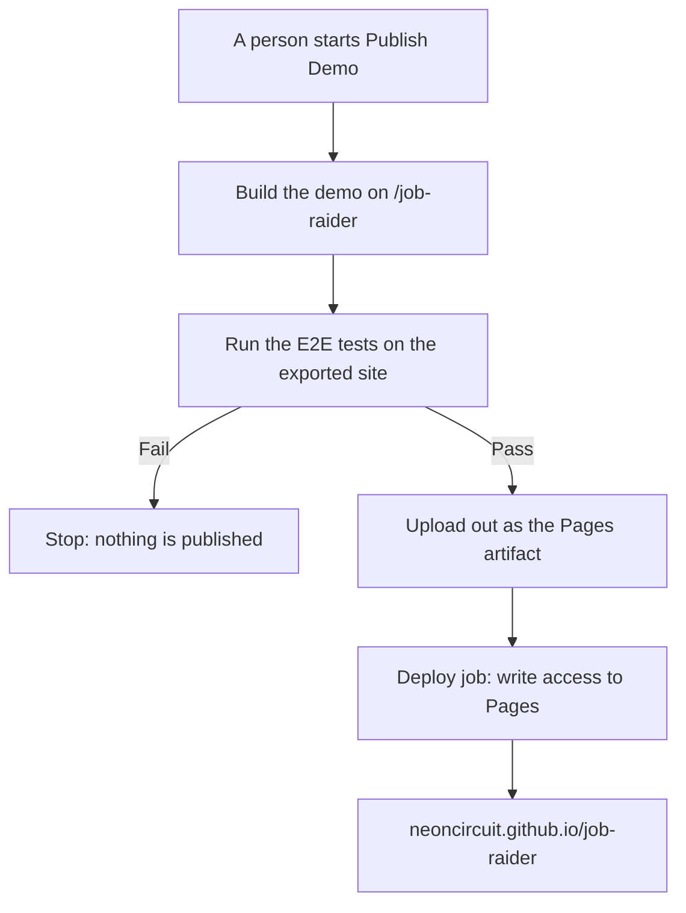

# MH-6: The workflow that publishes the demo

## Apply with the runner

The handoff runner applies this file: it writes the test file, runs the red command (it must fail), adds the workflow, runs the checks, and commits. The runner does not push, and this handoff publishes nothing.

Apply this handoff (WSL, from `apps/backend-py`):

```bash
.venv/bin/python scripts/run_handoff.py ../../tasks/active/step-4-demo/mh-6-pages-workflow.md
```

## Why

The demo needs a public URL. GitHub Pages is free for a public repository and needs no new account. A publish is outward-facing, so the workflow has two gates: a person starts it, and the E2E tests must pass first.



## Decisions

- The only trigger is `workflow_dispatch`. A push to `main` does not publish. A later step can add a push trigger, after the first publish.
- `actions/deploy-pages` publishes the artifact with no Jekyll step, so the `_next` folder needs no `.nojekyll` file.
- `actions/configure-pages` is not used: the base path is fixed, and the action adds nothing here.
- Only the deploy job has write access.
- The base path is written in the workflow, so a fork with another name must change it.

## After this handoff

This handoff does not change the repository settings. These steps stay with the user:

1. Set Settings > Pages > Source to GitHub Actions.
2. Approve the first publish. Claude then starts the workflow.

The first run on GitHub is the first proof of the deploy job. It cannot run before Pages is on.

## Files

- `apps/frontend-ts/tests/lib/pages-workflow.test.ts` (new)
- `.github/workflows/pages.yml` (new)

## Step 1: add the test, run it, and see it fail

```ts new=apps/frontend-ts/tests/lib/pages-workflow.test.ts
/**
 * Tests for the workflow that publishes the demo (Step 4, MH-6).
 *
 * A publish is outward-facing, so these tests keep its two gates: a person
 * starts it, and the E2E tests must pass first.
 */

import { readFileSync } from "node:fs";
import { resolve } from "node:path";

import { describe, expect, it } from "vitest";

const WORKFLOW = readFileSync(
  resolve(__dirname, "../../../../.github/workflows/pages.yml"),
  "utf-8",
);

/**
 * Read a top-level block of the workflow.
 *
 * @param name - The key of the block.
 * @returns The text from the key to the next top-level key.
 */
function block(name: string): string {
  const start = WORKFLOW.search(new RegExp(`^${name}:`, "m"));
  expect(start).toBeGreaterThanOrEqual(0);
  const rest = WORKFLOW.slice(start + name.length + 1);
  const end = rest.search(/^\S/m);
  return end === -1 ? rest : rest.slice(0, end);
}

describe("the Publish Demo workflow", () => {
  it("runs only when a person starts it", () => {
    expect(block("on").trim()).toBe("workflow_dispatch:");
  });

  it("uploads the site only after the E2E tests", () => {
    const tests = WORKFLOW.indexOf("npm run test:e2e:demo");
    const upload = WORKFLOW.indexOf("actions/upload-pages-artifact");

    expect(tests).toBeGreaterThan(0);
    expect(upload).toBeGreaterThan(tests);
  });

  it("deploys only after the build job", () => {
    expect(block("jobs")).toMatch(/^ {2}deploy:\n(.*\n)* {4}needs: build$/m);
  });

  it("builds for the base path of the site", () => {
    expect(WORKFLOW).toContain("NEXT_PUBLIC_BASE_PATH: /job-raider");
    expect(WORKFLOW).toContain("path: apps/frontend-ts/out");
  });

  it("gives write access to the deploy job only", () => {
    expect(block("permissions").trim()).toBe("contents: read");
    expect(WORKFLOW.split("pages: write")).toHaveLength(2);
    expect(WORKFLOW.indexOf("pages: write")).toBeGreaterThan(
      WORKFLOW.indexOf("  deploy:"),
    );
  });
});
```

Run it. It must fail (the workflow does not exist yet):

```bash red cwd=apps/frontend-ts
source ~/.nvm/nvm.sh && nvm use 24 && npx vitest run --no-cache tests/lib/pages-workflow.test.ts
```

## Step 2: add the workflow

```yaml new=.github/workflows/pages.yml
# Job Raider - Publish the public demo to GitHub Pages
#
# This workflow builds the static demo, runs the E2E tests on it, and deploys
# it only when they pass. A person starts it by hand, so a push to main never
# publishes the site.
#
# Before the first run, set Settings > Pages > Source to GitHub Actions.

name: Publish Demo

on:
  workflow_dispatch:

permissions:
  contents: read

# One deploy at a time. A new run does not cancel a deploy that has started.
concurrency:
  group: pages
  cancel-in-progress: false

jobs:
  build:
    name: Build and Test the Demo
    # Pinned for the same reason as test-frontend-e2e in ci.yml.
    runs-on: ubuntu-24.04
    defaults:
      run:
        working-directory: apps/frontend-ts

    steps:
      - uses: actions/checkout@v7

      - name: Set up Node.js
        uses: actions/setup-node@v7
        with:
          node-version-file: '.nvmrc'
          cache: 'npm'
          cache-dependency-path: apps/frontend-ts/package-lock.json

      - name: Install dependencies
        run: |
          npm ci

      - name: Install Playwright browsers
        run: |
          npx playwright install --with-deps chromium

      - name: Build the demo
        run: |
          npm run build:demo
        env:
          NEXT_PUBLIC_BASE_PATH: /job-raider

      - name: Run E2E tests on the exported site
        run: |
          npm run test:e2e:demo
        env:
          CI: true

      - name: Upload the site
        uses: actions/upload-pages-artifact@v5
        with:
          path: apps/frontend-ts/out

  deploy:
    name: Deploy to GitHub Pages
    needs: build
    runs-on: ubuntu-latest
    permissions:
      pages: write
      id-token: write
    environment:
      name: github-pages
      url: ${{ steps.deployment.outputs.page_url }}

    steps:
      - name: Deploy
        id: deployment
        uses: actions/deploy-pages@v5
```

## Done when

Run the frontend unit tests:

```bash check cwd=apps/frontend-ts
source ~/.nvm/nvm.sh && nvm use 24 && npx vitest run --no-cache
```

Format, lint, and type-check the test:

```bash check cwd=apps/frontend-ts
source ~/.nvm/nvm.sh && nvm use 24 && npx prettier --check tests/lib/pages-workflow.test.ts
```

```bash check cwd=apps/frontend-ts
source ~/.nvm/nvm.sh && nvm use 24 && npx eslint tests/lib/pages-workflow.test.ts
```

```bash check cwd=apps/frontend-ts
source ~/.nvm/nvm.sh && nvm use 24 && npx tsc --noEmit
```

Check that the workflow is valid YAML:

```bash check cwd=apps/backend-py
.venv/bin/python -c "import yaml; yaml.safe_load(open('../../.github/workflows/pages.yml'))"
```

Commit message:

```text commit
ci(demo): add the workflow that publishes the demo

Build the demo, run the E2E tests on it, and deploy it to GitHub Pages
only when they pass. A person starts the workflow by hand, so a push
to main never publishes the site. Only the deploy job has write access.

Co-Authored-By: Claude Opus 5.5 <noreply@anthropic.com>
```
