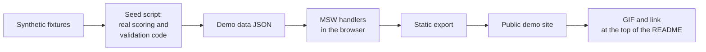

# Task: Step 4, Make It Demo-able

## Goal
A visitor can see the core loop of Job Raider in a browser, with no FastAPI, Ollama, or resume (review finding F1). A real user gets an onboarding checklist on the dashboard that reads real state.

## Constraints & Context
- Nothing leaves the visitor's browser. The demo has no backend, no model, and no analytics.
- Synthetic data only. The seed script reads only `tests/fixtures/eval/`, never `apps/backend-py/data/` and never `.env` files.
- Show real output: the seed runs the real scoring and validation code on synthetic inputs, so the demo does not show invented scores.
- Each demo page says that it is a demo, that the data is sample data, and that the jobs and companies are fictional. A company name in the demo must not match a real firm.
- The normal build must not change: no MSW code and no demo data in its output.
- Keep dry run as the default. Do not make auto-submit reachable. The demo never submits anything.
- Publishing the site, and enabling GitHub Pages on the repository, need the user's approval at that step.
- GPU: one model at a time, 7B or smaller, and unload after use. The seed needs `nomic-embed-text` and one letter from `qwen2.5:3b`.
- This Next.js version differs from older ones. Read `node_modules/next/dist/docs/` before writing frontend code (`apps/frontend-ts/AGENTS.md`).

## Acceptance Criteria
- [x] Plan approved by the user (host and scope). (2026-11-05: GitHub Pages)
- [x] `npm run build:demo` gives a static site. The normal build keeps the proxy route and has no MSW code. (`30d2360`, 6 tests, 10 of 10 mutants; works on the Pages base path in a real browser; MH-4 gates this in CI)
- [x] Seed script and committed demo data, with a test that the data is synthetic and that the types match. (`2b2bdd8`; the types closed in `0739a13`)
- [x] MSW handlers for the core pages (Dashboard, Jobs, Cover Letter, Applications, Profile, Metrics), a demo banner, and a sidebar without the pages that need a backend. (`0739a13`, 51 of 51 mutants)
- [x] E2E tests on the exported site in CI: each core page shows data, the banner is there, and no request fails. (`2e45b68`, CI run 42317711516, 13 of 13 mutants)
- [ ] Onboarding checklist on the dashboard that reads real state, with tests.
- [ ] Demo deployed, with the user's approval.
- [ ] README: demo link, short GIF, and the architecture diagram at the top.
- [ ] Done when: a visitor opens the public URL, follows the core loop with sample data, and sees that it is a demo.

## Status
`in-progress` (2026-11-07: MH-1 to MH-4 applied; next: MH-5, the onboarding checklist)
