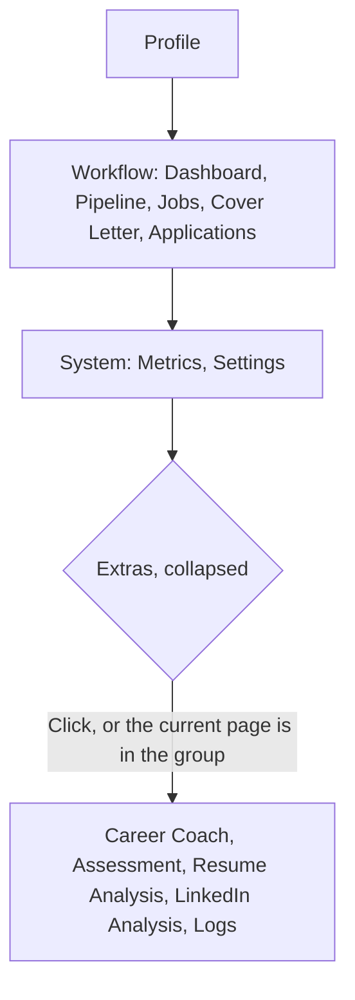

# MH-3: Sidebar groups

## Apply with the runner

The handoff runner applies this file: it writes the test file, runs the red command (it must fail), makes the changes, runs the checks, and commits. The runner does not push.

Apply this handoff (WSL, from `apps/backend-py`):

```bash
.venv/bin/python scripts/run_handoff.py ../../tasks/active/step-5-focus-prune/mh-3-sidebar-groups.md
```

## Why

The sidebar has 13 entries, and the core loop is mixed with pages that most users do not need (review finding F2). After this handoff, the core loop comes first, and the other pages are in a group that starts collapsed.



## Decisions

- Cover Letter moves into Workflow, between Jobs and Applications, because a user writes the letter before applying.
- Logs moves to Extras. It is a tool for debugging, not part of the loop.
- The group stays open while the current page is in it, so the active link is always visible.
- The open state is not saved. Each new visit starts with the group collapsed.
- The demo hides all five extra pages, so the demo has no Extras group.
- Themes stay as they are (user decision, 2026-11-07).
- The smoke E2E test opens Extras before it clicks a link that the group hides.

## Files

- `apps/frontend-ts/src/components/layout/SidebarExtras.tsx` (new)
- `apps/frontend-ts/tests/components/sidebar-content.test.tsx` (new)
- `apps/frontend-ts/src/components/layout/SidebarContent.tsx` (change)
- `apps/frontend-ts/tests/e2e/smoke.spec.ts` (change)

## Step 1: add the tests, run them, and see them fail

```tsx new=apps/frontend-ts/tests/components/sidebar-content.test.tsx
/**
 * Tests for the sidebar groups (Step 5, MH-3).
 */

import { render, screen, within } from "@testing-library/react";
import userEvent from "@testing-library/user-event";
import { afterEach, describe, expect, it, vi } from "vitest";

import { SidebarContent } from "@/components/layout/SidebarContent";

const pathname = vi.hoisted(() => ({ value: "/dashboard" }));
vi.mock("next/navigation", () => ({ usePathname: () => pathname.value }));
vi.mock("@/components/layout/ConnectionStatus", () => ({
  ConnectionStatus: () => null,
}));
vi.mock("@/components/layout/SystemResourcesMeter", () => ({
  SystemResourcesMeter: () => null,
}));
vi.mock("@/components/theme-toggle", () => ({ ThemeToggle: () => null }));

const CORE = [
  "Profile",
  "Dashboard",
  "Pipeline",
  "Jobs",
  "Cover Letter",
  "Applications",
  "Metrics",
  "Settings",
];
const EXTRAS = [
  "Career Coach",
  "Assessment",
  "Resume Analysis",
  "LinkedIn Analysis",
  "Logs",
];

/**
 * Read the names of the navigation links, in order.
 *
 * @returns The link names.
 */
function linkNames(): string[] {
  return within(screen.getByRole("navigation"))
    .getAllByRole("link")
    .map((link) => link.textContent ?? "");
}

describe("SidebarContent", () => {
  afterEach(() => {
    pathname.value = "/dashboard";
    vi.unstubAllEnvs();
  });

  it("shows the core loop in order, with the extras collapsed", () => {
    render(<SidebarContent />);

    expect(linkNames()).toEqual(CORE);
    expect(screen.getByRole("button", { name: "Extras" })).toHaveAttribute(
      "aria-expanded",
      "false",
    );
  });

  it("opens the extras on a click", async () => {
    render(<SidebarContent />);

    await userEvent.click(screen.getByRole("button", { name: "Extras" }));

    expect(linkNames()).toEqual([...CORE, ...EXTRAS]);
    expect(screen.getByRole("button", { name: "Extras" })).toHaveAttribute(
      "aria-expanded",
      "true",
    );
  });

  it("closes the extras on a second click", async () => {
    render(<SidebarContent />);
    const toggle = screen.getByRole("button", { name: "Extras" });

    await userEvent.click(toggle);
    await userEvent.click(toggle);

    expect(linkNames()).toEqual(CORE);
  });

  it("keeps the extras open on one of their pages", () => {
    pathname.value = "/assessment/session";

    render(<SidebarContent />);

    expect(linkNames()).toEqual([...CORE, ...EXTRAS]);
    expect(screen.getByRole("button", { name: "Extras" })).toHaveAttribute(
      "aria-expanded",
      "true",
    );
  });

  it("closes the mobile sheet from an extra link", async () => {
    const onNavItemClick = vi.fn();
    render(<SidebarContent onNavItemClick={onNavItemClick} />);

    await userEvent.click(screen.getByRole("button", { name: "Extras" }));
    await userEvent.click(screen.getByRole("link", { name: "Logs" }));

    expect(onNavItemClick).toHaveBeenCalledOnce();
  });

  it("has no extras group in the demo", () => {
    vi.stubEnv("NEXT_PUBLIC_DEMO_MODE", "1");

    render(<SidebarContent />);

    expect(linkNames()).toEqual(CORE);
    expect(
      screen.queryByRole("button", { name: "Extras" }),
    ).not.toBeInTheDocument();
  });
});
```

```ts edit=apps/frontend-ts/tests/e2e/smoke.spec.ts
<<<<<<< OLD
import type { Page } from "@playwright/test";
=======
import type { Locator, Page } from "@playwright/test";
>>>>>>> NEW
```

```ts edit=apps/frontend-ts/tests/e2e/smoke.spec.ts
<<<<<<< OLD
/**
 * Navigate to a primary route via whichever nav the current viewport exposes.
=======
/**
 * Open the Extras group of the sidebar when it hides a link.
 *
 * @param scope - The sidebar or the mobile navigation sheet.
 * @param linkName - Accessible name of the nav link.
 * @returns Resolved once the link is in the DOM.
 */
async function openExtrasFor(scope: Locator, linkName: string): Promise<void> {
  const link = scope.getByRole("link", { name: linkName, exact: true });
  if ((await link.count()) === 0) {
    await scope.getByRole("button", { name: "Extras" }).click({ force: true });
  }
}

/**
 * Navigate to a primary route via whichever nav the current viewport exposes.
>>>>>>> NEW
```

```ts edit=apps/frontend-ts/tests/e2e/smoke.spec.ts
<<<<<<< OLD
    await dialog.getByRole("link", { name: linkName, exact: true }).click();
=======
    await openExtrasFor(dialog, linkName);
    await dialog.getByRole("link", { name: linkName, exact: true }).click();
>>>>>>> NEW
```

```ts edit=apps/frontend-ts/tests/e2e/smoke.spec.ts
<<<<<<< OLD
  await page
    .locator("aside")
    .getByRole("link", { name: linkName, exact: true })
    .click({ force: true });
=======
  const sidebar = page.locator("aside");
  await openExtrasFor(sidebar, linkName);
  await sidebar
    .getByRole("link", { name: linkName, exact: true })
    .click({ force: true });
>>>>>>> NEW
```

Run the unit test. It must fail (the Extras group does not exist yet):

```bash red cwd=apps/frontend-ts
source ~/.nvm/nvm.sh && nvm use 24 && npx vitest run --no-cache tests/components/sidebar-content.test.tsx
```

## Step 2: group the sidebar

```tsx new=apps/frontend-ts/src/components/layout/SidebarExtras.tsx
"use client";

import { useState } from "react";
import { usePathname } from "next/navigation";
import { ChevronRight } from "lucide-react";

import { cn } from "@/lib/utils/cn";
import { SidebarNavLink } from "./SidebarNavLink";

interface ExtraItem {
  href: string;
  icon: React.ReactNode;
  label: string;
}

interface SidebarExtrasProps {
  /** The pages outside the core loop. */
  items: readonly ExtraItem[];
  /** Called when a navigation item is activated (used by mobile to close the sheet). */
  onNavItemClick?: () => void;
}

/**
 * Show the pages outside the core loop in a group that starts collapsed.
 *
 * The group stays open while the current page is one of its items, so the
 * active link is always visible.
 *
 * @param items - The pages outside the core loop.
 * @param onNavItemClick - Optional callback when a nav link is activated.
 * @returns The group, or nothing when it has no items.
 */
export function SidebarExtras({ items, onNavItemClick }: SidebarExtrasProps) {
  const pathname = usePathname();
  const [open, setOpen] = useState(false);
  const holdsActive = items.some(
    (item) => pathname === item.href || pathname.startsWith(item.href + "/"),
  );
  const shown = open || holdsActive;

  if (items.length === 0) {
    return null;
  }
  return (
    <div className="space-y-0.5">
      <button
        type="button"
        aria-expanded={shown}
        aria-controls="sidebar-extras"
        onClick={() => setOpen(!shown)}
        className="flex w-full items-center gap-1 rounded-md px-3 pb-1 font-heading text-[10px] font-semibold uppercase tracking-wider text-muted-foreground hover:text-sidebar-foreground focus-visible:outline-none focus-visible:ring-2 focus-visible:ring-sidebar-ring"
      >
        <ChevronRight
          size={12}
          className={cn("transition-transform", shown && "rotate-90")}
        />
        Extras
      </button>
      {shown && (
        <div id="sidebar-extras" className="space-y-0.5">
          {items.map((item) => (
            <SidebarNavLink
              key={item.href}
              {...item}
              onClick={onNavItemClick}
            />
          ))}
        </div>
      )}
    </div>
  );
}
```

```tsx edit=apps/frontend-ts/src/components/layout/SidebarContent.tsx
<<<<<<< OLD
import { SidebarNavLink } from "./SidebarNavLink";
=======
import { SidebarNavLink } from "./SidebarNavLink";
import { SidebarExtras } from "./SidebarExtras";
>>>>>>> NEW
```

```tsx edit=apps/frontend-ts/src/components/layout/SidebarContent.tsx
<<<<<<< OLD
const NAV_SECTIONS: NavSection[] = [
  {
    label: "Workflow",
    items: [
      {
        href: "/dashboard",
        icon: <LayoutDashboard size={16} />,
        label: "Dashboard",
      },
      { href: "/pipeline", icon: <Rocket size={16} />, label: "Pipeline" },
      { href: "/jobs", icon: <Briefcase size={16} />, label: "Jobs" },
      {
        href: "/applications",
        icon: <ClipboardList size={16} />,
        label: "Applications",
      },
    ],
  },
  {
    label: "Analysis",
    items: [
      {
        href: "/cover-letter",
        icon: <Mail size={16} />,
        label: "Cover Letter",
      },
      {
        href: "/career-coach",
        icon: <Compass size={16} />,
        label: "Career Coach",
      },
      {
        href: "/assessment",
        icon: <GraduationCap size={16} />,
        label: "Assessment",
      },
      {
        href: "/resume-analysis",
        icon: <FileSearch size={16} />,
        label: "Resume Analysis",
      },
      {
        href: "/linkedin-analysis",
        icon: <LinkIcon size={16} />,
        label: "LinkedIn Analysis",
      },
    ],
  },
  {
    label: "System",
    items: [
      { href: "/metrics", icon: <BarChart3 size={16} />, label: "Metrics" },
      { href: "/logs", icon: <ScrollText size={16} />, label: "Logs" },
      { href: "/settings", icon: <Settings size={16} />, label: "Settings" },
    ],
  },
];
=======
/** The core loop, in the order that a user works through it. */
const NAV_SECTIONS: NavSection[] = [
  {
    label: "Workflow",
    items: [
      {
        href: "/dashboard",
        icon: <LayoutDashboard size={16} />,
        label: "Dashboard",
      },
      { href: "/pipeline", icon: <Rocket size={16} />, label: "Pipeline" },
      { href: "/jobs", icon: <Briefcase size={16} />, label: "Jobs" },
      {
        href: "/cover-letter",
        icon: <Mail size={16} />,
        label: "Cover Letter",
      },
      {
        href: "/applications",
        icon: <ClipboardList size={16} />,
        label: "Applications",
      },
    ],
  },
  {
    label: "System",
    items: [
      { href: "/metrics", icon: <BarChart3 size={16} />, label: "Metrics" },
      { href: "/settings", icon: <Settings size={16} />, label: "Settings" },
    ],
  },
];

/** Pages outside the core loop, in a group that starts collapsed. */
const EXTRA_ITEMS: NavItem[] = [
  {
    href: "/career-coach",
    icon: <Compass size={16} />,
    label: "Career Coach",
  },
  {
    href: "/assessment",
    icon: <GraduationCap size={16} />,
    label: "Assessment",
  },
  {
    href: "/resume-analysis",
    icon: <FileSearch size={16} />,
    label: "Resume Analysis",
  },
  {
    href: "/linkedin-analysis",
    icon: <LinkIcon size={16} />,
    label: "LinkedIn Analysis",
  },
  { href: "/logs", icon: <ScrollText size={16} />, label: "Logs" },
];
>>>>>>> NEW
```

```tsx edit=apps/frontend-ts/src/components/layout/SidebarContent.tsx
<<<<<<< OLD
          ))}
        </div>
      </nav>
=======
          ))}
          <SidebarExtras
            items={visibleNavItems(EXTRA_ITEMS)}
            onNavItemClick={onNavItemClick}
          />
        </div>
      </nav>
>>>>>>> NEW
```

## Done when

Run the frontend unit tests:

```bash check cwd=apps/frontend-ts
source ~/.nvm/nvm.sh && nvm use 24 && npx vitest run --no-cache
```

Format, lint, and type-check:

```bash check cwd=apps/frontend-ts
source ~/.nvm/nvm.sh && nvm use 24 && npx prettier --check src/components/layout/SidebarExtras.tsx tests/components/sidebar-content.test.tsx src/components/layout/SidebarContent.tsx tests/e2e/smoke.spec.ts
```

```bash check cwd=apps/frontend-ts
source ~/.nvm/nvm.sh && nvm use 24 && npx eslint src/components/layout/SidebarExtras.tsx tests/components/sidebar-content.test.tsx src/components/layout/SidebarContent.tsx tests/e2e/smoke.spec.ts
```

```bash check cwd=apps/frontend-ts
source ~/.nvm/nvm.sh && nvm use 24 && npx tsc --noEmit
```

Commit message:

```text commit
feat(sidebar): show the core loop first, and group the other pages

The core loop comes first: Dashboard, Pipeline, Jobs, Cover Letter, and
Applications. Career Coach, Assessment, Resume Analysis, LinkedIn
Analysis, and Logs move to an Extras group that starts collapsed. The
group stays open while the current page is in it, and the demo has no
Extras group.

Co-Authored-By: Claude Opus 5.5 <noreply@anthropic.com>
```
