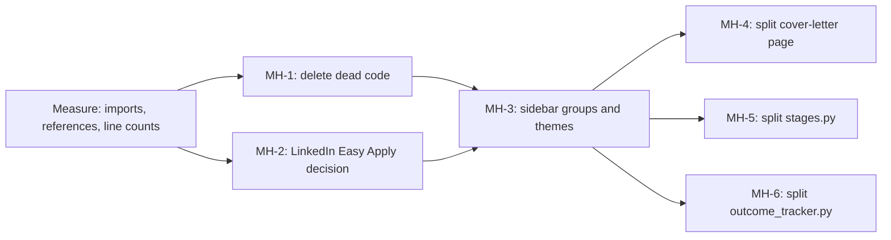

# Task: Step 5, Focus and Prune

## Goal
Make the core loop clear and remove code that nothing uses (review section 6, Step 5). A visitor and a reviewer must see the core loop first, and every module in the repository must be used and tested.

## Constraints & Context
- Delete only what the measure shows as unused. Each deletion has a reason in `notes.md`: no import, no reference, or a user decision.
- Do not touch untracked local data. The root `data/` folder is not in git and can hold personal data.
- Keep dry run as the default. Do not make auto-submit reachable.
- A split changes no behaviour: the existing tests pass with no change, and the public imports stay the same.
- The runner cannot delete files, so MH-1 and MH-2 are direct commits by Claude, with the full checks run first on a clone.
- Each step needs the user's "Yes, apply it". Push only after the user approves.

## Acceptance Criteria
- [x] Plan approved by the user, with the Easy Apply and theme decisions. (2026-11-07: keep `src/linkedin/`, keep all 13 themes)
- [x] Dead code deleted: `frontend-py/`, `src/database/` with `alembic.ini` and its 6 requirements, `src/reports/`, and the 2 YAML files that nothing reads. Backend tests (with the packages blocked) and the mypy gate pass. (`374c4a3`; a fresh install was not run)
- [x] LinkedIn Easy Apply decided: keep the dormant package, because it has no massive downside now (user rule). MH-2 dropped.
- [x] Sidebar shows the core loop first, with a collapsed "Extras" group. (`a266ed9`, 10 of 10 mutants)
- [ ] `cover-letter/page.tsx`, `stages.py`, and `outcome_tracker.py` split into modules of fewer than 600 lines each, with no change in behaviour.
- [ ] README tree and docs have no reference to a deleted path.

## Status
`in-progress` (2026-11-07: MH-1, MH-3, and MH-4 applied; MH-5 and MH-6 next)
