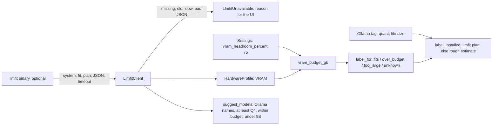

# MH-2: llmfit client and safety budget

## Apply with the runner

The handoff runner applies this file: it writes the tests, runs the red command (it must fail), makes the changes, runs the checks, and commits. The runner does not push.

Apply this handoff (WSL, from `apps/backend-py`):

```bash
.venv/bin/python scripts/run_handoff.py ../../tasks/active/step-6-llmfit/mh-2-llmfit-client.md
```

## Why

Users choose their own local models (open-source first). llmfit tells which models fit their hardware, but it is optional, and its labels are permissive: in the MH-1 measure it called a model a good fit at 87% to 99% of the VRAM, and this machine had blue screens under heavy GPU load. This handoff adds the backend parts that do not need the API yet: a safe llmfit client, Job Raider's own fit rules against a safety budget, and the headroom setting (75% by default, user decision). MH-3 adds the API route and the cache.



## Decisions

- **Optional.** Every failure (missing binary, version below 1.1.20, non-zero exit, timeout, output that is not JSON) raises `LlmfitUnavailable` with a reason. The client never runs a shell, and only runs `system`, `fit`, and `plan`.
- **Where to find it.** `LLMFIT_PATH` first, then the bin folder of the running Python (the backend `.venv`, where `setup.sh` will install it in MH-5), then PATH. A wrong `LLMFIT_PATH` gives "not installed", not another binary.
- **Lenient parse.** The models ignore fields they do not use, and a catalog row that does not parse is skipped. Only `llama.cpp` rows are kept, because Ollama runs GGUF files.
- **Our label, not llmfit's.** The budget is the total VRAM times the headroom. `fits` is within the budget, `over_budget` is within the total VRAM, `too_large` is above it, and `unknown` has no GPU or no estimate.
- **Installed models.** The llmfit `plan` for the installed quantization wins. Without it, the need is the file size plus 1 GB (from the MH-1 measure: a 4.42 GB Q4_K_M file needs 5.35 GB at 8,192 tokens), labelled `rough_estimate`.
- **Suggestions.** Only rows with an Ollama name, not installed, not embedding models, under the 9B pull limit, within the budget, and at Q4 or higher: `ollama pull` gets the default tag (usually Q4_K_M), so a row that fits only at Q2 or Q3 says nothing about it.
- **Setting.** `hardware.vram_headroom_percent`, 30 to 100, default 75. A save from a client that does not send the `hardware` section keeps the stored value, because the current frontend does not know the section yet (MH-4 adds it).
- **Fixtures.** Made-up hardware ("Example GPU", 12 GB) and invented rows with llmfit's JSON shape. The real samples from this machine stay out of git.

## Files

- `apps/backend-py/tests/fixtures/llmfit/system.json`, `fit.json`, `plan.json` (new)
- `apps/backend-py/tests/unit/test_llmfit_client.py` (new)
- `apps/backend-py/tests/unit/test_hardware_fit.py` (new)
- `apps/backend-py/src/hardware/__init__.py`, `llmfit_client.py`, `fit.py` (new)
- `apps/backend-py/src/api/settings.py` (change)

## Step 1: add the tests, run them, and see them fail

```json new=apps/backend-py/tests/fixtures/llmfit/system.json
{
  "providers": {
    "llama.cpp": {
      "available": false,
      "binary_style": "separate",
      "server_running": false
    }
  },
  "system": {
    "available_ram_gb": 20.5,
    "backend": "CUDA",
    "cpu_cores": 16,
    "cpu_name": "Example CPU 8-Core",
    "gpu_count": 1,
    "gpu_name": "Example GPU",
    "gpu_vram_gb": 12.0,
    "gpus": [
      {
        "backend": "CUDA",
        "count": 1,
        "name": "Example GPU",
        "unified_memory": false,
        "vram_gb": 12.0
      }
    ],
    "has_gpu": true,
    "total_ram_gb": 32.0,
    "unified_memory": false
  }
}
```
```json new=apps/backend-py/tests/fixtures/llmfit/fit.json
{
  "system": {
    "gpu_name": "Example GPU",
    "gpu_vram_gb": 12.0,
    "has_gpu": true,
    "total_ram_gb": 32.0
  },
  "models": [
    {
      "name": "example/Chat-7B-Instruct",
      "ollama_name": "examplechat:7b",
      "runtime": "llama.cpp",
      "best_quant": "Q5_K_M",
      "fit_level": "Good",
      "memory_required_gb": 6.4,
      "utilization_pct": 71.1,
      "estimated_tps": 70.0,
      "score": 88.0,
      "params_b": 7.2,
      "category": "Chat",
      "use_case": "General chat",
      "license": "apache-2.0",
      "installed": false,
      "estimate_confidence": "medium",
      "notes": ["Extra fields are ignored"]
    },
    {
      "name": "example/Chat-7B-Instruct-AWQ",
      "ollama_name": null,
      "runtime": "vLLM",
      "best_quant": "AWQ-4bit",
      "fit_level": "Perfect",
      "memory_required_gb": 5.1,
      "utilization_pct": 56.7,
      "estimated_tps": 90.0,
      "score": 95.0,
      "params_b": 7.2,
      "category": "Chat",
      "use_case": "General chat",
      "license": "apache-2.0",
      "installed": false
    },
    {
      "name": "example/Coder-3B",
      "ollama_name": "examplecoder:3b",
      "runtime": "llama.cpp",
      "best_quant": "Q8_0",
      "fit_level": "Perfect",
      "memory_required_gb": 4.1,
      "utilization_pct": 45.6,
      "estimated_tps": 95.0,
      "score": 82.0,
      "params_b": 3.1,
      "category": "Coding",
      "use_case": "Code",
      "license": "mit",
      "installed": true
    },
    {
      "name": "example/Big-14B",
      "ollama_name": "examplebig:14b",
      "runtime": "llama.cpp",
      "best_quant": "Q3_K_M",
      "fit_level": "Marginal",
      "memory_required_gb": 8.6,
      "utilization_pct": 95.6,
      "estimated_tps": 40.0,
      "score": 84.0,
      "params_b": 14.7,
      "category": "General",
      "use_case": "General",
      "license": null,
      "installed": false
    },
    {
      "name": "example/Embed-Large",
      "ollama_name": "exampleembed",
      "runtime": "llama.cpp",
      "best_quant": "Q8_0",
      "fit_level": "Perfect",
      "memory_required_gb": 0.9,
      "utilization_pct": 10.0,
      "estimated_tps": 500.0,
      "score": 80.0,
      "params_b": 0.34,
      "category": "Embedding",
      "use_case": "Embeddings",
      "license": "mit",
      "installed": false
    },
    {
      "name": "example/Bad-Row",
      "runtime": "llama.cpp",
      "best_quant": "Q4_K_M",
      "fit_level": "Good"
    }
  ]
}
```
```json new=apps/backend-py/tests/fixtures/llmfit/plan.json
{
  "estimate_notice": "Estimate-based output; not an exact benchmark.",
  "model_name": "example/Chat-7B-Instruct",
  "provider": "Example",
  "context": 8192,
  "quantization": "Q4_K_M",
  "disk_size_gb": 4.4,
  "kv_quant": "fp16",
  "target_tps": null,
  "minimum": {"vram_gb": 5.35, "ram_gb": 8.0, "cpu_cores": 4},
  "recommended": {"vram_gb": 7.1, "ram_gb": 12.0, "cpu_cores": 8},
  "run_paths": [
    {
      "path": "gpu",
      "feasible": true,
      "minimum": {"vram_gb": 5.35, "ram_gb": 8.0, "cpu_cores": 4},
      "recommended": {"vram_gb": 7.1, "ram_gb": 12.0, "cpu_cores": 8},
      "estimated_tps": 87.8,
      "fit_level": "Good",
      "notes": []
    },
    {
      "path": "cpu_only",
      "feasible": true,
      "minimum": {"vram_gb": 0.0, "ram_gb": 6.0, "cpu_cores": 4},
      "recommended": {"vram_gb": 0.0, "ram_gb": 8.0, "cpu_cores": 8},
      "estimated_tps": 9.0,
      "fit_level": "Marginal",
      "notes": []
    }
  ]
}
```
```python new=apps/backend-py/tests/unit/test_llmfit_client.py
"""
Tests for the llmfit client (Step 6, MH-2).

A small fake ``llmfit`` script answers like the real binary, so the tests run
the real subprocess path without llmfit installed. The fixtures use made-up
hardware values.
"""

import json
import stat
import sys
from pathlib import Path
from typing import List

import pytest

from src.hardware import llmfit_client
from src.hardware.llmfit_client import (
    LLAMA_CPP_RUNTIME,
    LlmfitClient,
    LlmfitUnavailable,
    find_llmfit,
    parse_plan,
    parse_version,
)

FIXTURES = Path(__file__).resolve().parents[1] / "fixtures" / "llmfit"

FAKE_LLMFIT = """\
import json, os, sys, time
from pathlib import Path

args = sys.argv[1:]
Path(os.environ["FAKE_LLMFIT_ARGV"]).write_text(json.dumps(args))
mode = os.environ.get("FAKE_LLMFIT_MODE", "ok")
fixtures = Path(os.environ["FAKE_LLMFIT_FIXTURES"])
if mode == "fail":
    sys.exit(2)
if mode == "slow":
    time.sleep(5)
if args == ["-V"]:
    print({"ok": "llmfit 1.1.20", "old": "llmfit 1.1.6"}.get(mode, "no version"))
    sys.exit(0)
if mode == "notjson":
    print("not json")
    sys.exit(0)
for name in ("system", "fit", "plan"):
    if name in args:
        print((fixtures / f"{name}.json").read_text())
        sys.exit(0)
sys.exit(2)
"""


@pytest.fixture
def fake_llmfit(tmp_path: Path, monkeypatch: pytest.MonkeyPatch) -> Path:
    """
    Write a fake llmfit binary and point the fake at the fixtures.

    Args:
        tmp_path: Temporary folder for this test.
        monkeypatch: Pytest monkeypatch fixture.

    Returns:
        Path of the fake binary.
    """
    binary = tmp_path / "bin" / "llmfit"
    binary.parent.mkdir()
    binary.write_text(f"#!{sys.executable}\n{FAKE_LLMFIT}")
    binary.chmod(binary.stat().st_mode | stat.S_IEXEC)
    monkeypatch.setenv("FAKE_LLMFIT_ARGV", str(tmp_path / "argv.json"))
    monkeypatch.setenv("FAKE_LLMFIT_FIXTURES", str(FIXTURES))
    monkeypatch.setenv("FAKE_LLMFIT_MODE", "ok")
    return binary


def last_argv(tmp_path: Path) -> List[str]:
    """
    Read the arguments of the last fake llmfit run.

    Args:
        tmp_path: Temporary folder of the test.

    Returns:
        The arguments after the binary name.
    """
    return json.loads((tmp_path / "argv.json").read_text())


class TestFindLlmfit:
    """Finding the binary."""

    def test_uses_the_configured_path(
        self, fake_llmfit: Path, monkeypatch: pytest.MonkeyPatch
    ) -> None:
        """LLMFIT_PATH wins when it names a file."""
        monkeypatch.setenv("LLMFIT_PATH", str(fake_llmfit))
        assert find_llmfit() == str(fake_llmfit)

    def test_a_configured_path_that_is_missing_gives_none(
        self, tmp_path: Path, monkeypatch: pytest.MonkeyPatch
    ) -> None:
        """A wrong LLMFIT_PATH does not fall back to another binary."""
        monkeypatch.setenv("LLMFIT_PATH", str(tmp_path / "missing"))
        assert find_llmfit() is None

    def test_prefers_the_binary_beside_python(
        self, fake_llmfit: Path, monkeypatch: pytest.MonkeyPatch
    ) -> None:
        """The backend .venv bin folder comes before PATH."""
        monkeypatch.delenv("LLMFIT_PATH", raising=False)
        monkeypatch.setattr(
            llmfit_client.sys, "executable", str(fake_llmfit.parent / "python")
        )
        monkeypatch.setattr(llmfit_client.shutil, "which", lambda _: "/elsewhere")
        assert find_llmfit() == str(fake_llmfit)

    def test_falls_back_to_path(
        self, tmp_path: Path, monkeypatch: pytest.MonkeyPatch
    ) -> None:
        """Without a configured path or a .venv binary, PATH is used."""
        monkeypatch.delenv("LLMFIT_PATH", raising=False)
        monkeypatch.setattr(llmfit_client.sys, "executable", str(tmp_path / "python"))
        monkeypatch.setattr(llmfit_client.shutil, "which", lambda _: "/usr/bin/llmfit")
        assert find_llmfit() == "/usr/bin/llmfit"


class TestRun:
    """Running the binary safely."""

    def test_missing_binary_is_unavailable(self) -> None:
        """No binary gives a clear reason, not a crash."""
        client = LlmfitClient(binary="")
        with pytest.raises(LlmfitUnavailable, match="not installed"):
            client.system()

    def test_non_zero_exit_is_unavailable(
        self, fake_llmfit: Path, monkeypatch: pytest.MonkeyPatch
    ) -> None:
        """A failed run gives the exit code."""
        monkeypatch.setenv("FAKE_LLMFIT_MODE", "fail")
        with pytest.raises(LlmfitUnavailable, match="exited with code 2"):
            LlmfitClient(binary=str(fake_llmfit)).system()

    def test_output_that_is_not_json_is_unavailable(
        self, fake_llmfit: Path, monkeypatch: pytest.MonkeyPatch
    ) -> None:
        """Text output gives "not JSON"."""
        monkeypatch.setenv("FAKE_LLMFIT_MODE", "notjson")
        with pytest.raises(LlmfitUnavailable, match="not JSON"):
            LlmfitClient(binary=str(fake_llmfit)).system()

    def test_a_slow_run_is_stopped(
        self, fake_llmfit: Path, monkeypatch: pytest.MonkeyPatch
    ) -> None:
        """The timeout stops a run that hangs."""
        monkeypatch.setenv("FAKE_LLMFIT_MODE", "slow")
        with pytest.raises(LlmfitUnavailable, match="did not answer"):
            LlmfitClient(binary=str(fake_llmfit), timeout=0.5).system()

    def test_only_read_only_subcommands_run(self, fake_llmfit: Path) -> None:
        """A subcommand outside the allow list never starts the binary."""
        client = LlmfitClient(binary=str(fake_llmfit))
        with pytest.raises(LlmfitUnavailable, match="not allowed"):
            client._run_json([], ["serve"])


class TestVersion:
    """The version check."""

    def test_parse_version(self) -> None:
        """The first x.y.z in the text is the version."""
        assert parse_version("llmfit 1.1.20") == (1, 1, 20)
        assert parse_version("llmfit") is None

    def test_a_new_enough_version_passes(self, fake_llmfit: Path) -> None:
        """1.1.20 is the minimum."""
        assert LlmfitClient(binary=str(fake_llmfit)).version() == (1, 1, 20)

    def test_an_old_version_asks_for_an_update(
        self, fake_llmfit: Path, monkeypatch: pytest.MonkeyPatch
    ) -> None:
        """1.1.6 (the version found in /usr/local/bin) is too old."""
        monkeypatch.setenv("FAKE_LLMFIT_MODE", "old")
        with pytest.raises(LlmfitUnavailable, match="update recommended"):
            LlmfitClient(binary=str(fake_llmfit)).version()

    def test_no_version_is_unavailable(
        self, fake_llmfit: Path, monkeypatch: pytest.MonkeyPatch
    ) -> None:
        """Output without a version number is not trusted."""
        monkeypatch.setenv("FAKE_LLMFIT_MODE", "garbage")
        with pytest.raises(LlmfitUnavailable, match="did not report a version"):
            LlmfitClient(binary=str(fake_llmfit)).version()


class TestParse:
    """Parsing the JSON output."""

    def test_system(self, fake_llmfit: Path, tmp_path: Path) -> None:
        """The system block parses, and --json comes first."""
        profile = LlmfitClient(binary=str(fake_llmfit)).system()
        assert profile.gpu_name == "Example GPU"
        assert profile.gpu_vram_gb == 12.0
        assert profile.has_gpu is True
        assert profile.total_ram_gb == 32.0
        assert last_argv(tmp_path) == ["--json", "system"]

    def test_catalog_keeps_llama_cpp_rows_and_skips_bad_rows(
        self, fake_llmfit: Path
    ) -> None:
        """vLLM rows and rows without a memory need are left out."""
        rows = LlmfitClient(binary=str(fake_llmfit)).catalog()
        assert [r.name for r in rows] == [
            "example/Chat-7B-Instruct",
            "example/Coder-3B",
            "example/Big-14B",
            "example/Embed-Large",
        ]
        assert all(r.runtime == LLAMA_CPP_RUNTIME for r in rows)

    def test_catalog_passes_the_budget_before_the_subcommand(
        self, fake_llmfit: Path, tmp_path: Path
    ) -> None:
        """--memory is a global flag, so it comes before fit."""
        LlmfitClient(binary=str(fake_llmfit)).catalog(memory_gb=9.0)
        assert last_argv(tmp_path) == [
            "--json",
            "--memory",
            "9.00G",
            "fit",
            "-n",
            "100000",
        ]

    def test_plan_reads_the_gpu_path(self, fake_llmfit: Path, tmp_path: Path) -> None:
        """The plan gives the GPU minimum for the installed quantization."""
        plan = LlmfitClient(binary=str(fake_llmfit)).plan(
            "example/Chat-7B-Instruct", "Q4_K_M", 8192
        )
        assert plan.quantization == "Q4_K_M"
        assert plan.min_vram_gb == 5.35
        assert plan.recommended_vram_gb == 7.1
        assert last_argv(tmp_path) == [
            "--json",
            "plan",
            "example/Chat-7B-Instruct",
            "--quant",
            "Q4_K_M",
            "--context",
            "8192",
        ]

    def test_plan_without_a_gpu_path_is_unavailable(self) -> None:
        """A plan with only CPU paths gives no VRAM need."""
        data = json.loads((FIXTURES / "plan.json").read_text())
        data["run_paths"] = [p for p in data["run_paths"] if p["path"] != "gpu"]
        with pytest.raises(LlmfitUnavailable, match="no GPU path"):
            parse_plan(data)
```
```python new=apps/backend-py/tests/unit/test_hardware_fit.py
"""
Tests for the hardware fit rules and the hardware setting (Step 6, MH-2).
"""

import json
from pathlib import Path
from typing import List

import pytest
from pydantic import ValidationError

from src.api.settings import HardwareSettings, UserSettings, merge_preserving_api_keys
from src.hardware.fit import (
    DEFAULT_VRAM_HEADROOM_PERCENT,
    FitLabel,
    FitSource,
    catalog_by_ollama_name,
    is_low_quant,
    label_for,
    label_installed,
    ollama_key,
    rough_need_gb,
    suggest_models,
    vram_budget_gb,
)
from src.hardware.llmfit_client import LLAMA_CPP_RUNTIME, CatalogModel

FIXTURES = Path(__file__).resolve().parents[1] / "fixtures" / "llmfit"


def catalog_rows() -> List[CatalogModel]:
    """
    Load the llama.cpp rows of the fit fixture that parse.

    Returns:
        Catalog rows, as ``LlmfitClient.catalog`` returns them.
    """
    rows = json.loads((FIXTURES / "fit.json").read_text())["models"]
    parsed = []
    for row in rows:
        if "memory_required_gb" in row and row["runtime"] == LLAMA_CPP_RUNTIME:
            parsed.append(CatalogModel.model_validate(row))
    return parsed


class TestBudget:
    """The safety budget."""

    def test_default_is_75_percent(self) -> None:
        """The user chose 75% of the VRAM (2026-11-08)."""
        assert DEFAULT_VRAM_HEADROOM_PERCENT == 75
        assert vram_budget_gb(8.0, 75) == 6.0
        assert vram_budget_gb(12.0, 75) == 9.0

    def test_no_gpu_gives_no_budget(self) -> None:
        """Without VRAM the budget is zero."""
        assert vram_budget_gb(None, 75) == 0.0
        assert vram_budget_gb(0.0, 75) == 0.0


class TestLabel:
    """Labels against the budget and the total VRAM."""

    def test_boundaries(self) -> None:
        """The budget and the total are inclusive."""
        assert label_for(6.0, 6.0, 8.0) == FitLabel.FITS
        assert label_for(6.01, 6.0, 8.0) == FitLabel.OVER_BUDGET
        assert label_for(8.0, 6.0, 8.0) == FitLabel.OVER_BUDGET
        assert label_for(8.01, 6.0, 8.0) == FitLabel.TOO_LARGE

    def test_unknown_without_need_or_gpu(self) -> None:
        """No estimate or no GPU gives unknown, never fits."""
        assert label_for(None, 6.0, 8.0) == FitLabel.UNKNOWN
        assert label_for(2.0, 0.0, None) == FitLabel.UNKNOWN

    def test_rough_need_adds_the_allowance(self) -> None:
        """A 4.68 GB file needs about 5.68 GB."""
        assert rough_need_gb(4_680_000_000) == 5.68
        assert rough_need_gb(None) is None
        assert rough_need_gb(0) is None

    def test_installed_prefers_the_plan(self) -> None:
        """The llmfit plan for the installed quant wins over the file size."""
        fit = label_installed("examplechat:7b", "Q4_K_M", 4_680_000_000, 5.35, 6.0, 8.0)
        assert fit.source == FitSource.LLMFIT_PLAN
        assert fit.need_gb == 5.35
        assert fit.label == FitLabel.FITS

    def test_installed_falls_back_to_a_rough_estimate(self) -> None:
        """Without a plan the file size decides, and the source says so."""
        fit = label_installed(
            "mine-16k:latest", "Q4_K_M", 6_590_000_000, None, 6.0, 8.0
        )
        assert fit.source == FitSource.ROUGH_ESTIMATE
        assert fit.need_gb == 7.59
        assert fit.label == FitLabel.OVER_BUDGET

    def test_installed_without_size_or_plan_is_unknown(self) -> None:
        """No data gives unknown."""
        fit = label_installed("x", None, None, None, 6.0, 8.0)
        assert fit.source == FitSource.NONE
        assert fit.label == FitLabel.UNKNOWN


class TestCatalog:
    """Matching and suggestions."""

    def test_ollama_key(self) -> None:
        """ ":latest" is dropped and case does not matter."""
        assert ollama_key("Mistral:latest") == "mistral"
        assert ollama_key("qwen2.5-coder:7b") == "qwen2.5-coder:7b"

    def test_index_keeps_the_best_score(self) -> None:
        """Two rows with one Ollama name keep the higher score."""
        low = CatalogModel(
            name="a", ollama_name="m:7b", memory_required_gb=5.0, score=60.0
        )
        high = CatalogModel(
            name="b", ollama_name="M:7b", memory_required_gb=5.0, score=70.0
        )
        assert catalog_by_ollama_name([low, high])["m:7b"].name == "b"

    @pytest.mark.parametrize(
        ("quant", "low"),
        [
            ("Q2_K", True),
            ("Q3_K_M", True),
            ("IQ3_XS", True),
            ("Q4_K_M", False),
            ("Q8_0", False),
        ],
    )
    def test_low_quant(self, quant: str, low: bool) -> None:
        """Below 4 bits says nothing about the default Ollama tag."""
        assert is_low_quant(quant) is low

    def test_suggestions(self) -> None:
        """Installed, embedding, too large, low quant, and over budget are out."""
        picks = suggest_models(
            catalog_rows(),
            budget_gb=9.0,
            installed_tags=[],
            max_params_billion=9.0,
        )
        # examplecoder is installed (llmfit says so), exampleembed is an
        # embedding model, examplebig is 14.7B at Q3_K_M.
        assert [p.ollama_name for p in picks] == ["examplechat:7b"]
        assert picks[0].memory_required_gb == 6.4

    def test_suggestions_respect_installed_tags_and_budget(self) -> None:
        """An installed tag and a budget below the need both remove a row."""
        rows = catalog_rows()
        assert suggest_models(rows, 9.0, ["ExampleChat:7b"], 9.0) == []
        assert suggest_models(rows, 6.0, [], 9.0) == []

    def test_suggestions_skip_a_row_that_fits_only_below_q4(self) -> None:
        """A small model that fits only at Q3 is not a suggestion; at Q4 it is."""
        low = CatalogModel(
            name="s",
            ollama_name="small:4b",
            best_quant="Q3_K_M",
            memory_required_gb=3.0,
            score=90.0,
            params_b=4.0,
        )
        assert suggest_models([low], 6.0, [], 9.0) == []
        q4 = low.model_copy(update={"best_quant": "Q4_K_M"})
        assert [p.ollama_name for p in suggest_models([q4], 6.0, [], 9.0)] == [
            "small:4b"
        ]

    def test_suggestions_are_sorted_and_limited(self) -> None:
        """Best score first, and no more than the limit."""
        rows = [
            CatalogModel(
                name=f"m{i}",
                ollama_name=f"m{i}:3b",
                best_quant="Q4_K_M",
                memory_required_gb=3.0,
                score=float(i),
                params_b=3.0,
            )
            for i in range(5)
        ]
        picks = suggest_models(rows, 6.0, [], 9.0, limit=3)
        assert [p.ollama_name for p in picks] == ["m4:3b", "m3:3b", "m2:3b"]


class TestHardwareSetting:
    """The headroom setting."""

    def test_default_and_bounds(self) -> None:
        """75 by default; 30 to 100 are allowed."""
        assert HardwareSettings().vram_headroom_percent == 75
        assert HardwareSettings(vram_headroom_percent=30).vram_headroom_percent == 30
        with pytest.raises(ValidationError):
            HardwareSettings(vram_headroom_percent=29)
        with pytest.raises(ValidationError):
            HardwareSettings(vram_headroom_percent=101)

    def test_old_settings_files_load(self) -> None:
        """A settings file from before Step 6 gets the default."""
        assert UserSettings.model_validate({}).hardware.vram_headroom_percent == 75

    def test_a_save_without_the_section_keeps_the_stored_value(self) -> None:
        """An older client does not send "hardware"; the stored value stays."""
        current = UserSettings(hardware=HardwareSettings(vram_headroom_percent=60))
        incoming = UserSettings.model_validate({"version": "1.0"})
        merged = merge_preserving_api_keys(current, incoming)
        assert merged.hardware.vram_headroom_percent == 60

    def test_a_save_with_the_section_uses_the_new_value(self) -> None:
        """A client that sends "hardware" changes it."""
        current = UserSettings(hardware=HardwareSettings(vram_headroom_percent=60))
        incoming = UserSettings.model_validate(
            {"hardware": {"vram_headroom_percent": 85}}
        )
        merged = merge_preserving_api_keys(current, incoming)
        assert merged.hardware.vram_headroom_percent == 85
```

```bash red cwd=apps/backend-py
.venv/bin/python -m pytest -q -p no:cacheprovider tests/unit/test_llmfit_client.py tests/unit/test_hardware_fit.py
```

## Step 2: add the client and the fit rules

```python new=apps/backend-py/src/hardware/__init__.py
"""
Job Raider - Hardware Fit

This package reads the user's hardware with llmfit (optional) and decides
which local models fit a safety budget of GPU memory.
"""
```
```python new=apps/backend-py/src/hardware/llmfit_client.py
"""
Job Raider - llmfit Client

llmfit (https://github.com/AlexsJones/llmfit, MIT) detects the CPU, RAM, and
GPU, and estimates the memory that each model needs. It is optional: when the
binary is missing, too old, slow, or gives bad output, every call here raises
``LlmfitUnavailable`` and the caller shows "not available".

The client runs only read-only subcommands (``system``, ``fit``, ``plan``),
with no shell and with a timeout. It parses only the fields that Job Raider
uses, so new fields in a later llmfit version do not break it.
"""

import json
import os
import re
import shutil
import subprocess
import sys
from pathlib import Path
from typing import Any, Dict, List, Optional, Sequence, Tuple

from pydantic import BaseModel, ConfigDict, Field, ValidationError

LLMFIT_MIN_VERSION: Tuple[int, int, int] = (1, 1, 20)
"""Oldest llmfit version whose JSON fields this client was checked against."""

LLMFIT_PATH_ENV = "LLMFIT_PATH"
"""Environment variable that can name the llmfit binary."""

READ_ONLY_SUBCOMMANDS = frozenset({"system", "fit", "plan"})
"""The only subcommands the client runs. None of them downloads or writes."""

DEFAULT_TIMEOUT_SECONDS = 20.0
"""``fit`` over the full catalog took 2.4 to 2.8 s in the MH-1 measure."""

LLAMA_CPP_RUNTIME = "llama.cpp"
"""llmfit runtime that matches Ollama, which runs GGUF files."""

_VERSION_RE = re.compile(r"(\d+)\.(\d+)\.(\d+)")


class LlmfitUnavailable(Exception):
    """llmfit cannot give an answer. The message says why, for the UI."""


class _Lenient(BaseModel):
    """Base model that ignores fields this client does not use."""

    model_config = ConfigDict(extra="ignore")


class HardwareProfile(_Lenient):
    """Hardware that llmfit detected (``llmfit --json system``)."""

    has_gpu: bool = False
    gpu_name: Optional[str] = None
    gpu_vram_gb: Optional[float] = None
    backend: Optional[str] = None
    total_ram_gb: float = 0.0
    available_ram_gb: Optional[float] = None
    cpu_name: Optional[str] = None
    cpu_cores: Optional[int] = None


class CatalogModel(_Lenient):
    """One model row of ``llmfit --json fit``."""

    name: str
    ollama_name: Optional[str] = None
    runtime: str = ""
    best_quant: str = ""
    fit_level: str = ""
    memory_required_gb: float
    utilization_pct: Optional[float] = None
    estimated_tps: Optional[float] = None
    score: float = 0.0
    params_b: Optional[float] = None
    category: Optional[str] = None
    use_case: Optional[str] = None
    license: Optional[str] = None
    installed: bool = False


class QuantPlan(_Lenient):
    """Memory need of one model at one quantization (``llmfit plan``)."""

    model_name: str
    quantization: str
    context: int
    disk_size_gb: Optional[float] = None
    min_vram_gb: float = Field(description="Minimum VRAM for the GPU path")
    recommended_vram_gb: Optional[float] = None


def parse_version(text: str) -> Optional[Tuple[int, int, int]]:
    """
    Read a version number from ``llmfit -V`` output.

    Args:
        text: Output such as ``"llmfit 1.1.20"``.

    Returns:
        The version as a tuple of three ints, or None if there is none.
    """
    match = _VERSION_RE.search(text)
    if not match:
        return None
    major, minor, patch = (int(part) for part in match.groups())
    return (major, minor, patch)


def find_llmfit() -> Optional[str]:
    """
    Find the llmfit binary.

    The order is: the ``LLMFIT_PATH`` variable, the bin folder of the running
    Python (the backend ``.venv``, where ``setup.sh`` installs it), and PATH.

    Returns:
        The path of the binary, or None if llmfit is not installed.
    """
    configured = os.environ.get(LLMFIT_PATH_ENV)
    if configured:
        return configured if Path(configured).is_file() else None
    beside_python = Path(sys.executable).parent / "llmfit"
    if beside_python.is_file():
        return str(beside_python)
    return shutil.which("llmfit")


class LlmfitClient:
    """Run llmfit and parse its JSON output."""

    def __init__(
        self,
        binary: Optional[str] = None,
        timeout: float = DEFAULT_TIMEOUT_SECONDS,
    ):
        """
        Initialize the client.

        Args:
            binary: Path of the llmfit binary. None means ``find_llmfit()``.
            timeout: Seconds before a call is stopped.
        """
        self.binary = binary if binary is not None else find_llmfit()
        self.timeout = timeout

    def _run(self, args: Sequence[str]) -> str:
        """
        Run llmfit with the given arguments and return its standard output.

        Args:
            args: Arguments after the binary name.

        Returns:
            Standard output of a successful run.

        Raises:
            LlmfitUnavailable: llmfit is missing, fails, or is too slow.
        """
        if not self.binary:
            raise LlmfitUnavailable("llmfit is not installed")
        try:
            completed = subprocess.run(
                [self.binary, *args],
                capture_output=True,
                text=True,
                timeout=self.timeout,
                check=False,
            )
        except subprocess.TimeoutExpired as exc:
            raise LlmfitUnavailable(
                f"llmfit did not answer within {self.timeout:g} s"
            ) from exc
        except OSError as exc:
            raise LlmfitUnavailable(f"llmfit could not start: {exc}") from exc
        if completed.returncode != 0:
            raise LlmfitUnavailable(f"llmfit exited with code {completed.returncode}")
        return completed.stdout

    def _run_json(self, global_args: Sequence[str], subcommand: Sequence[str]) -> Any:
        """
        Run one read-only subcommand with ``--json`` and parse the output.

        Args:
            global_args: Flags that go before the subcommand (such as
                ``["--memory", "6G"]``).
            subcommand: The subcommand and its own arguments.

        Returns:
            The parsed JSON value.

        Raises:
            LlmfitUnavailable: The subcommand is not allowed, llmfit fails,
                or the output is not JSON.
        """
        if not subcommand or subcommand[0] not in READ_ONLY_SUBCOMMANDS:
            raise LlmfitUnavailable(f"subcommand not allowed: {list(subcommand)}")
        output = self._run(["--json", *global_args, *subcommand])
        try:
            return json.loads(output)
        except json.JSONDecodeError as exc:
            raise LlmfitUnavailable("llmfit gave output that is not JSON") from exc

    def version(self) -> Tuple[int, int, int]:
        """
        Get the llmfit version, and check that it is new enough.

        Returns:
            The version tuple.

        Raises:
            LlmfitUnavailable: llmfit is missing, has no version, or is older
                than ``LLMFIT_MIN_VERSION``.
        """
        found = parse_version(self._run(["-V"]))
        if found is None:
            raise LlmfitUnavailable("llmfit did not report a version")
        if found < LLMFIT_MIN_VERSION:
            wanted = ".".join(str(part) for part in LLMFIT_MIN_VERSION)
            have = ".".join(str(part) for part in found)
            raise LlmfitUnavailable(
                f"llmfit {have} is older than {wanted}; update recommended"
            )
        return found

    def system(self) -> HardwareProfile:
        """
        Read the hardware.

        Returns:
            The detected hardware.

        Raises:
            LlmfitUnavailable: llmfit fails or the output has no system block.
        """
        data = self._run_json([], ["system"])
        try:
            return HardwareProfile.model_validate(data["system"])
        except (KeyError, TypeError, ValidationError) as exc:
            raise LlmfitUnavailable("llmfit system output has no system block") from exc

    def catalog(self, memory_gb: Optional[float] = None) -> List[CatalogModel]:
        """
        Score the whole catalog, keeping only llama.cpp rows (Ollama's format).

        Args:
            memory_gb: GPU memory to score against. None means the detected
                VRAM. Job Raider passes its safety budget here, so llmfit picks
                a quantization that fits the budget.

        Returns:
            The llama.cpp rows. Rows that do not parse are skipped.

        Raises:
            LlmfitUnavailable: llmfit fails or the output has no model list.
        """
        global_args: List[str] = []
        if memory_gb is not None:
            global_args = ["--memory", f"{memory_gb:.2f}G"]
        data = self._run_json(global_args, ["fit", "-n", "100000"])
        rows = data.get("models") if isinstance(data, dict) else None
        if not isinstance(rows, list):
            raise LlmfitUnavailable("llmfit fit output has no model list")
        models: List[CatalogModel] = []
        for row in rows:
            try:
                model = CatalogModel.model_validate(row)
            except ValidationError:
                continue
            if model.runtime == LLAMA_CPP_RUNTIME:
                models.append(model)
        return models

    def plan(self, model_name: str, quantization: str, context: int) -> QuantPlan:
        """
        Get the memory need of one model at one quantization.

        Args:
            model_name: llmfit catalog name (such as ``Qwen/Qwen2.5-7B-Instruct``).
            quantization: Quantization of the installed file (such as ``Q4_K_M``).
            context: Context length in tokens.

        Returns:
            The plan for the GPU path.

        Raises:
            LlmfitUnavailable: llmfit fails or the output has no GPU path.
        """
        data = self._run_json(
            [],
            [
                "plan",
                model_name,
                "--quant",
                quantization,
                "--context",
                str(context),
            ],
        )
        return parse_plan(data)


def parse_plan(data: Dict[str, Any]) -> QuantPlan:
    """
    Read the GPU path of ``llmfit plan`` JSON.

    Args:
        data: Parsed ``plan`` output.

    Returns:
        The plan with the GPU minimum and recommended VRAM.

    Raises:
        LlmfitUnavailable: The output has no GPU path.
    """
    try:
        gpu = next(p for p in data["run_paths"] if p.get("path") == "gpu")
        return QuantPlan(
            model_name=data["model_name"],
            quantization=data["quantization"],
            context=int(data["context"]),
            disk_size_gb=data.get("disk_size_gb"),
            min_vram_gb=float(gpu["minimum"]["vram_gb"]),
            recommended_vram_gb=(gpu.get("recommended") or {}).get("vram_gb"),
        )
    except (KeyError, StopIteration, TypeError, ValueError) as exc:
        raise LlmfitUnavailable("llmfit plan output has no GPU path") from exc
```
```python new=apps/backend-py/src/hardware/fit.py
"""
Job Raider - Hardware Fit Rules

These pure functions decide whether a local model fits the user's safety
budget of GPU memory. llmfit gives the hardware and its estimates; the label
comes from Job Raider's own budget, because llmfit can call a model a good fit
when it fills almost all of the VRAM, and heavy GPU load has caused crashes.

Labels:

- ``fits``: the need is within the budget.
- ``over_budget``: the need is above the budget but within the total VRAM. The
  model can run, but it leaves less headroom than the user asked for.
- ``too_large``: the need is above the total VRAM.
- ``unknown``: there is no GPU or no estimate.
"""

import re
from enum import Enum
from typing import Dict, Iterable, List, Optional

from pydantic import BaseModel

from .llmfit_client import CatalogModel

DEFAULT_VRAM_HEADROOM_PERCENT = 75
"""Default share of the total VRAM that a model may use (user decision)."""

ROUGH_ALLOWANCE_GB = 1.0
"""Context and runtime memory added to a file size for a rough estimate.

MH-1 measure: the Q4_K_M ``qwen2.5-coder:7b`` file is 4.42 GB in llmfit's
estimate, and its minimum VRAM at an 8,192-token context is 5.35 GB.
"""

BYTES_PER_GB = 1_000_000_000

_LOW_QUANT_RE = re.compile(r"^(Q[23]_|IQ[123]_)", re.IGNORECASE)
_EMBEDDING_CATEGORY = "embedding"


class FitLabel(str, Enum):
    """Fit of one model against the safety budget."""

    FITS = "fits"
    OVER_BUDGET = "over_budget"
    TOO_LARGE = "too_large"
    UNKNOWN = "unknown"


class FitSource(str, Enum):
    """Where the memory need of a model comes from."""

    LLMFIT_PLAN = "llmfit_plan"
    ROUGH_ESTIMATE = "rough_estimate"
    NONE = "none"


class InstalledFit(BaseModel):
    """Fit result for one installed Ollama model."""

    name: str
    quantization: Optional[str] = None
    need_gb: Optional[float] = None
    label: FitLabel
    source: FitSource


class Suggestion(BaseModel):
    """A model that is not installed and fits the budget."""

    ollama_name: str
    category: Optional[str] = None
    params_b: Optional[float] = None
    memory_required_gb: float
    estimated_tps: Optional[float] = None
    score: float
    license: Optional[str] = None


def vram_budget_gb(total_vram_gb: Optional[float], headroom_percent: int) -> float:
    """
    Compute the safety budget of GPU memory.

    Args:
        total_vram_gb: Total VRAM from llmfit, or None when there is no GPU.
        headroom_percent: Share of the VRAM that a model may use, 1 to 100.

    Returns:
        The budget in GB, or 0.0 when there is no GPU.
    """
    if not total_vram_gb or total_vram_gb <= 0:
        return 0.0
    return round(total_vram_gb * headroom_percent / 100.0, 2)


def label_for(
    need_gb: Optional[float], budget_gb: float, total_vram_gb: Optional[float]
) -> FitLabel:
    """
    Label a memory need against the budget and the total VRAM.

    Args:
        need_gb: Memory the model needs, or None when it is not known.
        budget_gb: Safety budget from ``vram_budget_gb``.
        total_vram_gb: Total VRAM, or None when there is no GPU.

    Returns:
        The fit label.
    """
    if need_gb is None or not total_vram_gb or budget_gb <= 0:
        return FitLabel.UNKNOWN
    if need_gb <= budget_gb:
        return FitLabel.FITS
    if need_gb <= total_vram_gb:
        return FitLabel.OVER_BUDGET
    return FitLabel.TOO_LARGE


def rough_need_gb(size_bytes: Optional[int]) -> Optional[float]:
    """
    Estimate the memory need from the size of the model file.

    Args:
        size_bytes: File size that Ollama reports, or None.

    Returns:
        File size plus ``ROUGH_ALLOWANCE_GB``, in GB, or None without a size.
    """
    if not size_bytes or size_bytes <= 0:
        return None
    return round(size_bytes / BYTES_PER_GB + ROUGH_ALLOWANCE_GB, 2)


def label_installed(
    tag: str,
    quantization: Optional[str],
    size_bytes: Optional[int],
    plan_need_gb: Optional[float],
    budget_gb: float,
    total_vram_gb: Optional[float],
) -> InstalledFit:
    """
    Label one installed Ollama model.

    The llmfit plan for the installed quantization is used when there is one.
    Otherwise the label uses a rough estimate from the file size.

    Args:
        tag: Ollama tag.
        quantization: Quantization of the installed file, from Ollama.
        size_bytes: File size from Ollama.
        plan_need_gb: Minimum VRAM from ``llmfit plan``, or None.
        budget_gb: Safety budget in GB.
        total_vram_gb: Total VRAM, or None when there is no GPU.

    Returns:
        The fit result with its source.
    """
    if plan_need_gb is not None:
        need: Optional[float] = round(plan_need_gb, 2)
        source = FitSource.LLMFIT_PLAN
    else:
        need = rough_need_gb(size_bytes)
        source = FitSource.ROUGH_ESTIMATE if need is not None else FitSource.NONE
    return InstalledFit(
        name=tag,
        quantization=quantization,
        need_gb=need,
        label=label_for(need, budget_gb, total_vram_gb),
        source=source,
    )


def ollama_key(tag: str) -> str:
    """
    Normalize an Ollama tag for a match with llmfit's ``ollama_name``.

    Args:
        tag: Ollama tag such as ``mistral:latest``.

    Returns:
        The tag without a ``:latest`` suffix, in lower case.
    """
    key = tag.strip().lower()
    return key[: -len(":latest")] if key.endswith(":latest") else key


def catalog_by_ollama_name(catalog: Iterable[CatalogModel]) -> Dict[str, CatalogModel]:
    """
    Index catalog rows by their Ollama name, keeping the best score per name.

    Args:
        catalog: llama.cpp rows from ``LlmfitClient.catalog``.

    Returns:
        Map from the normalized Ollama name to the row.
    """
    index: Dict[str, CatalogModel] = {}
    for row in catalog:
        if not row.ollama_name:
            continue
        key = ollama_key(row.ollama_name)
        if key not in index or row.score > index[key].score:
            index[key] = row
    return index


def is_low_quant(quantization: str) -> bool:
    """
    Tell whether a quantization is below 4 bits.

    ``ollama pull`` gets the default tag, usually Q4_K_M. A row that fits the
    budget only at Q2 or Q3 says nothing about the default tag, so it is not
    a suggestion.

    Args:
        quantization: llmfit ``best_quant`` such as ``Q3_K_M``.

    Returns:
        True for Q2, Q3, and IQ1 to IQ3 quantizations.
    """
    return bool(_LOW_QUANT_RE.match(quantization.strip()))


def suggest_models(
    catalog: Iterable[CatalogModel],
    budget_gb: float,
    installed_tags: Iterable[str],
    max_params_billion: float,
    limit: int = 8,
) -> List[Suggestion]:
    """
    Pick models that are not installed and fit the budget.

    Call this with a catalog that llmfit scored against the budget
    (``LlmfitClient.catalog(memory_gb=budget)``).

    Args:
        catalog: llama.cpp rows from llmfit.
        budget_gb: Safety budget in GB.
        installed_tags: Ollama tags that are installed now.
        max_params_billion: The pull limit. Larger models are not suggested.
        limit: Maximum number of suggestions.

    Returns:
        Suggestions sorted by llmfit score, best first. Embedding models are
        left out, because the embedding model is a separate setting.
    """
    installed = {ollama_key(tag) for tag in installed_tags}
    picks: List[Suggestion] = []
    for key, row in sorted(
        catalog_by_ollama_name(catalog).items(), key=lambda item: -item[1].score
    ):
        if key in installed or row.installed:
            continue
        if (row.category or "").lower() == _EMBEDDING_CATEGORY:
            continue
        if row.params_b is not None and row.params_b >= max_params_billion:
            continue
        if is_low_quant(row.best_quant) or row.memory_required_gb > budget_gb:
            continue
        picks.append(
            Suggestion(
                ollama_name=key,
                category=row.category,
                params_b=row.params_b,
                memory_required_gb=row.memory_required_gb,
                estimated_tps=row.estimated_tps,
                score=row.score,
                license=row.license,
            )
        )
        if len(picks) >= limit:
            break
    return picks
```

## Step 3: add the headroom setting

```python edit=apps/backend-py/src/api/settings.py
<<<<<<< OLD
from ..llm.router import TaskType
=======
from ..hardware.fit import DEFAULT_VRAM_HEADROOM_PERCENT
from ..llm.router import TaskType
>>>>>>> NEW
```
```python edit=apps/backend-py/src/api/settings.py
<<<<<<< OLD


class UserSettings(BaseModel):
=======


class HardwareSettings(BaseModel):
    """Hardware fit settings (Step 6)."""

    vram_headroom_percent: int = Field(
        default=DEFAULT_VRAM_HEADROOM_PERCENT,
        ge=30,
        le=100,
        description=(
            "Share of the total GPU memory that a local model may use. A model "
            "above it is labelled over budget, and a pull asks to confirm."
        ),
    )


class UserSettings(BaseModel):
>>>>>>> NEW
```
```python edit=apps/backend-py/src/api/settings.py
<<<<<<< OLD
    cost_limits: CostLimits = Field(
        default_factory=CostLimits, description="Cost and usage limits"
    )
=======
    cost_limits: CostLimits = Field(
        default_factory=CostLimits, description="Cost and usage limits"
    )
    hardware: HardwareSettings = Field(
        default_factory=HardwareSettings, description="Hardware fit settings"
    )
>>>>>>> NEW
```
```python edit=apps/backend-py/src/api/settings.py
<<<<<<< OLD
    # has_* are client-facing only; do not persist as source of truth
=======
    # A client from before Step 6 omits the hardware section; keep the stored one.
    if "hardware" not in incoming.model_fields_set:
        merged.hardware = current.hardware.model_copy(deep=True)
    # has_* are client-facing only; do not persist as source of truth
>>>>>>> NEW
```

## Step 4: checks

```bash check cwd=apps/backend-py
.venv/bin/python -m pytest -q -p no:cacheprovider tests/unit/test_llmfit_client.py tests/unit/test_hardware_fit.py tests/unit/test_settings_api.py tests/unit/test_settings_secrets_redaction.py tests/unit/test_settings_delete_api_key.py tests/unit/test_settings_load_bad_ollama_host.py tests/unit/test_settings_storage_isolation.py tests/unit/test_router_settings.py
```

```bash check cwd=apps/backend-py
.venv/bin/python -m black --check src/hardware/__init__.py src/hardware/llmfit_client.py src/hardware/fit.py tests/unit/test_llmfit_client.py tests/unit/test_hardware_fit.py src/api/settings.py
```

```bash check cwd=apps/backend-py
.venv/bin/python -m ruff check src/hardware/__init__.py src/hardware/llmfit_client.py src/hardware/fit.py tests/unit/test_llmfit_client.py tests/unit/test_hardware_fit.py src/api/settings.py
```

```bash check cwd=apps/backend-py
.venv/bin/python scripts/mypy_gate.py
```

```text commit
feat(hardware): add an optional llmfit client and a VRAM safety budget

llmfit (MIT) detects the GPU and estimates the memory that each model
needs. It is optional: a missing, old, slow, or failing binary gives a
reason, not an error. The client runs only read-only subcommands, with no
shell and a timeout, and parses only the fields it uses.

Job Raider labels each model against its own budget: the total VRAM times
hardware.vram_headroom_percent (75 by default). Installed models use the
llmfit plan for their real quantization, or a rough estimate from the
file size. Suggestions need an Ollama name, at least Q4, the 9B limit,
and the budget. A save without the hardware section keeps the stored
value.

Co-Authored-By: Claude Opus 5.5 <noreply@anthropic.com>
```
