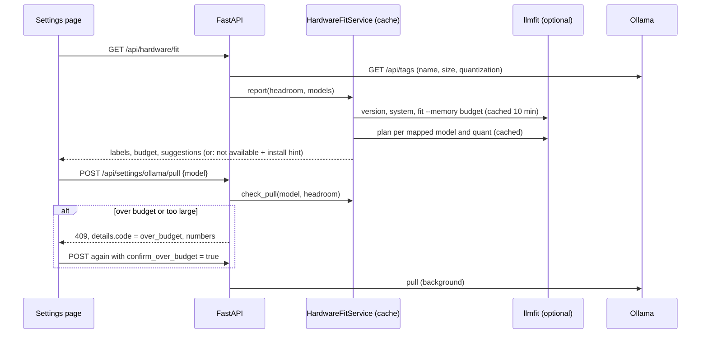

# MH-3: Hardware fit API and pull warning

## Apply with the runner

The handoff runner applies this file: it writes the tests, runs the red command (it must fail), makes the changes, runs the checks, and commits. The runner does not push.

Apply this handoff (WSL, from `apps/backend-py`):

```bash
.venv/bin/python scripts/run_handoff.py ../../tasks/active/step-6-llmfit/mh-3-hardware-api.md
```

## Why

MH-2 added the llmfit client and the fit rules. This handoff makes them reachable: `GET /api/hardware/fit` gives the Settings page the hardware, the safety budget, a label for each installed Ollama model, and suggestions. The pull route warns when a model is over the budget, and the user decides (user decision: warn and confirm). The 9B refusal stays.



## Decisions

- **Cache.** The hardware and the catalog are cached for 10 minutes per headroom value; each plan is cached per model and quantization. `refresh=true` clears both. The MH-2 smoke run took 11.7 s without a cache. One catalog run serves both the mapping and the suggestions, because `fit --memory <budget>` returns every row.
- **Plans in parallel.** Up to 4 plans run at the same time. llmfit loads no model, so the GPU load is zero.
- **Installed quantization.** `ollama_admin.list_models` now also returns `quantization` (Ollama `details.quantization_level`), so the plan uses the real file.
- **Pull check.** The quantization comes from the tag (`-q8_0`, `-fp16`), or Q4_K_M by default. A tag that llmfit does not know, or a missing llmfit, gives no warning, and the pull goes on as before. An over-budget or too-large model gets 409 with `details.code = "over_budget"` and the numbers, and no pull slot is taken. `confirm_over_budget: true` skips the check.
- **Errors.** The 409 body has the same shape as the other errors (`error`, `message`, `details`, `timestamp`), so the frontend reads it the same way.
- **Tests never run a real llmfit.** A new autouse fixture in `tests/conftest.py` points `LLMFIT_PATH` at a missing file and resets the service, so a developer's own llmfit cannot change a test result.

## Files

- `apps/backend-py/tests/unit/test_hardware_service.py` (new)
- `apps/backend-py/src/hardware/service.py` (new)
- `apps/backend-py/src/api/routes/hardware.py` (new)
- `apps/backend-py/src/api/routes/settings.py`, `src/api/main.py`, `src/api/ollama_admin.py`, `tests/conftest.py` (change)

## Step 1: add the tests, run them, and see them fail

```python new=apps/backend-py/tests/unit/test_hardware_service.py
"""
Tests for the hardware fit service, its route, and the pull warning
(Step 6, MH-3).

A stub client stands in for llmfit, with made-up hardware (8 GB of VRAM, so
the default budget is 6 GB).
"""

import json
from typing import Any, Dict, List, Optional, Tuple
from unittest.mock import MagicMock, patch

import pytest
from fastapi.testclient import TestClient

from src.api import ollama_admin
from src.hardware import service as hardware_service
from src.hardware.fit import FitLabel, FitSource
from src.hardware.llmfit_client import (
    CatalogModel,
    HardwareProfile,
    LlmfitUnavailable,
    QuantPlan,
)
from src.hardware.service import (
    INSTALL_HINT,
    HardwareFitService,
    quant_from_tag,
)

PLAN_NEEDS = {
    ("example/Chat-7B", "Q4_K_M"): 5.35,
    ("example/Reason-8B", "Q4_K_M"): 6.2,
    ("example/Big-14B", "Q4_K_M"): 10.6,
}

CATALOG = [
    CatalogModel(
        name="example/Chat-7B",
        ollama_name="examplechat:7b",
        runtime="llama.cpp",
        best_quant="Q4_K_M",
        memory_required_gb=5.3,
        score=80.0,
        params_b=7.0,
    ),
    CatalogModel(
        name="example/Reason-8B",
        ollama_name="examplereason:8b",
        runtime="llama.cpp",
        best_quant="Q4_K_M",
        memory_required_gb=5.9,
        score=85.0,
        params_b=8.0,
    ),
    CatalogModel(
        name="example/Big-14B",
        ollama_name="examplebig:14b",
        runtime="llama.cpp",
        best_quant="Q2_K",
        memory_required_gb=5.8,
        score=70.0,
        params_b=14.0,
    ),
    CatalogModel(
        name="example/Small-3B",
        ollama_name="examplesmall:3b",
        runtime="llama.cpp",
        best_quant="Q8_0",
        memory_required_gb=4.0,
        score=75.0,
        params_b=3.0,
    ),
]

INSTALLED: List[Dict[str, Any]] = [
    {"name": "examplechat:7b", "size": 4_680_000_000, "quantization": "Q4_K_M"},
    {"name": "examplereason:8b", "size": 5_230_000_000, "quantization": "Q4_K_M"},
    {"name": "mine-16k:latest", "size": 6_590_000_000, "quantization": "Q4_K_M"},
]


class StubClient:
    """Answers like LlmfitClient and counts the calls."""

    def __init__(self, unavailable: Optional[str] = None) -> None:
        """
        Initialize the stub.

        Args:
            unavailable: When set, every call raises LlmfitUnavailable.
        """
        self.unavailable = unavailable
        self.calls: List[Tuple[str, Any]] = []

    def _check(self) -> None:
        """Raise when the stub plays a missing llmfit."""
        if self.unavailable:
            raise LlmfitUnavailable(self.unavailable)

    def version(self) -> Tuple[int, int, int]:
        """Return the minimum version."""
        self._check()
        self.calls.append(("version", None))
        return (1, 1, 20)

    def system(self) -> HardwareProfile:
        """Return made-up hardware with 8 GB of VRAM."""
        self._check()
        self.calls.append(("system", None))
        return HardwareProfile(
            has_gpu=True, gpu_name="Example GPU", gpu_vram_gb=8.0, total_ram_gb=32.0
        )

    def catalog(self, memory_gb: Optional[float] = None) -> List[CatalogModel]:
        """Return the stub catalog and record the budget."""
        self._check()
        self.calls.append(("catalog", memory_gb))
        return list(CATALOG)

    def plan(self, model_name: str, quantization: str, context: int) -> QuantPlan:
        """Return a plan from PLAN_NEEDS, or raise for an unknown pair."""
        self._check()
        self.calls.append(("plan", (model_name, quantization)))
        need = PLAN_NEEDS.get((model_name, quantization))
        if need is None:
            raise LlmfitUnavailable("no plan")
        return QuantPlan(
            model_name=model_name,
            quantization=quantization,
            context=context,
            min_vram_gb=need,
        )

    def count(self, kind: str) -> int:
        """
        Count the calls of one kind.

        Args:
            kind: version, system, catalog, or plan.

        Returns:
            The number of calls.
        """
        return sum(1 for name, _ in self.calls if name == kind)


class FakeClock:
    """A clock that tests move by hand."""

    def __init__(self) -> None:
        """Start at zero."""
        self.now = 0.0

    def __call__(self) -> float:
        """Return the current time."""
        return self.now


def make_service(
    stub: StubClient, clock: Optional[FakeClock] = None
) -> HardwareFitService:
    """
    Build a service that uses the stub client.

    Args:
        stub: Stub llmfit client.
        clock: Fake clock, or None for a new one.

    Returns:
        The service.
    """
    return HardwareFitService(
        client_factory=lambda: stub,
        max_params_billion=9.0,
        clock=clock or FakeClock(),
    )


class TestReport:
    """The report for the Settings page."""

    def test_labels_and_suggestions(self) -> None:
        """Plans label mapped models; the file size labels the others."""
        stub = StubClient()
        report = make_service(stub).report(75, INSTALLED, True)
        assert report.available is True
        assert report.llmfit_version == "1.1.20"
        assert report.budget_gb == 6.0
        assert ("catalog", 6.0) in stub.calls
        by_name = {fit.name: fit for fit in report.installed}
        assert by_name["examplechat:7b"].label == FitLabel.FITS
        assert by_name["examplechat:7b"].source == FitSource.LLMFIT_PLAN
        assert by_name["examplereason:8b"].label == FitLabel.OVER_BUDGET
        assert by_name["examplereason:8b"].need_gb == 6.2
        assert by_name["mine-16k:latest"].source == FitSource.ROUGH_ESTIMATE
        assert by_name["mine-16k:latest"].label == FitLabel.OVER_BUDGET
        # examplebig is 14B at Q2_K; examplesmall fits and is not installed.
        assert [s.ollama_name for s in report.suggestions] == ["examplesmall:3b"]

    def test_unavailable_gives_a_reason_and_a_hint(self) -> None:
        """Without llmfit the report says why and how to install it."""
        report = make_service(StubClient(unavailable="llmfit is not installed")).report(
            75, INSTALLED, True
        )
        assert report.available is False
        assert report.reason == "llmfit is not installed"
        assert report.install_hint == INSTALL_HINT
        assert "llmfit==1.1.20" in INSTALL_HINT
        assert report.installed == []

    def test_a_failed_plan_falls_back_to_the_file_size(self) -> None:
        """A model that llmfit cannot plan still gets a rough label."""
        installed = [{"name": "examplechat:7b", "size": 4_680_000_000}]
        installed[0]["quantization"] = "Q5_K_M"
        report = make_service(StubClient()).report(75, installed, True)
        assert report.installed[0].source == FitSource.ROUGH_ESTIMATE
        assert report.installed[0].need_gb == 5.68


class TestCache:
    """The cache keeps llmfit calls rare."""

    def test_second_report_uses_the_cache(self) -> None:
        """Hardware, catalog, and plans run once within the cache period."""
        stub = StubClient()
        service = make_service(stub)
        service.report(75, INSTALLED, True)
        service.report(75, INSTALLED, True)
        assert stub.count("system") == 1
        assert stub.count("catalog") == 1
        assert stub.count("plan") == 2

    def test_refresh_and_expiry_run_llmfit_again(self) -> None:
        """refresh=True and an old cache both run llmfit again."""
        stub = StubClient()
        clock = FakeClock()
        service = make_service(stub, clock)
        service.report(75, INSTALLED, True)
        service.report(75, INSTALLED, True, refresh=True)
        assert stub.count("catalog") == 2
        assert stub.count("plan") == 4
        clock.now = hardware_service.CACHE_SECONDS + 1
        service.report(75, INSTALLED, True)
        assert stub.count("catalog") == 3

    def test_a_new_headroom_scores_a_new_budget(self) -> None:
        """Each headroom value has its own catalog run."""
        stub = StubClient()
        service = make_service(stub)
        service.report(75, INSTALLED, True)
        report = service.report(90, INSTALLED, True)
        assert ("catalog", 7.2) in stub.calls
        by_name = {fit.name: fit for fit in report.installed}
        assert by_name["examplereason:8b"].label == FitLabel.FITS


class TestPullCheck:
    """The check before a pull."""

    @pytest.mark.parametrize(
        ("tag", "quant"),
        [
            ("qwen2.5:7b", "Q4_K_M"),
            ("llama3.1:8b-instruct-q8_0", "Q8_0"),
            ("phi3:mini-fp16", "F16"),
            ("model:3b-iq3_xs", "IQ3_XS"),
        ],
    )
    def test_quant_from_tag(self, tag: str, quant: str) -> None:
        """A quant in the tag wins; otherwise the default Q4_K_M."""
        assert quant_from_tag(tag) == quant

    def test_over_budget(self) -> None:
        """A mapped model above the budget is over_budget, with the numbers."""
        check = make_service(StubClient()).check_pull("examplereason:8b", 75)
        assert check is not None
        assert check.label == FitLabel.OVER_BUDGET
        assert check.need_gb == 6.2
        assert check.budget_gb == 6.0
        assert check.total_vram_gb == 8.0

    def test_too_large(self) -> None:
        """A model above the total VRAM is too_large."""
        check = make_service(StubClient()).check_pull("examplebig:14b", 75)
        assert check is not None
        assert check.label == FitLabel.TOO_LARGE

    def test_unknown_tag_or_no_llmfit_gives_no_check(self) -> None:
        """No data means no warning."""
        assert make_service(StubClient()).check_pull("other:7b", 75) is None
        missing = make_service(StubClient(unavailable="llmfit is not installed"))
        assert missing.check_pull("examplereason:8b", 75) is None


def _stream_response(events: List[dict]) -> MagicMock:
    """
    Build a mock streaming response for ``requests.post``.

    Args:
        events: NDJSON events that Ollama would send.

    Returns:
        Context-manager mock whose ``iter_lines`` yields the events.
    """
    response = MagicMock()
    response.iter_lines.return_value = [json.dumps(e).encode() for e in events]
    response.__enter__.return_value = response
    return response


@pytest.fixture
def stub_service(monkeypatch: pytest.MonkeyPatch) -> HardwareFitService:
    """
    Make the routes use a service with the stub client.

    Args:
        monkeypatch: Pytest monkeypatch fixture.

    Returns:
        The service.
    """
    service = make_service(StubClient())
    monkeypatch.setattr(hardware_service, "get_fit_service", lambda: service)
    return service


@pytest.fixture(autouse=True)
def reset_pull_state():
    """
    Free the pull slot and clear state around each test.

    Yields:
        None.
    """
    yield
    if ollama_admin._pull_lock.locked():
        ollama_admin._pull_lock.release()
    ollama_admin._pull_state.clear()
    ollama_admin._pull_state["status"] = "idle"


class TestRoutes:
    """GET /api/hardware/fit and the pull warning."""

    def test_fit_route_without_llmfit(self, client: TestClient) -> None:
        """No llmfit (the conftest hides any real binary): available is false."""
        listing = {"host": "h", "reachable": False, "models": [], "in_use": []}
        with patch.object(ollama_admin, "list_models", return_value=listing):
            body = client.get("/api/hardware/fit").json()
        assert body["available"] is False
        assert body["reason"] == "llmfit is not installed"
        assert "llmfit==1.1.20" in body["install_hint"]
        assert body["headroom_percent"] == 75
        assert body["ollama_reachable"] is False

    def test_fit_route_with_llmfit(
        self, client: TestClient, stub_service: HardwareFitService
    ) -> None:
        """The route passes the installed models and the headroom setting."""
        listing = {"host": "h", "reachable": True, "models": INSTALLED, "in_use": []}
        with patch.object(ollama_admin, "list_models", return_value=listing):
            body = client.get("/api/hardware/fit").json()
        assert body["available"] is True
        assert body["budget_gb"] == 6.0
        assert body["hardware"]["gpu_name"] == "Example GPU"
        labels = {fit["name"]: fit["label"] for fit in body["installed"]}
        assert labels["examplereason:8b"] == "over_budget"
        assert body["suggestions"][0]["ollama_name"] == "examplesmall:3b"

    def test_list_models_reports_the_quantization(self) -> None:
        """ollama_admin passes the quantization of each installed model."""
        tags = {
            "models": [
                {
                    "name": "x:7b",
                    "size": 1,
                    "details": {"parameter_size": "7B", "quantization_level": "Q4_0"},
                }
            ]
        }
        response = MagicMock()
        response.json.return_value = tags
        with patch.object(ollama_admin.requests, "get", return_value=response):
            listing = ollama_admin.list_models("localhost:11434", set())
        assert listing["models"][0]["quantization"] == "Q4_0"

    def test_over_budget_pull_asks_to_confirm(
        self, client: TestClient, stub_service: HardwareFitService
    ) -> None:
        """A model over the budget gets 409 and no pull starts."""
        response = client.post(
            "/api/settings/ollama/pull", json={"model": "examplereason:8b"}
        )
        assert response.status_code == 409
        body = response.json()
        assert body["details"]["code"] == "over_budget"
        assert body["details"]["need_gb"] == 6.2
        assert body["details"]["budget_gb"] == 6.0
        assert "safety budget of 6.0 GB (75% of 8.0 GB)" in body["message"]
        assert ollama_admin.get_pull_state()["status"] == "idle"

    def test_too_large_pull_names_the_total(
        self, client: TestClient, stub_service: HardwareFitService
    ) -> None:
        """Above the total VRAM, the message names the total."""
        with patch.object(ollama_admin, "check_pull_allowed", return_value=None):
            response = client.post(
                "/api/settings/ollama/pull", json={"model": "examplebig:14b"}
            )
        assert response.status_code == 409
        assert "total GPU memory of 8.0 GB" in response.json()["message"]

    def test_confirmed_pull_starts(
        self, client: TestClient, stub_service: HardwareFitService
    ) -> None:
        """confirm_over_budget lets the pull start."""
        with patch.object(
            ollama_admin.requests,
            "post",
            return_value=_stream_response([{"status": "success"}]),
        ):
            response = client.post(
                "/api/settings/ollama/pull",
                json={"model": "examplereason:8b", "confirm_over_budget": True},
            )
        assert response.status_code == 202
        assert response.json()["model"] == "examplereason:8b"

    def test_a_pull_that_fits_starts(
        self, client: TestClient, stub_service: HardwareFitService
    ) -> None:
        """A model within the budget needs no confirmation."""
        with patch.object(
            ollama_admin.requests,
            "post",
            return_value=_stream_response([{"status": "success"}]),
        ):
            response = client.post(
                "/api/settings/ollama/pull", json={"model": "examplechat:7b"}
            )
        assert response.status_code == 202
```

```bash red cwd=apps/backend-py
.venv/bin/python -m pytest -q -p no:cacheprovider tests/unit/test_hardware_service.py
```

## Step 2: add the service and the route

```python new=apps/backend-py/src/hardware/service.py
"""
Job Raider - Hardware Fit Service

This module joins the llmfit client, the fit rules, and the installed Ollama
models into one report for the Settings page, and checks a pull against the
safety budget. llmfit is slow (about 0.8 s per ``plan`` and 2.5 s per catalog
run), so the service caches the hardware and the catalog for each headroom
value, and caches each plan per model and quantization.
"""

import re
import threading
import time
from concurrent.futures import ThreadPoolExecutor
from dataclasses import dataclass
from typing import Any, Callable, Dict, List, Mapping, Optional, Sequence, Tuple

from pydantic import BaseModel, Field

from ..api.ollama_admin import MAX_PARAMS_BILLION
from .fit import (
    FitLabel,
    FitSource,
    InstalledFit,
    Suggestion,
    catalog_by_ollama_name,
    label_for,
    label_installed,
    ollama_key,
    suggest_models,
    vram_budget_gb,
)
from .llmfit_client import (
    LLMFIT_MIN_VERSION,
    CatalogModel,
    HardwareProfile,
    LlmfitClient,
    LlmfitUnavailable,
)

CACHE_SECONDS = 600.0
"""How long the hardware and the catalog stay cached."""

PLAN_CONTEXT_TOKENS = 8192
"""Context length for each plan. The MH-1 measure used the same value."""

DEFAULT_PULL_QUANT = "Q4_K_M"
"""Quantization of most default Ollama tags, used when a tag names none."""

PLAN_WORKERS = 4
"""Plans that run at the same time. llmfit loads no model, so the load is small."""

INSTALL_HINT = (
    "llmfit is optional and recommended. Run ./setup.sh, or install it into the "
    "backend environment: apps/backend-py/.venv/bin/pip install "
    "llmfit==" + ".".join(str(part) for part in LLMFIT_MIN_VERSION)
)

_TAG_QUANT_RE = re.compile(r"(iq\d_[a-z0-9_]+|q\d_[a-z0-9_]+|f16|fp16|bf16)")


class HardwareFitReport(BaseModel):
    """Hardware fit for the Settings page."""

    available: bool
    reason: Optional[str] = None
    install_hint: Optional[str] = None
    llmfit_version: Optional[str] = None
    hardware: Optional[HardwareProfile] = None
    headroom_percent: int
    budget_gb: float = 0.0
    ollama_reachable: bool = True
    installed: List[InstalledFit] = Field(default_factory=list)
    suggestions: List[Suggestion] = Field(default_factory=list)


class PullCheck(BaseModel):
    """Fit of a model that the user wants to pull."""

    tag: str
    quantization: str
    label: FitLabel
    need_gb: Optional[float] = None
    budget_gb: float
    total_vram_gb: Optional[float] = None
    headroom_percent: int
    source: FitSource


@dataclass
class _Snapshot:
    """Cached llmfit results for one headroom value."""

    version: str
    hardware: HardwareProfile
    budget_gb: float
    catalog: List[CatalogModel]
    index: Dict[str, CatalogModel]
    created: float


def quant_from_tag(tag: str) -> str:
    """
    Read the quantization from an Ollama tag, such as ``llama3.1:8b-q8_0``.

    Args:
        tag: Ollama tag.

    Returns:
        The quantization in upper case, or ``DEFAULT_PULL_QUANT`` if the tag
        names none.
    """
    match = _TAG_QUANT_RE.search(tag.lower())
    if not match:
        return DEFAULT_PULL_QUANT
    found = match.group(1).upper()
    return "F16" if found == "FP16" else found


class HardwareFitService:
    """Build hardware fit reports with caching."""

    def __init__(
        self,
        client_factory: Callable[[], LlmfitClient] = LlmfitClient,
        max_params_billion: float = MAX_PARAMS_BILLION,
        cache_seconds: float = CACHE_SECONDS,
        clock: Callable[[], float] = time.monotonic,
    ):
        """
        Initialize the service.

        Args:
            client_factory: Makes an llmfit client. Tests pass a stub.
            max_params_billion: The pull limit; larger models are not suggested.
            cache_seconds: How long the hardware and the catalog stay cached.
            clock: Monotonic clock in seconds. Tests pass a fake clock.
        """
        self._client_factory = client_factory
        self._max_params_billion = max_params_billion
        self._cache_seconds = cache_seconds
        self._clock = clock
        self._lock = threading.Lock()
        self._snapshots: Dict[int, _Snapshot] = {}
        self._plans: Dict[Tuple[str, str], Optional[float]] = {}

    def _snapshot(
        self, client: LlmfitClient, headroom_percent: int, refresh: bool
    ) -> _Snapshot:
        """
        Get the hardware and the catalog for one headroom value.

        Args:
            client: llmfit client.
            headroom_percent: Share of the VRAM that a model may use.
            refresh: True to ignore the cache (also clears cached plans).

        Returns:
            The cached or new snapshot.

        Raises:
            LlmfitUnavailable: llmfit cannot answer.
        """
        with self._lock:
            if refresh:
                self._snapshots.clear()
                self._plans.clear()
            cached = self._snapshots.get(headroom_percent)
            if cached and self._clock() - cached.created < self._cache_seconds:
                return cached
        version = ".".join(str(part) for part in client.version())
        hardware = client.system()
        budget = vram_budget_gb(hardware.gpu_vram_gb, headroom_percent)
        catalog = client.catalog(memory_gb=budget if budget > 0 else None)
        snapshot = _Snapshot(
            version=version,
            hardware=hardware,
            budget_gb=budget,
            catalog=catalog,
            index=catalog_by_ollama_name(catalog),
            created=self._clock(),
        )
        with self._lock:
            self._snapshots[headroom_percent] = snapshot
        return snapshot

    def _plan_need(
        self, client: LlmfitClient, model_name: str, quantization: str
    ) -> Optional[float]:
        """
        Get the minimum VRAM of one model at one quantization, with a cache.

        Args:
            client: llmfit client.
            model_name: llmfit catalog name.
            quantization: Quantization of the file.

        Returns:
            Minimum VRAM in GB, or None when llmfit has no plan for it.
        """
        key = (model_name, quantization.upper())
        with self._lock:
            if key in self._plans:
                return self._plans[key]
        try:
            need: Optional[float] = client.plan(
                model_name, key[1], PLAN_CONTEXT_TOKENS
            ).min_vram_gb
        except LlmfitUnavailable:
            need = None
        with self._lock:
            self._plans[key] = need
        return need

    def report(
        self,
        headroom_percent: int,
        installed_models: Sequence[Mapping[str, Any]],
        ollama_reachable: bool,
        refresh: bool = False,
    ) -> HardwareFitReport:
        """
        Build the hardware fit report.

        Args:
            headroom_percent: Share of the VRAM that a model may use.
            installed_models: Models from ``ollama_admin.list_models`` (``name``,
                ``size``, ``quantization``).
            ollama_reachable: False when Ollama did not answer.
            refresh: True to run llmfit again instead of using the cache.

        Returns:
            The report. ``available`` is False, with a reason and an install
            hint, when llmfit cannot answer.
        """
        client = self._client_factory()
        try:
            snap = self._snapshot(client, headroom_percent, refresh)
        except LlmfitUnavailable as exc:
            return HardwareFitReport(
                available=False,
                reason=str(exc),
                install_hint=INSTALL_HINT,
                headroom_percent=headroom_percent,
                ollama_reachable=ollama_reachable,
            )

        def need_for(model: Mapping[str, Any]) -> Optional[float]:
            """Plan the installed quantization of a model that maps to llmfit."""
            row = snap.index.get(ollama_key(str(model["name"])))
            quant = model.get("quantization")
            if row is None or not quant:
                return None
            return self._plan_need(client, row.name, str(quant))

        with ThreadPoolExecutor(max_workers=PLAN_WORKERS) as pool:
            needs = list(pool.map(need_for, installed_models))

        total = snap.hardware.gpu_vram_gb
        installed = [
            label_installed(
                str(model["name"]),
                model.get("quantization"),
                model.get("size"),
                need,
                snap.budget_gb,
                total,
            )
            for model, need in zip(installed_models, needs)
        ]
        suggestions = suggest_models(
            snap.catalog,
            snap.budget_gb,
            [str(model["name"]) for model in installed_models],
            self._max_params_billion,
        )
        return HardwareFitReport(
            available=True,
            llmfit_version=snap.version,
            hardware=snap.hardware,
            headroom_percent=headroom_percent,
            budget_gb=snap.budget_gb,
            ollama_reachable=ollama_reachable,
            installed=installed,
            suggestions=suggestions,
        )

    def check_pull(self, tag: str, headroom_percent: int) -> Optional[PullCheck]:
        """
        Check a model that the user wants to pull against the budget.

        Args:
            tag: Ollama tag to pull.
            headroom_percent: Share of the VRAM that a model may use.

        Returns:
            The check, or None when llmfit cannot answer or does not know the
            tag. None means "no warning": the pull goes on as before.
        """
        client = self._client_factory()
        try:
            snap = self._snapshot(client, headroom_percent, refresh=False)
        except LlmfitUnavailable:
            return None
        row = snap.index.get(ollama_key(tag))
        if row is None:
            return None
        quant = quant_from_tag(tag)
        need = self._plan_need(client, row.name, quant)
        total = snap.hardware.gpu_vram_gb
        return PullCheck(
            tag=tag,
            quantization=quant,
            label=label_for(need, snap.budget_gb, total),
            need_gb=None if need is None else round(need, 2),
            budget_gb=snap.budget_gb,
            total_vram_gb=total,
            headroom_percent=headroom_percent,
            source=FitSource.LLMFIT_PLAN if need is not None else FitSource.NONE,
        )


_service: Optional[HardwareFitService] = None
_service_lock = threading.Lock()


def get_fit_service() -> HardwareFitService:
    """
    Get the process-wide service, so the cache is shared by all requests.

    Returns:
        The service.
    """
    global _service
    with _service_lock:
        if _service is None:
            _service = HardwareFitService()
        return _service
```
```python new=apps/backend-py/src/api/routes/hardware.py
"""
Job Raider - Hardware Fit Routes

``GET /api/hardware/fit`` tells which installed Ollama models fit the user's
safety budget of GPU memory, and suggests models to pull. llmfit is optional:
without it, the report says so and gives an install hint.
"""

from fastapi import APIRouter
from fastapi.concurrency import run_in_threadpool

from ...hardware import service as hardware_service
from ...hardware.service import HardwareFitReport
from .. import ollama_admin
from ..ollama_models import resolve_effective_ollama_host
from ..settings import get_storage

router = APIRouter()


@router.get("/fit", response_model=HardwareFitReport)
async def hardware_fit(refresh: bool = False) -> HardwareFitReport:
    """
    Get the hardware fit report.

    The first call runs llmfit and can take several seconds. Later calls use
    the cache for 10 minutes, unless ``refresh`` is true.

    Args:
        refresh: True to run llmfit again instead of using the cache.

    Returns:
        The hardware, the safety budget, a label for each installed model,
        and suggestions.
    """
    settings = get_storage().load_settings()
    host = resolve_effective_ollama_host(settings.api_config.ollama_host)
    listing = await run_in_threadpool(ollama_admin.list_models, host, set())
    return await run_in_threadpool(
        hardware_service.get_fit_service().report,
        settings.hardware.vram_headroom_percent,
        listing["models"],
        bool(listing["reachable"]),
        refresh,
    )
```

## Step 3: wire the route, the pull warning, the quantization, and the test guard

```python edit=apps/backend-py/src/api/routes/settings.py
<<<<<<< OLD
from typing import Any, Dict, List, Optional, Set, Tuple

from fastapi import APIRouter, BackgroundTasks, HTTPException
from fastapi.concurrency import run_in_threadpool
=======
from typing import Any, Dict, List, Optional, Set, Tuple, Union

from fastapi import APIRouter, BackgroundTasks, HTTPException
from fastapi.concurrency import run_in_threadpool
from fastapi.encoders import jsonable_encoder
from fastapi.responses import JSONResponse
>>>>>>> NEW
```
```python edit=apps/backend-py/src/api/routes/settings.py
<<<<<<< OLD
from ...api import ollama_admin
=======
from ...api import ollama_admin
from ...api.models.responses import ErrorResponse
>>>>>>> NEW
```
```python edit=apps/backend-py/src/api/routes/settings.py
<<<<<<< OLD
from ...config.loader import get_config_loader
=======
from ...config.loader import get_config_loader
from ...hardware import service as hardware_service
from ...hardware.fit import FitLabel
from ...hardware.service import PullCheck
>>>>>>> NEW
```
```python edit=apps/backend-py/src/api/routes/settings.py
<<<<<<< OLD
    model: str = Field(description="Model tag, for example qwen2.5:3b")
=======
    model: str = Field(description="Model tag, for example qwen2.5:3b")
    confirm_over_budget: bool = Field(
        default=False,
        description="Pull even when the model is over the GPU memory budget",
    )
>>>>>>> NEW
```
```python edit=apps/backend-py/src/api/routes/settings.py
<<<<<<< OLD
@router.post("/ollama/pull", status_code=202, response_model=Dict[str, Any])
async def pull_ollama_model(
    body: OllamaPullRequest, background_tasks: BackgroundTasks
) -> Dict[str, Any]:
    """
    Start pulling an Ollama model in the background.

    Only one pull runs at a time. Models of 9B parameters or more are refused.

    Args:
        body: Model tag to pull.
        background_tasks: FastAPI background task runner.

    Returns:
        The pull state after the pull starts.
    """
    host, _used = _ollama_context()
    try:
        name = ollama_admin.validate_model_name(body.model)
        ollama_admin.check_pull_allowed(name)
        state = ollama_admin.begin_pull(name)
    except ollama_admin.OllamaAdminError as exc:
        raise HTTPException(status_code=exc.status_code, detail=str(exc)) from exc
=======
def _over_budget_response(check: PullCheck) -> JSONResponse:
    """
    Build the 409 answer that asks the user to confirm a large pull.

    Args:
        check: Fit of the model against the safety budget.

    Returns:
        JSON error response; ``details.code`` is ``over_budget`` and the other
        details give the numbers for the confirm dialog.
    """
    limit = (
        f"the total GPU memory of {check.total_vram_gb:.1f} GB"
        if check.label == FitLabel.TOO_LARGE
        else f"your safety budget of {check.budget_gb:.1f} GB "
        f"({check.headroom_percent}% of {check.total_vram_gb:.1f} GB)"
    )
    error = ErrorResponse(
        error="Over budget",
        message=(
            f"{check.tag} needs about {check.need_gb:.1f} GB of GPU memory, "
            f"above {limit}. Confirm to pull it anyway."
        ),
        details={"code": "over_budget", **check.model_dump(mode="json")},
    )
    return JSONResponse(status_code=409, content=jsonable_encoder(error))


@router.post("/ollama/pull", status_code=202, response_model=Dict[str, Any])
async def pull_ollama_model(
    body: OllamaPullRequest, background_tasks: BackgroundTasks
) -> Union[Dict[str, Any], JSONResponse]:
    """
    Start pulling an Ollama model in the background.

    Only one pull runs at a time. Models of 9B parameters or more are refused.
    When llmfit is installed and the model needs more GPU memory than the
    safety budget, the answer is 409 until the request has
    ``confirm_over_budget``.

    Args:
        body: Model tag to pull, and the confirmation flag.
        background_tasks: FastAPI background task runner.

    Returns:
        The pull state after the pull starts, or the 409 answer.
    """
    host, _used = _ollama_context()
    try:
        name = ollama_admin.validate_model_name(body.model)
        ollama_admin.check_pull_allowed(name)
    except ollama_admin.OllamaAdminError as exc:
        raise HTTPException(status_code=exc.status_code, detail=str(exc)) from exc
    if not body.confirm_over_budget:
        headroom = get_storage().load_settings().hardware.vram_headroom_percent
        check = await run_in_threadpool(
            hardware_service.get_fit_service().check_pull, name, headroom
        )
        if check is not None and check.label in (
            FitLabel.OVER_BUDGET,
            FitLabel.TOO_LARGE,
        ):
            return _over_budget_response(check)
    try:
        state = ollama_admin.begin_pull(name)
    except ollama_admin.OllamaAdminError as exc:
        raise HTTPException(status_code=exc.status_code, detail=str(exc)) from exc
>>>>>>> NEW
```
```python edit=apps/backend-py/src/api/main.py
<<<<<<< OLD
    evaluation,
    jobs,
=======
    evaluation,
    hardware,
    jobs,
>>>>>>> NEW
```
```python edit=apps/backend-py/src/api/main.py
<<<<<<< OLD
app.include_router(logs.router, prefix="/api/logs", tags=["Logs"], dependencies=_auth)
=======
app.include_router(logs.router, prefix="/api/logs", tags=["Logs"], dependencies=_auth)
app.include_router(
    hardware.router, prefix="/api/hardware", tags=["Hardware"], dependencies=_auth
)
>>>>>>> NEW
```
```python edit=apps/backend-py/tests/conftest.py
<<<<<<< OLD


@pytest.fixture(autouse=True)
def _bypass_api_auth_except_auth_tests(request):
=======


@pytest.fixture(autouse=True)
def _no_real_llmfit(tmp_path: Path, monkeypatch: pytest.MonkeyPatch):
    """
    Keep tests away from a real llmfit binary on the developer's machine.

    ``LLMFIT_PATH`` points at a missing file, so ``find_llmfit()`` gives None,
    and the cached hardware fit service is reset. Tests that need llmfit
    pass a fake binary or a stub client.

    Args:
        tmp_path: Pytest temporary directory for this test.
        monkeypatch: Pytest monkeypatch fixture.

    Yields:
        None.
    """
    import src.hardware.service as hardware_service

    monkeypatch.setenv("LLMFIT_PATH", str(tmp_path / "no-llmfit"))
    monkeypatch.setattr(hardware_service, "_service", None)
    yield


@pytest.fixture(autouse=True)
def _bypass_api_auth_except_auth_tests(request):
>>>>>>> NEW
```
```python edit=apps/backend-py/src/api/ollama_admin.py
<<<<<<< OLD
            "parameter_size": (m.get("details") or {}).get("parameter_size"),
=======
            "parameter_size": (m.get("details") or {}).get("parameter_size"),
            "quantization": (m.get("details") or {}).get("quantization_level"),
>>>>>>> NEW
```

## Step 4: checks

```bash check cwd=apps/backend-py
.venv/bin/python -m pytest -q -p no:cacheprovider tests/unit/test_hardware_service.py tests/unit/test_hardware_fit.py tests/unit/test_llmfit_client.py tests/unit/test_ollama_admin.py tests/unit/test_settings_api.py tests/unit/test_settings_secrets_redaction.py tests/unit/test_settings_delete_api_key.py tests/unit/test_auth.py
```

```bash check cwd=apps/backend-py
.venv/bin/python -m black --check src/hardware/service.py src/api/routes/hardware.py tests/unit/test_hardware_service.py src/api/main.py src/api/ollama_admin.py src/api/routes/settings.py tests/conftest.py
```

```bash check cwd=apps/backend-py
.venv/bin/python -m ruff check src/hardware/service.py src/api/routes/hardware.py tests/unit/test_hardware_service.py src/api/main.py src/api/ollama_admin.py src/api/routes/settings.py tests/conftest.py
```

```bash check cwd=apps/backend-py
.venv/bin/python scripts/mypy_gate.py
```

```text commit
feat(hardware): add the hardware fit API and a pull warning

GET /api/hardware/fit gives the hardware, the VRAM safety budget, a label
for each installed Ollama model, and suggestions. llmfit results are
cached for 10 minutes per headroom value, and plans per model and
quantization. Without llmfit the report says why and how to install it.

A pull of a model above the budget now answers 409 with the numbers,
until the request has confirm_over_budget. The 9B refusal stays. Ollama
model listings include the quantization. Tests never run a real llmfit.

Co-Authored-By: Claude Opus 5.5 <noreply@anthropic.com>
```
