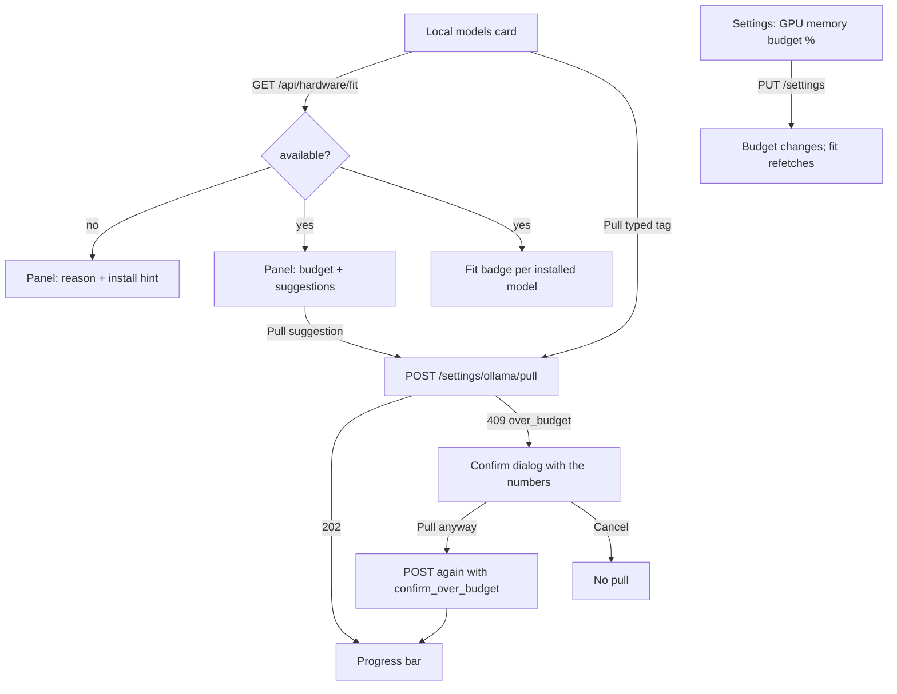

# MH-4: Hardware fit in Settings

## Apply with the runner

The handoff runner applies this file: it writes the tests, runs the red command (it must fail), makes the changes, runs the checks, and commits. The runner does not push.

Apply this handoff (WSL, from `apps/backend-py`):

```bash
.venv/bin/python scripts/run_handoff.py ../../tasks/active/step-6-llmfit/mh-4-settings-card.md
```

## Why

MH-3 added `GET /api/hardware/fit` and the over-budget 409 on a pull. This handoff shows them to the user, so each user decides with evidence which local models to use (open-source first, user's request):

- The Local models card labels each installed model: Fits, Over budget, Too large, or Unknown. The hover text gives the memory need and its source.
- A panel shows the safety budget and the models that fit it, each with a Pull button. Without llmfit, the panel says why and gives the install hint; the rest of the card works as before.
- A pull over the budget opens a confirm dialog with the backend's numbers. "Pull anyway" sends the pull again with `confirm_over_budget` (user decision: warn and confirm).
- Settings has a "GPU memory budget (%)" field (30 to 100, default 75).



## Decisions

- **One mock point.** `getHardwareFit` is in `settingsApi`, next to the other Local models calls.
- **Errors keep their details.** `ApiError` gets an optional `details` field from the JSON error body, so the card can read the 409 numbers. Every other caller works as before.
- **The existing card tests do not change.** They do not mock `getHardwareFit`, so the panel shows "Hardware fit could not load." and the rest of the card behaves as before. New tests cover the new behaviour.
- **Two pull mutations.** The first pull sends `{ model }` as before; only the confirmed pull sends `confirm_over_budget`.
- **The demo shows no invented GPU.** The demo data rule is "no invented GPU or host readings". So the demo answers the fit request with `available: false`, a reason, and the install hint. It now also lists the two sample models that its settings already name as installed. A pull in the demo still gets "not in the demo".
- **E2E mock.** The mock API answers the fit request, the model list, the pull status, and a pull: the suggestion `examplebig:8b` gets 409 until the request confirms.

## Files

- `apps/frontend-ts/tests/lib/hardware-fit.test.ts`, `tests/components/hardware-fit-card.test.tsx`, `tests/app/settings/hardware-fit-setting.test.tsx`, `tests/e2e/hardware-fit.spec.ts` (new)
- `apps/frontend-ts/src/lib/hardware-fit.ts`, `src/components/settings/hardware-fit-panel.tsx` (new)
- `src/lib/types/api.ts`, `src/lib/api/client.ts`, `src/lib/api/settings.ts`, `src/components/settings/ollama-models-card.tsx`, `src/app/settings/page.tsx`, `src/demo/data.ts`, `src/demo/handlers.ts`, `tests/demo/handlers.test.ts`, `tests/e2e/support/mock-api.ts` (change)

## Step 1: add the tests, run them, and see them fail

```ts new=apps/frontend-ts/tests/lib/hardware-fit.test.ts
/**
 * Tests for the hardware fit helpers (Step 6, MH-4).
 */

import { describe, expect, it } from "vitest";

import { ApiError } from "@/lib/api/client";
import {
  FIT_LABEL_TEXT,
  fitBadgeClass,
  fitTitle,
  overBudgetDetails,
} from "@/lib/hardware-fit";

const DETAILS = {
  code: "over_budget",
  tag: "examplereason:8b",
  quantization: "Q4_K_M",
  label: "over_budget",
  need_gb: 6.2,
  budget_gb: 6,
  total_vram_gb: 8,
  headroom_percent: 75,
};

describe("hardware fit helpers", () => {
  it("names and colours each label", () => {
    expect(FIT_LABEL_TEXT.fits).toBe("Fits");
    expect(FIT_LABEL_TEXT.over_budget).toBe("Over budget");
    expect(FIT_LABEL_TEXT.too_large).toBe("Too large");
    expect(fitBadgeClass("fits")).toContain("text-success");
    expect(fitBadgeClass("over_budget")).toContain("text-warning");
    expect(fitBadgeClass("too_large")).toContain("text-destructive");
  });

  it("says where the memory need comes from", () => {
    expect(
      fitTitle({
        name: "a",
        need_gb: 5.35,
        label: "fits",
        source: "llmfit_plan",
      }),
    ).toBe("Needs about 5.3 GB (llmfit plan)");
    expect(
      fitTitle({
        name: "b",
        need_gb: 7.59,
        label: "over_budget",
        source: "rough_estimate",
      }),
    ).toBe("Needs about 7.6 GB (rough estimate from size)");
    expect(
      fitTitle({ name: "c", need_gb: null, label: "unknown", source: "none" }),
    ).toBe("No estimate for this model");
  });

  it("reads the details of an over-budget 409", () => {
    const error = new ApiError(409, "needs about 6.2 GB", DETAILS);
    expect(overBudgetDetails(error)).toEqual(DETAILS);
  });

  it("ignores every other error", () => {
    expect(overBudgetDetails(new ApiError(409, "busy"))).toBeNull();
    expect(
      overBudgetDetails(new ApiError(400, "blocked", { ...DETAILS })),
    ).toBeNull();
    expect(
      overBudgetDetails(
        new ApiError(409, "other", { ...DETAILS, code: "pull_running" }),
      ),
    ).toBeNull();
    expect(overBudgetDetails(new Error("network"))).toBeNull();
  });
});
```
```tsx new=apps/frontend-ts/tests/components/hardware-fit-card.test.tsx
/**
 * Job Raider - hardware fit in the Local models card (Step 6, MH-4).
 *
 * Tests cover the fit badges, the budget line, the install hint without
 * llmfit, a pull from the suggestions, the over-budget confirm dialog, and
 * the refresh button. The hardware is made up (an 8 GB GPU).
 */

import { beforeEach, describe, expect, it, vi } from "vitest";
import { render, screen, waitFor, within } from "@testing-library/react";
import userEvent from "@testing-library/user-event";
import { QueryClient, QueryClientProvider } from "@tanstack/react-query";
import { toast } from "sonner";

import { OllamaModelsCard } from "@/components/settings/ollama-models-card";
import { ApiError } from "@/lib/api/client";
import type { HardwareFitReport, OllamaModelList } from "@/lib/types/api";

const mockList = vi.fn();
const mockPull = vi.fn();
const mockStatus = vi.fn();
const mockDelete = vi.fn();
const mockFit = vi.fn();

vi.mock("@/lib/api/settings", () => ({
  settingsApi: {
    listOllamaModels: (...a: unknown[]) => mockList(...a),
    pullOllamaModel: (...a: unknown[]) => mockPull(...a),
    getOllamaPullStatus: (...a: unknown[]) => mockStatus(...a),
    deleteOllamaModel: (...a: unknown[]) => mockDelete(...a),
    getHardwareFit: (...a: unknown[]) => mockFit(...a),
  },
}));

vi.mock("sonner", () => ({
  toast: { success: vi.fn(), error: vi.fn() },
}));

const LIST: OllamaModelList = {
  host: "localhost:11434",
  reachable: true,
  in_use: [],
  models: [
    {
      name: "examplechat:7b",
      size: 4_680_000_000,
      parameter_size: "7B",
      quantization: "Q4_K_M",
      in_use: false,
    },
    {
      name: "examplereason:8b",
      size: 5_230_000_000,
      parameter_size: "8B",
      quantization: "Q4_K_M",
      in_use: false,
    },
  ],
};

const FIT: HardwareFitReport = {
  available: true,
  llmfit_version: "1.1.20",
  hardware: {
    has_gpu: true,
    gpu_name: "Example GPU",
    gpu_vram_gb: 8,
    total_ram_gb: 32,
  },
  headroom_percent: 75,
  budget_gb: 6,
  ollama_reachable: true,
  installed: [
    {
      name: "examplechat:7b",
      quantization: "Q4_K_M",
      need_gb: 5.35,
      label: "fits",
      source: "llmfit_plan",
    },
    {
      name: "examplereason:8b",
      quantization: "Q4_K_M",
      need_gb: 6.2,
      label: "over_budget",
      source: "llmfit_plan",
    },
  ],
  suggestions: [
    {
      ollama_name: "examplebig:8b",
      category: "General",
      params_b: 8,
      memory_required_gb: 5.9,
      score: 84,
    },
  ],
};

const OVER_BUDGET = new ApiError(
  409,
  "examplebig:8b needs about 6.4 GB of GPU memory, above your safety budget of 6.0 GB (75% of 8.0 GB). Confirm to pull it anyway.",
  {
    code: "over_budget",
    tag: "examplebig:8b",
    quantization: "Q4_K_M",
    label: "over_budget",
    need_gb: 6.4,
    budget_gb: 6,
    total_vram_gb: 8,
    headroom_percent: 75,
  },
);

/**
 * Render the card inside a fresh query client.
 *
 * @returns The user-event instance.
 */
function renderCard() {
  const client = new QueryClient({
    defaultOptions: { queries: { retry: false }, mutations: { retry: false } },
  });
  render(
    <QueryClientProvider client={client}>
      <OllamaModelsCard />
    </QueryClientProvider>,
  );
  return userEvent.setup();
}

/**
 * Find the table row of one model.
 *
 * @param name - Model tag.
 * @returns The row element.
 */
async function rowOf(name: string): Promise<HTMLElement> {
  const cell = await screen.findByText(name);
  return cell.closest("tr") as HTMLElement;
}

describe("OllamaModelsCard hardware fit", () => {
  beforeEach(() => {
    vi.clearAllMocks();
    mockList.mockResolvedValue(LIST);
    mockStatus.mockResolvedValue({ status: "idle" });
    mockFit.mockResolvedValue(FIT);
  });

  it("labels each model and shows the budget", async () => {
    renderCard();

    const chat = within(await rowOf("examplechat:7b"));
    const reason = within(await rowOf("examplereason:8b"));
    expect(await chat.findByText("Fits")).toHaveAttribute(
      "title",
      "Needs about 5.3 GB (llmfit plan)",
    );
    expect(reason.getByText("Over budget")).toBeInTheDocument();
    const panel = screen.getByLabelText("Hardware fit");
    expect(panel).toHaveTextContent("Safety budget 6.0 GB of 8.0 GB");
    expect(panel).toHaveTextContent("(75%) on Example GPU");
    expect(panel).toHaveTextContent("llmfit 1.1.20");
  });

  it("explains how to install llmfit when it is missing", async () => {
    mockFit.mockResolvedValue({
      available: false,
      reason: "llmfit is not installed",
      install_hint: "Run ./setup.sh, or pip install llmfit==1.1.20",
      headroom_percent: 75,
      budget_gb: 0,
      ollama_reachable: true,
      installed: [],
      suggestions: [],
    } satisfies HardwareFitReport);
    renderCard();

    const panel = await screen.findByLabelText("Hardware fit");
    expect(panel).toHaveTextContent("optional and recommended");
    expect(panel).toHaveTextContent("llmfit is not installed");
    expect(panel).toHaveTextContent("pip install llmfit==1.1.20");
    // The models still list, with no fit label.
    const chat = within(await rowOf("examplechat:7b"));
    expect(chat.getByText("—")).toBeInTheDocument();
  });

  it("pulls a suggested model", async () => {
    mockPull.mockResolvedValue({ status: "pulling", model: "examplebig:8b" });
    const user = renderCard();

    await user.click(
      await screen.findByRole("button", { name: "Pull examplebig:8b" }),
    );

    await waitFor(() => expect(mockPull).toHaveBeenCalledWith("examplebig:8b"));
  });

  it("asks to confirm an over-budget pull, then pulls", async () => {
    mockPull
      .mockRejectedValueOnce(OVER_BUDGET)
      .mockResolvedValueOnce({ status: "pulling", model: "examplebig:8b" });
    const user = renderCard();

    await user.click(
      await screen.findByRole("button", { name: "Pull examplebig:8b" }),
    );
    const dialog = await screen.findByRole("alertdialog");
    expect(dialog).toHaveTextContent("Pull examplebig:8b anyway?");
    expect(dialog).toHaveTextContent("safety budget of 6.0 GB");
    expect(toast.error).not.toHaveBeenCalled();

    await user.click(
      within(dialog).getByRole("button", { name: "Pull anyway" }),
    );

    await waitFor(() =>
      expect(mockPull).toHaveBeenLastCalledWith("examplebig:8b", true),
    );
  });

  it("does not pull when the user cancels", async () => {
    mockPull.mockRejectedValueOnce(OVER_BUDGET);
    const user = renderCard();

    await user.click(
      await screen.findByRole("button", { name: "Pull examplebig:8b" }),
    );
    const dialog = await screen.findByRole("alertdialog");
    await user.click(within(dialog).getByRole("button", { name: "Cancel" }));

    await waitFor(() =>
      expect(screen.queryByRole("alertdialog")).not.toBeInTheDocument(),
    );
    expect(mockPull).toHaveBeenCalledTimes(1);
  });

  it("runs llmfit again on refresh", async () => {
    const user = renderCard();

    await user.click(
      await screen.findByRole("button", { name: "Refresh hardware fit" }),
    );

    await waitFor(() => expect(mockFit).toHaveBeenCalledWith(true));
  });
});
```
```tsx new=apps/frontend-ts/tests/app/settings/hardware-fit-setting.test.tsx
/**
 * Settings: the GPU memory budget field (Step 6, MH-4).
 */

import { afterEach, beforeEach, describe, expect, it, vi } from "vitest";
import { render, screen, waitFor } from "@testing-library/react";
import userEvent from "@testing-library/user-event";
import { QueryClient, QueryClientProvider } from "@tanstack/react-query";
import SettingsPage from "@/app/settings/page";
import type { AppSettings } from "@/lib/types/api";

const mockGet = vi.fn();
const mockUpdate = vi.fn();

vi.mock("@/lib/api/settings", () => ({
  settingsApi: {
    get: (...args: unknown[]) => mockGet(...args),
    update: (...args: unknown[]) => mockUpdate(...args),
    reset: vi.fn(),
    validate: vi.fn(),
    getModels: vi.fn().mockResolvedValue({
      ollama: ["qwen2.5:3b", "qwen2.5:7b"],
      ollama_installed: ["qwen2.5:3b", "qwen2.5:7b"],
      recommended: { small: "qwen2.5:3b", large: "qwen2.5:7b" },
    }),
    applyOllamaDefaults: vi.fn(),
    deleteApiKey: vi.fn(),
  },
  omitBlankApiKeys: (s: AppSettings) => s,
}));

vi.mock("@/components/settings/cinematic-atmosphere-toggle", () => ({
  CinematicAtmosphereToggle: () => null,
}));

vi.mock("@/components/settings/ollama-models-card", () => ({
  OllamaModelsCard: () => null,
}));

vi.mock("sonner", () => ({
  toast: { success: vi.fn(), error: vi.fn() },
}));

/**
 * Minimal settings payload.
 *
 * @param hardware - Hardware section, or undefined for an old backend.
 * @returns AppSettings for the Settings page.
 */
function settings(hardware?: AppSettings["hardware"]): AppSettings {
  return {
    routing: {
      default: {
        primary_provider: "ollama",
        primary_model: "qwen2.5:7b",
        fallback_provider: null,
        fallback_model: null,
      },
    },
    api_config: {
      has_anthropic_key: false,
      has_gemini_key: false,
      cloud_fallback_provider: "none",
      ollama_host: "http://localhost:11434",
    },
    model_params: { temperature: 0.7, max_tokens: 4096, top_p: 0.9 },
    cost_limits: {
      max_api_cost_per_run: 5,
      enable_cache: true,
      cache_ttl: 3600,
    },
    ...(hardware ? { hardware } : {}),
  };
}

/**
 * Render the Settings page under a fresh query client.
 *
 * @returns Testing Library render result.
 */
function renderPage() {
  const client = new QueryClient({
    defaultOptions: { queries: { retry: false } },
  });
  return render(
    <QueryClientProvider client={client}>
      <SettingsPage />
    </QueryClientProvider>,
  );
}

describe("Settings GPU memory budget", () => {
  beforeEach(() => {
    mockUpdate.mockImplementation((s: AppSettings) => Promise.resolve(s));
  });

  afterEach(() => {
    vi.clearAllMocks();
  });

  it("shows the stored value and saves a new one", async () => {
    mockGet.mockResolvedValue(settings({ vram_headroom_percent: 80 }));
    const user = userEvent.setup();
    renderPage();

    const field = await screen.findByLabelText("GPU memory budget (%)");
    expect(field).toHaveValue(80);
    await user.clear(field);
    await user.type(field, "60");
    await user.click(screen.getByRole("button", { name: "Save Settings" }));

    await waitFor(() => expect(mockUpdate).toHaveBeenCalled());
    expect(mockUpdate.mock.calls[0][0].hardware).toEqual({
      vram_headroom_percent: 60,
    });
  });

  it("uses 75 when the backend sends no hardware section", async () => {
    mockGet.mockResolvedValue(settings());
    renderPage();

    expect(await screen.findByLabelText("GPU memory budget (%)")).toHaveValue(
      75,
    );
  });

  it("refuses a value below 30", async () => {
    mockGet.mockResolvedValue(settings({ vram_headroom_percent: 75 }));
    const user = userEvent.setup();
    renderPage();

    const field = await screen.findByLabelText("GPU memory budget (%)");
    await user.clear(field);
    await user.type(field, "20");
    await user.click(screen.getByRole("button", { name: "Save Settings" }));

    // The browser's own check (min=30) stops the submit; zod is a second guard.
    expect(field).toBeInvalid();
    await new Promise((resolve) => setTimeout(resolve, 50));
    expect(mockUpdate).not.toHaveBeenCalled();
  });
});
```
```ts new=apps/frontend-ts/tests/e2e/hardware-fit.spec.ts
/**
 * Job Raider - Hardware fit E2E test (Step 6, MH-4).
 *
 * With the API mock: the Local models card labels each model against the
 * GPU memory budget, and a pull of an over-budget suggestion asks the user to
 * confirm before it starts. The hardware is made up (an 8 GB GPU).
 */

import { test, expect } from "./support/test";

test.describe("Hardware fit", () => {
  test("labels models and confirms an over-budget pull", async ({ page }) => {
    const pulls: unknown[] = [];
    page.on("request", (request) => {
      if (
        request.method() === "POST" &&
        request.url().endsWith("/settings/ollama/pull")
      ) {
        pulls.push(request.postDataJSON());
      }
    });

    await page.goto("/settings");
    const card = page.getByRole("region", { name: "Local models" });

    const reasonRow = card.getByRole("row", { name: /examplereason:8b/ });
    await expect(reasonRow.getByText("Over budget")).toBeVisible();
    const chatRow = card.getByRole("row", { name: /examplechat:7b/ });
    await expect(chatRow.getByText("Fits")).toBeVisible();
    await expect(
      card.getByLabel("Hardware fit", { exact: true }),
    ).toContainText("Safety budget 6.0 GB of 8.0 GB");

    await card.getByRole("button", { name: "Pull examplebig:8b" }).click();
    const dialog = page.getByRole("alertdialog");
    await expect(dialog).toContainText("Pull examplebig:8b anyway?");
    await expect(dialog).toContainText("safety budget of 6.0 GB");

    await dialog.getByRole("button", { name: "Pull anyway" }).click();
    await expect(dialog).toBeHidden();
    await expect.poll(() => pulls.length).toBe(2);
    expect(pulls).toEqual([
      { model: "examplebig:8b" },
      { model: "examplebig:8b", confirm_over_budget: true },
    ]);
  });
});
```

```bash red cwd=apps/frontend-ts
source ~/.nvm/nvm.sh && nvm use 24 && npx vitest run --no-cache tests/lib/hardware-fit.test.ts tests/components/hardware-fit-card.test.tsx tests/app/settings/hardware-fit-setting.test.tsx
```

## Step 2: add the helpers and the panel

```ts new=apps/frontend-ts/src/lib/hardware-fit.ts
/**
 * Hardware fit helpers (Step 6, MH-4).
 *
 * The backend labels each local model against the user's safety budget of
 * GPU memory (``GET /api/hardware/fit``). These helpers turn a label into the
 * badge text and colour, and read the 409 answer of an over-budget pull.
 */

import { ApiError } from "@/lib/api/client";
import type {
  FitLabel,
  InstalledFit,
  OverBudgetDetails,
} from "@/lib/types/api";

/** Badge text for each fit label. */
export const FIT_LABEL_TEXT: Record<FitLabel, string> = {
  fits: "Fits",
  over_budget: "Over budget",
  too_large: "Too large",
  unknown: "Unknown",
};

const FIT_LABEL_CLASS: Record<FitLabel, string> = {
  fits: "bg-success/10 text-success",
  over_budget: "bg-warning/10 text-warning",
  too_large: "bg-destructive/10 text-destructive",
  unknown: "bg-muted text-muted-foreground",
};

/**
 * Badge colour classes for a fit label.
 *
 * @param label - Fit label from the backend.
 * @returns Tailwind classes for the badge.
 */
export function fitBadgeClass(label: FitLabel): string {
  return FIT_LABEL_CLASS[label];
}

/**
 * Hover text that says how much memory a model needs and where the number
 * comes from.
 *
 * @param fit - Fit of one installed model.
 * @returns Text such as ``Needs about 5.4 GB (llmfit plan)``.
 */
export function fitTitle(fit: InstalledFit): string {
  if (fit.need_gb == null) return "No estimate for this model";
  const source =
    fit.source === "llmfit_plan" ? "llmfit plan" : "rough estimate from size";
  return `Needs about ${fit.need_gb.toFixed(1)} GB (${source})`;
}

/**
 * Read the over-budget details of a refused pull.
 *
 * @param error - Error from ``settingsApi.pullOllamaModel``.
 * @returns The details when the backend asks the user to confirm, else null.
 */
export function overBudgetDetails(error: unknown): OverBudgetDetails | null {
  if (!(error instanceof ApiError) || error.status !== 409) return null;
  const details = error.details;
  if (!details || details.code !== "over_budget") return null;
  if (typeof details.tag !== "string") return null;
  return details as unknown as OverBudgetDetails;
}
```
```tsx new=apps/frontend-ts/src/components/settings/hardware-fit-panel.tsx
"use client";

import { Cpu, Download, RefreshCw } from "lucide-react";
import { FIT_LABEL_TEXT, fitBadgeClass, fitTitle } from "@/lib/hardware-fit";
import type { HardwareFitReport, InstalledFit } from "@/lib/types/api";
import { Badge } from "@/components/ui/badge";
import { Button } from "@/components/ui/button";

/**
 * Fit badge for one installed model.
 *
 * @param props.fit - Fit of the model, or undefined when there is none.
 * @returns The badge, or a dash.
 */
export function FitBadge({ fit }: { fit: InstalledFit | undefined }) {
  if (!fit) return <span className="text-muted-foreground">—</span>;
  return (
    <Badge
      className={`${fitBadgeClass(fit.label)} text-xs`}
      title={fitTitle(fit)}
    >
      {FIT_LABEL_TEXT[fit.label]}
    </Badge>
  );
}

/**
 * Hardware fit summary for the Local models card (Step 6, MH-4).
 *
 * With llmfit, it shows the safety budget and models that fit it. Without
 * llmfit, it says why and how to install it; the rest of the card works.
 *
 * @param props.fit - Report from ``GET /api/hardware/fit``, if loaded.
 * @param props.isLoading - True while the report loads.
 * @param props.isError - True when the report request failed.
 * @param props.isRefreshing - True while a refresh runs.
 * @param props.pullDisabled - True when a pull cannot start now.
 * @param props.onRefresh - Run llmfit again.
 * @param props.onPull - Start a pull of a suggested model.
 * @returns The panel.
 */
export function HardwareFitPanel({
  fit,
  isLoading,
  isError,
  isRefreshing,
  pullDisabled,
  onRefresh,
  onPull,
}: {
  fit: HardwareFitReport | undefined;
  isLoading: boolean;
  isError: boolean;
  isRefreshing: boolean;
  pullDisabled: boolean;
  onRefresh: () => void;
  onPull: (model: string) => void;
}) {
  if (isLoading) {
    return (
      <p className="text-xs text-muted-foreground">Checking hardware fit…</p>
    );
  }
  if (isError || !fit) {
    return (
      <p className="text-xs text-muted-foreground">
        Hardware fit could not load.
      </p>
    );
  }
  if (!fit.available) {
    return (
      <div
        className="rounded-md border border-dashed p-3 text-xs space-y-1"
        aria-label="Hardware fit"
      >
        <p className="font-medium text-foreground">
          Hardware fit is off (llmfit is optional and recommended)
        </p>
        <p className="text-muted-foreground">{fit.reason}</p>
        {fit.install_hint && (
          <p className="text-muted-foreground">{fit.install_hint}</p>
        )}
      </div>
    );
  }

  const total = fit.hardware?.gpu_vram_gb;
  return (
    <div className="rounded-md border p-3 space-y-3" aria-label="Hardware fit">
      <div className="flex flex-wrap items-start justify-between gap-2">
        <p className="flex items-start gap-1.5 text-xs text-muted-foreground">
          <Cpu className="mt-0.5 h-3.5 w-3.5 shrink-0" />
          <span>
            {total ? (
              <>
                Safety budget{" "}
                <span className="font-medium text-foreground">
                  {fit.budget_gb.toFixed(1)} GB
                </span>{" "}
                of {total.toFixed(1)} GB GPU memory ({fit.headroom_percent}%)
              </>
            ) : (
              "No GPU found, so models run on the CPU"
            )}
            {fit.hardware?.gpu_name ? ` on ${fit.hardware.gpu_name}` : ""}.
            Checked by llmfit {fit.llmfit_version}.
          </span>
        </p>
        <Button
          size="sm"
          variant="ghost"
          aria-label="Refresh hardware fit"
          disabled={isRefreshing}
          onClick={onRefresh}
        >
          <RefreshCw
            className={`h-4 w-4 ${isRefreshing ? "animate-spin" : ""}`}
          />
        </Button>
      </div>

      {fit.suggestions.length > 0 && (
        <div className="space-y-1.5">
          <p className="text-xs font-medium text-foreground">
            Suggested for your hardware
          </p>
          <ul className="space-y-1">
            {fit.suggestions.map((s) => (
              <li
                key={s.ollama_name}
                className="flex flex-wrap items-center justify-between gap-2 text-xs"
              >
                <span>
                  <span className="font-mono text-foreground">
                    {s.ollama_name}
                  </span>
                  <span className="text-muted-foreground">
                    {" "}
                    {[
                      s.category,
                      s.params_b != null ? `${s.params_b} B` : null,
                      `needs about ${s.memory_required_gb.toFixed(1)} GB`,
                    ]
                      .filter(Boolean)
                      .join(" · ")}
                  </span>
                </span>
                <Button
                  size="sm"
                  variant="outline"
                  aria-label={`Pull ${s.ollama_name}`}
                  disabled={pullDisabled}
                  onClick={() => onPull(s.ollama_name)}
                >
                  <Download className="mr-1 h-3.5 w-3.5" />
                  Pull
                </Button>
              </li>
            ))}
          </ul>
          <p className="text-[11px] text-muted-foreground">
            Estimates from llmfit, not benchmarks. You choose what to pull.
          </p>
        </div>
      )}
    </div>
  );
}
```

## Step 3: wire the types, the API, the card, the settings field, the demo, and the E2E mock

```ts edit=apps/frontend-ts/src/lib/types/api.ts
<<<<<<< OLD
  parameter_size?: string | null;
=======
  parameter_size?: string | null;
  /** Quantization of the file, such as ``Q4_K_M`` (Step 6). */
  quantization?: string | null;
>>>>>>> NEW
```
```ts edit=apps/frontend-ts/src/lib/types/api.ts
<<<<<<< OLD
  cost_limits: CostLimits;
  updated_at?: string;
=======
  cost_limits: CostLimits;
  hardware?: HardwareSettings;
  updated_at?: string;
>>>>>>> NEW
```
```ts edit=apps/frontend-ts/src/lib/types/api.ts
<<<<<<< OLD
  finished_at?: string | null;
  error?: string | null;
}
=======
  finished_at?: string | null;
  error?: string | null;
}

// ── Hardware fit (Step 6) ─────────────────────────────────────────────────────

/** Hardware fit settings. */
export interface HardwareSettings {
  /** Share of the total GPU memory that a local model may use (30 to 100). */
  vram_headroom_percent: number;
}

/** Fit of a model against the safety budget of GPU memory. */
export type FitLabel = "fits" | "over_budget" | "too_large" | "unknown";

/** Where the memory need of a model comes from. */
export type FitSource = "llmfit_plan" | "rough_estimate" | "none";

/** Hardware that llmfit detected. */
export interface HardwareProfile {
  has_gpu: boolean;
  gpu_name?: string | null;
  gpu_vram_gb?: number | null;
  backend?: string | null;
  total_ram_gb: number;
  available_ram_gb?: number | null;
  cpu_name?: string | null;
  cpu_cores?: number | null;
}

/** Fit of one installed Ollama model. */
export interface InstalledFit {
  name: string;
  quantization?: string | null;
  need_gb?: number | null;
  label: FitLabel;
  source: FitSource;
}

/** A model that is not installed and fits the budget. */
export interface ModelSuggestion {
  ollama_name: string;
  category?: string | null;
  params_b?: number | null;
  memory_required_gb: number;
  estimated_tps?: number | null;
  score: number;
  license?: string | null;
}

/** ``GET /api/hardware/fit`` response. */
export interface HardwareFitReport {
  available: boolean;
  reason?: string | null;
  install_hint?: string | null;
  llmfit_version?: string | null;
  hardware?: HardwareProfile | null;
  headroom_percent: number;
  budget_gb: number;
  ollama_reachable: boolean;
  installed: InstalledFit[];
  suggestions: ModelSuggestion[];
}

/** ``details`` of the 409 answer when a pull is over the budget. */
export interface OverBudgetDetails {
  code: "over_budget";
  tag: string;
  quantization: string;
  label: FitLabel;
  need_gb?: number | null;
  budget_gb: number;
  total_vram_gb?: number | null;
  headroom_percent: number;
}
>>>>>>> NEW
```
```ts edit=apps/frontend-ts/src/lib/api/client.ts
<<<<<<< OLD
export class ApiError extends Error {
  constructor(
    public readonly status: number,
    public readonly detail: string,
  ) {
=======
export class ApiError extends Error {
  constructor(
    public readonly status: number,
    public readonly detail: string,
    /** The ``details`` object of a JSON error body, if there is one. */
    public readonly details?: Record<string, unknown>,
  ) {
>>>>>>> NEW
```
```ts edit=apps/frontend-ts/src/lib/api/client.ts
<<<<<<< OLD
    let detail = res.statusText;
    try {
      const json = await res.json();
      detail = normalizeApiErrorDetail(
        json?.detail ?? json?.message,
        res.statusText,
      );
    } catch {
=======
    let detail = res.statusText;
    let details: Record<string, unknown> | undefined;
    try {
      const json = await res.json();
      detail = normalizeApiErrorDetail(
        json?.detail ?? json?.message,
        res.statusText,
      );
      if (json?.details && typeof json.details === "object") {
        details = json.details as Record<string, unknown>;
      }
    } catch {
>>>>>>> NEW
```
```ts edit=apps/frontend-ts/src/lib/api/client.ts
<<<<<<< OLD
    throw new ApiError(res.status, detail);
=======
    throw new ApiError(res.status, detail, details);
>>>>>>> NEW
```
```ts edit=apps/frontend-ts/src/lib/api/settings.ts
<<<<<<< OLD
  AvailableModelsResponse,
=======
  AvailableModelsResponse,
  HardwareFitReport,
>>>>>>> NEW
```
```ts edit=apps/frontend-ts/src/lib/api/settings.ts
<<<<<<< OLD
  /**
   * Start pulling an Ollama model (one at a time; 9B+ refused).
   *
   * @param model - Model tag such as ``qwen2.5:3b``.
   */
  pullOllamaModel: (model: string) =>
    request<OllamaPullState>("POST", "/settings/ollama/pull", {
      body: { model },
    }),
=======
  /**
   * Start pulling an Ollama model (one at a time; 9B+ refused).
   *
   * A model over the GPU memory budget answers 409 (``details.code`` is
   * ``over_budget``) until the user confirms.
   *
   * @param model - Model tag such as ``qwen2.5:3b``.
   * @param confirmOverBudget - True after the user confirmed an over-budget pull.
   */
  pullOllamaModel: (model: string, confirmOverBudget = false) =>
    request<OllamaPullState>("POST", "/settings/ollama/pull", {
      body: confirmOverBudget
        ? { model, confirm_over_budget: true }
        : { model },
    }),

  /**
   * Get the hardware fit of the local models (llmfit is optional).
   *
   * @param refresh - True to run llmfit again instead of using the cache.
   */
  getHardwareFit: (refresh = false) =>
    request<HardwareFitReport>("GET", "/hardware/fit", {
      params: refresh ? { refresh: true } : undefined,
    }),
>>>>>>> NEW
```
```tsx edit=apps/frontend-ts/src/components/settings/ollama-models-card.tsx
<<<<<<< OLD
import type { OllamaPullState } from "@/lib/types/api";
=======
import type { OllamaPullState, OverBudgetDetails } from "@/lib/types/api";
import { overBudgetDetails } from "@/lib/hardware-fit";
>>>>>>> NEW
```
```tsx edit=apps/frontend-ts/src/components/settings/ollama-models-card.tsx
<<<<<<< OLD
import { QueryErrorBanner } from "@/components/layout/QueryErrorBanner";
=======
import { QueryErrorBanner } from "@/components/layout/QueryErrorBanner";
import {
  FitBadge,
  HardwareFitPanel,
} from "@/components/settings/hardware-fit-panel";
>>>>>>> NEW
```
```tsx edit=apps/frontend-ts/src/components/settings/ollama-models-card.tsx
<<<<<<< OLD
const PULL_KEY = ["ollama-pull-status"] as const;
=======
const PULL_KEY = ["ollama-pull-status"] as const;
const FIT_KEY = ["hardware-fit"] as const;
>>>>>>> NEW
```
```tsx edit=apps/frontend-ts/src/components/settings/ollama-models-card.tsx
<<<<<<< OLD
 * more, and refuses to delete models that routing or RAG embedding uses.
=======
 * more, and refuses to delete models that routing or RAG embedding uses.
 * With llmfit (optional), it labels each model against the GPU memory
 * budget, suggests models, and asks to confirm an over-budget pull.
>>>>>>> NEW
```
```tsx edit=apps/frontend-ts/src/components/settings/ollama-models-card.tsx
<<<<<<< OLD
  const [pendingDelete, setPendingDelete] = useState<string | null>(null);
=======
  const [pendingDelete, setPendingDelete] = useState<string | null>(null);
  const [overBudget, setOverBudget] = useState<{
    details: OverBudgetDetails;
    message: string;
  } | null>(null);
>>>>>>> NEW
```
```tsx edit=apps/frontend-ts/src/components/settings/ollama-models-card.tsx
<<<<<<< OLD
    refetchInterval: (q) =>
      q.state.data?.status === "pulling" ? 1_000 : false,
  });
=======
    refetchInterval: (q) =>
      q.state.data?.status === "pulling" ? 1_000 : false,
  });
  const fit = useQuery({
    queryKey: FIT_KEY,
    queryFn: () => settingsApi.getHardwareFit(),
  });
  const refreshFit = useMutation({
    mutationFn: () => settingsApi.getHardwareFit(true),
    onSuccess: (report) => qc.setQueryData(FIT_KEY, report),
    onError: (error) =>
      toast.error(
        getApiErrorMessage(error, "Could not refresh the hardware fit."),
      ),
  });
  const fitByName = new Map(
    (fit.data?.installed ?? []).map((item) => [item.name, item]),
  );
>>>>>>> NEW
```
```tsx edit=apps/frontend-ts/src/components/settings/ollama-models-card.tsx
<<<<<<< OLD
      toast.success(`Pulled ${pullState.model}`);
      qc.invalidateQueries({ queryKey: MODELS_KEY });
=======
      toast.success(`Pulled ${pullState.model}`);
      qc.invalidateQueries({ queryKey: MODELS_KEY });
      qc.invalidateQueries({ queryKey: FIT_KEY });
>>>>>>> NEW
```
```tsx edit=apps/frontend-ts/src/components/settings/ollama-models-card.tsx
<<<<<<< OLD
  const startPull = useMutation({
    mutationFn: (model: string) => settingsApi.pullOllamaModel(model),
    onSuccess: (state) => {
      qc.setQueryData(PULL_KEY, state);
      setModelInput("");
    },
    onError: (error) =>
      toast.error(getApiErrorMessage(error, "Could not start the pull.")),
  });
=======
  const onPullStarted = (state: OllamaPullState) => {
    qc.setQueryData(PULL_KEY, state);
    setModelInput("");
  };

  const startPull = useMutation({
    mutationFn: (model: string) => settingsApi.pullOllamaModel(model),
    onSuccess: onPullStarted,
    onError: (error) => {
      const details = overBudgetDetails(error);
      if (details) {
        setOverBudget({
          details,
          message: getApiErrorMessage(error, "Over the GPU memory budget."),
        });
        return;
      }
      toast.error(getApiErrorMessage(error, "Could not start the pull."));
    },
  });

  const confirmPull = useMutation({
    mutationFn: (model: string) => settingsApi.pullOllamaModel(model, true),
    onSuccess: onPullStarted,
    onError: (error) =>
      toast.error(getApiErrorMessage(error, "Could not start the pull.")),
  });
>>>>>>> NEW
```
```tsx edit=apps/frontend-ts/src/components/settings/ollama-models-card.tsx
<<<<<<< OLD
      toast.success(`Deleted ${data.deleted}`);
      qc.invalidateQueries({ queryKey: MODELS_KEY });
=======
      toast.success(`Deleted ${data.deleted}`);
      qc.invalidateQueries({ queryKey: MODELS_KEY });
      qc.invalidateQueries({ queryKey: FIT_KEY });
>>>>>>> NEW
```
```tsx edit=apps/frontend-ts/src/components/settings/ollama-models-card.tsx
<<<<<<< OLD
      </form>
=======
      </form>

      <HardwareFitPanel
        fit={fit.data}
        isLoading={fit.isLoading}
        isError={fit.isError}
        isRefreshing={refreshFit.isPending}
        pullDisabled={pulling || startPull.isPending || confirmPull.isPending}
        onRefresh={() => refreshFit.mutate()}
        onPull={(model) => startPull.mutate(model)}
      />
>>>>>>> NEW
```
```tsx edit=apps/frontend-ts/src/components/settings/ollama-models-card.tsx
<<<<<<< OLD
                  <th className="pb-2 pr-4">Size</th>
=======
                  <th className="pb-2 pr-4">Size</th>
                  <th className="pb-2 pr-4">Fit</th>
>>>>>>> NEW
```
```tsx edit=apps/frontend-ts/src/components/settings/ollama-models-card.tsx
<<<<<<< OLD
                    <td className="py-2 pr-4 text-muted-foreground">
                      {formatGb(m.size)}
                    </td>
=======
                    <td className="py-2 pr-4 text-muted-foreground">
                      {formatGb(m.size)}
                    </td>
                    <td className="py-2 pr-4">
                      <FitBadge fit={fitByName.get(m.name)} />
                    </td>
>>>>>>> NEW
```
```tsx edit=apps/frontend-ts/src/components/settings/ollama-models-card.tsx
<<<<<<< OLD
      </AlertDialog>
    </section>
=======
      </AlertDialog>

      <AlertDialog
        open={overBudget !== null}
        onOpenChange={(open) => !open && setOverBudget(null)}
      >
        <AlertDialogContent>
          <AlertDialogHeader>
            <AlertDialogTitle>
              Pull {overBudget?.details.tag} anyway?
            </AlertDialogTitle>
            <AlertDialogDescription>
              {overBudget?.message}
            </AlertDialogDescription>
          </AlertDialogHeader>
          <AlertDialogFooter>
            <AlertDialogCancel>Cancel</AlertDialogCancel>
            <AlertDialogAction
              onClick={() => {
                if (overBudget) confirmPull.mutate(overBudget.details.tag);
                setOverBudget(null);
              }}
            >
              Pull anyway
            </AlertDialogAction>
          </AlertDialogFooter>
        </AlertDialogContent>
      </AlertDialog>
    </section>
>>>>>>> NEW
```
```tsx edit=apps/frontend-ts/src/app/settings/page.tsx
<<<<<<< OLD
    ollama_keep_alive: z.string().optional(),
  }),
});
=======
    ollama_keep_alive: z.string().optional(),
  }),
  hardware: z.object({
    vram_headroom_percent: z.number().int().min(30).max(100),
  }),
});
>>>>>>> NEW
```
```tsx edit=apps/frontend-ts/src/app/settings/page.tsx
<<<<<<< OLD
        ollama_keep_alive: initial.cost_limits.ollama_keep_alive ?? "",
      },
    },
  });
=======
        ollama_keep_alive: initial.cost_limits.ollama_keep_alive ?? "",
      },
      hardware: {
        vram_headroom_percent: initial.hardware?.vram_headroom_percent ?? 75,
      },
    },
  });
>>>>>>> NEW
```
```tsx edit=apps/frontend-ts/src/app/settings/page.tsx
<<<<<<< OLD
      qc.invalidateQueries({ queryKey: ["settings-models"] });
      setModelsDirty(false);
=======
      qc.invalidateQueries({ queryKey: ["settings-models"] });
      qc.invalidateQueries({ queryKey: ["hardware-fit"] });
      setModelsDirty(false);
>>>>>>> NEW
```
```tsx edit=apps/frontend-ts/src/app/settings/page.tsx
<<<<<<< OLD
                <p className="text-xs text-muted-foreground">
                  Optional duration to keep Ollama models loaded after each chat
                  request. Leave blank to use Ollama defaults.
                </p>
              </div>
            </CardContent>
          </Card>
=======
                <p className="text-xs text-muted-foreground">
                  Optional duration to keep Ollama models loaded after each chat
                  request. Leave blank to use Ollama defaults.
                </p>
              </div>
            </CardContent>
          </Card>

          <Card>
            <CardHeader>
              <CardTitle className="text-base">Hardware Fit</CardTitle>
            </CardHeader>
            <CardContent className="space-y-1">
              <Label htmlFor="vram_headroom_percent">
                GPU memory budget (%)
              </Label>
              <Input
                id="vram_headroom_percent"
                type="number"
                min={30}
                max={100}
                step={1}
                {...register("hardware.vram_headroom_percent", {
                  valueAsNumber: true,
                })}
              />
              <p className="text-xs text-muted-foreground">
                Share of the total GPU memory that a local model may use. Models
                above it are labelled over budget, and a pull asks you to
                confirm. Default 75. Needs llmfit (optional and recommended).
              </p>
            </CardContent>
          </Card>
>>>>>>> NEW
```
```ts edit=apps/frontend-ts/src/demo/data.ts
<<<<<<< OLD
/** The recommended local models. */
=======
/** Two installed sample models, as the Local models card lists them. */
export const demoOllamaModels: OllamaModelList = {
  host: "localhost:11434",
  reachable: true,
  in_use: LOCAL_MODELS,
  models: [
    {
      name: "qwen2.5:3b",
      size: 1_929_912_432,
      parameter_size: "3.1B",
      quantization: "Q4_K_M",
      in_use: true,
    },
    {
      name: "qwen2.5:7b",
      size: 4_683_087_332,
      parameter_size: "7.6B",
      quantization: "Q4_K_M",
      in_use: true,
    },
  ],
};

/**
 * The demo reads no hardware, so it shows no invented GPU. It says how a local
 * install gets hardware fit instead.
 */
export const demoHardwareFit: HardwareFitReport = {
  available: false,
  reason:
    "The demo runs in your browser and reads no hardware. A local install with llmfit shows which models fit your GPU.",
  install_hint:
    "llmfit is optional and recommended. Run ./setup.sh, or install it into the backend environment: apps/backend-py/.venv/bin/pip install llmfit==1.1.20",
  headroom_percent: 75,
  budget_gb: 0,
  ollama_reachable: true,
  installed: [],
  suggestions: [],
};

/** The recommended local models. */
>>>>>>> NEW
```
```ts edit=apps/frontend-ts/src/demo/data.ts
<<<<<<< OLD
  DiscoverShortlistResponse,
  HealthResponse,
=======
  DiscoverShortlistResponse,
  HardwareFitReport,
  HealthResponse,
>>>>>>> NEW
```
```ts edit=apps/frontend-ts/src/demo/data.ts
<<<<<<< OLD
  MetricsSummaryResponse,
  PipelineHistoryResponse,
=======
  MetricsSummaryResponse,
  OllamaModelList,
  PipelineHistoryResponse,
>>>>>>> NEW
```
```ts edit=apps/frontend-ts/tests/demo/handlers.test.ts
<<<<<<< OLD
  demoApplications,
  demoHealth,
=======
  demoApplications,
  demoHardwareFit,
  demoHealth,
>>>>>>> NEW
```
```ts edit=apps/frontend-ts/tests/demo/handlers.test.ts
<<<<<<< OLD
  demoModels,
  demoProfile,
=======
  demoModels,
  demoOllamaModels,
  demoProfile,
>>>>>>> NEW
```
```ts edit=apps/frontend-ts/src/demo/handlers.ts
<<<<<<< OLD
  demoHealth,
=======
  demoHardwareFit,
  demoHealth,
>>>>>>> NEW
```
```ts edit=apps/frontend-ts/src/demo/handlers.ts
<<<<<<< OLD
  demoMetrics,
  demoModels,
=======
  demoMetrics,
  demoModels,
  demoOllamaModels,
>>>>>>> NEW
```
```ts edit=apps/frontend-ts/src/demo/handlers.ts
<<<<<<< OLD
  http.get(api("/settings/models"), () => HttpResponse.json(demoModels)),
=======
  http.get(api("/settings/models"), () => HttpResponse.json(demoModels)),
  http.get(api("/settings/ollama/models"), () =>
    HttpResponse.json(demoOllamaModels),
  ),
  http.get(api("/settings/ollama/pull/status"), () =>
    HttpResponse.json({ status: "idle" }),
  ),
  http.get(api("/hardware/fit"), () => HttpResponse.json(demoHardwareFit)),
>>>>>>> NEW
```
```ts edit=apps/frontend-ts/tests/demo/handlers.test.ts
<<<<<<< OLD
    ["/settings/models", demoModels],
=======
    ["/settings/models", demoModels],
    ["/settings/ollama/models", demoOllamaModels],
    ["/hardware/fit", demoHardwareFit],
>>>>>>> NEW
```
```ts edit=apps/frontend-ts/tests/e2e/support/mock-api.ts
<<<<<<< OLD
export async function mockApi(page: Page): Promise<void> {
=======
/** Hardware fit report for the E2E mock (made-up 8 GB GPU). */
const mockHardwareFit = {
  available: true,
  llmfit_version: "1.1.20",
  hardware: {
    has_gpu: true,
    gpu_name: "Example GPU",
    gpu_vram_gb: 8,
    total_ram_gb: 32,
  },
  headroom_percent: 75,
  budget_gb: 6,
  ollama_reachable: true,
  installed: [
    {
      name: "examplechat:7b",
      quantization: "Q4_K_M",
      need_gb: 5.35,
      label: "fits",
      source: "llmfit_plan",
    },
    {
      name: "examplereason:8b",
      quantization: "Q4_K_M",
      need_gb: 6.2,
      label: "over_budget",
      source: "llmfit_plan",
    },
  ],
  suggestions: [
    {
      ollama_name: "examplebig:8b",
      category: "General",
      params_b: 8,
      memory_required_gb: 5.9,
      score: 84,
    },
  ],
};

/** Installed models for the E2E mock. */
const mockOllamaModels = {
  host: "localhost:11434",
  reachable: true,
  in_use: [],
  models: [
    {
      name: "examplechat:7b",
      size: 4_680_000_000,
      parameter_size: "7B",
      quantization: "Q4_K_M",
      in_use: false,
    },
    {
      name: "examplereason:8b",
      size: 5_230_000_000,
      parameter_size: "8B",
      quantization: "Q4_K_M",
      in_use: false,
    },
  ],
};

/**
 * Answer a pull like the backend: an over-budget model needs a confirmation.
 *
 * @param route - The intercepted request.
 * @returns A promise that resolves when the route is fulfilled.
 */
function fulfillPull(route: Route): Promise<void> {
  const body = (route.request().postDataJSON() ?? {}) as {
    model?: string;
    confirm_over_budget?: boolean;
  };
  if (body.model === "examplebig:8b" && !body.confirm_over_budget) {
    return route.fulfill({
      status: 409,
      json: {
        error: "Over budget",
        message:
          "examplebig:8b needs about 6.4 GB of GPU memory, above your safety budget of 6.0 GB (75% of 8.0 GB). Confirm to pull it anyway.",
        details: {
          code: "over_budget",
          tag: "examplebig:8b",
          quantization: "Q4_K_M",
          label: "over_budget",
          need_gb: 6.4,
          budget_gb: 6,
          total_vram_gb: 8,
          headroom_percent: 75,
        },
      },
    });
  }
  return route.fulfill({
    status: 202,
    json: { status: "pulling", model: body.model, message: "pulling manifest" },
  });
}

export async function mockApi(page: Page): Promise<void> {
>>>>>>> NEW
```
```ts edit=apps/frontend-ts/tests/e2e/support/mock-api.ts
<<<<<<< OLD
      case "GET /settings":
      case "GET /settings/":
        return route.fulfill({ status: 200, json: mockSettings });
=======
      case "GET /settings":
      case "GET /settings/":
        return route.fulfill({ status: 200, json: mockSettings });
      case "GET /settings/ollama/models":
        return route.fulfill({ status: 200, json: mockOllamaModels });
      case "GET /settings/ollama/pull/status":
        return route.fulfill({ status: 200, json: { status: "idle" } });
      case "POST /settings/ollama/pull":
        return fulfillPull(route);
      case "GET /hardware/fit":
        return route.fulfill({ status: 200, json: mockHardwareFit });
>>>>>>> NEW
```

## Step 4: checks

```bash check cwd=apps/frontend-ts
source ~/.nvm/nvm.sh && nvm use 24 && npx vitest run --no-cache
```

```bash check cwd=apps/frontend-ts
source ~/.nvm/nvm.sh && nvm use 24 && npx prettier --check tests/lib/hardware-fit.test.ts tests/components/hardware-fit-card.test.tsx tests/app/settings/hardware-fit-setting.test.tsx tests/e2e/hardware-fit.spec.ts src/lib/hardware-fit.ts src/components/settings/hardware-fit-panel.tsx src/app/settings/page.tsx src/components/settings/ollama-models-card.tsx src/demo/data.ts src/demo/handlers.ts src/lib/api/client.ts src/lib/api/settings.ts src/lib/types/api.ts tests/demo/handlers.test.ts tests/e2e/support/mock-api.ts
```

```bash check cwd=apps/frontend-ts
source ~/.nvm/nvm.sh && nvm use 24 && npx eslint --max-warnings 0 tests/lib/hardware-fit.test.ts tests/components/hardware-fit-card.test.tsx tests/app/settings/hardware-fit-setting.test.tsx tests/e2e/hardware-fit.spec.ts src/lib/hardware-fit.ts src/components/settings/hardware-fit-panel.tsx src/app/settings/page.tsx src/components/settings/ollama-models-card.tsx src/demo/data.ts src/demo/handlers.ts src/lib/api/client.ts src/lib/api/settings.ts src/lib/types/api.ts tests/demo/handlers.test.ts tests/e2e/support/mock-api.ts
```

```bash check cwd=apps/frontend-ts
source ~/.nvm/nvm.sh && nvm use 24 && npx tsc --noEmit
```

```text commit
feat(settings): show hardware fit in the Local models card

Each installed Ollama model gets a fit label against the GPU memory
budget, with the need and its source on hover. A panel shows the budget
and models that fit it, each with a Pull button; without llmfit it gives
the reason and the install hint. A pull over the budget opens a confirm
dialog, and "Pull anyway" sends confirm_over_budget. Settings has a GPU
memory budget field (30 to 100, default 75).

ApiError keeps the details of a JSON error body. The demo shows no
invented GPU: its fit report is unavailable, with the install hint. The
E2E mock answers the fit, model, and pull requests.

Co-Authored-By: Claude Opus 5.5 <noreply@anthropic.com>
```
