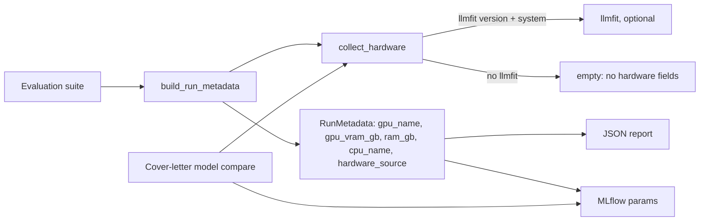

# MH-6: Hardware profile in evaluation runs

## Apply with the runner

The handoff runner applies this file: it writes the test, runs the red command (it must fail), makes the changes, runs the checks, and commits. The runner does not push.

Apply this handoff (WSL, from `apps/backend-py`):

```bash
.venv/bin/python scripts/run_handoff.py ../../tasks/active/step-6-llmfit/mh-6-run-hardware.md
```

## Why

A latency or a tokens-per-second number means little without the machine that measured it. With this handoff, each evaluation run records the hardware: the GPU, its memory, the RAM, the CPU, and the llmfit version. The values go into the run metadata (so the JSON report has them) and into the MLflow params, so results from different machines can be compared (CLAUDE.md: model performance goes through MLflow). The cover-letter model compare logs the same params. Without llmfit, the runs are as before.



## Decisions

- **Optional.** `collect_hardware` returns an empty dict when llmfit cannot answer, so no hardware field is set and the MLflow params stay as before.
- **Old reports load.** The new `RunMetadata` fields default to None, and `_metadata_params` already drops None values.
- **Cost.** The profile needs `llmfit -V` and `llmfit --json system`, about 1.6 s per run, which is small next to a suite run.
- **Tests never run a real llmfit.** The conftest guard from MH-3 hides any real binary; the new tests use a stub client and made-up hardware. The compare test also stubs the MLflow experiment lookup, so it creates no tracking store.

## Files

- `apps/backend-py/tests/unit/test_run_hardware_profile.py` (new)
- `apps/backend-py/src/evaluation/run_metadata.py`, `src/evaluation/cover_letter_compare.py` (change)

## Step 1: add the test, run it, and see it fail

```python new=apps/backend-py/tests/unit/test_run_hardware_profile.py
"""
Tests for the hardware profile in evaluation runs (Step 6, MH-6).

A stub client stands in for llmfit, with made-up hardware.
"""

from pathlib import Path
from typing import Any, Dict, List, Optional, Tuple

import pytest

from src.evaluation import cover_letter_compare, run_metadata
from src.evaluation.report import _metadata_params
from src.evaluation.run_metadata import RunMetadata, collect_hardware
from src.hardware.llmfit_client import HardwareProfile, LlmfitUnavailable


class StubClient:
    """Answers like LlmfitClient."""

    def __init__(self, unavailable: Optional[str] = None) -> None:
        """
        Initialize the stub.

        Args:
            unavailable: When set, every call raises LlmfitUnavailable.
        """
        self.unavailable = unavailable

    def version(self) -> Tuple[int, int, int]:
        """Return the minimum version, or raise."""
        if self.unavailable:
            raise LlmfitUnavailable(self.unavailable)
        return (1, 1, 20)

    def system(self) -> HardwareProfile:
        """Return made-up hardware."""
        return HardwareProfile(
            has_gpu=True,
            gpu_name="Example GPU",
            gpu_vram_gb=12.0,
            total_ram_gb=32.0,
            cpu_name="Example CPU",
        )


PROFILE = {
    "gpu_name": "Example GPU",
    "gpu_vram_gb": 12.0,
    "ram_gb": 32.0,
    "cpu_name": "Example CPU",
    "hardware_source": "llmfit 1.1.20",
}


def test_collect_hardware_reads_llmfit() -> None:
    """The profile names the GPU, its memory, the RAM, the CPU, and llmfit."""
    assert collect_hardware(lambda: StubClient()) == PROFILE


def test_collect_hardware_without_llmfit_is_empty() -> None:
    """No llmfit gives no profile, and no error."""
    stub = StubClient(unavailable="llmfit is not installed")
    assert collect_hardware(lambda: stub) == {}


def test_collect_hardware_drops_unknown_values() -> None:
    """A machine without a GPU has no GPU fields."""

    class NoGpu(StubClient):
        """Stub with no GPU."""

        def system(self) -> HardwareProfile:
            """Return hardware without a GPU."""
            return HardwareProfile(has_gpu=False, total_ram_gb=16.0)

    assert collect_hardware(lambda: NoGpu()) == {
        "ram_gb": 16.0,
        "hardware_source": "llmfit 1.1.20",
    }


def test_run_metadata_records_the_profile(
    tmp_path: Path, monkeypatch: pytest.MonkeyPatch
) -> None:
    """build_run_metadata adds the profile, and MLflow params include it."""
    monkeypatch.setattr(run_metadata, "collect_hardware", lambda: dict(PROFILE))
    data = tmp_path / "cases.jsonl"
    data.write_text("{}\n")
    metadata = run_metadata.build_run_metadata("unit", [data], 1, repo_dir=tmp_path)
    assert metadata.gpu_name == "Example GPU"
    assert metadata.hardware_source == "llmfit 1.1.20"
    params = _metadata_params(metadata)
    assert params["gpu_vram_gb"] == 12.0
    assert params["cpu_name"] == "Example CPU"


def test_without_llmfit_the_params_stay_as_before(tmp_path: Path) -> None:
    """The conftest hides any real llmfit, so no hardware param is logged."""
    data = tmp_path / "cases.jsonl"
    data.write_text("{}\n")
    metadata = run_metadata.build_run_metadata("unit", [data], 1, repo_dir=tmp_path)
    params = _metadata_params(metadata)
    assert not {"gpu_name", "gpu_vram_gb", "ram_gb", "cpu_name"} & set(params)


def test_old_reports_still_load() -> None:
    """Metadata saved before Step 6 has no hardware fields."""
    old = RunMetadata.model_validate(
        {
            "suite": "grounding",
            "git_sha": "abc",
            "git_dirty": False,
            "dataset_sha256": "d",
            "case_count": 3,
            "started_at": "2026-11-01T00:00:00Z",
        }
    )
    assert old.gpu_name is None
    assert "gpu_name" not in _metadata_params(old)


class FakeTracker:
    """Records what a compare run logs."""

    def __init__(self) -> None:
        """Start with empty records."""
        self.params: List[Dict[str, Any]] = []

    def start_run(self, run_name: str, tags: Dict[str, str]) -> str:
        """Return a fixed run id."""
        return "run-1"

    def log_params(self, params: Dict[str, Any]) -> None:
        """Record params."""
        self.params.append(params)

    def log_metrics(self, metrics: Dict[str, float]) -> None:
        """Ignore metrics."""

    def log_artifact(self, path: str) -> None:
        """Ignore artifacts."""

    def end_run(self) -> None:
        """Nothing to close."""


def test_compare_run_logs_the_profile(
    tmp_path: Path, monkeypatch: pytest.MonkeyPatch
) -> None:
    """A cover-letter model compare logs the hardware with its params."""
    monkeypatch.setattr(cover_letter_compare, "collect_hardware", lambda: dict(PROFILE))
    # No real MLflow lookup: it could create a tracking store in the cwd.
    monkeypatch.setattr(cover_letter_compare, "_experiment_id", lambda: "1")
    tracker = FakeTracker()
    report = {
        "generated_at": "2026-11-09T00:00:00Z",
        "winner": "a:7b",
        "protocol": {"cool_down_s": 5},
        "reports": [
            {
                "model": "a:7b",
                "mean_score": 0.8,
                "cases": [{"case_id": "c1", "score": 0.8, "elapsed_ms": 900}],
            }
        ],
    }
    path = tmp_path / "compare.json"
    path.write_text("{}")
    cover_letter_compare.log_to_mlflow(
        report, path, tracker_factory=lambda **_: tracker
    )
    assert tracker.params, "no params were logged"
    assert tracker.params[0]["gpu_name"] == "Example GPU"
    assert tracker.params[0]["models"] == "a:7b"
```

```bash red cwd=apps/backend-py
.venv/bin/python -m pytest -q -p no:cacheprovider tests/unit/test_run_hardware_profile.py
```

## Step 2: record the hardware profile

```python edit=apps/backend-py/src/evaluation/run_metadata.py
<<<<<<< OLD
from typing import Optional, Sequence, Tuple
=======
from typing import Any, Callable, Dict, Optional, Sequence, Tuple
>>>>>>> NEW
```
```python edit=apps/backend-py/src/evaluation/run_metadata.py
<<<<<<< OLD
from ..utils.logger import Components, get_logger
=======
from ..hardware.llmfit_client import LlmfitClient, LlmfitUnavailable
from ..utils.logger import Components, get_logger
>>>>>>> NEW
```
```python edit=apps/backend-py/src/evaluation/run_metadata.py
<<<<<<< OLD
    seed: Optional[int] = None


def collect_git_state(repo_dir: Path) -> Tuple[str, Optional[bool]]:
=======
    seed: Optional[int] = None
    # Hardware profile from llmfit (Step 6); None when llmfit is missing.
    gpu_name: Optional[str] = None
    gpu_vram_gb: Optional[float] = None
    ram_gb: Optional[float] = None
    cpu_name: Optional[str] = None
    hardware_source: Optional[str] = None


def collect_git_state(repo_dir: Path) -> Tuple[str, Optional[bool]]:
>>>>>>> NEW
```
```python edit=apps/backend-py/src/evaluation/run_metadata.py
<<<<<<< OLD


def build_run_metadata(
=======


def collect_hardware(
    client_factory: Callable[[], LlmfitClient] = LlmfitClient,
) -> Dict[str, Any]:
    """
    Read the hardware with llmfit (optional), so that results from different
    machines can be compared.

    Args:
        client_factory: Makes an llmfit client. Tests pass a stub.

    Returns:
        ``gpu_name``, ``gpu_vram_gb``, ``ram_gb``, ``cpu_name``, and
        ``hardware_source`` (the llmfit version), without empty values; an
        empty dict when llmfit cannot answer.
    """
    client = client_factory()
    try:
        version = client.version()
        hardware = client.system()
    except LlmfitUnavailable as exc:
        logger.info("No hardware profile for the run metadata: %s", exc)
        return {}
    profile: Dict[str, Any] = {
        "gpu_name": hardware.gpu_name,
        "gpu_vram_gb": hardware.gpu_vram_gb,
        "ram_gb": hardware.total_ram_gb or None,
        "cpu_name": hardware.cpu_name,
        "hardware_source": "llmfit " + ".".join(str(part) for part in version),
    }
    return {key: value for key, value in profile.items() if value is not None}


def build_run_metadata(
>>>>>>> NEW
```
```python edit=apps/backend-py/src/evaluation/run_metadata.py
<<<<<<< OLD
    Returns:
        Run metadata with a UTC start time.
    """
=======
    Returns:
        Run metadata with a UTC start time, and the hardware profile when
        llmfit is installed.
    """
>>>>>>> NEW
```
```python edit=apps/backend-py/src/evaluation/run_metadata.py
<<<<<<< OLD
        seed=seed,
    )
=======
        seed=seed,
        **collect_hardware(),
    )
>>>>>>> NEW
```
```python edit=apps/backend-py/src/evaluation/cover_letter_compare.py
<<<<<<< OLD
from ..utils.logger import Components, get_logger
=======
from ..utils.logger import Components, get_logger
from .run_metadata import collect_hardware
>>>>>>> NEW
```
```python edit=apps/backend-py/src/evaluation/cover_letter_compare.py
<<<<<<< OLD
                    "case_count": len(reports[0]["cases"]) if reports else 0,
                }
=======
                    "case_count": len(reports[0]["cases"]) if reports else 0,
                    **collect_hardware(),
                }
>>>>>>> NEW
```

## Step 3: checks

```bash check cwd=apps/backend-py
.venv/bin/python -m pytest -q -p no:cacheprovider tests/unit/test_run_hardware_profile.py tests/unit/test_evaluation_harness.py tests/unit/test_compare_cover_letter_models.py tests/unit/test_dedupe_suite.py tests/unit/test_scam_suite.py
```

```bash check cwd=apps/backend-py
.venv/bin/python -m black --check tests/unit/test_run_hardware_profile.py src/evaluation/cover_letter_compare.py src/evaluation/run_metadata.py
```

```bash check cwd=apps/backend-py
.venv/bin/python -m ruff check tests/unit/test_run_hardware_profile.py src/evaluation/cover_letter_compare.py src/evaluation/run_metadata.py
```

```bash check cwd=apps/backend-py
.venv/bin/python scripts/mypy_gate.py
```

```text commit
feat(evaluation): record the hardware profile in evaluation runs

Each evaluation run now records the GPU, its memory, the RAM, the CPU,
and the llmfit version in the run metadata and the MLflow params, so
results from different machines can be compared. The cover-letter model
compare logs the same params. Without llmfit, the runs are as before,
and reports from before this change still load.

Co-Authored-By: Claude Opus 5.5 <noreply@anthropic.com>
```
