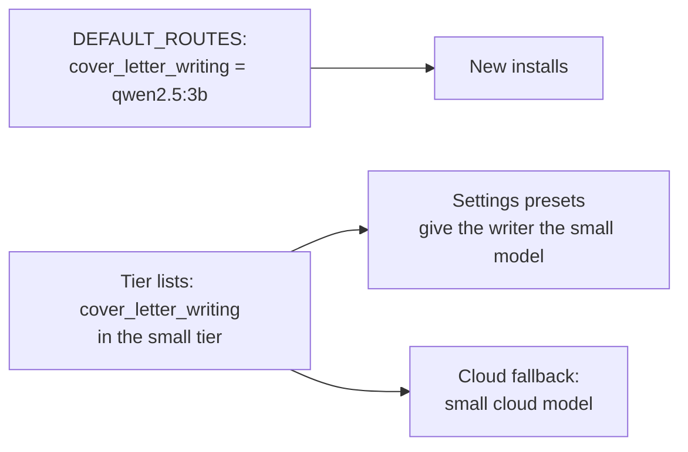

# MH-1: qwen2.5:3b becomes the default cover-letter writer

## Apply with the runner

The handoff runner applies this file: it adds the tests, runs the two red commands (they must fail), makes the code edits, runs the "Done when" checks (they must pass), and commits. See `docs/handoff-runner.md`.

Apply this handoff (WSL, from `apps/backend-py`):

```bash
.venv/bin/python scripts/run_handoff.py ../../tasks/active/writer-default-3b/mh-1-writer-default.md
```

## Why

Step 3.8 recommends `qwen2.5:3b` as the local cover-letter writer (`docs/decision-log.md`, 2026-11-02). Two places decide the writer model: the built-in route (`LLMRouter.DEFAULT_ROUTES`) and the Settings tier presets, which set every large-tier task to the large model. So the route changes to `qwen2.5:3b`, and `cover_letter_writing` moves from the large tier to the small tier in the backend and the frontend. With a cloud fallback, the writer then gets the small cloud model (user decision, 2026-11-02).



## Files

- `apps/backend-py/src/llm/router.py` (change)
- `apps/backend-py/src/api/ollama_models.py` (change)
- `apps/backend-py/tests/unit/test_writer_default.py` (new)
- `apps/frontend-ts/src/lib/ollama-tiers.ts` (change)
- `apps/frontend-ts/tests/lib/ollama-tiers.test.ts` (change: one new test)

## Step 1: add the tests, run them, and see them fail

The backend tests:

```python new=apps/backend-py/tests/unit/test_writer_default.py
"""Tests for the default cover-letter writer (decision log 2026-11-02, Step 3.8)."""

from src.api.ollama_models import (
    OLLAMA_LARGE_TASKS,
    OLLAMA_SMALL_TASKS,
    RECOMMENDED_OLLAMA_SMALL,
    apply_ollama_tier_models,
    default_cloud_fallback_model,
)
from src.api.settings import CloudProvider
from src.llm.router import LLMRouter, TaskType


def test_default_writer_route_is_the_small_local_model() -> None:
    """The built-in cover-letter writing route uses qwen2.5:3b on Ollama."""
    route = LLMRouter.DEFAULT_ROUTES[TaskType.COVER_LETTER_WRITING]

    assert route.primary_provider == "ollama"
    assert route.primary_model == "qwen2.5:3b"
    assert route.fallback_provider is None


def test_default_writer_is_the_recommended_small_model() -> None:
    """The writer route and the recommended small tier model are the same."""
    route = LLMRouter.DEFAULT_ROUTES[TaskType.COVER_LETTER_WRITING]

    assert route.primary_model == RECOMMENDED_OLLAMA_SMALL


def test_cover_letter_writing_is_in_the_small_tier() -> None:
    """Cover-letter writing is a small-tier task, not a large-tier task."""
    assert "cover_letter_writing" in OLLAMA_SMALL_TASKS
    assert "cover_letter_writing" not in OLLAMA_LARGE_TASKS
    assert "resume_writing" in OLLAMA_LARGE_TASKS


def test_tier_apply_gives_the_writer_the_small_model() -> None:
    """Applying the tiers sets the writer to the small model."""
    routing = apply_ollama_tier_models({}, "gemma3:4b", "qwen2.5:14b")

    assert routing["cover_letter_writing"].primary_model == "gemma3:4b"
    assert routing["resume_writing"].primary_model == "qwen2.5:14b"


def test_writer_cloud_fallback_is_the_small_cloud_model() -> None:
    """With a cloud fallback, the writer gets the small cloud model."""
    assert (
        default_cloud_fallback_model(CloudProvider.ANTHROPIC, "cover_letter_writing")
        == "claude-haiku-4-5-20251001"
    )
    assert (
        default_cloud_fallback_model(CloudProvider.GEMINI, "cover_letter_writing")
        == "gemini-2.5-flash"
    )
```

One frontend test, after the test that applies the small and large models:

```ts edit=apps/frontend-ts/tests/lib/ollama-tiers.test.ts
<<<<<<< OLD
    expect(next.routing.scoring?.primary_model).toBe("gemma3:4b");
  });
=======
    expect(next.routing.scoring?.primary_model).toBe("gemma3:4b");
  });

  it("puts cover-letter writing in the small tier", () => {
    const next = applyOllamaTierModelsLocally(
      baseSettings(),
      "gemma3:4b",
      "qwen2.5:14b",
    );
    expect(next.routing.cover_letter_writing?.primary_model).toBe("gemma3:4b");
    expect(next.routing.cover_letter_writing?.fallback_model).toBe(
      "claude-haiku-4-5-20251001",
    );
    expect(next.routing.resume_writing?.primary_model).toBe("qwen2.5:14b");
  });
>>>>>>> NEW
```

Run the backend tests. They must fail (the route uses `qwen2.5:7b`, and the writer is in the large tier):

```bash red cwd=apps/backend-py
.venv/bin/python -m pytest tests/unit/test_writer_default.py -q
```

Run the frontend tier tests. They must fail (the writer gets the large model). The vitest commands use `--no-cache`: on this host, `node_modules/.vite/vitest/` belongs to `root`, so vitest cannot write its results cache and exits with 1 even when all tests pass.

```bash red cwd=apps/frontend-ts
source ~/.nvm/nvm.sh && nvm use 24 && npx vitest run --no-cache tests/lib/ollama-tiers.test.ts
```

## Step 2: change the route and the tiers

The built-in route in `src/llm/router.py`:

```python edit=apps/backend-py/src/llm/router.py
<<<<<<< OLD
            task_type=TaskType.COVER_LETTER_WRITING,
            primary_provider="ollama",
            primary_model="qwen2.5:7b",
=======
            task_type=TaskType.COVER_LETTER_WRITING,
            primary_provider="ollama",
            # Step 3.8: chosen on the grounding set (decision log 2026-11-02).
            primary_model="qwen2.5:3b",
>>>>>>> NEW
```

The small tier in `src/api/ollama_models.py`:

```python edit=apps/backend-py/src/api/ollama_models.py
<<<<<<< OLD
        "trust_analysis",
        "cover_letter_review",
    }
=======
        "trust_analysis",
        "cover_letter_review",
        "cover_letter_writing",
    }
>>>>>>> NEW
```

The large tier in `src/api/ollama_models.py`:

```python edit=apps/backend-py/src/api/ollama_models.py
<<<<<<< OLD
        "classification",
        "cover_letter_writing",
        "assessment_generation",
=======
        "classification",
        "assessment_generation",
>>>>>>> NEW
```

The small tier in `src/lib/ollama-tiers.ts`:

```ts edit=apps/frontend-ts/src/lib/ollama-tiers.ts
<<<<<<< OLD
  "trust_analysis",
  "cover_letter_review",
] as const;
=======
  "trust_analysis",
  "cover_letter_review",
  "cover_letter_writing",
] as const;
>>>>>>> NEW
```

The large tier in `src/lib/ollama-tiers.ts`:

```ts edit=apps/frontend-ts/src/lib/ollama-tiers.ts
<<<<<<< OLD
  "classification",
  "cover_letter_writing",
  "assessment_generation",
=======
  "classification",
  "assessment_generation",
>>>>>>> NEW
```

## Done when

Run the new backend tests and the other routing and Settings tests:

```bash check cwd=apps/backend-py
.venv/bin/python -m pytest tests/unit/test_writer_default.py tests/unit/test_ollama_models.py tests/unit/test_settings_api.py tests/unit/test_router_settings.py tests/unit/test_cloud_fallback_none.py tests/unit/test_router_model_override.py tests/unit/test_router_response_cache.py -q
```

Format and lint the backend files:

```bash check cwd=apps/backend-py
.venv/bin/python -m black src/llm/router.py src/api/ollama_models.py tests/unit/test_writer_default.py
```

```bash check cwd=apps/backend-py
.venv/bin/python -m ruff check src/llm/router.py src/api/ollama_models.py tests/unit/test_writer_default.py
```

Run the mypy gate (no new errors):

```bash check cwd=apps/backend-py
.venv/bin/python scripts/mypy_gate.py
```

Run the frontend tier tests:

```bash check cwd=apps/frontend-ts
source ~/.nvm/nvm.sh && nvm use 24 && npx vitest run --no-cache tests/lib/ollama-tiers.test.ts
```

Check the frontend format, lint, and types:

```bash check cwd=apps/frontend-ts
source ~/.nvm/nvm.sh && nvm use 24 && npx prettier --check src/lib/ollama-tiers.ts tests/lib/ollama-tiers.test.ts
```

```bash check cwd=apps/frontend-ts
source ~/.nvm/nvm.sh && nvm use 24 && npx eslint src/lib/ollama-tiers.ts tests/lib/ollama-tiers.test.ts
```

```bash check cwd=apps/frontend-ts
source ~/.nvm/nvm.sh && nvm use 24 && npx tsc --noEmit
```

Commit message:

```text commit
feat(llm): make qwen2.5:3b the default cover-letter writer

Step 3.8 recommends qwen2.5:3b as the local cover-letter writer
(decision log 2026-11-02). The built-in cover_letter_writing route now
uses it, and cover_letter_writing moves from the large to the small
Ollama tier in the backend and the frontend, so the Settings presets
keep it. With a cloud fallback, the writer gets the small cloud model.
A saved Settings route still wins over these defaults.
```
