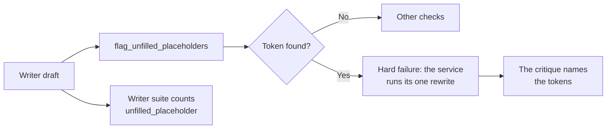

# MH-1: Find unfilled placeholders in cover letters

## Apply with the runner

The handoff runner applies this file: it writes the test file, runs the red command (it must fail), makes the edits, runs the "Done when" checks (they must pass), and commits. See `docs/handoff-runner.md`.

Apply this handoff (WSL, from `apps/backend-py`):

```bash
.venv/bin/python scripts/run_handoff.py ../../tasks/active/writer-placeholders/mh-1-placeholder-check.md
```

## Why

The demo seed gave a letter with literal `[Company]` text, and the validator passed it. In a trial, about 3 in 10 `qwen2.5:3b` letters had `[...]` tokens. The prompt has no brackets, so the model writes them by itself. The writer reports hold no letter text, so the rate of Step 3.8 cannot be counted now: this check must exist first.



- A token is square brackets around 2 to 80 characters on one line. It catches `[Company]` and `[Plant Disease Classifier]`. It does not catch `<Company>` or `XYZ Corp`.
- The issue is a hard failure, so `is_valid` is false and the existing one rewrite runs. The rewrite critique names the tokens.
- The writer suite counts the issue, so `unfilled_placeholder_rate` reaches the report and MLflow.
- The grounding gate does not change: the issue is not a grounding label.
- The decision rule for the runs after this handoff is in `notes.md`, committed before any run.

## Files

- `apps/backend-py/tests/unit/test_cover_letter_placeholders.py` (new)
- `apps/backend-py/src/generation/cover_letter_grounding.py` (change)
- `apps/backend-py/src/generation/cover_letter_validator.py` (change)
- `apps/backend-py/src/evaluation/suites/writer.py` (change)
- `apps/frontend-ts/src/lib/types/api.ts` (change)

## Step 1: add the test file, run it, and see it fail

```python new=apps/backend-py/tests/unit/test_cover_letter_placeholders.py
"""Tests for the unfilled-placeholder check of cover letters."""

from typing import List

import pytest

from src.evaluation.suites.writer import LetterRow, pair_counts, summarize
from src.generation.cover_letter_grounding import flag_unfilled_placeholders
from src.generation.cover_letter_validator import (
    CoverLetterIssue,
    CoverLetterValidationResult,
    CoverLetterValidator,
    build_grounding_rewrite_critique,
    collect_hard_fail_issues,
)
from src.generation.cover_letter_writer import GeneratedCoverLetter
from src.generation.selector import SelectionOutput
from tests.unit.test_ranking_suite import job_with, profile_with

CLEAN = (
    "At Test Co, the Engineer role needs Python services, and I built them.\n\n"
    "I look forward to discussing how I can contribute to the team."
)


def validate(content: str) -> CoverLetterValidationResult:
    """
    Validate a letter for a small job and profile.

    Args:
        content: The letter.

    Returns:
        The validation result.
    """
    letter = GeneratedCoverLetter(
        content=content,
        highlighted_experiences=[],
        word_count=len(content.split()),
        model_used="test-model",
    )
    selection = SelectionOutput(
        selected_projects=[],
        keywords_to_emphasize=[],
        key_achievements=[],
        summary_suggestion="",
        raw_response="",
    )
    validator = CoverLetterValidator(llm_router=None, strict_mode=False)
    return validator.validate(
        letter,
        job_with("a", "Engineer", "Build Python services."),
        profile_with(["Python"]),
        selection,
    )


@pytest.mark.parametrize(
    ("text", "expected"),
    [
        ("I admire [Company].", ["[Company]"]),
        ("In [Plant Disease Classifier] I trained", ["[Plant Disease Classifier]"]),
        (
            "[Research Engineer, Machine Learning]",
            ["[Research Engineer, Machine Learning]"],
        ),
        ("[Company] and [Role]", ["[Company]", "[Role]"]),
        ("[Company] and [Role] at [Company]", ["[Company]", "[Role]"]),
        ("[Role] at [Company]", ["[Role]", "[Company]"]),
        ("No brackets in this letter.", []),
        ("", []),
        ("A note [1] with one digit.", []),
        ("[]", []),
        ("[ab]", ["[ab]"]),
        ("[" + "a" * 80 + "]", ["[" + "a" * 80 + "]"]),
        ("[" + "a" * 81 + "]", []),
        ("[line one\nline two]", []),
        ("[[Company]]", ["[Company]"]),
    ],
)
def test_flag_unfilled_placeholders(text: str, expected: List[str]) -> None:
    """A token is one bracket pair around 2 to 80 characters on one line."""
    assert flag_unfilled_placeholders(text) == expected


def test_a_placeholder_is_a_hard_failure() -> None:
    """The letter is not valid, so the one rewrite runs."""
    result = validate(CLEAN + "\n\nI am eager to join [Company].")

    assert CoverLetterIssue.UNFILLED_PLACEHOLDER in result.issues
    assert CoverLetterIssue.UNFILLED_PLACEHOLDER in collect_hard_fail_issues(
        result.issues
    )
    assert result.is_valid is False
    assert result.recommendation == "reject"
    assert result.details["unfilled_placeholders"] == ["[Company]"]


def test_a_letter_without_placeholders_has_no_issue() -> None:
    """A clean letter gets no finding."""
    result = validate(CLEAN)

    assert CoverLetterIssue.UNFILLED_PLACEHOLDER not in result.issues
    assert result.details["unfilled_placeholders"] == []


def test_the_rewrite_critique_names_the_tokens() -> None:
    """The writer learns which tokens to replace."""
    result = validate(CLEAN + "\n\nJoin [Company] as [Role].")

    critique = build_grounding_rewrite_critique(result)

    assert "[Company], [Role]" in critique
    assert "plain text" in critique


def test_a_critique_without_tokens_has_no_placeholder_line() -> None:
    """Other hard failures do not get the placeholder instruction."""
    assert "placeholders" not in build_grounding_rewrite_critique(validate(CLEAN))


def test_the_writer_suite_counts_the_issue() -> None:
    """The first-draft rate reaches the report and each pair."""
    flagged = LetterRow(case_id="c", profile_id="p", sample=0, outcome="written")
    flagged.issues = ["unfilled_placeholder"]
    clean = LetterRow(case_id="c", profile_id="p", sample=1, outcome="written")
    rows = [flagged, clean]

    assert summarize(rows)["unfilled_placeholder_rate"] == 0.5
    assert pair_counts(rows)["c"]["flagged"]["unfilled_placeholder"] == 1
```

Run it. It must fail (`flag_unfilled_placeholders` does not exist yet):

```bash red cwd=apps/backend-py
.venv/bin/python -m pytest tests/unit/test_cover_letter_placeholders.py -q
```

## Step 2: add the check

Add the rule:

```python edit=apps/backend-py/src/generation/cover_letter_grounding.py
<<<<<<< OLD
def flag_inconsistent_percent_claims(letter_text: str) -> List[dict]:
=======
def flag_unfilled_placeholders(letter_text: str) -> List[str]:
    """
    Flag template text that the writer left in a letter.

    A token is square brackets around 2 to 80 characters on one line, such
    as ``[Company]``. Small models write these with no cue in the prompt.

    Args:
        letter_text: Generated cover letter body.

    Returns:
        Each token once, in order of first use.
    """
    return list(dict.fromkeys(re.findall(r"\[[^\[\]\n]{2,80}\]", letter_text)))


def flag_inconsistent_percent_claims(letter_text: str) -> List[dict]:
>>>>>>> NEW
```

Import it in the validator:

```python edit=apps/backend-py/src/generation/cover_letter_validator.py
<<<<<<< OLD
    flag_ungrounded_sentences,
    flag_unsupported_number_sentences,
)
=======
    flag_unfilled_placeholders,
    flag_ungrounded_sentences,
    flag_unsupported_number_sentences,
)
>>>>>>> NEW
```

Add the issue, and make it a hard failure:

```python edit=apps/backend-py/src/generation/cover_letter_validator.py
<<<<<<< OLD
    ANALOGICAL_CLAIM = "analogical_claim"
=======
    ANALOGICAL_CLAIM = "analogical_claim"
    UNFILLED_PLACEHOLDER = "unfilled_placeholder"
>>>>>>> NEW
```

```python edit=apps/backend-py/src/generation/cover_letter_validator.py
<<<<<<< OLD
        CoverLetterIssue.ANALOGICAL_CLAIM,
    }
)
=======
        CoverLetterIssue.ANALOGICAL_CLAIM,
        CoverLetterIssue.UNFILLED_PLACEHOLDER,
    }
)
>>>>>>> NEW
```

Name the tokens in the rewrite critique:

```python edit=apps/backend-py/src/generation/cover_letter_validator.py
<<<<<<< OLD
            lines.append(prefix + "; ".join(str(flag) for flag in flags))
    return "\n".join(lines)
=======
            lines.append(prefix + "; ".join(str(flag) for flag in flags))
    placeholders = details.get("unfilled_placeholders") or []
    if placeholders:
        lines.append(
            "Replace these placeholders with the real names as plain text, "
            "with no square brackets: " + ", ".join(str(item) for item in placeholders)
        )
    return "\n".join(lines)
>>>>>>> NEW
```

Run the rule in `validate`, add the issue, and report the tokens:

```python edit=apps/backend-py/src/generation/cover_letter_validator.py
<<<<<<< OLD
        inconsistent_percent_claims = flag_inconsistent_percent_claims(content)
        grounding_issues: List[CoverLetterIssue] = []
=======
        inconsistent_percent_claims = flag_inconsistent_percent_claims(content)
        unfilled_placeholders = flag_unfilled_placeholders(content)
        grounding_issues: List[CoverLetterIssue] = []
>>>>>>> NEW
```

```python edit=apps/backend-py/src/generation/cover_letter_validator.py
<<<<<<< OLD
            grounding_issues.append(CoverLetterIssue.INCONSISTENT_METRIC)
        issues.extend(grounding_issues)
=======
            grounding_issues.append(CoverLetterIssue.INCONSISTENT_METRIC)
        if unfilled_placeholders:
            grounding_issues.append(CoverLetterIssue.UNFILLED_PLACEHOLDER)
        issues.extend(grounding_issues)
>>>>>>> NEW
```

```python edit=apps/backend-py/src/generation/cover_letter_validator.py
<<<<<<< OLD
            "analogical_claims": analogical_claims,
            "grounding_penalty": grounding_penalty_breakdown,
=======
            "analogical_claims": analogical_claims,
            "unfilled_placeholders": unfilled_placeholders,
            "grounding_penalty": grounding_penalty_breakdown,
>>>>>>> NEW
```

Count the issue in the writer suite:

```python edit=apps/backend-py/src/evaluation/suites/writer.py
<<<<<<< OLD
    "scope_inflation",
)
=======
    "scope_inflation",
    "unfilled_placeholder",
)
>>>>>>> NEW
```

Add the issue to the frontend type:

```ts edit=apps/frontend-ts/src/lib/types/api.ts
<<<<<<< OLD
  | "analogical_claim"
=======
  | "analogical_claim"
  | "unfilled_placeholder"
>>>>>>> NEW
```

## Done when

Run the new tests and the other cover-letter, grounding, and writer tests:

```bash check cwd=apps/backend-py
.venv/bin/python -m pytest tests/unit/test_cover_letter_placeholders.py tests/test_cover_letter_validator.py tests/unit/test_cover_letter_grounding.py tests/unit/test_grounding_thresholds.py tests/unit/test_writer_compare.py tests/unit/test_writer_suite.py -q
```

Format and lint the changed files:

```bash check cwd=apps/backend-py
.venv/bin/python -m black src/generation/cover_letter_grounding.py src/generation/cover_letter_validator.py src/evaluation/suites/writer.py tests/unit/test_cover_letter_placeholders.py
```

```bash check cwd=apps/backend-py
.venv/bin/python -m ruff check src/generation/cover_letter_grounding.py src/generation/cover_letter_validator.py src/evaluation/suites/writer.py tests/unit/test_cover_letter_placeholders.py
```

Run the mypy gate (no new errors):

```bash check cwd=apps/backend-py
.venv/bin/python scripts/mypy_gate.py
```

Type-check the frontend:

```bash check cwd=apps/frontend-ts
source ~/.nvm/nvm.sh && nvm use 24 && npx tsc --noEmit
```

Commit message:

```text commit
fix(validator): fail cover letters with unfilled placeholders

A letter with literal [Company] text passed the validator. A new hard
issue, unfilled_placeholder, finds square-bracket tokens, so the one
rewrite runs, and its critique names the tokens. The writer suite counts
the issue, so the first-draft rate reaches MLflow.

Co-Authored-By: Claude Opus 5.5 <noreply@anthropic.com>
```
