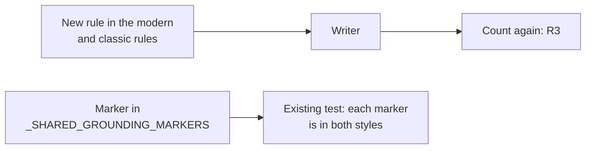

# MH-2: Tell the writer not to use placeholders

## Apply with the runner

The handoff runner applies this file: it adds the marker, runs the red command (it must fail), adds the rule, runs the "Done when" checks (they must pass), and commits. See `docs/handoff-runner.md`.

Apply this handoff (WSL, from `apps/backend-py`):

```bash
.venv/bin/python scripts/run_handoff.py ../../tasks/active/writer-placeholders/mh-2-prompt-rule.md
```

## Why

The first-draft count on the grounding pairs: 81 of 195 `qwen2.5:3b` letters have `[...]` tokens, against 1 of 195 for `qwen2.5:7b` (`notes.md`, R1 and R2). The prompt has no brackets and no rule against them.



- The rule names no example token: a literal `[Company]` in the prompt could teach the model that form.
- The rewrite uses the same rules, so it gets this rule too.
- The short why-interest answer has its own prompt, and it does not change here.

## Files

- `apps/backend-py/src/generation/cover_letter_writer.py` (change)

## Step 1: add the marker, run the test, and see it fail

The existing test checks that each marker is in the rules of both styles.

```python edit=apps/backend-py/src/generation/cover_letter_writer.py
<<<<<<< OLD
    "Do not pad with soft-sell filler",
)
=======
    "Do not pad with soft-sell filler",
    "Never use square brackets or placeholders",
)
>>>>>>> NEW
```

Run it. It must fail (the rule is not in the prompts yet):

```bash red cwd=apps/backend-py
.venv/bin/python -m pytest tests/test_cover_letter_writer.py -q
```

## Step 2: add the rule to both styles

```python edit=apps/backend-py/src/generation/cover_letter_writer.py
<<<<<<< OLD
    "18. Return ONLY the letter body as plain text, no JSON"
=======
    "18. Return ONLY the letter body as plain text, no JSON\n"
    "19. Never use square brackets or placeholders. Write the real "
    "company, role, and project names as plain text"
>>>>>>> NEW
```

```python edit=apps/backend-py/src/generation/cover_letter_writer.py
<<<<<<< OLD
    "17. Return ONLY the letter body as plain text, no JSON"
=======
    "17. Return ONLY the letter body as plain text, no JSON\n"
    "18. Never use square brackets or placeholders. Write the real "
    "company, role, and project names as plain text"
>>>>>>> NEW
```

## Done when

Run the writer and placeholder tests:

```bash check cwd=apps/backend-py
.venv/bin/python -m pytest tests/test_cover_letter_writer.py tests/unit/test_cover_letter_placeholders.py -q
```

Format and lint the changed file:

```bash check cwd=apps/backend-py
.venv/bin/python -m black src/generation/cover_letter_writer.py
```

```bash check cwd=apps/backend-py
.venv/bin/python -m ruff check src/generation/cover_letter_writer.py
```

Commit message:

```text commit
fix(writer): tell the writer not to use placeholders

On the grounding pairs, 81 of 195 qwen2.5:3b first drafts had square
bracket tokens such as [Company], against 1 of 195 for qwen2.5:7b. Both
letter styles now have a rule against them. The rule names no example
token, so it cannot teach that form.

Co-Authored-By: Claude Opus 5.5 <noreply@anthropic.com>
```
