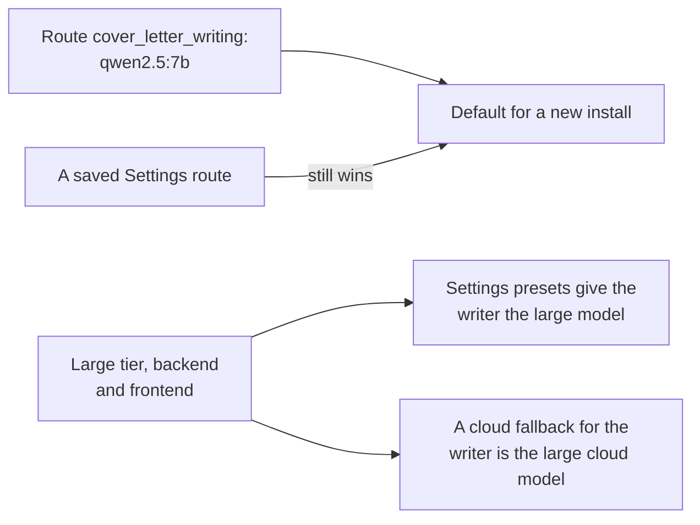

# MH-3: Restore qwen2.5:7b as the default cover-letter writer

## Apply with the runner

The handoff runner applies this file: it changes the tests, runs the red command (it must fail), changes the code, runs the "Done when" checks (they must pass), and commits. See `docs/handoff-runner.md`.

Apply this handoff (WSL, from `apps/backend-py`):

```bash
.venv/bin/python scripts/run_handoff.py ../../tasks/active/writer-placeholders/mh-3-restore-7b.md
```

## Why

The user chose to go back to `qwen2.5:7b` on 2026-11-05 ("Switch back to 7b"). On first drafts, `qwen2.5:3b` writes unfilled placeholders much more often: 18 of 195 letters with the prompt rule, against 1 of 195 for `qwen2.5:7b` with no rule (`notes.md`). Step 3.8 could not see this. This handoff reverses the default of `fa8dcb0`.



- A saved Settings route still wins over the default.
- The route comment names the reason, so a later reader does not switch it back without the evidence.
- Known limit: on this host, `qwen2.5:7b` peaks near the GPU limit when other apps hold GPU memory, and the VRAM guard then moves it to the CPU.

## Files

- `apps/backend-py/tests/unit/test_writer_default.py` (change)
- `apps/frontend-ts/tests/lib/ollama-tiers.test.ts` (change)
- `apps/backend-py/src/llm/router.py` (change)
- `apps/backend-py/src/api/ollama_models.py` (change)
- `apps/frontend-ts/src/lib/ollama-tiers.ts` (change)

## Step 1: change the tests, run them, and see them fail

```python edit=apps/backend-py/tests/unit/test_writer_default.py
<<<<<<< OLD
"""Tests for the default cover-letter writer (decision log 2026-11-02, Step 3.8)."""
=======
"""Tests for the default cover-letter writer (decision log 2026-11-05)."""
>>>>>>> NEW
```

```python edit=apps/backend-py/tests/unit/test_writer_default.py
<<<<<<< OLD
    OLLAMA_SMALL_TASKS,
    RECOMMENDED_OLLAMA_SMALL,
=======
    OLLAMA_SMALL_TASKS,
    RECOMMENDED_OLLAMA_LARGE,
>>>>>>> NEW
```

```python edit=apps/backend-py/tests/unit/test_writer_default.py
<<<<<<< OLD
def test_default_writer_route_is_the_small_local_model() -> None:
    """The built-in cover-letter writing route uses qwen2.5:3b on Ollama."""
=======
def test_default_writer_route_is_the_large_local_model() -> None:
    """The built-in cover-letter writing route uses qwen2.5:7b on Ollama."""
>>>>>>> NEW
```

```python edit=apps/backend-py/tests/unit/test_writer_default.py
<<<<<<< OLD
    assert route.primary_model == "qwen2.5:3b"
=======
    assert route.primary_model == "qwen2.5:7b"
>>>>>>> NEW
```

```python edit=apps/backend-py/tests/unit/test_writer_default.py
<<<<<<< OLD
def test_default_writer_is_the_recommended_small_model() -> None:
    """The writer route and the recommended small tier model are the same."""
    route = LLMRouter.DEFAULT_ROUTES[TaskType.COVER_LETTER_WRITING]

    assert route.primary_model == RECOMMENDED_OLLAMA_SMALL


def test_cover_letter_writing_is_in_the_small_tier() -> None:
    """Cover-letter writing is a small-tier task, not a large-tier task."""
    assert "cover_letter_writing" in OLLAMA_SMALL_TASKS
    assert "cover_letter_writing" not in OLLAMA_LARGE_TASKS
    assert "resume_writing" in OLLAMA_LARGE_TASKS


def test_tier_apply_gives_the_writer_the_small_model() -> None:
    """Applying the tiers sets the writer to the small model."""
    routing = apply_ollama_tier_models({}, "gemma3:4b", "qwen2.5:14b")

    assert routing["cover_letter_writing"].primary_model == "gemma3:4b"
    assert routing["resume_writing"].primary_model == "qwen2.5:14b"


def test_writer_cloud_fallback_is_the_small_cloud_model() -> None:
    """With a cloud fallback, the writer gets the small cloud model."""
    assert (
        default_cloud_fallback_model(CloudProvider.ANTHROPIC, "cover_letter_writing")
        == "claude-haiku-4-5-20251001"
    )
    assert (
        default_cloud_fallback_model(CloudProvider.GEMINI, "cover_letter_writing")
        == "gemini-2.5-flash"
    )
=======
def test_default_writer_is_the_recommended_large_model() -> None:
    """The writer route and the recommended large tier model are the same."""
    route = LLMRouter.DEFAULT_ROUTES[TaskType.COVER_LETTER_WRITING]

    assert route.primary_model == RECOMMENDED_OLLAMA_LARGE


def test_cover_letter_writing_is_in_the_large_tier() -> None:
    """Cover-letter writing is a large-tier task, not a small-tier task."""
    assert "cover_letter_writing" in OLLAMA_LARGE_TASKS
    assert "cover_letter_writing" not in OLLAMA_SMALL_TASKS
    assert "resume_writing" in OLLAMA_LARGE_TASKS


def test_tier_apply_gives_the_writer_the_large_model() -> None:
    """Applying the tiers sets the writer to the large model."""
    routing = apply_ollama_tier_models({}, "gemma3:4b", "qwen2.5:14b")

    assert routing["cover_letter_writing"].primary_model == "qwen2.5:14b"
    assert routing["selection"].primary_model == "gemma3:4b"


def test_writer_cloud_fallback_is_the_large_cloud_model() -> None:
    """With a cloud fallback, the writer gets the large cloud model."""
    assert (
        default_cloud_fallback_model(CloudProvider.ANTHROPIC, "cover_letter_writing")
        == "claude-sonnet-4-6"
    )
    assert (
        default_cloud_fallback_model(CloudProvider.GEMINI, "cover_letter_writing")
        == "gemini-2.5-pro"
    )
>>>>>>> NEW
```

```ts edit=apps/frontend-ts/tests/lib/ollama-tiers.test.ts
<<<<<<< OLD
  it("puts cover-letter writing in the small tier", () => {
    const next = applyOllamaTierModelsLocally(
      baseSettings(),
      "gemma3:4b",
      "qwen2.5:14b",
    );
    expect(next.routing.cover_letter_writing?.primary_model).toBe("gemma3:4b");
    expect(next.routing.cover_letter_writing?.fallback_model).toBe(
      "claude-haiku-4-5-20251001",
    );
    expect(next.routing.resume_writing?.primary_model).toBe("qwen2.5:14b");
  });
=======
  it("puts cover-letter writing in the large tier", () => {
    const next = applyOllamaTierModelsLocally(
      baseSettings(),
      "gemma3:4b",
      "qwen2.5:14b",
    );
    expect(next.routing.cover_letter_writing?.primary_model).toBe(
      "qwen2.5:14b",
    );
    expect(next.routing.cover_letter_writing?.fallback_model).toBe(
      "claude-sonnet-4-6",
    );
    expect(next.routing.selection?.primary_model).toBe("gemma3:4b");
  });
>>>>>>> NEW
```

Run them. They must fail (the default is still `qwen2.5:3b`):

```bash red cwd=apps/backend-py
.venv/bin/python -m pytest tests/unit/test_writer_default.py -q
```

```bash red cwd=apps/frontend-ts
source ~/.nvm/nvm.sh && nvm use 24 && npx vitest run --no-cache tests/lib/ollama-tiers.test.ts
```

## Step 2: change the default

```python edit=apps/backend-py/src/llm/router.py
<<<<<<< OLD
            # Step 3.8: chosen on the grounding set (decision log 2026-11-02).
            primary_model="qwen2.5:3b",
=======
            # Back on 2026-11-05: qwen2.5:3b drafts had placeholders (decision log).
            primary_model="qwen2.5:7b",
>>>>>>> NEW
```

Move the task to the large tier, in the backend:

```python edit=apps/backend-py/src/api/ollama_models.py
<<<<<<< OLD
        "cover_letter_review",
        "cover_letter_writing",
    }
)
=======
        "cover_letter_review",
    }
)
>>>>>>> NEW
```

```python edit=apps/backend-py/src/api/ollama_models.py
<<<<<<< OLD
    {
        "jd_extraction",
=======
    {
        "cover_letter_writing",
        "jd_extraction",
>>>>>>> NEW
```

And in the frontend:

```ts edit=apps/frontend-ts/src/lib/ollama-tiers.ts
<<<<<<< OLD
  "cover_letter_review",
  "cover_letter_writing",
] as const;
=======
  "cover_letter_review",
] as const;
>>>>>>> NEW
```

```ts edit=apps/frontend-ts/src/lib/ollama-tiers.ts
<<<<<<< OLD
const OLLAMA_LARGE_TASKS = [
  "jd_extraction",
=======
const OLLAMA_LARGE_TASKS = [
  "cover_letter_writing",
  "jd_extraction",
>>>>>>> NEW
```

## Done when

Run the backend tests that use the routes:

```bash check cwd=apps/backend-py
.venv/bin/python -m pytest tests/unit/test_writer_default.py tests/unit/test_cover_letter_placeholders.py tests/test_cover_letter_writer.py -q
```

Format and lint the backend files:

```bash check cwd=apps/backend-py
.venv/bin/python -m black src/llm/router.py src/api/ollama_models.py tests/unit/test_writer_default.py
```

```bash check cwd=apps/backend-py
.venv/bin/python -m ruff check src/llm/router.py src/api/ollama_models.py tests/unit/test_writer_default.py
```

Check the frontend:

```bash check cwd=apps/frontend-ts
source ~/.nvm/nvm.sh && nvm use 24 && npx vitest run --no-cache tests/lib/ollama-tiers.test.ts
```

```bash check cwd=apps/frontend-ts
source ~/.nvm/nvm.sh && nvm use 24 && npx prettier --check src/lib/ollama-tiers.ts tests/lib/ollama-tiers.test.ts
```

```bash check cwd=apps/frontend-ts
source ~/.nvm/nvm.sh && nvm use 24 && npx eslint src/lib/ollama-tiers.ts tests/lib/ollama-tiers.test.ts
```

```bash check cwd=apps/frontend-ts
source ~/.nvm/nvm.sh && nvm use 24 && npx tsc --noEmit
```

Commit message:

```text commit
fix(llm): restore qwen2.5:7b as the default cover-letter writer

On first drafts, qwen2.5:3b writes unfilled placeholders much more often
than qwen2.5:7b: 18 of 195 letters with the prompt rule, against 1 of
195 with no rule. Step 3.8 could not see this. The writer route and both
tier lists go back to the large model. A saved Settings route still wins.

Co-Authored-By: Claude Opus 5.5 <noreply@anthropic.com>
```
