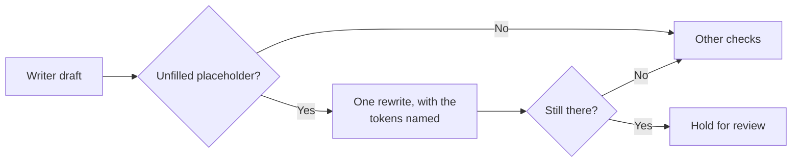

# Task: Stop Unfilled Placeholders in Cover Letters

## Goal
A cover letter must not reach the user with text such as `[Company]`. The validator finds these tokens, the one rewrite gets a chance to fix them, and the first-draft rate is measured on `qwen2.5:3b` and `qwen2.5:7b`, so the default writer rests on evidence.

## Constraints & Context
- Found in Step 4, MH-2 (`tasks/active/step-4-demo/notes.md`): about 3 in 10 `qwen2.5:3b` letters have `[...]` tokens with ordinary company names. The prompt has no brackets. The validator has no check for them, so Step 3.8 could not weigh this.
- The decision rule is in `notes.md`, committed before any run of this task.
- GPU: one model at a time, and unload after use. The user approved the `qwen2.5:7b` count (about 6.7 GB of VRAM) on 2026-11-05.
- Do not run the seed again to pick a clean letter. The demo letter stays as the fixed code writes it.

## Acceptance Criteria
- [x] Rule and plan committed before any run. (`4459f04`)
- [x] Validator check `unfilled_placeholder`, as a hard failure, with its tokens in the rewrite critique, and the writer suite counts it. (`c107816`, 14 of 14 mutants)
- [x] First-draft counts on `qwen2.5:3b` and `qwen2.5:7b` before the prompt rule, in MLflow. (R1 81 of 195, R2 1 of 195)
- [ ] Prompt rule, then the same counts again, in MLflow. (`55d5d53`; R3 18 of 195; R4 waits: it is needed now, because the user chose `qwen2.5:7b`)
- [x] Final-letter count through the real service, with the rewrite, on `qwen2.5:3b`. (R5: 0 of 24 with a token)
- [ ] The default writer decided by the rule; `docs/decision-log.md` and the README updated. (The user chose `qwen2.5:7b`; `mh-3-restore-7b.md` is ready; docs not done)
- [ ] Done when: the MH-2 seed can run on the fixed code, and the README states the placeholder rate and its limits.

## Status
`blocked` (2026-11-05: waits for the user to close RuneScape; resume steps in `notes.md`, "Paused")
