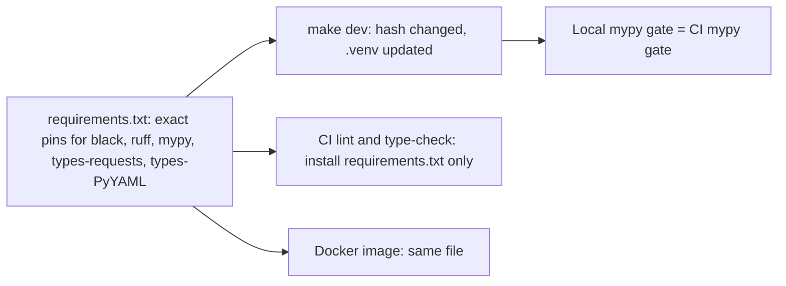

# Task: CI Type-Check Pins in the Local Environment

## Goal
Make the local backend `.venv` use the same versions of mypy, its stub packages, black, and ruff as CI, so that a local check gives the same result as CI.

## Constraints & Context
- CI type-check job: `pip install mypy==2.4.0 types-requests==2.33.0.20261006 types-PyYAML==6.0.12.20260906`, then `requirements.txt`. CI lint job: `pip install black ruff mypy` (no versions), then `requirements.txt`.
- `requirements.txt` has `black>=24.1.0`, `ruff>=0.2.0`, `mypy>=1.8.0`, and no stub packages. Locally this gives mypy 2.4.1 and no stubs, and the mypy gate on `main` reports 2 errors (`jobstreet_scraper.py`, `mycareersfuture_scraper.py`) that CI does not report. Found in `tasks/archive/generic-phrasing/`.
- `make dev` (`scripts/dev.sh`), `setup.sh`, and the Docker image all install `requirements.txt`. `dev.sh` updates the `.venv` when the hash of `requirements.txt` changes, so a pin there reaches each local `.venv` at the next `make dev`.
- Do not change `mypy-baseline.txt`, and never run `mypy_gate.py --update`. The pinned mypy is the version that CI uses now (2.4.0), so the baseline stays valid.
- Black and ruff versions: pin the versions that CI and the local `.venv` use now (checked against the last CI log: black 26.10.1, ruff 0.17.5), so that no file needs a new format.

## Plan

1. `requirements.txt`: replace the three `>=` lines with exact pins, and add `types-requests` and `types-PyYAML` with the CI versions. Move the CI comment ("Regenerate mypy-baseline.txt when you change these versions") next to them.
2. `.github/workflows/ci.yml`: the lint and type-check jobs install `requirements.txt` only (remove the inline `pip install` lines for these tools).
3. Check on a scratch clone: `make dev-deps` updates the clone's `.venv` from the changed file; then the mypy gate gives "177 known errors, 0 new" with no extra install; black and ruff give no change on the CI paths; pytest passes.
4. Check in CI after the push: the lint and type-check jobs pass with the same counts.

## Acceptance Criteria
- [x] `requirements.txt` pins black, ruff, mypy, `types-requests`, and `types-PyYAML` to exact versions, with the baseline comment.
- [x] CI lint and type-check jobs install the tools only from `requirements.txt`; actionlint has no findings.
- [x] On a scratch clone, `make dev-deps` updates the `.venv`, and the mypy gate passes with 0 new errors without an extra install; black and ruff report no change; pytest passes.
- [x] Applied after "Yes, apply it"; pushed after approval; the CI run passes; recorded in `notes.md`.
- [x] `tasks/todo.md` updated; folder archived.

## Status
`done` (2026-11-13)
