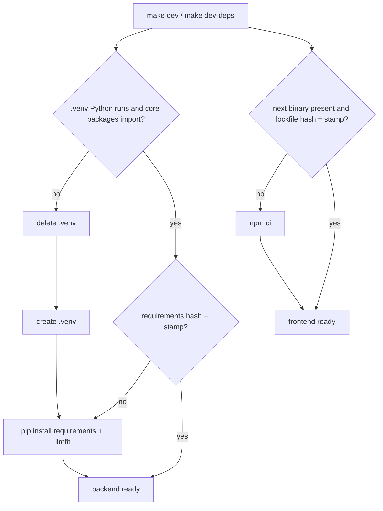

# Task: make dev Creates, Repairs, and Updates the Environments

## Goal
`make dev` must work on a fresh clone and recover from broken or outdated environments, instead of failing (user request, 2026-11-11, right after the move to `~/personal-projects/job-raider`). CLAUDE.md: the startup script keeps each backend `.venv` up to date with its `requirements.txt`.

## Constraints & Context
- The checks are fast when nothing changed (about 1 s), so they run on every start; mprocs processes do not repeat them (`DEV_DEPS_CHECKED`).
- llmfit stays optional: a failed install warns, and `NO_LLMFIT=1` skips it.
- It needs the user's "Yes, apply it" before the commit. Push only after the user approves.

## Acceptance Criteria
- [x] A fresh clone gets a `.venv` (with llmfit) and `node_modules` from `make dev-deps`.
- [x] A broken package, a changed requirements file, a missing `next` binary, and a changed lockfile are each detected and repaired.
- [x] Static tests guard the checks; the existing launcher test still passes; the full backend suite passes.
- [x] The user runs `make dev` in `~/personal-projects/job-raider`. (2026-11-11: "Yes, it works")

## Status
`done` (2026-11-11: commit `5cc602d`; CI run 42855541242 green)
