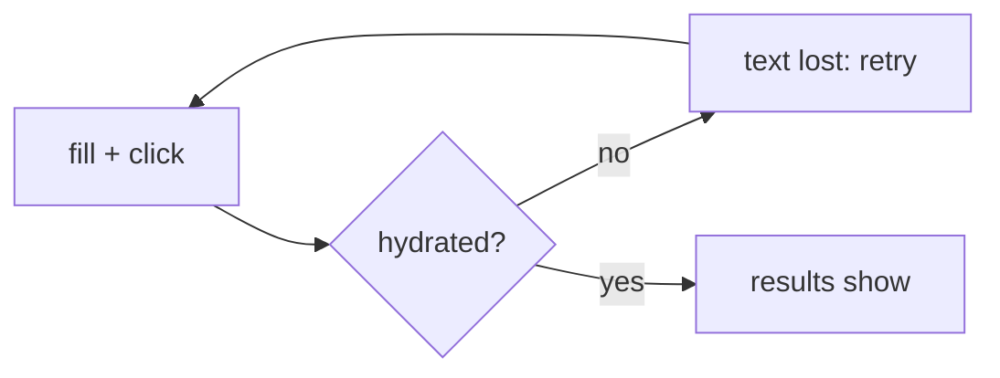

# Task: Stable Jobs Page E2E Search

## Goal
Stop the Jobs page E2E search tests from failing about 1 time in 10. The tests type into the Keywords field before React hydrates it, so hydration resets the field and no search runs.

## Constraints & Context
- Change the test only; the mocked search is safe to repeat. A search that never works must still fail.
- One runner handoff (`mh-1-jobs-search.md`). A flake cannot fail on demand, so the handoff has no red step; the proof is a forced race and repeated runs on a clone.
- It needs the user's "Yes, apply it". Push only after the user approves.

## Acceptance Criteria
- [x] With the page's JavaScript delayed (forced race), the old spec fails and the new spec passes.
- [x] Repeated runs of the Jobs spec on both projects have no failure.
- [x] The full E2E suite passes.

## Status
`done` (2026-11-10: applied as `f7d2462`; CI run 42732898798 green)
