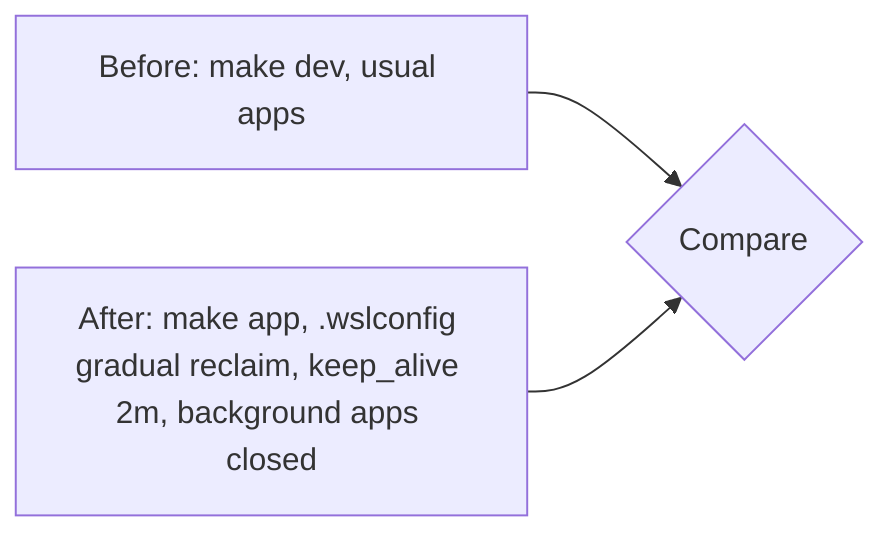

# Notes: lean-setup

Planned 2026-11-14 (user: make the app usable on 16 GB RAM; laptop RTX 2070). Review section to be added when the task is done.

## Progress 2026-11-14

- Recorder: added `committed_gb` (Windows `\Memory\Committed Bytes`) and `vmmem_gb` (`vmmemWSL` working set). Test sample with `make dev` running: GPU 4,840 MiB, RAM free 1.60 GB, committed 31.41 GB, `vmmemWSL` 2.81 GB.
- `make app` built on the scratch clone: `dev.sh` modes `app`, `app-api`, `app-frontend`; `APP_MODE=1` removes the uvicorn reload and runs the Next.js production server; the frontend builds only when `.next/BUILD_ID` is missing or older than `src`, `public`, `package.json`, or `next.config.*`. New `mprocs.app.yaml` and Makefile `app` target. `make dev` is unchanged (a test checks that it keeps `--reload` and the two reload directories).
- Tests: 6 new (app-api without reload; dev api keeps reload; frontend builds when there is no build; frontend reuses a current build; mprocs app config; Makefile target). Launcher and mprocs tests: 11 passed. black, ruff, and `bash -n` pass.
- Production build on the clone: 4 min 24 s, peak RSS 1.0 GB (one time, and again only after a source change).
- Frontend server memory, same pages loaded (`/`, settings, pipeline, jobs, cover letter, profile):
  - Dev server (`make dev`): `next-server` 585 MB + `next dev` 40 MB + postcss worker 89 MB + `npm` 38 MB = about 750 MB.
  - Production server (`next start`, port 3100): `next-server` 136 MB + `npm` 68 MB = about 205 MB.
  - Saving: about 550 MB. All pages returned 200 (the root 307 redirect is expected).

## Before run 2026-11-14 (today's setup: make dev, MLflow container, usual Windows apps)

Workload: 3 letters, Deep validation and Review & rewrite on (`measure_letter_flow.py`), from `main`.

| Letter | Time | Words | Stock phrases | Score | Rewrites |
|---|---|---|---|---|---|
| classifier_robotics | 1,285 s | 207 | 0 | 85 | 1 |
| fastapi_kubernetes | 140 s | 197 | 0 | 87 | 1 |
| forms_security | 50 s | 243 | 0 | 85 | 1 |

Total 1,475 s. Resources (85 samples): GPU idle 1.1 GB, peak 6.1 GB (never two models at once). RAM free fell from 1.85 GB to 0.39 GB. Committed memory rose from 29.3 GB to a peak of 34.8 GB on 15.9 GB. `vmmemWSL` grew from 2.65 GB to 5.26 GB. Pages/sec often above 1,000, peaks 19,380 and 22,909.

Finding (root cause of the slow first letter): under this memory pressure, a cold model load took longer than the client timeout (120 s). Ollama logged 9 "Load failed ... context canceled" between 16:16 and 16:36: each client timeout cancelled the load, and the retry started the load again from zero. Selection for letter 1 failed ("Request timed out after 120s") and the letter was written without it. The one-model-at-a-time before run (1,074 s for the first letter) probably had the same cause. This is a defect in how the client waits for a model load, separate from the setup. It must be fixed, or the after run measures the same retry loop.

## Handover to the laptop (2026-11-14)

- The user moves the work to the laptop (RTX 2070, 16 GB RAM). The desktop is then free to measure the lean setup.
- The session scratchpad was cleared, and the scratch clone with `make app` went with it. The change was rebuilt from the session record on a fresh clone and saved as `make-app.patch` (5 files: `scripts/dev.sh`, `mprocs.app.yaml`, `Makefile`, two test files). The 11 launcher and mprocs tests pass again; black, ruff, and `bash -n` pass. It is not applied to `main`.
- To use it on a scratch clone: `git apply tasks/active/lean-setup/make-app.patch`.
- `tools/profile_recorder.sh` (Windows host; argument: the output folder) and `tools/measure_letter_flow.py` (run from `apps/backend-py`; the eval pairs are in the repo) are the measurement tools from this task.
- Order agreed with the user: first `tasks/archive/ollama-load-timeout/`, then the lean-setup after run, then the `llama3.2:3b` experiment.

## Laptop: `make app` on a scratch clone (2026-11-15)

- `make-app.patch` applied to a fresh clone of `main` without conflicts. `bash -n scripts/dev.sh` passes.
- Red: the 6 new launcher tests fail on the original launcher files. Green: 2 of them still failed, because the test helper for `app-frontend` copied `dev.sh` without `scripts/find_python.sh` (added to `dev.sh` after the patch was written). The helper now copies it, as the other helper does. 11 launcher tests pass; full backend pytest 2405 passed; black, ruff, mypy gate (0 new) pass.
- Real start (`make app`, plain mode, env file from `.env.example`): both services up in 28 s, with the first production build. The root page gives 307; `/settings`, `/pipeline`, `/jobs`, `/cover-letter`, `/profile` give 200. The backend runs as one process without `--reload` (checked in `/proc/<pid>/cmdline`). A second start reused the build (no build step, frontend up in 2 s).
- Memory after the page loads: `next-server` (production) 123 MB, backend 825 MB.
- `next start` prints a warning: it does not support `output: standalone` (used by the Docker image) and proposes `node .next/standalone/server.js`. All pages are served. The guide must mention the warning.

## Laptop before run (2026-11-15, `make dev`, the usual Windows apps)

Setup: `main` with the load-timeout fix, `make dev`, native Ollama service, no MLflow container. Open Windows apps (largest first, working set): `vmmemWSL` 2,791 MB, Memory Compression 1,511 MB, Claude 1,065 MB, Edge WebView 879 MB, Opera 441 MB, Notion 340 MB, Brave 316 MB, Spotify 270 MB, Jagex Launcher 146 MB, Docker Desktop backend 102 MB.

| Letter | Time | Words | Stock phrases | Score | Rewrites |
|---|---|---|---|---|---|
| classifier_robotics | 94 s | 221 | 0 | 83 | 1 |
| fastapi_kubernetes | 56 s | 151 | 0 | 87 | 1 |
| forms_security | 54 s | 219 | 0 | 83 | 1 |

- Total 204 s, mean 68 s per letter. 0 cancelled loads, 0 request timeouts. 10 model loads (one model at a time).
- Resources: GPU peak 4,678 MiB, never two models at once. Windows free RAM from 2.58 GB down to 0.42 GB. Committed memory 28.65 GB at the start, peak 34.88 GB. `vmmemWSL` from 3.16 to 6.69 GB. Pages/sec above 1,000 in 11 of 15 samples, peak 121,718.
- The workload calls the backend code directly and loads no page, so the dev frontend stays small in this run. The frontend saving shows when pages are used (desktop: dev server about 750 MB, production about 205 MB).

## `make app` applied on `main` (2026-11-15)

- Applied after "Yes, apply it"; the diff on `main` was the same as the checked patch. On `main`: 11 launcher tests, black, ruff, mypy gate (0 new), full backend pytest (2405 passed). Commit "feat(dev): add make app, a lean run with the production frontend".
- `git apply` wrote `scripts/dev.sh` again with mode 644 on disk, so `./scripts/dev.sh` (called by the Makefile) could not run. The repository has `core.filemode=false` (from the Windows checkout), so git did not show it, and the commit keeps mode 100755. The file mode on disk was set back to 744 (as the other scripts).
- Start check on `main`, one page (`/settings`) loaded:
  - `make dev`: up in about 9 s; dev `next-server` 876 MB.
  - `make app`: up in about 30 s (with the production build); production `next-server` 119 MB; backend 821 MB in one process.
- Both modes log "Authentication MISCONFIGURED - API_KEY is not set" at start. This comes from the local backend settings, not from this change.

## Laptop run with `make app` only (2026-11-15; not the lean after run)

The machine changes were not in effect at the time of this run: no `.wslconfig` in the Windows user folder, WSL not restarted (up since 23:26 the day before), Docker Desktop running (8 processes), Brave, Spotify, and the Jagex Launcher open, and Ollama keep_alive still 5 minutes (the `expires_at` of the loaded models was 5 minutes after each call; the router follows the saved Settings). So this run measures `make app` against `make dev`, with the rest the same.

| Letter | `make dev` (before) | `make app` only |
|---|---|---|
| classifier_robotics | 94 s, score 83 | 127 s, score 63 |
| fastapi_kubernetes | 56 s, score 87 | 52 s, score 83 |
| forms_security | 54 s, score 83 | 50 s, score 83 |
| Total | 204 s | 229 s |

- 0 cancelled loads, 0 request timeouts, 10 model loads in both runs.
- Resources (`make app` only): GPU peak 4,678 MiB; Windows free RAM 3.01 GB at the start, minimum 0.47 GB; committed memory 29.08 GB at the start, peak 34.90 GB; `vmmemWSL` 3.12 to 7.16 GB; pages/sec peak 110,002.
- Server memory: production `next-server` 105 MB, backend 820 MB at the start. During the model loads, Linux moved both servers' pages out of RAM (backend 820 MB down to 12 MB resident, frontend 105 MB down to 7 MB), so WSL memory pressure was high.
- Result: with no page loaded, `make app` alone does not change the whole-machine numbers in this workload. The time difference (229 s against 204 s) is mostly the first letter (127 s against 94 s) and is in the range of run-to-run variation; the first letter's score (63) is the writer's own variation (temperature 0.7), not an effect of the launcher.

## Laptop lean after run (2026-11-15)

Checked before the run: `.wslconfig` with `autoMemoryReclaim=gradual` in the Windows user folder, read at the WSL start (09:35, after the file was written at 09:31); no Docker Desktop processes; Brave, Spotify, and the Jagex Launcher closed (only crash handlers and the Spotify launcher, 29 MB in total); Opera and Notion open; Ollama keep_alive 2m in Settings (checked at the first load: the model expired 119 s after the call). `make app` (production frontend, backend without reload).

| | Before (`make dev`) | After (lean) |
|---|---|---|
| classifier_robotics | 94 s, score 83, 0 stock phrases | 79 s, score 83, 2 stock phrases |
| fastapi_kubernetes | 56 s, score 87 | 48 s, score 87 |
| forms_security | 54 s, score 83 | 41 s, score 83 |
| Total time | 204 s | 168 s |
| Model loads | 10 (first 3b load 29.6 s earlier in the day) | 10 (4.2 to 18.1 s each) |
| Cancelled loads, timeouts | 0, 0 | 0, 0 |
| GPU peak | 4,678 MiB | 4,669 MiB |
| Windows free RAM, start / minimum | 2.58 / 0.42 GB | 1.45 / 0.32 GB |
| Committed memory, start / peak | 28.65 / 34.88 GB | 24.54 / 30.33 GB |
| `vmmemWSL`, start / peak | 3.16 / 6.69 GB | 4.10 / 7.07 GB |
| Pages/sec, peak; samples above 1,000 | 121,718; 11 of 15 | 64,950; 11 of 15 |
| Frontend server | dev server (no page loaded) | production, 116 MB |
| Opera working set | 441 MB | 1,973 MB |

Findings:
- Time per letter fell by 18 % (204 to 168 s). Model loads were faster (4 to 18 s), probably because less paging competed with the loads. One run each; the writer's own variation (temperature 0.7) is part of the difference.
- Committed memory fell by about 4.5 GB at the start and at the peak. The paging peak halved. This is the effect of the closed apps (Brave, Spotify, Jagex, Docker Desktop), even with Opera at 1,973 MB instead of 441 MB (more tabs after the reopen).
- Windows free RAM stayed low (minimum 0.32 GB) in both runs: Windows uses free memory as cache, and WSL kept up to 7 GB during the run. `autoMemoryReclaim=gradual` gives memory back only when WSL is idle; the idle samples after the run are below.
- The quality guard of the writer is not part of this task. The stock phrases in letter 1 of the after run ("i am confident that", "invaluable") are writer variation; the lighter-writer task measures quality.
- WSL start after `wsl --shutdown` with systemd: Ollama was ready after about 90 s, when systemd finished its start. The guide tells the user to wait for it.
- Problem found during the setup for this run: both env files had Windows line endings and an empty `API_KEY`. `setup.sh` read the carriage return as a key, so it did not generate one, and the backend rejected every request (the Settings form did not load). The files were fixed with the user's approval (LF, one shared new key; no value was shown). The `setup.sh` defect is a separate fix.

### Idle memory after the lean after run (`autoMemoryReclaim=gradual`)

Samples every 60 s after the run ended (10:12:50), no app running, no model loaded:

| Time | `vmmemWSL` | Windows free RAM | Linux page cache |
|---|---|---|---|
| 10:13:32 | 6.60 GB | 1.06 GB | 6,451 MB |
| 10:15:34 | 6.54 GB | 1.47 GB | 6,470 MB |
| 10:16:35 | 6.18 GB | 1.71 GB | 6,072 MB |
| 10:19:38 | 5.21 GB | 1.91 GB | 5,002 MB |
| 10:23:41 | 4.17 GB | 2.46 GB | 3,843 MB |

- The release started about 3 minutes after the run and continued at about 0.3 GB per minute (2.4 GB in 10 minutes). Without the setting, WSL keeps its page cache until it stops.
- A memory cap (decision 2) is not needed for now: gradual reclaim returns the memory when the work stops, and a cap could slow the model loads during the work (not measured).

## Review (2026-11-15)

- `make app` applied after "Yes, apply it" (the diff on `main` was the same as the checked patch, with the test helper fix). The guide and the measurements were committed after the user's approval. Pushed; CI run 43669248430 passed (12 jobs passed, Build Docker Image skipped).
- Result on the laptop: 18 % less time for 3 letters, about 4.5 GB less committed memory at the peak, half the paging peak. Gradual reclaim returned 2.4 GB in 10 idle minutes. A memory cap is not needed for now.
- `make-app.patch` in this folder is the version from the desktop; the applied change also has the `find_python.sh` copy in the `app-frontend` test helper.
- Follow-ups: the `setup.sh` defect (it reads a carriage return as an API key) is a separate fix. The model changes with one model at a time on (about three per letter) are measured again in the lighter-writer task.
