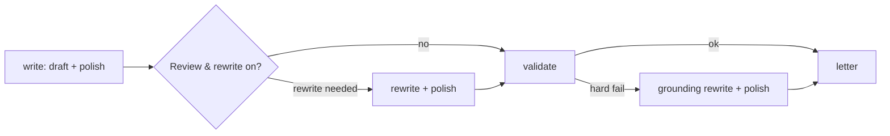

# Task: Stock-Phrase Polish After Every Letter Rewrite

## Goal
Make sure no letter leaves the app with a stock phrase that the polish step would have removed: run the polish step after each rewrite, not only after the first draft.

## Constraints & Context
- Cover letter test (2026-11-14, Cover Letter page, pasted unstructured job description, Deep validation and Review & rewrite on): the final letter had "i am confident that" (detector count 1; body 264 words).
- Cause: `CoverLetterWriter.write` runs `polish_stock_phrases`; `cover_letter_service.generate_cover_letter_sync` can then call `CoverLetterWriter.rewrite` twice (after the reviewer's critique, and the grounding rewrite after a hard-fail validation). `rewrite` has no polish step, so the final letter can carry stock phrases again.
- The polish step was measured for first drafts (`tasks/archive/generic-phrasing/`: 83% to 9.5% of letters with stock phrases; grounding not worse). It is a step after writing, so it can be measured on the same rewritten letters before and after (lesson of 2026-11-14).

## Plan

1. `CoverLetterWriter.rewrite` runs `polish_stock_phrases` on its output (same style and model as the rewrite) and records `stock_phrase_edits`, as `write` does. Both rewrite paths in the service get it from one place.
2. Tests with a fake router: a rewrite with a stock phrase is polished; a rewrite without one makes no extra call; the service's review-and-rewrite path returns a polished letter.
3. Check on real letters: the full service (Review & rewrite on) on a few grounding pairs from a scratch clone, counting stock phrases in the final letters and the flagged ungrounded sentences, with and without the step on the same rewritten letters.

## Acceptance Criteria
- [x] `rewrite` polishes its output; `stock_phrase_edits` recorded.
- [x] Unit tests, red step, and mutants; CI checks pass locally.
- [x] Real-letter check: fewer final letters with stock phrases; no letter gains a grounding flag.
- [x] Applied after "Yes, apply it"; pushed after approval; the CI run passes.
- [x] `tasks/todo.md` updated; folder archived.

## Status
`done` (2026-11-14)
