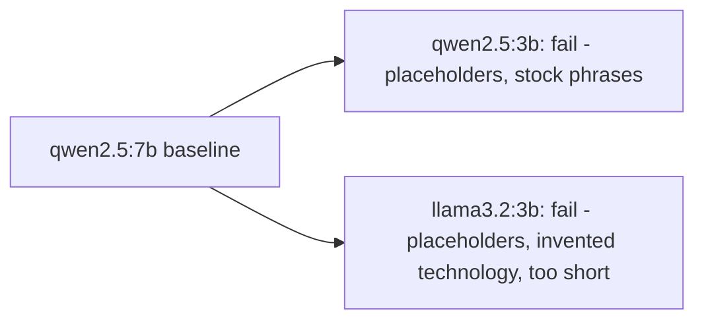

# Notes: lighter-writer

Planned 2026-11-15 on the laptop (work order step 4). `llama3.2:3b` pulled (2.0 GB, digest checked) the same day.

## Code change on a scratch clone (2026-11-15)

- Finding: the resume suite had no model override, and the writer suite passes its model per call (`CoverLetterWriter.write(model=...)`). `ResumeWriter.write` has no model argument.
- Change:
  - `writer.py`: `llama3.2:3b` added to `WRITER_MODELS`.
  - `resume.py`, `local_resume_writer`: resolves the route with `model` as an override (the router accepts it only for a model installed in Ollama), then sets `model` on the run's in-memory `resume_writing` route, so the CV writer and the polish step use it. The saved Settings do not change. The error message now says "Pull the model, or set the resume writing route to Ollama in Settings."
- Tests: `test_lighter_writer_models.py` (4): `llama3.2:3b` passes `check_model`; a model off the list is still refused; the resume suite uses the run model when the saved route has another model; a model that Ollama does not have is refused, and the route does not change. Red: 2 failed (the allow-list, the run model), 2 passed.
- `test_writer_command.py`: the allow-list test listed the four models of Step 3.8; it now lists five (the plan check approved `llama3.2:3b`).
- Checks on the clone: 37 tests in the three suite files; black (369 unchanged), ruff, mypy gate (0 new), full backend pytest (2413 passed).

## Code change applied (2026-11-15)

Applied after "Yes, apply it" (commit "feat(eval): allow llama3.2:3b and a --model override for the resume suite"); the content on `main` is the same as on the clone. On `main`: 53 suite tests, black, ruff, mypy gate (0 new), full backend pytest (2413 passed). Not pushed yet.

## Baseline runs, `qwen2.5:7b` (2026-11-15, laptop)

Setup: lean setup (no `make app`, keep_alive 2m, no Docker Desktop, Brave, Spotify, or Jagex; Opera closed, Notion open), native Ollama, `main` at the commit that planned this task (git dirty: false). Reports go to the session scratchpad (`--out`), not to `data/eval/`. One recorder per run.

| Run | Time | MLflow run | Result |
|---|---|---|---|
| Writer, 195 letters | 26 min | `36002d10af8948f5a70afdbfed29917f` | 195 written, 0 fallback, 0 error |
| Resume, 65 CVs | 9 min | `beffdcdf49f44c739c17055ffc76135b` | 65 written, 0 fallback, 0 error |

Letters: `unfilled_placeholder_rate` 0.0, `ungrounded_claims_rate` 1.0, `scope_inflation_rate` 0.19, `fabricated_technology_rate` 0.0, `fabricated_experience_rate` 0.005, `generic_phrasing_rate` 0.149, `words_p50` 233, `valid_rate` 0.887, `mean_score` 90.34, latency p50 7.7 s / p95 9.1 s, peak VRAM 4,667 MiB.

CVs: `hallucinated_skill_rate` 0.0, `unsupported_numbers_rate` 0.031 (2 of 65), `generic_phrasing_rate` 0.031 after the polish step (0.492 before; 30 CVs lost stock phrases, 0 gained an accuracy flag), `date_inconsistency_rate` 0.031, `prose_words_p50` 82, `valid_rate` 1.0, `mean_score` 100, latency p50 7.2 s / p95 8.9 s, polish p50 0.9 s, peak VRAM 4,667 MiB.

Resources: writer run: free RAM minimum 0.48 GB, committed peak 29.56 GB, `vmmemWSL` peak 7.05 GB, paging peak 108,511 pages/s (23 of 104 samples above 1,000). Resume run: 0.44 GB, 29.30 GB, 6.88 GB, 60,929 pages/s (13 of 37). 0 cancelled loads in both runs.

Ceiling check (before the candidate runs):
- `ungrounded_claims_rate` is 1.0 (at its ceiling), as in Step 3.8. The rule already uses the paired secondary analysis (S1: flagged sentences per letter), not this share.
- All other guard metrics are below their ceiling. `fabricated_technology_rate` and `unfilled_placeholder_rate` are 0.0 at the floor: "not higher" means a candidate must also be at 0 (placeholders: at most 1 of 195 by the rule).

## Candidate runs (2026-11-15, laptop, same setup as the baseline)

| Run | Time | MLflow run |
|---|---|---|
| Writer, `qwen2.5:3b` | 14 min | `f0dd5cd54db54c508a18092e91594e05` |
| Resume, `qwen2.5:3b` | 4 min | `8ea200328b3c4e518b60c38c9c0c66e8` |
| Writer, `llama3.2:3b` | 12 min | `353d140a31474c7195fda22f69012c6a` |
| Resume, `llama3.2:3b` | 6 min | `a2e9ee4b0fb54c909c035250dbbb420d` |

All runs: 0 fallback, 0 error, 0 other model, 0 cancelled loads.

### Letters (195 per model)

| Rule item | `qwen2.5:7b` | `qwen2.5:3b` | `llama3.2:3b` |
|---|---|---|---|
| Unfilled placeholders (at most 1) | 0 | 21 (0.108), fail | 3 (0.015), fail |
| S1, ungrounded sentences per letter (interval not above 0) | 4.123 | 3.036; -1.087 (-1.395 to -0.774), pass | 2.518; -1.605 (-1.954 to -1.256), pass |
| S2, scope inflation (interval not above 0) | 0.190 | 0.164; -0.026 (-0.113 to 0.056), pass | 0.036; -0.154 (-0.221 to -0.087), pass |
| Fabricated technology (not higher) | 0.000 | 0.000, pass | 0.005 (1 letter), fail |
| Stock phrases (at most +0.05) | 0.149 | 0.579, fail | 0.133, pass |
| Median words (at least 180) | 233 | 203, pass | 166, fail |
| Result | baseline | **fail** | **fail** |

Reported only: fabricated experience 0.005 / 0.036 / 0.056; valid share 0.887 / 0.790 / 0.913; mean score 90.3 / 88.9 / 87.8; latency p50 7.7 / 4.3 / 3.1 s; peak VRAM 4,667 / 2,195 / 2,565 MiB; letters under 150 words: 15 (3b), 52 (llama).

### CVs (65 per model, after the polish step)

| Rule item | `qwen2.5:7b` | `qwen2.5:3b` | `llama3.2:3b` |
|---|---|---|---|
| Hallucinated skills (at most +1 CV) | 0 | 0, pass | 0, pass |
| Unsupported numbers (at most +1 CV) | 2 (0.031) | 0, pass | 2 (0.031), pass |
| Stock phrases after polish (at most +0.05) | 0.031 | 0.000, pass | 0.354, fail |
| Result | baseline | **pass** | **fail** |

Reported only: stock phrases before polish 0.492 / 0.015 / 0.831; CVs gaining an accuracy flag in the polish step 0 / 0 / 0; prose words p50 82 / 68 / 90; latency p50 7.2 / 4.1 / 4.4 s; peak VRAM 4,667 / 2,195 / 2,569 MiB; run time 9 / 4 / 6 min.

### Resources (recorder, per run)

| Run | GPU peak | Free RAM min | Committed peak | `vmmemWSL` peak | Paging peak (samples above 1,000) |
|---|---|---|---|---|---|
| Writer 7b | 4,671 MiB | 0.48 GB | 29.56 GB | 7.05 GB | 108,511 (23 of 104) |
| Writer 3b | 2,199 MiB | 0.42 GB | 26.94 GB | 7.01 GB | 5,148 (7 of 59) |
| Writer llama | 2,569 MiB | 0.45 GB | 27.43 GB | 6.75 GB | 35,601 (19 of 50) |
| Resume 7b | 4,671 MiB | 0.44 GB | 29.30 GB | 6.88 GB | 60,929 (13 of 37) |
| Resume 3b | 2,199 MiB | 0.77 GB | 26.60 GB | 6.57 GB | 16,518 (3 of 20) |
| Resume llama | 2,573 MiB | 0.39 GB | 27.43 GB | 7.47 GB | 5,252 (8 of 27) |

### Real output (3 letters and 3 CVs per model, written again with the suites' writers; CVs before the polish step)

- `qwen2.5:7b`: letters 222 to 238 words, specific, one mixes a project into an internship ("At Harbor Finch, I added automated tests for queue rules within our Campus Queue application"). CVs add small unsupported phrases ("ensuring data integrity", "streamlining the deployment process") and "proven track record" (removed by the polish step).
- `qwen2.5:3b`: letters 142 to 208 words, correct facts, generic openings and closings ("I am excited to apply", "I am confident that"); one letter claims a job requirement as experience ("My role there also involved writing decisions down and reviewing changes before they were released"). CVs repeat the profile facts almost word for word, with no added claims; shorter summaries.
- `llama3.2:3b`: serious faults that the metrics show only in part: one letter in the third person ("Mara Chen is revolutionizing data imports"), one invented project ("an autonomous vehicle project, where I successfully integrated Java libraries for navigation"), and one CV with job-ad duties as bullets ("Will be responsible for building reliable web services and data APIs").
- No unfilled bracket placeholder in these 18 samples (the suite runs found them at the rates above).

### Result

- Letters: neither candidate is good enough; `qwen2.5:7b` stays the letter writer.
- CVs: `qwen2.5:3b` passes every rule item and reads accurate in the samples, with half the GPU memory (2.2 against 4.7 GB), about half the time per CV, and less paging. Its CV prose is shorter (68 against 82 words).
- With one model at a time on, `qwen2.5:3b` is already loaded for the selection and checks, so `qwen2.5:3b` as the CV writer would also remove model changes during CV generation (not measured in this task).
- `llama3.2:3b` is not suitable for either document type.
- The default writer does not change in this task (plan). The user decides on a CV change as a separate step.

## Review (2026-11-15)

- Code change, results, and the guide section pushed after approval. CI run 43681265853 passed (all jobs; Build Docker Image skipped).
- Open decision for the user (Next Up in `tasks/todo.md`): `qwen2.5:3b` as the default CV writer. Before a change, measure the effect on the model changes per CV with one model at a time on.
