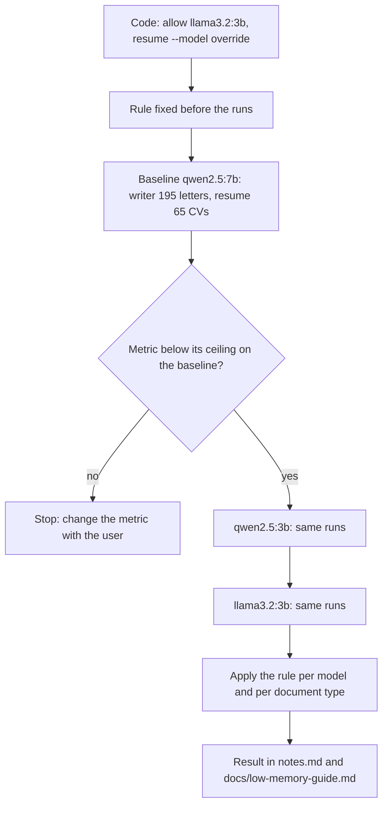

# Task: Lighter Writer for Smaller GPUs

## Goal
Find out if `qwen2.5:3b` or `llama3.2:3b` can write cover letters and CVs as well as `qwen2.5:7b`, with less GPU memory and time, so that the app is usable on GPUs with less than 8 GB. Measure on the laptop (RTX 2070, 8 GB) with the writer and resume suites, and decide with a rule that is fixed before the runs.

## Context
- `qwen2.5:7b` is the writer for letters and CVs. With the app running, total GPU use was 7.2 to 7.3 of 8 GB on the desktop; on the laptop the model alone uses 4.7 GB.
- `qwen2.5:3b` was the default letter writer for two days (2026-11-03 to 2026-11-05, `tasks/archive/writer-default-3b/`). It was reverted: it wrote unfilled `[Company]` placeholders (18 of 195 letters with the "no brackets" prompt rule, 0 of 195 for 7b; `tasks/archive/writer-placeholders/`). The validator now has the hard issue `unfilled_placeholder`. Any new comparison must count it.
- Step 3.8 (`tasks/archive/step-3-8-writer-models/`) compared writers on the desktop with 195 letters per model and the paired secondary analysis (`compare_writer_reports.py --secondary`). Its numbers are from older prompts (before the stock-phrase rules and polish steps), so this task runs the 7b baseline again.
- The CV suite (`main.py eval resume`, `tasks/archive/cv-eval-suite/`): 7b baseline with 1 sample per pair: hallucinated skills 0.000, unsupported numbers 0.016, stock phrases 0.406 (before the polish step), 14 min on the desktop.
- Code limits found:
  - Both suites accept only models in `WRITER_MODELS` (`src/evaluation/suites/writer.py`); `llama3.2:3b` is not in the list.
  - The resume suite has no model override: it uses the saved `resume_writing` route from Settings. The writer suite already passes `--model` as a route override.
  - The suites measure GPU memory (`nvidia-smi`), not RAM. The recorder from the lean-setup task (`tasks/archive/lean-setup/tools/profile_recorder.sh`) records RAM, paging, and committed memory.
- `llama3.2:3b` is pulled (2.0 GB) in the native Ollama store.

## Plan
1. Code change (scratch clone, red tests first, CI checks, "Yes, apply it"):
   - Add `llama3.2:3b` to `WRITER_MODELS`.
   - Resume suite: pass `--model` as an override of the `resume_writing` route, as the writer suite does for `cover_letter_writing`, with the fallback off. The saved Settings do not change.
   - Tests: the resume suite uses the given model without a Settings change; `llama3.2:3b` passes `check_model`; an unknown model still fails.
2. Runs on the laptop, lean setup (`make app` stopped during the runs, keep_alive 2m, background apps closed), one model at a time, with the recorder on:
   - Writer suite: `--samples 3` (195 letters) per model.
   - Resume suite: `--samples 1` (65 CVs) per model.
   - Order: `qwen2.5:7b`, then `qwen2.5:3b`, then `llama3.2:3b`. All runs log to MLflow (the local store).
   - Before the 3b runs: check on the 7b baseline that each guard metric is below its ceiling.
3. Decision rule (fixed before the runs; per model, letters and CVs separately). A candidate is "good enough for smaller GPUs" only if all are true against the 7b baseline of the same machine and code:
   - Letters:
     - `unfilled_placeholder`: at most 1 of 195 letters.
     - `--secondary` analysis: the S1 interval (ungrounded sentences per letter) is not above 0, the S2 interval (scope inflation) is not above 0, and `fabricated_technology` is not higher.
     - Stock-phrase share: not higher than the baseline by more than 0.05.
     - Median words: at least 180 (Step 3.8: letters of 160 words were too short).
   - CVs:
     - `hallucinated_skill_rate` and `unsupported_numbers_rate`: not higher than the baseline by more than 1 CV of 65 each.
     - Stock-phrase share after the polish step: not higher than the baseline by more than 0.05.
   - Report for each model, with no pass or fail: peak GPU memory, latency p50 and p95, total run time, Windows free RAM minimum, committed memory peak, paging peak.
4. Result:
   - `notes.md`: one table per document type, the rule result per model, and a short reading of real output (3 letters and 3 CVs per model; lesson "Read real output before you recommend a model").
   - `docs/low-memory-guide.md`: a section "Smaller GPUs" with the result.
   - The default writer does not change in this task. If a model passes, the user decides on a change (a Settings recommendation for small GPUs, or a new default) as a separate step.

## Constraints & Context
- Local models stay at 7B or smaller; one Ollama service; one model in GPU memory at a time. Never run a coding agent's local model during the runs.
- Run time on the laptop is not known: on the desktop, one writer run took 10 to 13 min and one resume run 14 min. Six runs on the laptop can take 1.5 to 3 hours. The runs go in the background, one after another, with the recorder; the laptop must stay on.
- Never read `.env`, `.env.local`, `user_settings.json`, or the contents of `data/`. The eval reports are written to `data/eval/`; the notes use the MLflow run IDs and the printed summaries only.
- Workflow: plan check, scratch clone for the code change, "Yes, apply it", separate approval to push.

## Acceptance Criteria
- [x] Plan checked by the user (2026-11-15).
- [x] Code change: `llama3.2:3b` allowed; resume suite `--model` override; tests red first, then green; CI checks pass; applied after "Yes, apply it".
- [x] Baseline runs (7b, writer and resume) with the recorder; guard metrics below their ceiling (except the ungrounded share, as planned).
- [x] Runs for `qwen2.5:3b` and `llama3.2:3b` with the recorder.
- [x] Rule applied per model and per document type; real output read; results in `notes.md`.
- [x] `docs/low-memory-guide.md` updated; pushed after approval; the CI run passes.
- [x] `tasks/todo.md` updated; folder archived.

## Status
`done` (2026-11-15)
