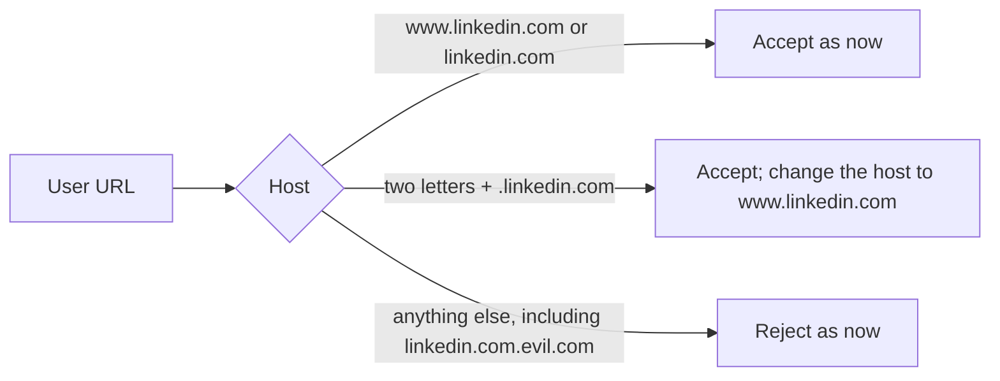

# Task: Allow LinkedIn Country Hosts

## Goal
Accept LinkedIn URLs on a country host, such as `https://sg.linkedin.com/in/name`, and use them as `https://www.linkedin.com/in/name`. Open question from Step 2 (2026-10-21), not blocking.

## Constraints & Context
- `src/linkedin/profile_url.py` (Step 2.6) allows only `linkedin.com` and `www.linkedin.com`. It is a security check: a crafted URL must not point the browser at another site, a file, or an IP address.
- Callers: `validate_linkedin_profile_url` (profile URL in `models/linkedin_analysis.py`, used by the LinkedIn profile analysis route in `api/routes/profile.py`, and `session.py`); `validate_linkedin_navigation_url` (`session.py`, `navigate_to_url`).
- LinkedIn share links often use a country host (`sg.`, `uk.`, `de.`, and others), so a user who pastes such a link gets "URL must use a linkedin.com host".
- Keep dry run as the default and keep LinkedIn auto-submit unreachable (`src/linkedin/` stays dormant except the profile URL check).

## Plan

1. `profile_url.py`: a host is allowed when it is `linkedin.com`, `www.linkedin.com`, or exactly two lowercase letters followed by `.linkedin.com` (a full match on the host name, not a suffix check). All other rules stay (https only, no credentials, `/in/` path for profiles).
2. A country host is changed to `www.linkedin.com` in the returned URL (path, query, and fragment stay), so the app stores and opens one form of each profile.
3. Tests in `tests/unit/test_linkedin_profile_url_validation.py`: `sg.` and `uk.` accepted and changed to `www.`; still rejected: `linkedin.com.evil.com`, `evil-linkedin.com`, `sg.linkedin.com.evil.com`, `abc.linkedin.com`, `s.linkedin.com`, `http://sg.linkedin.com/...`, credentials on a country host, and a country host without `/in/` for a profile.

## Acceptance Criteria
- [x] Two-letter country hosts are accepted for profile and navigation URLs, and the returned URL uses `www.linkedin.com`.
- [x] Every rejection in the current tests still holds, plus the new look-alike hosts above.
- [x] Red step and mutants (a suffix check instead of a full match; no host change) are caught.
- [x] CI checks pass locally (black, ruff, mypy gate 0 new, pytest).
- [x] Applied after "Yes, apply it"; pushed after approval; the CI run passes; recorded in `notes.md`.
- [x] The open question is removed from Next Up in `tasks/todo.md`; folder archived.

## Status
`done` (2026-11-13)
