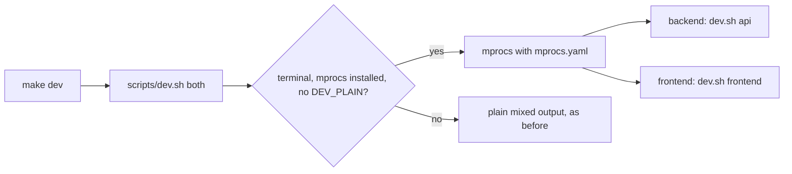

# Task: One Split View for make dev

## Goal
`make dev` shows the backend and the frontend in one terminal, as a split view with a process list and status (like the Turborepo terminal UI), instead of two mixed log streams (user request; user chose mprocs over tmux).

## Constraints & Context
- mprocs (MIT) is pinned to 0.9.6 as a frontend dev dependency, so `npm ci` installs it with no extra setup step. Its npm launcher needs `node` on the PATH, as the frontend does already.
- The plain mode stays: no binary, no terminal, or `DEV_PLAIN=1`.
- One direct commit, checked on the clone and cherry-picked (the runner cannot carry the `package-lock.json` change). It needs the user's "Yes, apply it". Push only after the user approves.

## Acceptance Criteria
- [x] `mprocs.yaml` starts `dev.sh api` and `dev.sh frontend`; `dev.sh both` hands off to mprocs in a terminal.
- [x] Tests guard the config, the pin, and the switch; the README, `docs/usage.md`, and the Makefile help say how to use it.
- [x] The user runs `make dev` on this machine and sees both services in one view. (2026-11-10: "Yes, it works")

## Status
`done` (2026-11-10: applied as `e1cdebd`; CI run 42844773681 green)
