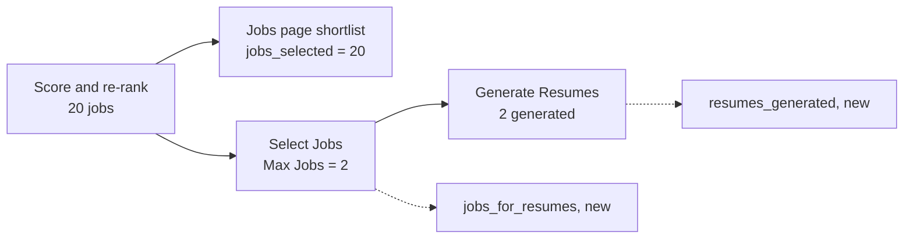

# Notes: Monitor Resume Count

## Observations (2026-10-29, Claude)

- In two full-mode dry runs with Max Jobs 2 (`run_0e3dbf88`, `run_0de31c69`), the Live Monitor showed "60 scraped · 20 scored · 20 shortlisted". The user expected 2 jobs.
- Max Jobs works. It is `max_jobs_to_present`, the limit of the Select Jobs stage (`present_selection`). Both runs selected 2 jobs and generated 2 resumes.
- "Shortlisted" is `jobs_selected = len(rag_ranked_listings or scored_listings)` in `routes/pipeline.py`: the ranked list that the run saves for the Jobs page. The status response has no count for the jobs that went to Generate Resumes.
- `get_pipeline_status` already reads the Generate Resumes metadata for `cloud_documents`. The new counts use the same pattern.

## Decisions (2026-10-29)

1. The user asked for a handoff (not a fix by Claude). Two micro-handoffs, one per layer: MH-1 backend (the status counts), MH-2 frontend (the resume line).
2. Keep `jobs_selected` and the "shortlisted" text as they are; add a second line. The database column and the History tab do not change.
3. The frontend tests run in WSL with Node 24 (`nvm use 24`), because `node_modules` has Linux binaries.

## Dry run of the micro-handoffs (2026-10-29, Claude)

On scratch copies in WSL's native disk (`/tmp/mrc`, not the repository). The frontend copy uses the repository's `node_modules` through a link.

- MH-1: before the change, the 2 new tests fail. After the change, the 23 tests pass (2 new, 21 in `test_pipeline_routes.py`). The given test and the 3 changed files pass black and ruff. (The first draft of the test had one line that black wraps; the handoff now has black's form.)
- MH-2: before the change, 2 of the 3 new tests fail (the "hides" test passes, because the line does not exist yet). After the change, the 7 Live Monitor tests pass (3 new, `cloud-badge`, `live-monitor`). prettier, eslint, and `npm run type-check` pass. (The first draft of the test had one line that prettier wraps; the handoff now has prettier's form.)
- `node_modules/.vite` and `coverage/` in `apps/frontend-ts` belong to root (some `node_modules/.bin` links too), probably from an earlier install or run as root. Vitest then fails with `EACCES` when it writes `node_modules/.vite/vitest/results.json`. `npx vitest run --no-cache` does not write that file and passes in the repository, so the handoff and `AGENT.md` use `--no-cache`. A lasting fix needs the user (`sudo chown`).

## Check of MH-1 (2026-10-30, Claude, commit `f4dad31`)

- The commit changes only `responses.py`, `routes/pipeline.py`, and the new test file. The diff matches the handoff line for line (the two fields, the two start values, the `present_selection` block, the `generated_count` line, and the two response arguments). The test file is the same as the handoff, character for character.
- Checks: 23 tests pass (2 new, 21 route tests). black and ruff pass.
- Mutation proofs (each on its own copy in WSL's native disk; the repository file did not change): R1 `jobs_for_resumes` not read, R2 `jobs_for_resumes` from the shortlist count, R3 a wrong stage key for Select Jobs, R4 `resumes_generated` from `attempted_count`, R5 and R6 a count not in the response. All 6 were caught.
- Full backend gate: black and ruff pass on the CI paths, the mypy gate has 0 new errors (180 known), and pytest has 1702 passed (1700 before, and 2 new tests).

Result: accept MH-1.

## Check of MH-2 (2026-10-30, Claude, commit `e12658a`)

- The commit changes only `api.ts`, `page.tsx`, and the new test file. The diff matches the handoff line for line (the two optional fields with comments, the two constants, and the resume line). The test file is the same as the handoff, character for character.
- Checks: the 7 Live Monitor tests pass (3 new, `cloud-badge`, `live-monitor`).
- Mutation proofs (each on its own copy, with the repository's `node_modules` linked; the repository file did not change): F1 the line shows when the count is 0, F2 no singular "job", F3 "generated" shows the selected count, F4 the selected count from the shortlist, F5 the generated count from the wrong field. All 5 were caught.
- Frontend gate (WSL, Node 24.22.1): `npm run lint` and `npm run type-check` pass, prettier passes on the 3 changed files, and the full vitest suite (`--no-cache`) has 256 tests in 48 files passed.

Result: accept MH-2. To close the task: a full-mode run after `make docker-up` (the frontend image changed) must show the resume line.

## The full-mode run (2026-10-30, the user, run `run_18ae691859d2`, `pipeline_run_20261030_011746.json`)

The user ran `make docker-up` first (both containers were made 6 minutes before the run), then a full-mode run: MyCareersFuture, Min Score 30, Max Jobs 2, Dry Run on, Skip Submission off.

- The run file: Select Jobs `selected_count` 2; Generate Resumes 2 generated (2 PDF, 2 DOCX), score 100; `submit_applications` ran with `dry_run` true, 0 applied, 0 simulated, 2 manual (no job had auto-submit).
- The Live Monitor (Claude, built-in browser, the run opened from History): "60 scraped · 20 scored · 20 shortlisted" and under it "Resumes: 2 jobs selected (Max Jobs) · 2 generated". The stage list ends with "Submit Applications".

Result: "Done when" is met.

## Review (2026-10-30, Claude)

- Goal met: the Live Monitor shows the jobs that Max Jobs selects for resumes and the resumes generated, next to the Jobs page shortlist.
- 2 micro-handoffs (backend, frontend), done by the agent in opencode. 11 of 11 mutation proofs were caught. 1702 backend tests and 256 frontend tests pass.
- Found on the way: root owns `node_modules/.vite` and `coverage/` in `apps/frontend-ts`, so vitest needs `--no-cache` until the user changes the owner.

## Blockers / Questions

- None.
