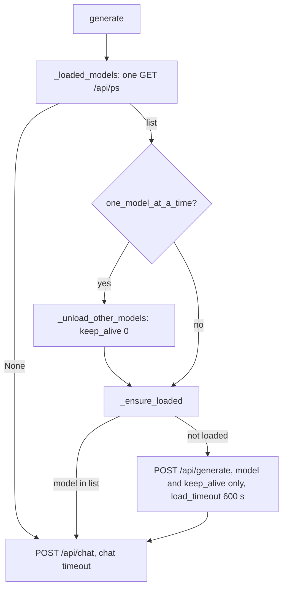
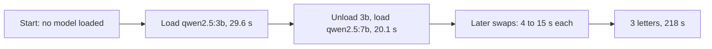

# Notes: ollama-load-timeout

Planned 2026-11-14 after the lean-setup before run found the load retry loop. Review section to be added when the task is done.

## Build on a scratch clone (2026-11-14, laptop)

- `src/llm/ollama_client.py`: `DEFAULT_LOAD_TIMEOUT = 600`; constructor argument `load_timeout`; `_loaded_models()` returns the names from `/api/ps` or `None`; `_unload_other_models(loaded)` takes that list; `_ensure_loaded(loaded, keep_alive)` sends the load request and logs the load time, or a warning on an error or a timeout. `generate()` calls `/api/ps` once and uses the result for both steps. The load uses the keep_alive of the chat request (the call value, else the client value); without one, the body has only the model.
- Change to the plan: one `/api/ps` call for both steps, not one call in each step. The existing one-model call sequences do not change.
- Existing tests changed:
  - `test_ollama_one_model.py`: `test_option_off_does_not_ask_ollama` asserted no `/api/ps` call with the option off. The plan makes the load step run for every setting, so the test is now `test_option_off_does_not_unload_other_models` (no unload; `/api/ps` and the load still run).
  - `test_ollama_token_counts.py`, `test_ollama_client_content.py`, `test_router_structured_options.py`: these mocked only `requests.post`, so the new `/api/ps` call went to a real Ollama server when one ran (3 tests failed on the laptop with the native service; in CI they would pass by chance). They now patch `_loaded_models`, so no unit test sends a request to a real server.
- Red: 10 new tests failed (no load step). Green: 38 tests in the five files pass.
- CI checks on the clone: black (367 files unchanged), ruff (all passed), mypy gate (177 known, 0 new), full backend pytest 2399 passed with the native Ollama running. No model was loaded during the run (GPU 17 MiB before and after, `/api/ps` empty).
- Run with `OLLAMA_HOST=127.0.0.1:9`: 1 failure, `test_one_generation_makes_one_http_request`. It compares the URL with `http://localhost:11434`; it fails in the same way on `main` without this change. CI does not set `OLLAMA_HOST`.
- Open: the measurement run (plan step 3) needs the app with the user's data, so it runs on `main` after the change is applied.

## Measurement run on the laptop (2026-11-14, `main` with the fix)

Setup: `make dev` (backend and frontend), native Ollama service, no MLflow container, the usual Windows apps open (browser, Notion, Claude app). Workload: `measure_letter_flow.py` (3 letters, Deep validation and Review & rewrite on). Recorder: `profile_recorder.sh`, 18 samples (one sample lost: a Windows counter call failed). No model was loaded at the start.

| Letter | Time | Words | Stock phrases | Score | Rewrites |
|---|---|---|---|---|---|
| classifier_robotics | 106 s | 207 | 0 | 83 | 1 |
| fastapi_kubernetes | 55 s | 192 | 0 | 87 | 1 |
| forms_security | 57 s | 220 | 0 | 83 | 1 |

- Total 218 s, mean 73 s per letter. The desktop before run: 1,285 / 140 / 50 s (total 1,475 s).
- Ollama log for the run: 0 "context canceled", 0 "Load failed". App log: 0 "timed out".
- The new load step logged each load: the first cold loads took 29.6 s (`qwen2.5:3b`) and 20.1 s (`qwen2.5:7b`); later loads took 4.3 to 14.3 s.
- Resources: GPU peak 4,678 MiB, never two models at once. Windows free RAM 0.37 to 1.27 GB. Committed memory 29.65 GB at the start, peak 34.71 GB. `vmmemWSL` grew from 5.10 to 7.02 GB. Pages/sec above 10,000 in 13 of 17 samples, peak 115,931.
- Limits of the comparison:
  - Different machine and setup (laptop, no MLflow container), and the model files were in the page cache (pulled shortly before). No load took longer than the 120 s chat timeout in this run, so the run does not show the old retry loop. The unit tests prove the new behaviour; the run shows 0 cancelled loads, 0 timeouts, and no slowdown.
  - The first cold call on this laptop took 89.8 s earlier the same day (`tasks/active/laptop-workstation/notes.md`), so a cold load near or above 120 s can happen here with more memory pressure.
- Observation for the lean-setup and lighter-writer tasks: with one model at a time on, each letter changes models about three times (3b for selection and checks, 7b for writing). Each change costs 4 to 20 s here, a large part of the 55 to 106 s per letter. Heavy paging on Windows (peak 115,931 pages/s) during the model changes matches the user's note to watch Windows memory.

## Review (2026-11-15)

- Applied on `main` after "Yes, apply it"; the diff on `main` was the same as the checked patch. On `main`: black, ruff, mypy gate (0 new), full backend pytest (2399 passed).
- Pushed after approval with the plain `git push` (the remote now uses SSH). CI run 43613378598 passed: 12 jobs passed, Build Docker Image skipped.
- Follow-up for other tasks: the model changes with one model at a time on (about three per letter, 4 to 20 s each) are a large part of the time per letter on the laptop. The lean-setup and lighter-writer measurements should report them.
