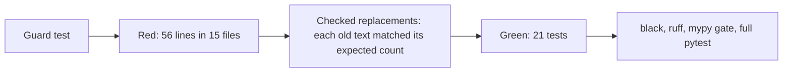

# Notes: relative-paths-in-docs

Planned 2026-11-14 on the desktop (user rule: no full host paths in documentation, for security). To be built on the laptop.

## Build on a scratch clone (2026-11-14, laptop)

- Guard rules (`apps/backend-py/tests/unit/test_no_host_paths.py`): an account home folder (also in a WSL UNC path), a projects folder in a home folder, a Windows drive folder under the WSL mount, the Claude scratchpad folder, a Windows user folder, and a Windows drive path to the repository folder. 10 blocked and 10 allowed examples test the rules.
- Changes to the plan, with reasons:
  - The drive rule fails only on a folder after the mount (for example the old D: repository folder), not on a bare mount. `setup.sh` and `docs/disk-space.md` call `df` on the C: mount to check free space; that shows nothing personal. `/mnt/d/...` (a placeholder) is allowed too.
  - A wildcard user folder (`Users/*`) is allowed: `docs/disk-space.md` uses it to find the WSL disk file.
  - Two extra rules: a Windows drive path to the repository folder (it was in two archived files), and a WSL UNC path to a home folder.
  - `~/.cache/...` is allowed (no account name). The Playwright path in `tasks/archive/step-3-6-cost-tracking/handoff.md` now uses it.
  - More findings than the plan listed: `tasks/backlog.md` (a Windows user folder in the roadmap line), `tasks/archive/generic-phrasing/notes.md` line 55, and `tasks/archive/step-2-local-first/handoff-step2-review.md` (a Docker volume on the D: drive).
  - `docker-rebuild.sh` keeps the Docker Desktop install path (allowed by the guard); it shows nothing personal.
- Red: the guard found 56 lines in 15 files; the 20 rule examples passed.
- Green: 21 tests pass. black (366 files unchanged), ruff (all checks passed), mypy gate (177 known errors, 0 new; it also reports 5 baseline errors fixed, which only the user removes from the baseline), full backend pytest (2389 passed).
- Correction (2026-11-14): after "Yes, apply it", the guard failed on `main` at its own file (line 166, an example written as one literal string). In the clone, the new test file was not tracked during the green run, so `git ls-files` did not list it. The patch was reverted on `main`; nothing was committed. The example is now built from parts, the checks ran again with the file tracked, and the user is asked again.

## Review (2026-11-14)

- Applied on `main` after the second "Yes, apply it"; the diff on `main` was the same as the checked patch. On `main`: guard (21 passed), black, ruff, and mypy gate (0 new) passed.
- Pushed after approval. CI run 43609576714 passed: 12 jobs passed, Build Docker Image skipped.
- Push note: in WSL on the laptop, git uses `credential.helper=manager`, but Git Credential Manager is not installed in WSL, so an HTTPS push waits for a prompt. The push went over SSH (the `gh` account uses SSH for git). The git config was not changed; the user decides on the fix.
- Not done in this task: `docker-rebuild.sh` keeps the Docker Desktop install path (allowed by the guard).
